# 🧠 Deep Learning: Introduction — Complete Notes

> A comprehensive beginner-to-intermediate learning resource covering deep learning fundamentals, neural networks, training, architectures, practical Python examples, real-world applications, best practices, and interview revision.

---

## 📚 Table of Contents

1. [Introduction to Deep Learning](#1--introduction-to-deep-learning)
2. [Artificial Intelligence vs Machine Learning vs Deep Learning](#2--artificial-intelligence-vs-machine-learning-vs-deep-learning)
3. [Why Deep Learning?](#3--why-deep-learning)
4. [Biological Inspiration and Artificial Neurons](#4--biological-inspiration-and-artificial-neurons)
5. [The Perceptron](#5--the-perceptron)
6. [Artificial Neural Network Architecture](#6--artificial-neural-network-architecture)
7. [Forward Propagation](#7--forward-propagation)
8. [Activation Functions](#8--activation-functions)
9. [Loss Functions](#9--loss-functions)
10. [Gradient Descent and Backpropagation](#10--gradient-descent-and-backpropagation)
11. [Training a Neural Network](#11--training-a-neural-network)
12. [Important Terminology](#12--important-terminology)
13. [Common Neural Network Architectures](#13--common-neural-network-architectures)
14. [Deep Learning Frameworks and Environment](#14--deep-learning-frameworks-and-environment)
15. [Practical Example 1: A Neural Network with NumPy](#15--practical-example-1-a-neural-network-with-numpy)
16. [Practical Example 2: Classification with TensorFlow/Keras](#16--practical-example-2-classification-with-tensorflowkeras)
17. [Practical Mini-Project: Handwritten Digit Classification](#17--practical-mini-project-handwritten-digit-classification)
18. [Evaluation Metrics](#18--evaluation-metrics)
19. [Applications and Real-World Examples](#19--applications-and-real-world-examples)
20. [Advantages and Limitations](#20--advantages-and-limitations)
21. [Best Practices](#21--best-practices)
22. [Common Mistakes and Troubleshooting](#22--common-mistakes-and-troubleshooting)
23. [Advanced Concepts to Explore Next](#23--advanced-concepts-to-explore-next)
24. [Deep Learning Interview Questions](#24--deep-learning-interview-questions)
25. [Quick Revision and Learning Roadmap](#25--quick-revision-and-learning-roadmap)

---

## 1. 🌟 Introduction to Deep Learning

### 1.1 What is Deep Learning?

**Deep Learning (DL)** is a subfield of Machine Learning that uses neural networks with multiple layers to learn patterns and representations from data. Rather than relying entirely on manually designed features, deep learning models can learn useful features directly from raw or lightly processed inputs.

Examples of inputs include:
- Images and video frames
- Text and documents
- Audio and speech signals
- Sensor readings and time-series data
- Structured numerical and categorical data

A deep learning model learns by adjusting its trainable parameters—primarily **weights** and **biases**—to reduce a chosen loss function.

### 1.2 Why is it called “deep”?

The word *deep* generally refers to the use of multiple processing layers between the input and output. A simple network may contain one hidden layer, while a deep network can contain many.

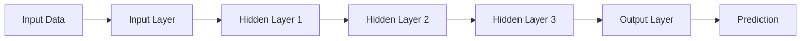

Each layer transforms its input into a representation that later layers can use. For example, in image recognition:
- Early layers may learn edges and simple textures.
- Middle layers may learn shapes and object parts.
- Later layers may learn high-level patterns useful for classification.

This hierarchy is a useful intuition, not a guarantee that every neuron has a simple human-interpretable meaning.

### 1.3 Core idea

The learning process can be summarized as:

1. Provide training examples and their targets.
2. Run inputs through the network to obtain predictions.
3. Measure prediction error using a loss function.
4. Calculate how each parameter contributed to that error.
5. Update parameters using an optimizer.
6. Repeat until training stops according to a chosen rule.
7. Evaluate on data not used to fit the model.

---

## 2. 🤖 Artificial Intelligence vs Machine Learning vs Deep Learning

These terms are related but not interchangeable.

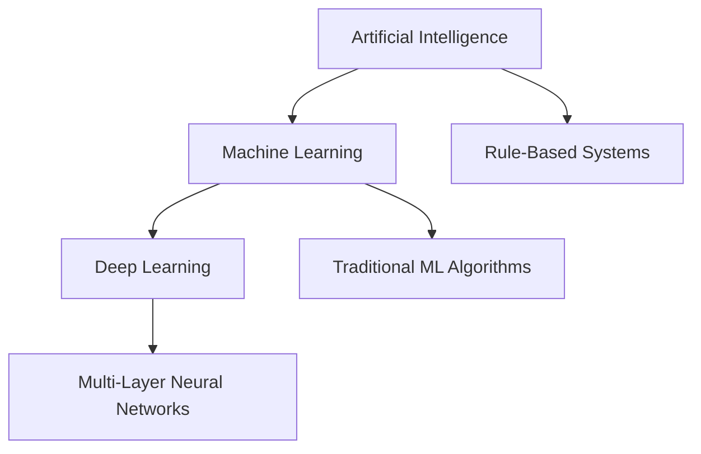

| Aspect | Artificial Intelligence (AI) | Machine Learning (ML) | Deep Learning (DL) |
|---|---|---|---|
| Meaning | Broad field of systems performing intelligent tasks | Systems learn patterns from data | ML based on multi-layer neural networks |
| Typical approach | Rules, search, planning, ML, and more | Decision trees, regression, SVMs, neural networks, etc. | CNNs, RNNs, Transformers, and other deep networks |
| Feature engineering | Depends on the method | Often important | Can learn hierarchical features |
| Data needs | Varies widely | Often effective with small-to-medium datasets | Frequently benefits from large datasets |
| Compute needs | Varies widely | Often moderate | Can be high, especially for large models |
| Examples | Planning system, expert system | Spam classifier using logistic regression | Image classifier using a CNN |

**Example:** A spam detector based on hand-written rules is an AI system. A spam detector trained using logistic regression is a machine learning system. A spam detector trained using a deep neural network is a deep learning system.

---

## 3. 🚀 Why Deep Learning?

Deep learning is especially useful when data contains complex patterns that are difficult to describe using manually written rules.

### 3.1 Key characteristics

- **Representation learning:** Learns useful features from data.
- **Nonlinear modeling:** Captures complex relationships.
- **End-to-end learning:** Can learn a mapping from raw input to a target with fewer hand-designed intermediate stages.
- **Scalability:** Larger datasets and models can improve performance when training and evaluation are designed well.
- **Transfer learning:** A model pretrained on one task can be adapted to a related task.

### 3.2 When should you use it?

| Situation | Is deep learning a good candidate? | Considerations |
|---|---|---|
| Large image dataset | Often yes | CNNs or vision Transformers may help |
| Text classification | Often yes | Transformers or smaller pretrained language models |
| Small tabular dataset | Not always | Start with tree-based models and linear baselines |
| Limited computing resources | Depends | Smaller models, transfer learning, or traditional ML |
| Highly explainable decision required | Requires care | Consider interpretable baselines and explanation methods |
| Very little labeled data | Possibly | Transfer learning, augmentation, semi-supervised learning |

Deep learning is not automatically better than traditional machine learning. Always compare against a reasonable baseline.

---

## 4. 🧬 Biological Inspiration and Artificial Neurons

Biological neurons receive signals through dendrites, process them, and transmit signals through an axon. Artificial neural networks are loosely inspired by this concept, but artificial neurons are mathematical functions rather than realistic biological simulations.

An artificial neuron:
1. Receives input values.
2. Multiplies each input by a weight.
3. Adds the weighted values and a bias.
4. Applies an activation function.
5. Produces an output.

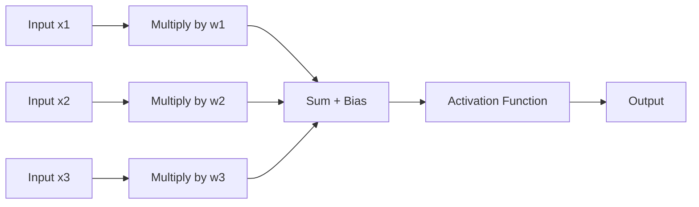

### 4.1 Mathematical formula

For inputs \(x_1, x_2, \ldots, x_n\):

\[
z = \sum_{i=1}^{n} w_i x_i + b
\]

Then:

\[
a = \phi(z)
\]

Where:

- \(x_i\): input feature
- \(w_i\): trainable weight
- \(b\): trainable bias
- \(z\): weighted sum before activation
- \(\phi\): activation function
- \(a\): neuron output

### 4.2 Weights and biases

- **Weight:** Controls the influence of an input.
- **Bias:** Shifts the neuron's pre-activation value.
- **Parameter:** A trainable quantity, usually a weight or bias.
- **Activation:** The output produced after applying the activation function.

For example, a model predicting house prices may learn that floor area has a strong positive influence while other features have different influences. These relationships are learned from training data rather than manually assigned.

---

## 5. 🔹 The Perceptron

A **perceptron** is one of the earliest neural network models. A basic perceptron computes a weighted sum and applies a threshold function to produce a binary output.

\[
\hat{y} =
\begin{cases}
1 & \text{if } w^T x + b \geq 0 \\
0 & \text{otherwise}
\end{cases}
\]

### 5.1 Example

Suppose a simple rule-based learning example predicts whether a student passes based on study hours. The perceptron learns a weight and bias from labeled examples to separate the two classes.

### 5.2 Limitation

A single perceptron can only represent a linear decision boundary. It cannot solve non-linearly separable tasks such as XOR on its own. Multi-layer networks with nonlinear activations can represent more complex decision boundaries.

---

## 6. 🏗️ Artificial Neural Network Architecture

An Artificial Neural Network (ANN), often called a feed-forward neural network or multilayer perceptron (MLP), typically contains an input layer, one or more hidden layers, and an output layer.

### 6.1 Layers

| Layer | Purpose | Example |
|---|---|---|
| Input layer | Receives the features | 784 pixel values |
| Hidden layer | Learns intermediate representations | Dense layer with 128 neurons |
| Output layer | Produces the final output | 10 class scores |
| Dropout layer | Randomly disables activations during training | Helps reduce overfitting |
| Batch normalization | Normalizes intermediate activations during training | Can stabilize optimization |

### 6.2 Fully connected (Dense) layer

In a dense layer, every output neuron connects to every input from the previous layer.

For a layer with input vector \(x\):

\[
z = Wx + b
\]

\[
a = \phi(z)
\]

If a layer has \(n_{in}\) input features and \(n_{out}\) neurons, the number of trainable parameters is:

\[
\text{Parameters} = n_{in} \times n_{out} + n_{out}
\]

The final term accounts for one bias per output neuron.

**Example:** A Dense layer with 20 input features and 8 neurons has \(20 \times 8 + 8 = 168\) trainable parameters.

### 6.3 Example architecture

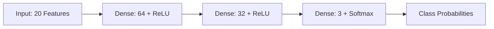

The output layer shown is suitable for a three-class, single-label classification problem. Other tasks require different output activations and loss functions.

---

## 7. ➡️ Forward Propagation

**Forward propagation** is the process of passing inputs through the network to generate predictions.

For a two-layer network:

\[
z^{[1]} = W^{[1]}x + b^{[1]}
\]

\[
a^{[1]} = \phi_1(z^{[1]})
\]

\[
z^{[2]} = W^{[2]}a^{[1]} + b^{[2]}
\]

\[
\hat{y} = \phi_2(z^{[2]})
\]

Here, the superscript identifies the layer. It is not an exponent.

### 7.1 Workflow

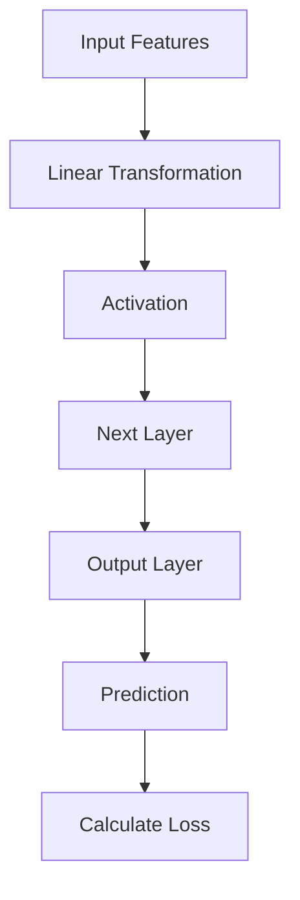

### 7.2 Inference vs training

- **Inference:** Use a trained model to make predictions.
- **Training:** Make predictions, calculate loss, compute gradients, and update parameters.

Inference does not normally update model weights.

---

## 8. ⚡ Activation Functions

An activation function introduces nonlinearity into a neural network. Without nonlinear activations between layers, stacking linear transformations still produces an overall linear transformation.

| Function | Formula | Typical use | Main limitation |
|---|---|---|---|
| Sigmoid | \(\sigma(x)=\frac{1}{1+e^{-x}}\) | Binary output probability | Saturation can cause vanishing gradients |
| Tanh | \(\tanh(x)\) | Some recurrent architectures | Saturation can cause vanishing gradients |
| ReLU | \(\max(0,x)\) | Common hidden-layer default | Some neurons may become inactive |
| Leaky ReLU | \(\max(\alpha x,x)\) | Hidden layers | Choice of \(\alpha\) matters |
| Softmax | \(p_i=\frac{e^{z_i}}{\sum_j e^{z_j}}\) | Multiclass probabilities | Can be sensitive to very large logits if implemented poorly |
| GELU | \(x\Phi(x)\), approximately | Transformers and modern networks | More computationally involved than ReLU |

### 8.1 Sigmoid

Maps a real-valued input to a value between 0 and 1.

\[
\sigma(x) = \frac{1}{1 + e^{-x}}
\]

Often used in a binary classification output layer when the model returns a probability for the positive class.

### 8.2 Tanh

Maps values to the interval \((-1,1)\). Its output is zero-centered, but gradients can become very small in saturated regions.

### 8.3 ReLU

\[
\operatorname{ReLU}(x) = \max(0,x)
\]

ReLU is computationally simple and widely used in hidden layers. If a neuron consistently receives negative pre-activations, its gradient can be zero; this is sometimes called the **dying ReLU** problem.

### 8.4 Softmax

For class scores \(z_1,\ldots,z_K\):

\[
P(y=i \mid x) = \frac{e^{z_i}}{\sum_{j=1}^{K}e^{z_j}}
\]

Softmax produces values that sum to 1 and are commonly interpreted as class probabilities for a single-label multiclass task.

### 8.5 Choosing an activation

- Hidden layers: ReLU is a useful baseline; GELU and Leaky ReLU are alternatives.
- Binary classification: one sigmoid output, or a single logit with a logits-aware loss.
- Multiclass single-label classification: softmax output, or logits with a suitable loss.
- Multilabel classification: independent sigmoid outputs, usually one per label.
- Regression: often a linear output, unless the target range requires a constraint.

---

## 9. 📉 Loss Functions

A **loss function** quantifies how far a prediction is from its target. The optimizer uses gradients of the loss to update model parameters.

### 9.1 Common loss functions

| Task | Common loss | Notes |
|---|---|---|
| Regression | Mean Squared Error (MSE) | Penalizes larger errors quadratically |
| Regression | Mean Absolute Error (MAE) | More robust to outliers than MSE in some settings |
| Binary classification | Binary cross-entropy | Usually paired with sigmoid probabilities or logits-aware equivalent |
| Multiclass classification | Categorical cross-entropy | Commonly used with one-hot targets |
| Multiclass classification | Sparse categorical cross-entropy | Commonly used with integer class labels |
| Imbalanced classification | Weighted cross-entropy or focal loss | Can emphasize difficult or underrepresented examples |

### 9.2 Mean Squared Error

\[
MSE = \frac{1}{N}\sum_{i=1}^{N}(y_i-\hat{y}_i)^2
\]

Where \(y_i\) is the true target and \(\hat{y}_i\) is the prediction.

### 9.3 Binary cross-entropy

\[
L = -\frac{1}{N}\sum_{i=1}^{N}
\left[y_i\log(\hat{y}_i)+(1-y_i)\log(1-\hat{y}_i)\right]
\]

This expression assumes predicted probabilities are in \((0,1)\). In practice, use numerically stable library implementations.

### 9.4 Loss vs metric

- **Loss** is the quantity optimized during training.
- **Metric** is a quantity used to assess model behavior.

They may overlap, but they serve different purposes. Accuracy can remain high while cross-entropy worsens if the model becomes confidently wrong on some examples.

---

## 10. 🔄 Gradient Descent and Backpropagation

### 10.1 Gradient descent

Gradient descent updates parameters in the direction that reduces the loss.

\[
\theta_{t+1} = \theta_t - \eta \nabla_\theta L(\theta_t)
\]

Where:
- \(\theta\): model parameters
- \(\eta\): learning rate
- \(L\): loss function
- \(\nabla_\theta L\): gradient of the loss with respect to the parameters

A learning rate that is too large may cause unstable updates; one that is too small may make learning slow.

### 10.2 Backpropagation

**Backpropagation** efficiently computes gradients of the loss with respect to model parameters using the chain rule of calculus. It sends gradient information backward through the computational graph.

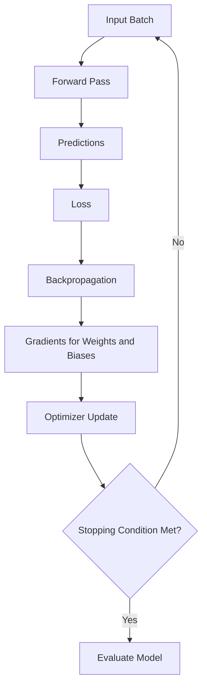

### 10.3 Gradient descent variants

| Method | How it updates | Strength | Limitation |
|---|---|---|---|
| Batch Gradient Descent | Uses the entire training set per update | Stable gradient estimate | Expensive for large datasets |
| Stochastic Gradient Descent (SGD) | Uses one example per update | Frequent updates | Noisy updates |
| Mini-batch SGD | Uses a small batch per update | Efficient and widely used | Requires batch-size selection |
| Momentum | Accumulates a moving direction | Can speed progress through consistent directions | Adds a hyperparameter |
| RMSProp | Adapts step sizes using recent squared gradients | Useful for changing gradient scales | Requires tuning |
| Adam | Combines momentum-like and adaptive updates | Strong general-purpose baseline | Not always best for every task |

### 10.4 Training loop

One typical mini-batch update consists of:

1. Load a batch.
2. Compute predictions.
3. Compute loss.
4. Clear previous gradients.
5. Backpropagate the loss.
6. Update parameters with the optimizer.

Deep learning libraries implement these operations and handle differentiation automatically.

---

## 11. 🏋️ Training a Neural Network

### 11.1 Important terms

- **Dataset:** Collection of examples.
- **Feature:** Input used for prediction.
- **Label/target:** Desired output.
- **Training set:** Used to fit model parameters.
- **Validation set:** Used to choose models, tune hyperparameters, and apply early stopping.
- **Test set:** Held back for final evaluation.
- **Epoch:** One pass through the full training dataset.
- **Batch size:** Number of examples processed together in one training step.
- **Iteration/step:** Usually one optimizer update.
- **Learning rate:** Controls the scale of parameter updates.
- **Optimizer:** Algorithm that updates parameters.
- **Hyperparameter:** Configuration chosen outside the direct parameter-learning process.
- **Checkpoint:** Saved model state, often from the best validation result.

### 11.2 Data split

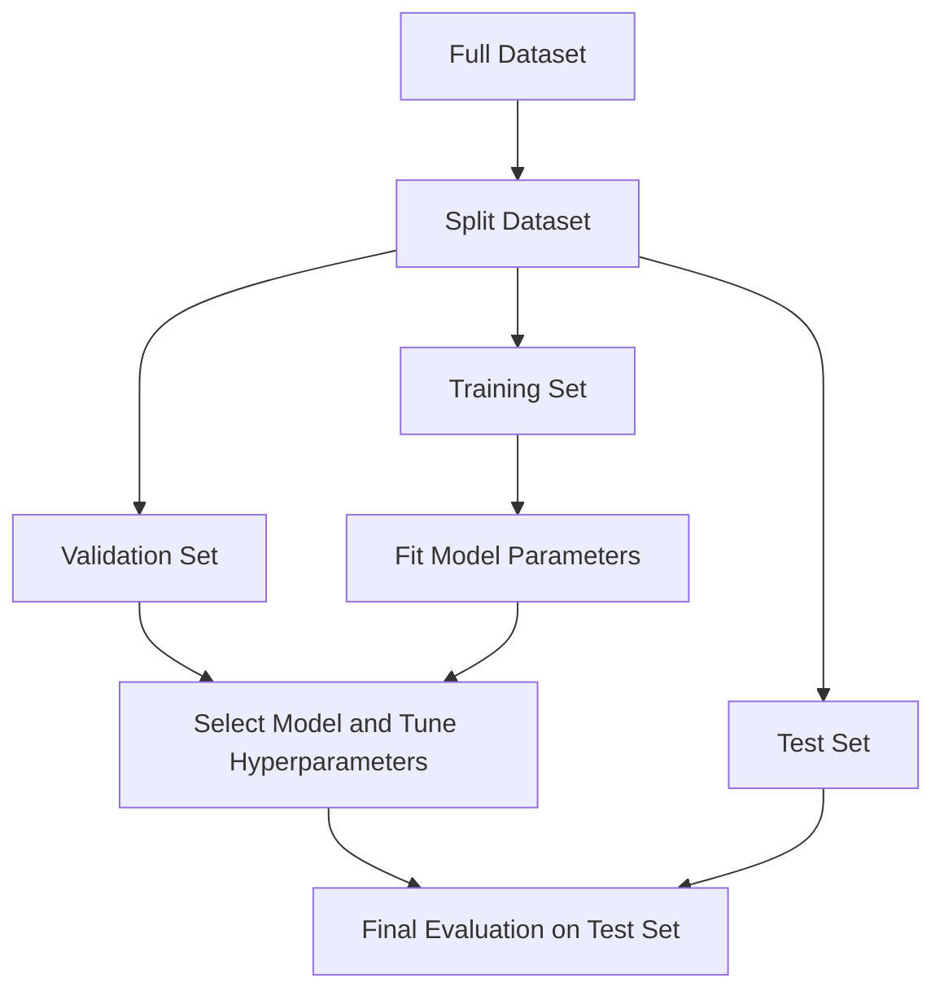

The exact split ratio depends on the dataset and task. A common starting point is 70–80% training, 10–15% validation, and 10–15% testing, but this is not a universal rule.

**Important:** Avoid data leakage. Information from the test set must not influence preprocessing, feature selection, hyperparameter tuning, or model selection.

### 11.3 Epoch, batch, and step example

If there are 10,000 training examples and the batch size is 100:

\[
\text{Steps per epoch} = \left\lceil \frac{10000}{100} \right\rceil = 100
\]

With 20 epochs, the training loop performs approximately 2,000 mini-batch updates, assuming every batch produces one update.

### 11.4 Overfitting and underfitting

| Behavior | Training performance | Validation performance | Typical response |
|---|---|---|---|
| Underfitting | Poor | Poor | Improve features/model capacity or train more appropriately |
| Good generalization | Good | Good and similar | Validate on independent test data |
| Overfitting | Very good | Worse or deteriorating | Regularize, augment, simplify, or obtain more data |

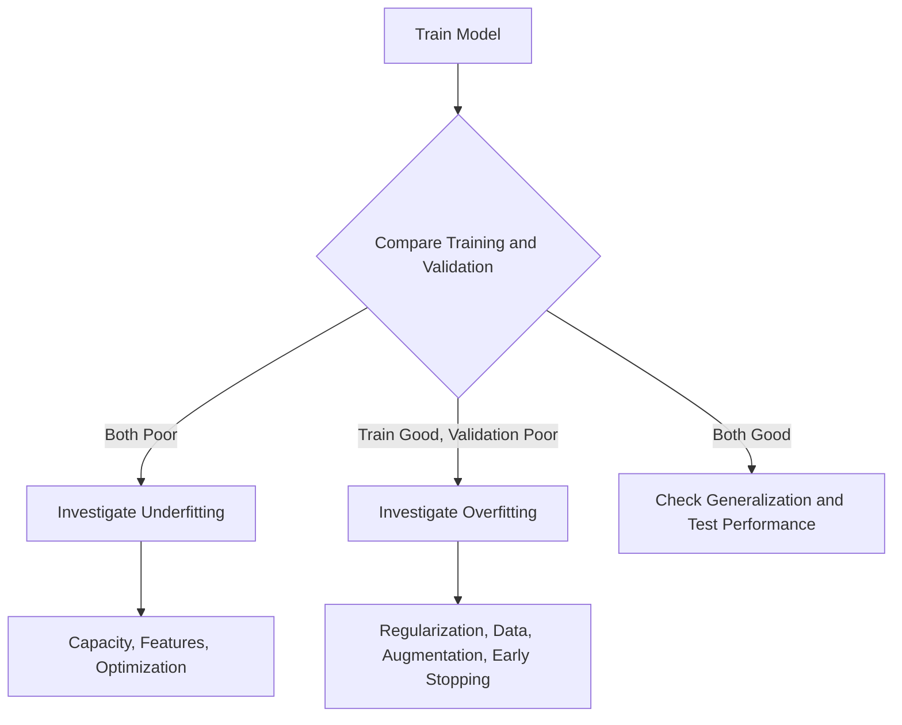

### 11.5 Techniques to improve generalization

- **Dropout:** Randomly drops activations during training.
- **L1/L2 regularization:** Adds a penalty related to parameter magnitudes.
- **Data augmentation:** Creates label-preserving variations of training examples.
- **Early stopping:** Stops when validation performance stops improving.
- **Weight decay:** Applies parameter shrinkage, often through the optimizer.
- **Transfer learning:** Starts from a pretrained model.
- **More representative data:** Often one of the most effective improvements.

### 11.6 Batch normalization

Batch normalization normalizes intermediate activations using batch statistics during training and stored moving statistics during inference. It can improve optimization in many architectures, but it is not guaranteed to improve every model.

### 11.7 Initialization

Weights should be initialized appropriately. Common strategies include:
- **Xavier/Glorot initialization:** Often suitable for tanh-like activations.
- **He/Kaiming initialization:** Often suitable for ReLU-like activations.

Poor initialization can contribute to vanishing or exploding activations and gradients.

---

## 12. 📖 Important Terminology

| Term | Definition |
|---|---|
| Neuron/unit | Mathematical processing unit in a neural network |
| Weight | Trainable coefficient controlling input influence |
| Bias | Trainable offset |
| Logit | Raw model score before a probability transformation such as softmax |
| Activation | Output of a neuron after its activation function |
| Parameter | Trainable model value |
| Hyperparameter | Training or architecture setting chosen by the practitioner |
| Gradient | Derivative of loss with respect to a parameter |
| Backpropagation | Algorithm for calculating gradients through the network |
| Optimizer | Uses gradients to update model parameters |
| Generalization | Performance on previously unseen examples |
| Regularization | Methods that discourage overly complex or poorly generalizing solutions |
| Transfer learning | Reusing a model or representations learned from another task |
| Fine-tuning | Continuing training of a pretrained model, often on task-specific data |
| Inference | Generating predictions with a trained model |
| Latency | Time needed to produce a prediction |
| Throughput | Number of examples processed per unit time |
| Checkpoint | Saved model state |
| Embedding | Dense vector representation of an item such as a word or image |
| Attention | Mechanism that weights relationships between elements in a sequence or representation |

---

## 13. 🧱 Common Neural Network Architectures

### 13.1 Architecture comparison

| Architecture | Full name / idea | Best-known use cases | Key idea |
|---|---|---|---|
| MLP / ANN | Multilayer Perceptron | Tabular data, simple classification and regression | Dense layers |
| CNN | Convolutional Neural Network | Images, video, spatial signals | Local filters and shared weights |
| RNN | Recurrent Neural Network | Sequential data | Recurrent hidden state |
| LSTM | Long Short-Term Memory | Sequence modeling | Gated memory mechanism |
| GRU | Gated Recurrent Unit | Sequence modeling | Simpler gated recurrence |
| Transformer | Attention-based architecture | NLP, vision, multimodal tasks | Self-attention and feed-forward blocks |
| Autoencoder | Encoder-decoder representation learner | Compression, denoising, anomaly detection | Reconstructs input |
| GAN | Generative Adversarial Network | Image generation and synthesis | Generator competes with discriminator |
| GNN | Graph Neural Network | Molecules, networks, relational data | Message passing across graph connections |
| Diffusion model | Iterative denoising generative model | Image, audio, and other generation | Learns to reverse a noise process |

### 13.2 Convolutional Neural Networks (CNNs)

CNNs use convolutional filters to learn spatial patterns. They are commonly used in image classification, object detection, segmentation, and medical imaging.


### 13.3 Recurrent Neural Networks (RNNs)

RNNs process sequences while maintaining a hidden state. Standard RNNs can struggle with long-range dependencies because gradients may vanish or explode. LSTM and GRU cells were developed to improve sequence learning.

### 13.4 Transformers

Transformers use attention to let elements of a sequence interact with other elements. They are widely used in language models and increasingly in computer vision, audio, and multimodal systems.

### 13.5 Autoencoders

An autoencoder learns to encode an input into a lower-dimensional or alternative representation and decode it to reconstruct the input.

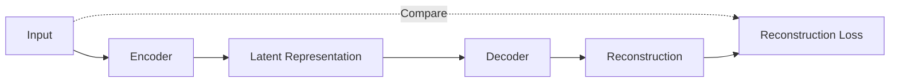

### 13.6 Generative models

Generative models learn patterns in data and can produce new samples. Examples include GANs, variational autoencoders (VAEs), autoregressive models, and diffusion models.

---

## 14. 🛠️ Deep Learning Frameworks and Environment

### 14.1 Common tools

| Tool | Purpose |
|---|---|
| Python | Main language for many deep learning workflows |
| NumPy | Numerical arrays and mathematical operations |
| pandas | Tabular data processing |
| Matplotlib | Visualization |
| scikit-learn | Splitting data, preprocessing, baselines, and evaluation |
| TensorFlow/Keras | Building and training neural networks |
| PyTorch | Flexible tensor computation and neural network training |
| Jupyter Notebook | Interactive experimentation |
| VS Code | Editor for scripts and notebooks |
| CUDA | NVIDIA GPU computing platform used by compatible frameworks |

### 14.2 Create an environment

```bash
python -m venv .venv
```

Activate it on Windows PowerShell:

```powershell
.\.venv\Scripts\Activate.ps1
```

Activate it on macOS/Linux:

```bash
source .venv/bin/activate
```

Install common libraries:

```bash
python -m pip install --upgrade pip
python -m pip install numpy pandas matplotlib scikit-learn tensorflow
```

To use PyTorch instead of TensorFlow, follow the official PyTorch installation selector for the correct operating system and compute configuration.

### 14.3 Verify installation

```python
import numpy as np
import tensorflow as tf

print("NumPy:", np.__version__)
print("TensorFlow:", tf.__version__)
print("GPU devices:", tf.config.list_physical_devices("GPU"))
```

A GPU is optional for introductory models. Package versions and GPU compatibility change over time, so consult official installation instructions when configuring a GPU environment.

---

## 15. 🧪 Practical Example 1: A Neural Network with NumPy

This simplified example demonstrates forward propagation for a small network. The weights are fixed; this code **does not train** the network.

```python
import numpy as np

# Two samples, each with three input features
X = np.array([
    [0.2, 0.4, 0.6],
    [0.9, 0.1, 0.3]
], dtype=np.float32)

# Three inputs -> four hidden neurons
W1 = np.array([
    [0.1, 0.2, 0.3, 0.4],
    [0.2, 0.1, 0.4, 0.3],
    [0.3, 0.4, 0.1, 0.2]
], dtype=np.float32)
b1 = np.zeros((1, 4), dtype=np.float32)

# Four hidden neurons -> two output classes
W2 = np.array([
    [0.2, -0.1],
    [0.1, 0.3],
    [-0.2, 0.2],
    [0.4, 0.1]
], dtype=np.float32)
b2 = np.zeros((1, 2), dtype=np.float32)


def relu(x):
    return np.maximum(0, x)


def softmax(x):
    # Subtract row maximum for numerical stability
    shifted = x - np.max(x, axis=1, keepdims=True)
    exp_x = np.exp(shifted)
    return exp_x / np.sum(exp_x, axis=1, keepdims=True)


hidden = relu(X @ W1 + b1)
logits = hidden @ W2 + b2
probabilities = softmax(logits)

print("Class probabilities:\n", probabilities)
print("Predicted classes:", np.argmax(probabilities, axis=1))
```

### Explanation

- `X @ W1 + b1` performs the first linear transformation.
- `relu(...)` introduces nonlinearity.
- The second linear transformation produces logits.
- `softmax(...)` converts logits to a probability distribution per sample.
- `argmax(...)` returns the index of the highest-scoring class.

This is a forward-pass demonstration only. To learn weights from data, use a training algorithm such as gradient descent with backpropagation.

---

## 16. 🧑‍💻 Practical Example 2: Classification with TensorFlow/Keras

The following example trains a small neural network on synthetic data. It is intended to demonstrate the workflow, not to establish performance on a real-world task.

```python
import numpy as np
import tensorflow as tf
from sklearn.datasets import make_moons
from sklearn.model_selection import train_test_split
from sklearn.preprocessing import StandardScaler

# Reproducibility for this demonstration
np.random.seed(42)
tf.keras.utils.set_random_seed(42)

# Generate a nonlinear binary classification dataset
X, y = make_moons(
    n_samples=2000,
    noise=0.20,
    random_state=42
)

# Split before fitting preprocessing
X_train, X_temp, y_train, y_temp = train_test_split(
    X, y,
    test_size=0.30,
    random_state=42,
    stratify=y
)

X_val, X_test, y_val, y_test = train_test_split(
    X_temp, y_temp,
    test_size=0.50,
    random_state=42,
    stratify=y_temp
)

# Fit scaler only on training data
scaler = StandardScaler()
X_train = scaler.fit_transform(X_train)
X_val = scaler.transform(X_val)
X_test = scaler.transform(X_test)

model = tf.keras.Sequential([
    tf.keras.layers.Input(shape=(2,)),
    tf.keras.layers.Dense(32, activation="relu"),
    tf.keras.layers.Dense(16, activation="relu"),
    tf.keras.layers.Dense(1, activation="sigmoid")
])

model.compile(
    optimizer=tf.keras.optimizers.Adam(learning_rate=0.001),
    loss="binary_crossentropy",
    metrics=["accuracy"]
)

early_stopping = tf.keras.callbacks.EarlyStopping(
    monitor="val_loss",
    patience=10,
    restore_best_weights=True
)

history = model.fit(
    X_train,
    y_train,
    validation_data=(X_val, y_val),
    epochs=100,
    batch_size=32,
    callbacks=[early_stopping],
    verbose=1
)

test_loss, test_accuracy = model.evaluate(X_test, y_test, verbose=0)
print(f"Test loss: {test_loss:.4f}")
print(f"Test accuracy: {test_accuracy:.4f}")

# Probability and class prediction for one sample
sample = X_test[:1]
probability = model.predict(sample, verbose=0)[0, 0]
predicted_class = int(probability >= 0.5)

print("Probability of class 1:", float(probability))
print("Predicted class:", predicted_class)
```

### What this example demonstrates

1. Creating a dataset.
2. Separating training, validation, and test data.
3. Fitting a scaler on training data only.
4. Defining a multi-layer network.
5. Selecting an optimizer, loss, and metric.
6. Using early stopping based on validation loss.
7. Evaluating the final selected model on the test set.

**Important:** Avoid repeatedly checking test performance while tuning. Use validation results for model selection and reserve the test set for final evaluation.

---

## 17. 🧩 Practical Mini-Project: Handwritten Digit Classification

### 17.1 Project objective

Build a neural network that classifies grayscale images of handwritten digits from 0 to 9 using the MNIST dataset.

### 17.2 Requirements

- Python
- TensorFlow/Keras
- NumPy
- Matplotlib

### 17.3 Workflow

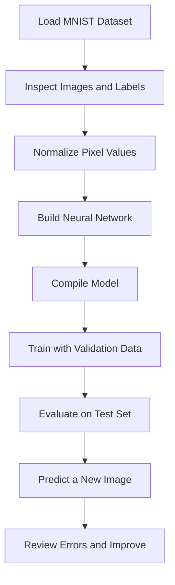

### 17.4 Complete starter code

```python
import numpy as np
import matplotlib.pyplot as plt
import tensorflow as tf
from sklearn.metrics import classification_report, confusion_matrix

tf.keras.utils.set_random_seed(42)

# Load the dataset: 28x28 grayscale images and integer labels 0-9
(x_train, y_train), (x_test, y_test) = (
    tf.keras.datasets.mnist.load_data()
)

# Convert pixels from [0, 255] to [0, 1]
x_train = x_train.astype("float32") / 255.0
x_test = x_test.astype("float32") / 255.0

model = tf.keras.Sequential([
    tf.keras.layers.Input(shape=(28, 28)),
    tf.keras.layers.Flatten(),
    tf.keras.layers.Dense(128, activation="relu"),
    tf.keras.layers.Dropout(0.2),
    tf.keras.layers.Dense(10, activation="softmax")
])

model.compile(
    optimizer="adam",
    loss="sparse_categorical_crossentropy",
    metrics=["accuracy"]
)

early_stopping = tf.keras.callbacks.EarlyStopping(
    monitor="val_loss",
    patience=3,
    restore_best_weights=True
)

history = model.fit(
    x_train,
    y_train,
    validation_split=0.1,
    epochs=20,
    batch_size=128,
    callbacks=[early_stopping],
    verbose=1
)

test_loss, test_accuracy = model.evaluate(
    x_test, y_test, verbose=0
)
print(f"Test accuracy: {test_accuracy:.4f}")
print(f"Test loss: {test_loss:.4f}")

# Predictions
probabilities = model.predict(x_test, verbose=0)
y_pred = np.argmax(probabilities, axis=1)

print(classification_report(y_test, y_pred))
print("Confusion matrix:\n", confusion_matrix(y_test, y_pred))

# Visualize one prediction
index = 0
plt.imshow(x_test[index], cmap="gray")
plt.title(
    f"True label: {y_test[index]}, "
    f"Predicted: {y_pred[index]}"
)
plt.axis("off")
plt.show()

# Save the trained model
model.save("mnist_digit_classifier.keras")
```

### 17.5 Understanding the architecture

| Layer | Purpose |
|---|---|
| `Input(shape=(28, 28))` | Accepts one 28 × 28 grayscale image |
| `Flatten()` | Converts the image matrix into a 784-element vector |
| `Dense(128, activation="relu")` | Learns nonlinear feature combinations |
| `Dropout(0.2)` | Regularizes the network during training |
| `Dense(10, activation="softmax")` | Produces probabilities for digits 0–9 |

The integer labels are used with `sparse_categorical_crossentropy`, so one-hot encoding is not required.

### 17.6 Possible extensions

- Compare an MLP with a CNN.
- Plot training and validation loss.
- Display misclassified images.
- Save class probabilities with predictions.
- Build a simple interface using Tkinter or Streamlit.
- Test on images captured from a camera, while accounting for differences from the MNIST data distribution.

---

## 18. 📊 Evaluation Metrics

A good evaluation depends on the task and the consequences of errors.

### 18.1 Classification metrics

| Metric | Formula / meaning | Useful when |
|---|---|---|
| Accuracy | Correct predictions / all predictions | Classes are reasonably balanced and error costs are similar |
| Precision | \(TP/(TP+FP)\) | False positives are costly |
| Recall / sensitivity | \(TP/(TP+FN)\) | False negatives are costly |
| Specificity | \(TN/(TN+FP)\) | Correctly identifying negatives matters |
| F1-score | Harmonic mean of precision and recall | Balancing precision and recall |
| ROC-AUC | Ranking performance across thresholds | Evaluating score ranking for binary classification |
| PR-AUC | Precision-recall area | Often informative for imbalanced positive classes |

Where:
- TP = true positives
- TN = true negatives
- FP = false positives
- FN = false negatives

### 18.2 Regression metrics

| Metric | Formula / meaning |
|---|---|
| MAE | Average absolute prediction error |
| MSE | Average squared prediction error |
| RMSE | Square root of MSE, in the target's units |
| \(R^2\) | Relative fit measure compared with predicting the target mean |

### 18.3 Confusion matrix

A confusion matrix counts correct and incorrect predictions by actual and predicted class. It can reveal that a model performs well overall while failing on a particular class.

For imbalanced datasets, report per-class precision, recall, and F1-score rather than relying only on accuracy.

---

## 19. 🌍 Applications and Real-World Examples

| Domain | Example task | Potential model family | Important consideration |
|---|---|---|---|
| Healthcare | Image-based screening support | CNNs, vision Transformers | Clinical validation, privacy, bias, human oversight |
| Transportation | Driver drowsiness detection | CNNs, temporal models | Lighting, occlusion, latency, safety |
| Agriculture | Crop disease recognition | CNNs, vision models | Field conditions and varied devices |
| Finance | Fraud pattern detection | MLPs, autoencoders, tree-based baselines | Class imbalance, drift, explainability |
| Retail | Product recommendations | Embeddings, neural ranking models | Privacy, feedback loops, cold-start users |
| Manufacturing | Visual defect detection | CNNs, anomaly detection models | Rare defects and production-line latency |
| Natural language processing | Translation, summarization, sentiment | Transformers | Hallucination, safety, language coverage |
| Speech | Speech recognition and synthesis | CNNs, RNNs, Transformers | Accent diversity, noise, privacy |
| Cybersecurity | Anomaly detection | Autoencoders, sequence models | Adversarial adaptation and false alarms |
| Robotics | Perception and control | Vision models, reinforcement learning | Simulation-to-real transfer and safety |

### Example: Road-surface damage detection

A possible workflow for a pothole detection system is:

1. Capture road images or video.
2. Annotate potholes with bounding boxes or segmentation masks.
3. Train or fine-tune an object detection model.
4. Evaluate precision, recall, and localization quality on held-out data.
5. Record confidence, timestamp, and location when available.
6. Have a human review uncertain detections before submitting official reports.

Deep learning can support detection, but it does not guarantee accurate GPS data, safe operation, or correct municipal reporting without additional engineering and validation.

---

## 20. ⚖️ Advantages and Limitations

### 20.1 Advantages

- Learns useful representations from complex data.
- Can achieve strong results on images, audio, text, and other unstructured data.
- Supports end-to-end training.
- Can reuse pretrained models through transfer learning.
- Can scale with data and compute when the task and training setup support it.
- Supports a broad range of predictive and generative tasks.

### 20.2 Limitations

- May require large datasets and substantial compute.
- Training and hyperparameter tuning can be time-consuming.
- Models may be difficult to interpret.
- Performance can degrade when real-world data differs from training data.
- Models can learn dataset bias or spurious correlations.
- Large models can have significant latency, energy, and deployment costs.
- High benchmark performance does not guarantee safe or reliable deployment.
- Generative models may produce plausible but incorrect outputs.

### 20.3 Trade-off summary

| Factor | Potential benefit | Potential cost |
|---|---|---|
| Model capacity | Learns complex patterns | Overfitting and compute cost |
| More training data | Better coverage of variations | Collection, labeling, privacy, and storage costs |
| Larger model | Higher capacity | Latency, memory, and deployment complexity |
| Transfer learning | Less training from scratch | Pretraining mismatch or inherited biases |
| Automation | Faster predictions at scale | Requires monitoring, fallback paths, and governance |

---

## 21. ✅ Best Practices

### 21.1 Before training

- Define the task and the real-world success criteria.
- Inspect the dataset, labels, duplicates, missing values, and class distribution.
- Create a simple baseline.
- Split data before fitting data-dependent preprocessing.
- Use group-aware or time-aware splits when ordinary random splitting would leak information.
- Keep a separate test set.

### 21.2 During training

- Start with a small, understandable architecture.
- Normalize or standardize inputs where appropriate.
- Choose a loss that matches the target format.
- Track training and validation loss and metrics.
- Save the best checkpoint based on a validation metric.
- Set random seeds for more reproducible experiments, while recognizing that exact determinism is not always guaranteed.
- Record library versions, data versions, model configuration, and training time.

### 21.3 Before deployment

- Evaluate per-class errors and important subgroups.
- Test on data that resembles the deployment environment.
- Measure latency, memory use, and throughput.
- Validate preprocessing and inference code together.
- Monitor data drift and performance changes.
- Define human review and fallback behavior for high-impact decisions.
- Document intended use, limitations, and known failure modes.

---

## 22. 🧯 Common Mistakes and Troubleshooting

| Mistake / symptom | Likely cause | Recommended action |
|---|---|---|
| Training accuracy is high but validation accuracy is low | Overfitting or data mismatch | Use regularization, augmentation, simpler models, or better data |
| Both training and validation performance are poor | Underfitting, poor preprocessing, or optimization issues | Check labels and inputs; improve model or training setup |
| Loss becomes `NaN` | Unstable learning rate, invalid values, or numerical issues | Inspect data, lower learning rate, use stable loss functions |
| Model predicts one class only | Imbalance, label bug, or optimization failure | Inspect labels and confusion matrix; try class weighting |
| Output probabilities do not sum to 1 | Wrong output activation or interpretation | Use softmax for single-label multiclass probabilities |
| Binary classifier uses the wrong loss | Target and output mismatch | Match sigmoid/logits and binary cross-entropy configuration |
| Validation result is unexpectedly excellent | Data leakage or duplicate samples across splits | Audit split strategy and preprocessing |
| Training is too slow | Inefficient input pipeline or oversized model | Profile data loading, batch size, model, and hardware |
| GPU is not detected | Incompatible driver, framework, or package build | Verify official installation and compatibility instructions |
| Performance changes between runs | Random initialization, data ordering, nondeterministic operations | Set seeds and document configuration |
| Model works in notebook but not in production | Preprocessing mismatch or dependency drift | Package preprocessing with the model and test the full pipeline |

### Debugging checklist

1. Print input shapes, dtypes, and sample values.
2. Check for `NaN` and infinite values.
3. Verify labels and class-index mapping.
4. Confirm output shape matches the task.
5. Confirm loss function and target encoding are compatible.
6. Overfit a tiny subset deliberately as a sanity check.
7. Compare predictions against labels manually.
8. Check training and validation curves.
9. Evaluate on a clean test set only after model selection.

---

## 23. 🔬 Advanced Concepts to Explore Next

### 23.1 Regularization and optimization

- Learning-rate schedules and warmup
- AdamW and decoupled weight decay
- Gradient clipping
- Label smoothing
- Mixup and CutMix
- Stochastic depth

### 23.2 Representation learning

- Transfer learning and fine-tuning
- Self-supervised learning
- Contrastive learning
- Metric learning and embeddings
- Knowledge distillation

### 23.3 Model architecture

- Residual connections and ResNet
- EfficientNet and mobile architectures
- Vision Transformers (ViT)
- Attention mechanisms
- Encoder-decoder networks such as U-Net
- Graph neural networks

### 23.4 Generative AI

- Autoregressive language models
- Variational autoencoders (VAEs)
- Generative adversarial networks (GANs)
- Diffusion models
- Retrieval-augmented generation (RAG) as a system pattern that combines retrieval with a generative model

### 23.5 Deployment and operations

- Model quantization and pruning
- ONNX and inference runtimes
- Batch and online inference
- Edge AI and mobile deployment
- Experiment tracking and model registries
- Monitoring, drift detection, and model retraining

### 23.6 Safety, privacy, and responsible use

- Dataset consent and provenance
- Fairness and subgroup evaluation
- Robustness to distribution shifts
- Interpretability and auditability
- Secure handling of sensitive data
- Human oversight for high-impact decisions

---

## 24. 🎯 Deep Learning Interview Questions

### Beginner questions

**1. What is deep learning?**  
A machine learning approach that uses neural networks with multiple layers to learn representations and patterns from data.

**2. What is an artificial neuron?**  
A mathematical unit that computes a weighted sum plus bias and applies an activation function.

**3. What is the purpose of an activation function?**  
It introduces nonlinearity so a network can learn relationships beyond a single linear transformation.

**4. What is the difference between a parameter and a hyperparameter?**  
Parameters are learned from data, such as weights. Hyperparameters are settings selected outside that direct learning process, such as batch size or learning rate.

**5. What is an epoch?**  
One complete pass through the training dataset.

**6. What is batch size?**  
The number of examples processed together in one training step.

**7. What is a loss function?**  
A function that quantifies the discrepancy between predictions and target values.

**8. What is an optimizer?**  
An algorithm that uses gradients to update model parameters.

### Intermediate questions

**9. What is backpropagation?**  
An algorithm that applies the chain rule to calculate gradients of the loss with respect to network parameters.

**10. What is the difference between forward propagation and backpropagation?**  
Forward propagation calculates predictions; backpropagation calculates gradients used to improve the parameters.

**11. Why is ReLU widely used?**  
It is computationally simple and helps mitigate some gradient-saturation issues associated with sigmoid and tanh in hidden layers.

**12. What is overfitting?**  
When a model fits training data well but performs poorly on unseen data.

**13. How can overfitting be reduced?**  
Use representative data, regularization, augmentation, early stopping, suitable model capacity, or transfer learning.

**14. What is the vanishing gradient problem?**  
Gradients become very small as they propagate backward, making earlier layers difficult to train effectively.

**15. What is transfer learning?**  
Using knowledge or representations learned by a model on one task to help with another related task.

**16. Why should preprocessing be fitted on training data only?**  
Fitting preprocessing on validation or test data leaks information from those sets into the training process.

### Advanced questions

**17. What is the difference between CNNs and Transformers?**  
CNNs use convolutional operations with local connectivity and shared filters; Transformers use attention to model interactions among elements. Modern systems may combine both.

**18. What is gradient clipping?**  
A technique that limits gradient magnitude to reduce unstable updates caused by very large gradients.

**19. What is the difference between precision and recall?**  
Precision measures how many predicted positives are correct; recall measures how many actual positives are found.

**20. What is data leakage?**  
When information unavailable at prediction time, or information from evaluation data, improperly influences training or model selection.

**21. Why is accuracy insufficient for some imbalanced datasets?**  
A model can achieve high accuracy by predicting the majority class while missing many minority-class examples.

**22. What is fine-tuning?**  
Continuing training of a pretrained model on task-specific data, often with a smaller learning rate.

**23. What is inference latency?**  
The time required to generate a prediction for an input or batch.

**24. What is a logits-aware loss?**  
A loss implementation that accepts raw model scores and internally performs a numerically stable probability-related computation, avoiding the need to apply a separate activation first.

---

## 25. ⚡ Quick Revision and Learning Roadmap

### 25.1 Key points

- Deep learning is a branch of machine learning based on multi-layer neural networks.
- A neuron computes a weighted sum plus bias and applies an activation function.
- Hidden layers typically use nonlinear activations.
- Forward propagation produces predictions.
- A loss function measures prediction error.
- Backpropagation calculates gradients using the chain rule.
- An optimizer updates weights and biases.
- An epoch is one pass through the training data; a step is usually one optimizer update.
- Training data fits parameters; validation data guides model selection; test data estimates final generalization.
- Overfitting means training performance is much better than unseen-data performance.
- CNNs are commonly used for spatial data; RNNs model sequences; Transformers use attention.
- Always match the output layer, label format, and loss function to the task.
- Evaluate beyond accuracy when class imbalance or error costs matter.
- Strong performance depends on data quality, suitable evaluation, and responsible deployment—not only model size.

### 25.2 Important formulas

| Concept | Formula |
|---|---|
| Neuron weighted sum | \(z = \sum_i w_i x_i + b\) |
| Neuron activation | \(a = \phi(z)\) |
| Dense layer | \(z = Wx + b\) |
| ReLU | \(\max(0,x)\) |
| Sigmoid | \(\frac{1}{1+e^{-x}}\) |
| Softmax | \(\frac{e^{z_i}}{\sum_j e^{z_j}}\) |
| Mean Squared Error | \(\frac{1}{N}\sum_i(y_i-\hat y_i)^2\) |
| Gradient descent | \(\theta \leftarrow \theta-\eta\nabla_\theta L\) |
| Accuracy | \(\frac{TP+TN}{TP+TN+FP+FN}\) |
| Precision | \(\frac{TP}{TP+FP}\) |
| Recall | \(\frac{TP}{TP+FN}\) |
| F1-score | \(2\frac{\text{Precision}\cdot\text{Recall}}{\text{Precision}+\text{Recall}}\) |
| Dense-layer parameters | \(n_{in}n_{out}+n_{out}\) |
| Steps per epoch | \(\left\lceil\frac{\text{training examples}}{\text{batch size}}\right\rceil\) |

### 25.3 Essential commands

```bash
# Create a virtual environment
python -m venv .venv

# Install introductory deep learning packages
python -m pip install numpy pandas matplotlib scikit-learn tensorflow

# Run a Python script
python train_model.py
```

```python
# Inspect TensorFlow version and available GPUs
import tensorflow as tf

print(tf.__version__)
print(tf.config.list_physical_devices("GPU"))

# Inspect a Keras model
model.summary()

# Save a model
model.save("model.keras")

# Load a saved model
loaded_model = tf.keras.models.load_model("model.keras")
```

### 25.4 Visual summary

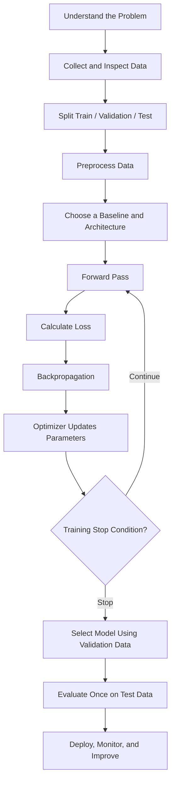

### 25.5 Recommended learning roadmap

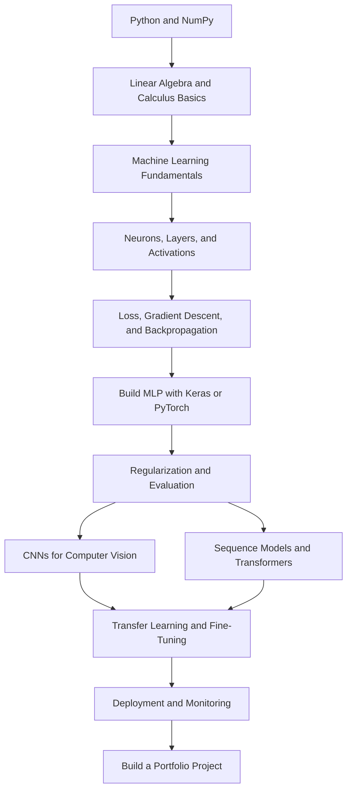

### 25.6 Practice checklist

- [ ] Explain the difference between AI, ML, and DL.
- [ ] Calculate the output of a single artificial neuron.
- [ ] Explain weights, biases, activations, logits, and probabilities.
- [ ] Compare sigmoid, tanh, ReLU, and softmax.
- [ ] Match common tasks to suitable loss functions.
- [ ] Explain forward propagation, backpropagation, and gradient descent.
- [ ] Describe epoch, batch size, iteration, parameter, and hyperparameter.
- [ ] Identify overfitting from training and validation curves.
- [ ] Train and evaluate a basic neural network.
- [ ] Interpret a confusion matrix and per-class metrics.
- [ ] Complete the MNIST mini-project.
- [ ] Compare an MLP with a CNN.
- [ ] Save and reload a trained model.
- [ ] Document limitations and test on unseen data.

---

## 📌 Final Takeaway

Deep learning is a powerful approach for learning complex patterns from data, but success depends on much more than adding layers. Build a strong foundation in neural-network mathematics, understand the training process, choose appropriate data and evaluation methods, compare against baselines, and test carefully on unseen examples. Then progress from basic MLPs to CNNs, sequence models, Transformers, transfer learning, and deployment.
