# 🧠 Neural Networks — Detailed Notes

> Professional learning notes covering neural network fundamentals, architecture, mathematical foundations, training, optimization, regularization, evaluation, practical code, troubleshooting, applications, interview questions, and revision.

---

## 📚 Table of Contents

1. [Introduction to Neural Networks](#1--introduction-to-neural-networks)
2. [AI, Machine Learning, Deep Learning, and Neural Networks](#2--ai-machine-learning-deep-learning-and-neural-networks)
3. [Biological Inspiration and Artificial Neurons](#3--biological-inspiration-and-artificial-neurons)
4. [The Perceptron](#4--the-perceptron)
5. [Network Architecture and Layers](#5--network-architecture-and-layers)
6. [Weights, Biases, and Parameters](#6--weights-biases-and-parameters)
7. [Forward Propagation](#7--forward-propagation)
8. [Activation Functions](#8--activation-functions)
9. [Output Layers and Problem Types](#9--output-layers-and-problem-types)
10. [Loss Functions](#10--loss-functions)
11. [Gradient Descent](#11--gradient-descent)
12. [Backpropagation](#12--backpropagation)
13. [Training Workflow](#13--training-workflow)
14. [Optimizers](#14--optimizers)
15. [Initialization, Normalization, and Gradient Problems](#15--initialization-normalization-and-gradient-problems)
16. [Overfitting, Underfitting, and Regularization](#16--overfitting-underfitting-and-regularization)
17. [Important Training Terminology](#17--important-training-terminology)
18. [Neural Network Architectures](#18--neural-network-architectures)
19. [Evaluation Metrics](#19--evaluation-metrics)
20. [Practical Example 1: Forward Propagation with NumPy](#20--practical-example-1-forward-propagation-with-numpy)
21. [Practical Example 2: Train a Neural Network with Keras](#21--practical-example-2-train-a-neural-network-with-keras)
22. [Mini-Project: Binary Classification](#22--mini-project-binary-classification)
23. [Applications and Real-World Use Cases](#23--applications-and-real-world-use-cases)
24. [Advantages and Limitations](#24--advantages-and-limitations)
25. [Best Practices and Common Mistakes](#25--best-practices-and-common-mistakes)
26. [Advanced Neural Network Concepts](#26--advanced-neural-network-concepts)
27. [Neural Network Interview Questions](#27--neural-network-interview-questions)
28. [Quick Revision and Learning Roadmap](#28--quick-revision-and-learning-roadmap)

---

## 1. 🌟 Introduction to Neural Networks

### 1.1 What is a neural network?

An **Artificial Neural Network (ANN)** is a computational model made up of interconnected mathematical units called neurons. These neurons are organized into layers and learn patterns from data by adjusting trainable parameters such as weights and biases.

Neural networks can be used for:
- **Classification:** predicting a category.
- **Regression:** predicting a continuous value.
- **Forecasting:** predicting future values.
- **Representation learning:** creating useful numerical representations.
- **Generation:** producing text, images, audio, or other data.
- **Control and decision-making:** selecting actions in an environment.

### 1.2 Basic concept

A neural network typically performs these steps:

1. Receive input features.
2. Transform inputs using weights and biases.
3. Apply activation functions.
4. Pass the resulting representations through further layers.
5. Produce an output or prediction.
6. During training, compare the prediction with the target.
7. Calculate gradients and update the parameters to reduce loss.

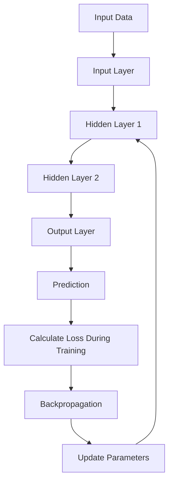

### 1.3 Why use neural networks?

Neural networks can learn nonlinear relationships and intermediate representations that are difficult to express with fixed rules. Their effectiveness depends on the problem, data quality, architecture, optimization, and evaluation design.

---

## 2. 🤖 AI, Machine Learning, Deep Learning, and Neural Networks

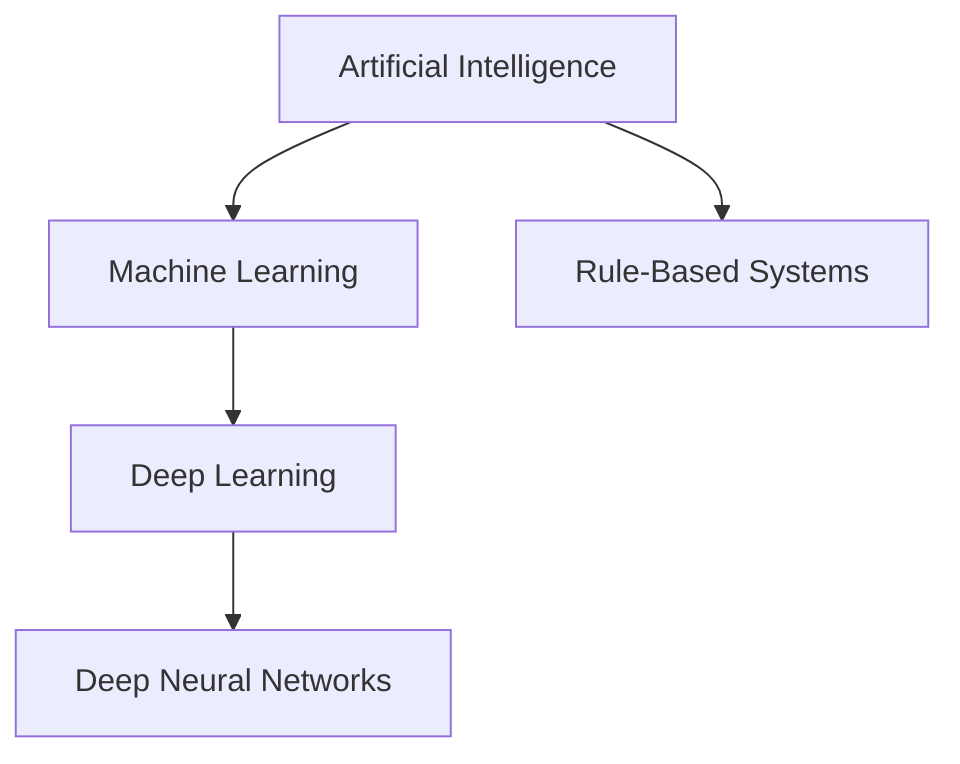

| Term | Explanation | Example |
|---|---|---|
| Artificial Intelligence | Broad field of systems performing intelligent tasks | Search or planning system |
| Machine Learning | Algorithms learn patterns from data | Decision tree classifier |
| Neural Network | Model using interconnected trainable units | Multilayer perceptron |
| Deep Learning | Machine learning using networks with multiple layers | CNN for image classification |

A neural network with only a small number of layers is still a neural network. Deep learning commonly refers to neural networks with multiple representation-learning layers.

---

## 3. 🧬 Biological Inspiration and Artificial Neurons

Biological neurons receive and transmit electrochemical signals. Artificial neurons are loosely inspired by this idea but are simplified mathematical functions, not detailed simulations of biological cells.

### 3.1 Structure of an artificial neuron

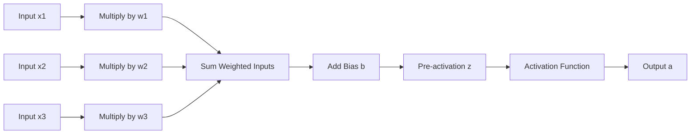

### 3.2 Mathematical formula

For \(n\) input features:

\[
z = \sum_{i=1}^{n} w_i x_i + b
\]

The neuron output is:

\[
a = \phi(z)
\]

Where:
- \(x_i\): input feature.
- \(w_i\): weight associated with that input.
- \(b\): bias.
- \(z\): weighted sum before activation.
- \(\phi\): activation function.
- \(a\): activated output.

### 3.3 Intuition

Suppose a model predicts whether a student passes based on study hours, attendance, and assignment completion. The network learns weights that determine how these features influence its prediction. The learned weights do not automatically imply causation.

---

## 4. 🔹 The Perceptron

A **perceptron** is a simple artificial neuron used for binary classification. It calculates a weighted sum and applies a threshold.

\[
\hat{y} =
\begin{cases}
1 & \text{if } w^T x + b \geq 0 \\
0 & \text{otherwise}
\end{cases}
\]

### 4.1 Decision boundary

The boundary is described by:

\[
w^T x + b = 0
\]

With two features, this boundary is a line; with three features, it is a plane; with more features, it is a hyperplane.

### 4.2 Limitation: XOR

A single perceptron cannot learn the XOR relationship because XOR is not linearly separable. A multilayer network with nonlinear activation functions can learn such a relationship.

| \(x_1\) | \(x_2\) | XOR output |
|---:|---:|---:|
| 0 | 0 | 0 |
| 0 | 1 | 1 |
| 1 | 0 | 1 |
| 1 | 1 | 0 |

---

## 5. 🏗️ Network Architecture and Layers

A common feed-forward neural network contains an input layer, hidden layers, and an output layer.

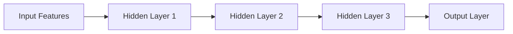

### 5.1 Input layer

Receives the features that represent an example. If each example has 10 numerical features, the input shape is generally 10.

### 5.2 Hidden layers

Transform input representations into progressively useful representations. The number of layers and neurons influences model capacity, compute requirements, and optimization behavior.

### 5.3 Output layer

Produces predictions. Its shape and activation depend on the task:
- One output for a scalar regression task.
- One sigmoid probability for binary classification.
- One output per class for single-label multiclass classification.
- One output per label for multilabel classification.

### 5.4 Dense (fully connected) layer

Every neuron in a dense layer receives input from every unit in the previous layer.

For input vector \(x\):

\[
z = Wx + b
\]

\[
a = \phi(z)
\]

If a dense layer has \(n_{in}\) input units and \(n_{out}\) output units, its trainable parameter count is:

\[
P = n_{in}n_{out} + n_{out}
\]

The final term is one bias for each output unit.

**Example:** A dense layer with 12 input features and 5 neurons has \(12 \times 5 + 5 = 65\) trainable parameters.

### 5.5 Parameter count example

For an architecture with 20 input features, a hidden layer of 64 neurons, and 3 output neurons:

- First layer: \(20 \times 64 + 64 = 1,344\)
- Output layer: \(64 \times 3 + 3 = 195\)
- Total: \(1,539\) trainable parameters.

---

## 6. ⚖️ Weights, Biases, and Parameters

### Weights

Weights control the strength and direction of input contributions. Positive and negative weights can influence a neuron's pre-activation in different directions.

### Biases

Biases provide an adjustable offset. They allow a neuron to shift its activation threshold instead of forcing the transformation to pass through the origin.

### Parameters vs hyperparameters

| Item | Type | Examples |
|---|---|---|
| Weight matrix | Trainable parameter | \(W\) |
| Bias vector | Trainable parameter | \(b\) |
| Learning rate | Hyperparameter | 0.001 |
| Number of hidden layers | Architecture hyperparameter | 3 |
| Batch size | Training hyperparameter | 32 |
| Dropout rate | Regularization hyperparameter | 0.2 |
| Number of epochs | Training setting | 50 |

Parameters are learned from data. Hyperparameters are chosen or tuned by the practitioner, although some systems can adapt certain settings automatically.

---

## 7. ➡️ Forward Propagation

**Forward propagation** computes the output of the network from the input.

For a two-layer network:

\[
z^{[1]} = W^{[1]}x + b^{[1]}
\]

\[
a^{[1]} = \phi_1(z^{[1]})
\]

\[
z^{[2]} = W^{[2]}a^{[1]} + b^{[2]}
\]

\[
\hat{y} = \phi_2(z^{[2]})
\]

The superscript in square brackets identifies a layer; it is not an exponent.

### Forward-pass workflow

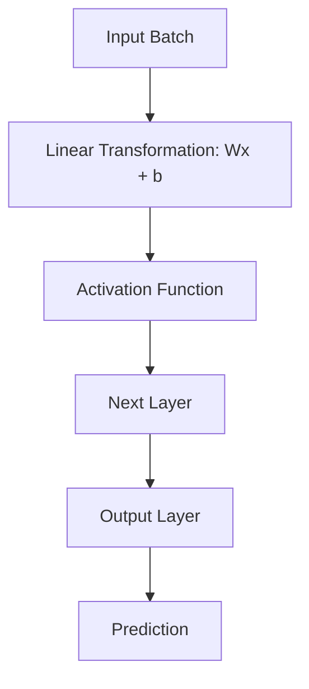

### Training vs inference

- **Training:** Forward pass, loss calculation, backpropagation, and parameter updates.
- **Inference:** Forward pass using learned parameters to produce predictions.

Inference normally does not update the model's weights.

---

## 8. ⚡ Activation Functions

Activation functions introduce nonlinearity. Without nonlinear activations between layers, a stack of linear transformations is equivalent to one linear transformation.

| Function | Formula | Output range | Common use | Limitation |
|---|---|---|---|---|
| Linear | \(f(x)=x\) | \((-\infty,\infty)\) | Regression output | No nonlinearity |
| Sigmoid | \(\frac{1}{1+e^{-x}}\) | \((0,1)\) | Binary probability output | Saturation and vanishing gradients |
| Tanh | \(\tanh(x)\) | \((-1,1)\) | Some hidden/recurrent units | Saturation |
| ReLU | \(\max(0,x)\) | \([0,\infty)\) | Common hidden-layer activation | Dying ReLU |
| Leaky ReLU | \(\max(\alpha x,x)\) | Real values | Alternative hidden activation | Requires slope choice |
| Softmax | \(\frac{e^{z_i}}{\sum_j e^{z_j}}\) | Each output in \((0,1)\), sums to 1 | Multiclass output | Not for independent multilabel outputs |
| GELU | \(x\Phi(x)\) | Real values | Transformers and modern networks | More involved computation |

### 8.1 Sigmoid

\[
\sigma(x)=\frac{1}{1+e^{-x}}
\]

Sigmoid maps values into the interval from 0 to 1. It is often used to represent the positive-class probability in binary classification.

### 8.2 Tanh

Tanh maps values into \((-1,1)\). It is zero-centered, but gradients can become small when the input magnitude is large.

### 8.3 ReLU

\[
ReLU(x)=\max(0,x)
\]

ReLU is simple and often effective for hidden layers. If a neuron consistently receives negative pre-activations, its gradient can be zero; this is known as the dying ReLU issue.

### 8.4 Softmax

For logits \(z_1,\ldots,z_K\):

\[
P(y=i\mid x)=\frac{e^{z_i}}{\sum_{j=1}^{K}e^{z_j}}
\]

Softmax converts class scores into a normalized distribution for single-label multiclass classification.

### 8.5 Choosing activations

- Hidden layers: ReLU is a practical starting point; GELU and Leaky ReLU are alternatives.
- Binary classification: sigmoid output with binary cross-entropy, or a single logit with a logits-aware loss.
- Single-label multiclass classification: softmax output, or raw logits with a suitable loss.
- Multilabel classification: independent sigmoid outputs.
- Regression: linear output is common; use a constrained output only when appropriate for the target.

---

## 9. 🎯 Output Layers and Problem Types

| Problem | Output design | Common loss | Target format |
|---|---|---|---|
| Binary classification | 1 sigmoid probability | Binary cross-entropy | 0/1 |
| Binary classification with logits | 1 raw score | Binary cross-entropy with logits | 0/1 |
| Multiclass, single label | K softmax probabilities | Categorical cross-entropy | One-hot vector |
| Multiclass, integer labels | K class scores/probabilities | Sparse categorical cross-entropy | Integer class index |
| Multilabel classification | K sigmoid outputs | Binary cross-entropy | K independent binary labels |
| Regression | Usually 1 linear output | MSE or MAE | Continuous number |

**Important:** The output layer, target encoding, and loss function must agree. In many frameworks, using a logits-aware loss is more numerically stable than manually applying sigmoid or softmax before the loss.

---

## 10. 📉 Loss Functions

A loss function measures the mismatch between model predictions and target values. Training aims to minimize the selected loss, usually through gradient-based optimization.

### 10.1 Mean Squared Error (MSE)

\[
MSE = \frac{1}{N}\sum_{i=1}^{N}(y_i-\hat{y}_i)^2
\]

Common for regression. Large errors are penalized quadratically.

### 10.2 Mean Absolute Error (MAE)

\[
MAE = \frac{1}{N}\sum_{i=1}^{N}|y_i-\hat{y}_i|
\]

MAE is less sensitive to very large errors than MSE, though the best choice depends on the task.

### 10.3 Binary cross-entropy

\[
L=-\frac{1}{N}\sum_{i=1}^{N}
[y_i\log(p_i)+(1-y_i)\log(1-p_i)]
\]

This expression uses predicted probabilities \(p_i\). Implementations should use numerically stable library functions.

### 10.4 Categorical cross-entropy

\[
L=-\sum_{k=1}^{K}y_k\log(p_k)
\]

For one-hot targets, the loss penalizes low probability assigned to the true class.

### 10.5 Loss vs metric

- **Loss:** The objective used to optimize parameters.
- **Metric:** A measure used to assess model behavior.

Accuracy is easy to interpret but may be insufficient for imbalanced data. Cross-entropy also reflects how confident the model is in its predictions.

---

## 11. 📐 Gradient Descent

Gradient descent updates parameters in the direction that reduces the loss.

\[
\theta_{t+1}=\theta_t-\eta\nabla_\theta L(\theta_t)
\]

Where:
- \(\theta\): model parameters.
- \(\eta\): learning rate.
- \(L\): loss.
- \(\nabla_\theta L\): gradient of the loss with respect to parameters.

### 11.1 Learning rate

- Too high: updates may overshoot or become unstable.
- Too low: training may progress slowly.
- Well chosen: training can converge efficiently, though optimization is not guaranteed to find a global optimum.

### 11.2 Types of gradient descent

| Method | Data used per update | Strength | Trade-off |
|---|---|---|---|
| Batch gradient descent | Entire training set | Smooth gradient estimate | Expensive for large datasets |
| Stochastic gradient descent | One example | Frequent updates | High variance |
| Mini-batch gradient descent | Small batch | Efficient and commonly used | Batch size must be chosen |

### 11.3 Mini-batch steps per epoch

For 12,000 training examples and a batch size of 100:

\[
\text{Steps per epoch}=\left\lceil\frac{12000}{100}\right\rceil=120
\]

With 15 epochs, this is approximately 1,800 optimizer updates if every batch results in one update.

---

## 12. 🔄 Backpropagation

**Backpropagation** calculates the gradients of the loss with respect to network parameters using the chain rule. These gradients indicate how parameter changes affect the loss locally.

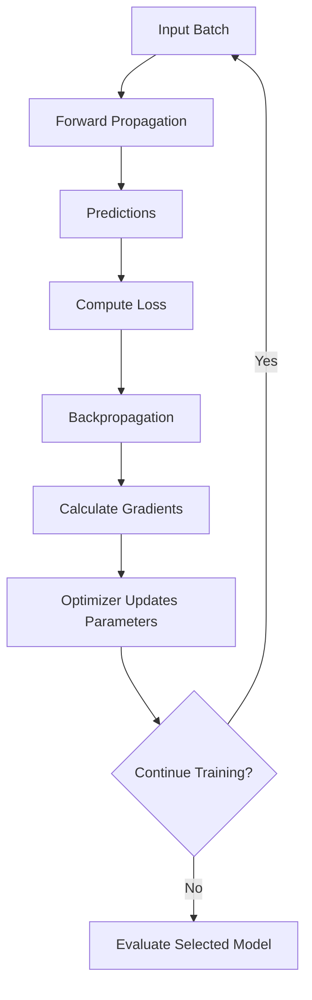

### Conceptual explanation

Suppose the prediction is wrong. Backpropagation determines how much each weight and bias contributed to the loss through the network's chain of operations. The optimizer then adjusts the parameters in a direction expected to reduce the loss.

**Remember:** Backpropagation calculates gradients; the optimizer uses them to update parameters.

---

## 13. 🏋️ Training Workflow

### 13.1 End-to-end process

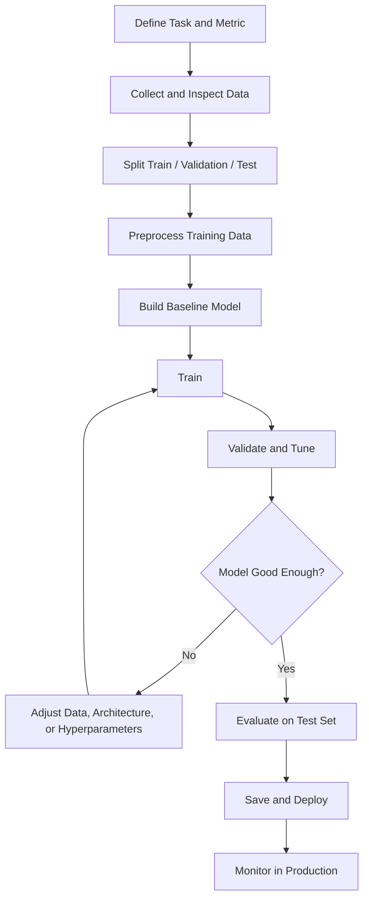

### 13.2 Dataset splits

| Split | Purpose |
|---|---|
| Training set | Learns model parameters |
| Validation set | Model selection, hyperparameter tuning, early stopping |
| Test set | Final estimate of generalization after model selection |

A common starting split is 70–80% training, 10–15% validation, and 10–15% testing, but the correct proportions depend on dataset size and structure.

**Avoid data leakage:** Do not fit scalers, imputers, feature selectors, or other data-dependent preprocessing on validation or test data. For grouped or temporal data, use an appropriate split strategy rather than blindly randomizing examples.

### 13.3 Training loop pseudocode

```text
Initialize model parameters
For each epoch:
    For each mini-batch:
        Compute predictions
        Compute loss
        Calculate gradients by backpropagation
        Update parameters using optimizer
    Evaluate validation metrics
    Save best checkpoint if validation criterion improves
Stop according to training or early-stopping rule
Evaluate selected model on test set
```

---

## 14. ⚙️ Optimizers

An optimizer uses gradients to update parameters.

| Optimizer | Main idea | Common use |
|---|---|---|
| SGD | Gradient-based updates | Many supervised tasks; often paired with momentum |
| SGD with Momentum | Accumulates a moving direction | Can speed progress and reduce oscillations |
| RMSProp | Adapts step sizes using recent squared gradients | Some recurrent and nonstationary settings |
| Adam | Combines momentum-like and adaptive updates | Strong general-purpose starting point |
| AdamW | Adam-style optimization with decoupled weight decay | Common modern baseline |

### Adam intuition

Adam maintains moving averages of gradients and squared gradients, then uses them to adapt parameter update sizes. It often works well with a moderate learning rate, but it is not always the best optimizer for every architecture or task.

### Practical tuning order

1. Start with a reasonable baseline optimizer.
2. Tune the learning rate first.
3. Inspect training and validation curves.
4. Consider a learning-rate schedule if progress plateaus.
5. Change a small number of settings at a time and record results.

---

## 15. 🧰 Initialization, Normalization, and Gradient Problems

### 15.1 Weight initialization

Initializing every weight to the same value can prevent neurons in a layer from learning distinct features. Randomized, scale-aware initialization helps break symmetry and control activation/gradient magnitudes.

| Initialization | Common context |
|---|---|
| Glorot/Xavier | Often used with tanh-like activations |
| He/Kaiming | Often used with ReLU-like activations |
| Zeros | Common for biases; generally unsuitable for all weights in a layer |

### 15.2 Vanishing gradients

Gradients become very small as they move backward through layers. Earlier layers may learn very slowly.

Possible mitigations:
- Suitable activation functions.
- Appropriate initialization.
- Residual connections.
- Normalization where appropriate.
- Gated sequence architectures for some recurrent tasks.

### 15.3 Exploding gradients

Gradients become extremely large, causing unstable updates or non-finite values.

Possible mitigations:
- Gradient clipping.
- Lower learning rate.
- Better initialization.
- Inspecting input scales and numerical values.
- Appropriate architecture and normalization.

### 15.4 Batch normalization

Batch normalization normalizes intermediate activations using batch statistics during training and moving statistics during inference. It can stabilize and speed optimization in many networks, though its benefit depends on the architecture and batch characteristics.

### 15.5 Layer normalization

Layer normalization normalizes across features within an example and is common in Transformer architectures. Unlike batch normalization, it does not rely on statistics aggregated across a batch.

---

## 16. 🛡️ Overfitting, Underfitting, and Regularization

- **Underfitting:** The model fails to capture relevant patterns, often performing poorly on both training and validation data.
- **Overfitting:** The model fits training data well but generalizes poorly to unseen examples.
- **Good generalization:** The model performs well on independent data representative of deployment.

| Condition | Training performance | Validation performance | Possible response |
|---|---|---|---|
| Underfitting | Poor | Poor | Improve model capacity, features, or optimization |
| Good fit | Good | Good and reasonably close | Confirm with a held-out test set |
| Overfitting | Very good | Worse or deteriorating | Regularize, augment data, simplify, or collect more representative data |

### Regularization methods

| Method | How it works | Consideration |
|---|---|---|
| L1 regularization | Penalizes absolute parameter magnitudes | Can encourage sparse weights |
| L2 regularization | Penalizes squared parameter magnitudes | Discourages large weights |
| Weight decay | Shrinks weights during optimizer updates | Implementation differs by optimizer |
| Dropout | Randomly removes activations during training | Disabled at inference in standard implementations |
| Early stopping | Stops when validation performance stops improving | Requires a meaningful validation set |
| Data augmentation | Creates realistic variations of training examples | Transformations must preserve labels |
| Reduce model capacity | Uses fewer layers or units | May cause underfitting if overdone |
| Transfer learning | Starts from a pretrained model | Pretraining data may not match the task |

---

## 17. 📖 Important Training Terminology

| Term | Meaning |
|---|---|
| Epoch | One pass through the full training dataset |
| Batch size | Number of examples processed together in one step |
| Step / iteration | Often one optimizer update |
| Learning rate | Scale of parameter updates |
| Loss | Optimization objective |
| Gradient | Derivative of loss with respect to a parameter |
| Optimizer | Rule for using gradients to update parameters |
| Parameter | Trainable value, such as weight or bias |
| Hyperparameter | Configuration selected or tuned by the practitioner |
| Logit | Raw score before probability transformation |
| Activation | Output after applying a neuron's activation function |
| Checkpoint | Saved model state |
| Inference | Generating predictions using a trained model |
| Generalization | Performance on unseen examples |
| Latency | Time required to generate a prediction |
| Throughput | Number of examples processed per unit time |
| Embedding | Learned dense vector representation |
| Residual connection | Shortcut path that adds or combines earlier representations |
| Attention | Mechanism for weighting interactions between elements |

---

## 18. 🧱 Neural Network Architectures

| Architecture | Core idea | Common tasks |
|---|---|---|
| MLP / Feed-forward ANN | Dense layers process feature vectors | Tabular classification and regression |
| CNN | Convolutions learn spatial features | Image classification, detection, segmentation |
| RNN | Hidden state processes sequence steps | Sequential data |
| LSTM | Gated memory for sequence modeling | Time series, speech, text |
| GRU | Simpler gated recurrent unit | Sequence tasks |
| Transformer | Self-attention and feed-forward blocks | Language, vision, audio, multimodal data |
| Autoencoder | Encodes and reconstructs input | Compression, denoising, anomaly detection |
| GAN | Generator and discriminator train adversarially | Data generation |
| GNN | Aggregates information over graph connections | Molecules, social networks, relational data |
| Diffusion model | Learns iterative denoising | Image and other data generation |

### CNN workflow


### Transformer workflow

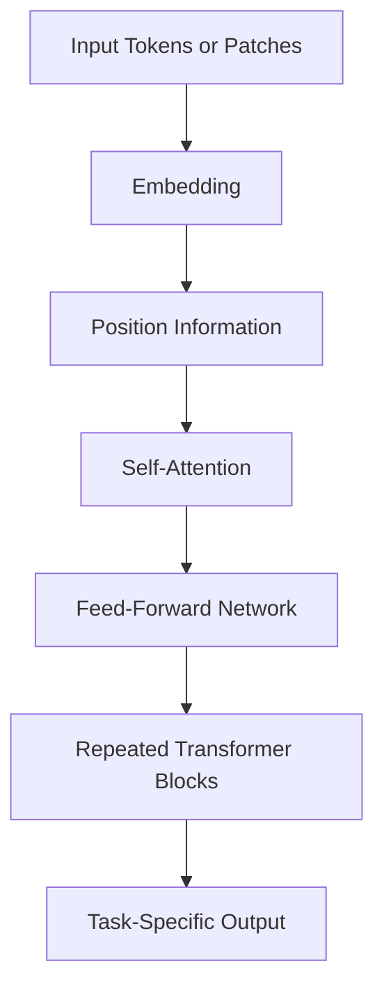

Transformers use attention to model relationships between elements. They are widely used in language models and also in vision, audio, and multimodal systems.

---

## 19. 📊 Evaluation Metrics

### Classification metrics

| Metric | Formula / meaning | Use |
|---|---|---|
| Accuracy | Correct predictions / total predictions | Balanced classes and similar error costs |
| Precision | \(TP/(TP+FP)\) | False positives matter |
| Recall | \(TP/(TP+FN)\) | False negatives matter |
| Specificity | \(TN/(TN+FP)\) | Correctly recognizing negatives matters |
| F1-score | Harmonic mean of precision and recall | Balance precision and recall |
| ROC-AUC | Ranking performance over thresholds | Binary score ranking |
| PR-AUC | Precision-recall area | Often useful with class imbalance |

Where TP = true positives, TN = true negatives, FP = false positives, and FN = false negatives.

### Regression metrics

- **MAE:** Mean absolute error.
- **MSE:** Mean squared error.
- **RMSE:** Square root of MSE.
- **R²:** Relative fit compared with predicting the target mean.

A confusion matrix shows counts of actual versus predicted classes. For imbalanced datasets, include per-class precision, recall, F1-score, and a confusion matrix instead of relying only on accuracy.

---

## 20. 🧪 Practical Example 1: Forward Propagation with NumPy

This example implements a forward pass for a tiny neural network. Its weights are manually specified, so it **does not train** the network.

```python
import numpy as np

# Two samples, each with three features
X = np.array([
    [0.2, 0.4, 0.6],
    [0.9, 0.1, 0.3]
], dtype=np.float32)

# Three input features -> four hidden units
W1 = np.array([
    [0.1, 0.2, 0.3, 0.4],
    [0.2, 0.1, 0.4, 0.3],
    [0.3, 0.4, 0.1, 0.2]
], dtype=np.float32)
b1 = np.zeros((1, 4), dtype=np.float32)

# Four hidden units -> two output classes
W2 = np.array([
    [0.2, -0.1],
    [0.1, 0.3],
    [-0.2, 0.2],
    [0.4, 0.1]
], dtype=np.float32)
b2 = np.zeros((1, 2), dtype=np.float32)


def relu(x):
    return np.maximum(0, x)


def softmax(logits):
    # Numerically stable softmax
    shifted = logits - np.max(logits, axis=1, keepdims=True)
    exp_values = np.exp(shifted)
    return exp_values / np.sum(exp_values, axis=1, keepdims=True)


hidden = relu(X @ W1 + b1)
logits = hidden @ W2 + b2
probabilities = softmax(logits)

print("Probabilities:\n", probabilities)
print("Predicted classes:", np.argmax(probabilities, axis=1))
```

### Explanation

- `X @ W1 + b1` computes the first linear transformation.
- ReLU introduces nonlinearity.
- The second transformation produces class logits.
- Softmax converts logits to a probability distribution.
- `argmax` selects the class with the largest score.

---

## 21. 🧑‍💻 Practical Example 2: Train a Neural Network with Keras

This example uses a synthetic nonlinear dataset to demonstrate the complete training workflow.

### Install dependencies

```bash
python -m pip install tensorflow scikit-learn numpy
```

### Code

```python
import numpy as np
import tensorflow as tf
from sklearn.datasets import make_moons
from sklearn.model_selection import train_test_split
from sklearn.preprocessing import StandardScaler
from sklearn.metrics import classification_report, confusion_matrix

np.random.seed(42)
tf.keras.utils.set_random_seed(42)

# Create a nonlinear binary classification dataset
X, y = make_moons(
    n_samples=2000,
    noise=0.20,
    random_state=42
)

# Split data before fitting preprocessing
X_train, X_temp, y_train, y_temp = train_test_split(
    X, y,
    test_size=0.30,
    random_state=42,
    stratify=y
)

X_val, X_test, y_val, y_test = train_test_split(
    X_temp, y_temp,
    test_size=0.50,
    random_state=42,
    stratify=y_temp
)

# Fit scaler only on training features
scaler = StandardScaler()
X_train = scaler.fit_transform(X_train)
X_val = scaler.transform(X_val)
X_test = scaler.transform(X_test)

model = tf.keras.Sequential([
    tf.keras.layers.Input(shape=(2,)),
    tf.keras.layers.Dense(32, activation="relu"),
    tf.keras.layers.Dense(16, activation="relu"),
    tf.keras.layers.Dense(1, activation="sigmoid")
])

model.compile(
    optimizer=tf.keras.optimizers.Adam(learning_rate=0.001),
    loss="binary_crossentropy",
    metrics=["accuracy"]
)

early_stopping = tf.keras.callbacks.EarlyStopping(
    monitor="val_loss",
    patience=10,
    restore_best_weights=True
)

history = model.fit(
    X_train,
    y_train,
    validation_data=(X_val, y_val),
    epochs=100,
    batch_size=32,
    callbacks=[early_stopping],
    verbose=1
)

# Evaluate only after model selection
test_loss, test_accuracy = model.evaluate(
    X_test, y_test, verbose=0
)
print(f"Test loss: {test_loss:.4f}")
print(f"Test accuracy: {test_accuracy:.4f}")

probabilities = model.predict(X_test, verbose=0).ravel()
y_pred = (probabilities >= 0.5).astype(int)

print(classification_report(y_test, y_pred))
print("Confusion matrix:\n", confusion_matrix(y_test, y_pred))

model.save("binary_classifier.keras")
```

### What to notice

1. The dataset is split before the scaler is fitted.
2. The scaler learns its statistics only from training features.
3. A sigmoid output is paired with binary cross-entropy.
4. Early stopping monitors validation loss.
5. The test set is used for final evaluation.
6. The model is saved in Keras format.

---

## 22. 🧩 Mini-Project: Binary Classification

### Objective

Create a neural network that predicts one of two classes from numerical features.

### Project workflow

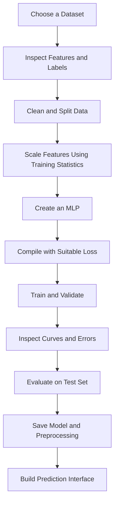

### Suggested folder structure

```text
neural-network-project/
├── data/
├── notebooks/
│   └── exploration.ipynb
├── src/
│   ├── train.py
│   ├── evaluate.py
│   └── predict.py
├── models/
├── reports/
├── requirements.txt
└── README.md
```

### Tasks

1. Select a dataset with two target classes.
2. Inspect missing values, duplicates, feature ranges, and class balance.
3. Create training, validation, and test splits.
4. Fit preprocessing only on training data.
5. Train a simple baseline model.
6. Train an MLP and compare its validation performance with the baseline.
7. Track loss and metrics across epochs.
8. Evaluate with precision, recall, F1-score, and a confusion matrix.
9. Save the model and preprocessing pipeline.
10. Document the model's limitations and failure cases.

### Extension ideas

- Compare one hidden layer against three hidden layers.
- Compare ReLU and tanh.
- Tune the learning rate and batch size.
- Add dropout or L2 regularization.
- Compare Adam with SGD plus momentum.
- Create a small Streamlit or Tkinter interface.

---

## 23. 🌍 Applications and Real-World Use Cases

| Domain | Example | Potential network |
|---|---|---|
| Healthcare | Image classification support | CNN, vision Transformer |
| Transportation | Driver drowsiness detection | CNN and temporal model |
| Computer vision | Object detection and segmentation | CNN, vision Transformer |
| NLP | Text classification and summarization | Transformer |
| Speech | Speech recognition | CNN, RNN, Transformer |
| Finance | Fraud detection | MLP, or compare with tree-based models |
| Agriculture | Crop disease recognition | CNN |
| Manufacturing | Visual defect detection | CNN or anomaly-detection network |
| Recommendation | Ranking and personalization | Embedding-based neural model |
| Time series | Forecasting sensor readings | MLP, RNN, Transformer, or specialized models |
| Graphs | Molecule property prediction | Graph Neural Network |
| Generative AI | Text or image generation | Transformer, diffusion model, other generative architectures |

### Example: Driver drowsiness detection

A potential pipeline could:
1. Capture frames from a camera.
2. Detect a face and relevant facial regions.
3. Classify eye state or other visual indicators.
4. Aggregate predictions over time to reduce noisy alerts.
5. Trigger an alert according to validated rules.
6. Log events while protecting privacy.

A neural network alone does not guarantee reliable real-world behavior. Lighting, camera placement, occlusion, user diversity, latency, and safety testing all matter. Any vehicle control integration requires appropriate engineering and safety review.

---

## 24. ⚖️ Advantages and Limitations

### Advantages

- Learns nonlinear relationships.
- Can learn features from raw or lightly processed data.
- Supports end-to-end training.
- Can scale to large and complex datasets.
- Supports transfer learning and pretrained models.
- Works across image, text, audio, structured, and sequential data.

### Limitations

- May need substantial data and compute.
- Can overfit when training data is limited or unrepresentative.
- Can be difficult to interpret.
- May inherit bias from training data.
- Can fail under distribution shift.
- Requires careful hyperparameter tuning and evaluation.
- Larger networks can be expensive to train and deploy.
- Good benchmark results do not guarantee safety or reliability in production.

| Factor | Benefit | Trade-off |
|---|---|---|
| More parameters | Higher representational capacity | More compute and potential overfitting |
| More data | Broader pattern coverage | Collection and labeling costs |
| Deeper architecture | Can learn complex representations | Optimization and deployment complexity |
| Transfer learning | Less training from scratch | Pretraining may not match the target domain |
| Automation | Fast predictions at scale | Requires monitoring and fallback mechanisms |

---

## 25. ✅ Best Practices and Common Mistakes

### Best practices

- Define the task and evaluation metric before modeling.
- Inspect data quality and label distribution.
- Establish a simple baseline before increasing model complexity.
- Keep test data separate throughout model development.
- Fit data-dependent preprocessing on training data only.
- Match the output layer and loss function to the target format.
- Start with a reasonable learning rate and inspect learning curves.
- Use early stopping and checkpointing where appropriate.
- Track seeds, package versions, data versions, and model configuration.
- Evaluate per-class performance and subgroup behavior when relevant.
- Measure latency and memory use before deployment.
- Document intended use, known limitations, and failure modes.

### Common mistakes

| Mistake | Why it is a problem | Fix |
|---|---|---|
| All weights initialized identically | Neurons may learn identical features | Use suitable random initialization |
| No nonlinear activation between dense layers | Network remains equivalent to a linear transformation | Add nonlinear activations |
| Learning rate too high | Unstable updates or divergence | Reduce learning rate and inspect loss |
| Learning rate too low | Slow progress | Tune learning rate or schedule |
| Wrong output activation/loss pairing | Incorrect objective or unstable training | Match logits/probabilities and labels correctly |
| Scaling the full dataset before splitting | Data leakage | Split first, fit scaler on training data |
| Monitoring only accuracy | Can hide minority-class failures | Report per-class metrics and confusion matrix |
| Too many layers too early | More complexity without clear benefit | Begin with a baseline and add complexity deliberately |
| Ignoring validation loss | Overfitting may go unnoticed | Track validation metrics and use early stopping |
| Repeatedly tuning on the test set | Test result becomes biased | Use validation for decisions and test for final evaluation |
| Ignoring input shape | Matrix operations or model inputs may fail | Print and verify tensor shapes |
| Forgetting inference preprocessing | Training and production inputs differ | Package and test preprocessing with the model |

### Troubleshooting checklist

1. Inspect input shapes and data types.
2. Check for missing, infinite, or invalid values.
3. Verify target encoding and class mapping.
4. Confirm the output shape and loss function match the task.
5. Try to overfit a very small subset as a debugging test.
6. Plot training and validation loss.
7. Inspect a sample of incorrect predictions.
8. Check for data leakage and duplicate samples across splits.
9. Confirm preprocessing is identical during training and inference.
10. Test the final pipeline on unseen examples.

---

## 26. 🔬 Advanced Neural Network Concepts

### Residual connections

Residual connections provide shortcut paths that add or combine an earlier representation with a later transformation. They help information and gradients travel through deep architectures and are central to ResNet-style models.

### Attention mechanisms

Attention assigns weights to relationships between elements in a representation. Self-attention allows each element to combine information from other elements, depending on the attention calculation.

### Embeddings

An embedding maps an item—such as a word, product, or user—to a learned dense vector. Similarity in embedding space can be useful for retrieval, recommendation, and representation learning.

### Transfer learning and fine-tuning

- **Feature extraction:** Keep most or all pretrained feature layers frozen and train a new task-specific head.
- **Fine-tuning:** Unfreeze some or all pretrained layers and continue training on task-specific data.
- **Benefit:** Can reduce data and compute requirements compared with training from scratch.
- **Risk:** A pretrained model may not represent the target domain well, and aggressive fine-tuning can damage useful pretrained features.

### Knowledge distillation

A smaller student model is trained to reproduce some behavior of a larger teacher model, potentially reducing inference cost while retaining useful performance.

### Quantization and pruning

- **Quantization:** Represents weights or activations with lower numerical precision to reduce model size or improve inference efficiency.
- **Pruning:** Removes selected parameters or structures that contribute less to the model.
- **Trade-off:** Speed and size improvements depend on hardware and runtime support; accuracy should be re-evaluated after compression.

### Neural network explainability

Tools such as feature attribution, saliency maps, and SHAP-style explanations can help investigate model behavior. These methods have limitations and should not be treated as proof of causation or as a guarantee that a model is fair or correct.

### Responsible deployment

Consider privacy, fairness, data provenance, robustness, distribution shift, monitoring, and human oversight. For high-impact applications, establish clear evaluation criteria and escalation procedures before deployment.

---

## 27. 🎯 Neural Network Interview Questions

### Beginner

**1. What is a neural network?**  
A model composed of interconnected mathematical units organized into layers that learn parameters from data.

**2. What is an artificial neuron?**  
A function that computes a weighted sum plus bias and applies an activation.

**3. What are weights and biases?**  
Weights control input contributions; biases shift the pre-activation value.

**4. What is a perceptron?**  
A simple neuron model commonly used for linearly separable binary classification.

**5. Why are activation functions needed?**  
They introduce nonlinearity so stacked layers can learn complex relationships.

**6. What is the difference between an epoch and a batch?**  
An epoch is a full pass through training data; a batch is the group of examples processed in one step.

### Intermediate

**7. What is forward propagation?**  
The calculation that transforms input features into predictions.

**8. What is backpropagation?**  
A chain-rule-based method for calculating gradients of loss with respect to model parameters.

**9. What is the difference between backpropagation and gradient descent?**  
Backpropagation computes gradients; gradient descent or another optimizer uses gradients to update parameters.

**10. What is overfitting?**  
When a model performs well on training data but poorly on unseen data.

**11. How can overfitting be reduced?**  
Use suitable data, regularization, augmentation, early stopping, transfer learning, or reduced model capacity.

**12. What is the vanishing gradient problem?**  
Gradients become very small during backward propagation, slowing learning in earlier layers.

**13. Why is ReLU popular?**  
It is computationally simple and avoids sigmoid-style saturation on its positive side.

**14. What is the difference between a parameter and a hyperparameter?**  
Parameters are learned during training; hyperparameters configure the architecture or training procedure.

### Advanced

**15. What is the difference between a CNN and an MLP?**  
An MLP commonly uses dense connections over feature vectors; a CNN uses convolutional filters and local connectivity, making it well suited to spatial patterns.

**16. Why can a single perceptron not learn XOR?**  
XOR is not linearly separable, so one linear decision boundary cannot classify it correctly.

**17. What is gradient clipping?**  
Limiting gradient magnitude to reduce unstable updates caused by excessively large gradients.

**18. What is the role of weight initialization?**  
It controls initial activation and gradient scales and helps break symmetry between neurons.

**19. Why is a test set needed?**  
It provides a final estimate of performance on unseen data after model selection is complete.

**20. Why can accuracy be misleading?**  
With imbalanced classes, a model can predict the majority class frequently and still miss important minority-class examples.

**21. What is transfer learning?**  
Reusing representations learned from one task to improve performance on another related task.

**22. What is the difference between logits and probabilities?**  
Logits are raw scores; probabilities are transformed scores, for example using sigmoid or softmax.

**23. What is a residual connection?**  
A shortcut path that adds or combines an earlier representation with a later layer's output.

**24. What should be monitored after deployment?**  
Prediction quality when labels become available, data drift, latency, throughput, error rates, and relevant subgroup behavior.

---

## 28. ⚡ Quick Revision and Learning Roadmap

### 28.1 Key points to remember

- A neural network learns by adjusting weights and biases.
- A neuron computes \(z=w^Tx+b\) and then applies an activation.
- Nonlinear activation functions let networks represent nonlinear relationships.
- Forward propagation produces predictions.
- Loss quantifies the prediction error.
- Backpropagation calculates gradients.
- The optimizer uses gradients to update parameters.
- The learning rate controls the scale of parameter updates.
- An epoch is one pass through the training data.
- Validation data guides model selection; test data is reserved for final evaluation.
- Overfitting is poor generalization despite strong training performance.
- Dropout, weight decay, augmentation, and early stopping can help generalization.
- The output layer and loss function must match the task and target encoding.
- Evaluate precision, recall, F1-score, and error patterns when accuracy alone is inadequate.
- Always compare against a baseline and test the complete inference pipeline.

### 28.2 Important formulas

| Concept | Formula |
|---|---|
| Neuron pre-activation | \(z=w^Tx+b\) |
| Neuron output | \(a=\phi(z)\) |
| Dense layer | \(z=Wx+b\) |
| Sigmoid | \(\sigma(x)=\frac{1}{1+e^{-x}}\) |
| ReLU | \(\max(0,x)\) |
| Softmax | \(p_i=\frac{e^{z_i}}{\sum_j e^{z_j}}\) |
| MSE | \(\frac{1}{N}\sum_i(y_i-\hat y_i)^2\) |
| Gradient descent | \(\theta\leftarrow\theta-\eta\nabla_\theta L\) |
| Dense parameters | \(n_{in}n_{out}+n_{out}\) |
| Steps per epoch | \(\lceil N/\text{batch size}\rceil\) |
| Precision | \(TP/(TP+FP)\) |
| Recall | \(TP/(TP+FN)\) |
| F1-score | \(2PR/(P+R)\) |

### 28.3 Essential commands

```bash
# Create an environment
python -m venv .venv

# Install common libraries
python -m pip install numpy scikit-learn tensorflow matplotlib

# Run a training script
python train.py
```

```python
import tensorflow as tf

print(tf.__version__)
print(tf.config.list_physical_devices("GPU"))

# Inspect architecture
model.summary()

# Save a Keras model
model.save("model.keras")

# Load a saved model
loaded_model = tf.keras.models.load_model("model.keras")
```

A GPU is optional for small introductory models. For GPU setup, follow the current official framework installation instructions for your operating system and hardware.

### 28.4 Visual summary

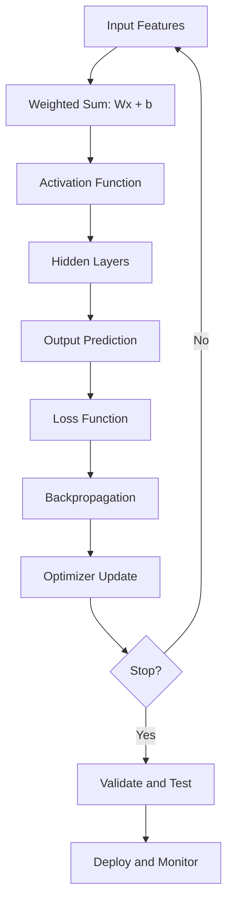

### 28.5 Learning roadmap

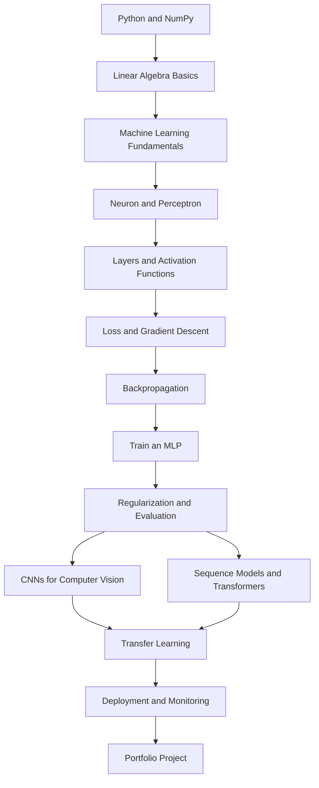

### 28.6 Practice checklist

- [ ] Explain the structure of an artificial neuron.
- [ ] Calculate a neuron's weighted sum and output.
- [ ] Explain why nonlinear activations matter.
- [ ] Compare sigmoid, tanh, ReLU, and softmax.
- [ ] Calculate dense-layer parameter counts.
- [ ] Explain forward propagation and backpropagation.
- [ ] Explain gradient descent and the learning rate.
- [ ] Distinguish training, validation, and test sets.
- [ ] Identify overfitting and underfitting from learning curves.
- [ ] Train a binary classifier with Keras.
- [ ] Interpret a confusion matrix and F1-score.
- [ ] Save and reload a model.
- [ ] Compare an MLP with a CNN.
- [ ] Document limitations and test on unseen examples.

---

## 📌 Final Takeaway

Neural networks learn patterns by combining weighted transformations, nonlinear activations, a loss function, gradient calculation, and parameter updates. Understanding these building blocks makes it easier to learn advanced architectures such as CNNs, RNNs, Transformers, and generative models. Build small models first, validate carefully, compare against baselines, and treat reliable evaluation and deployment as part of the model—not as an afterthought.
