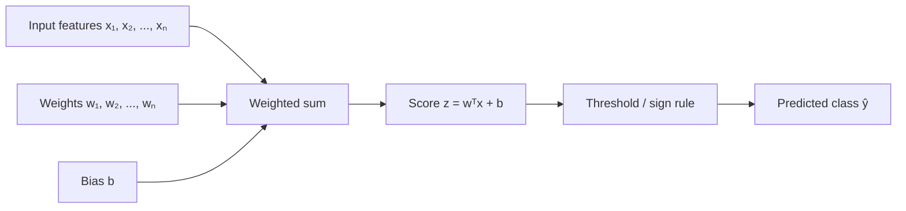
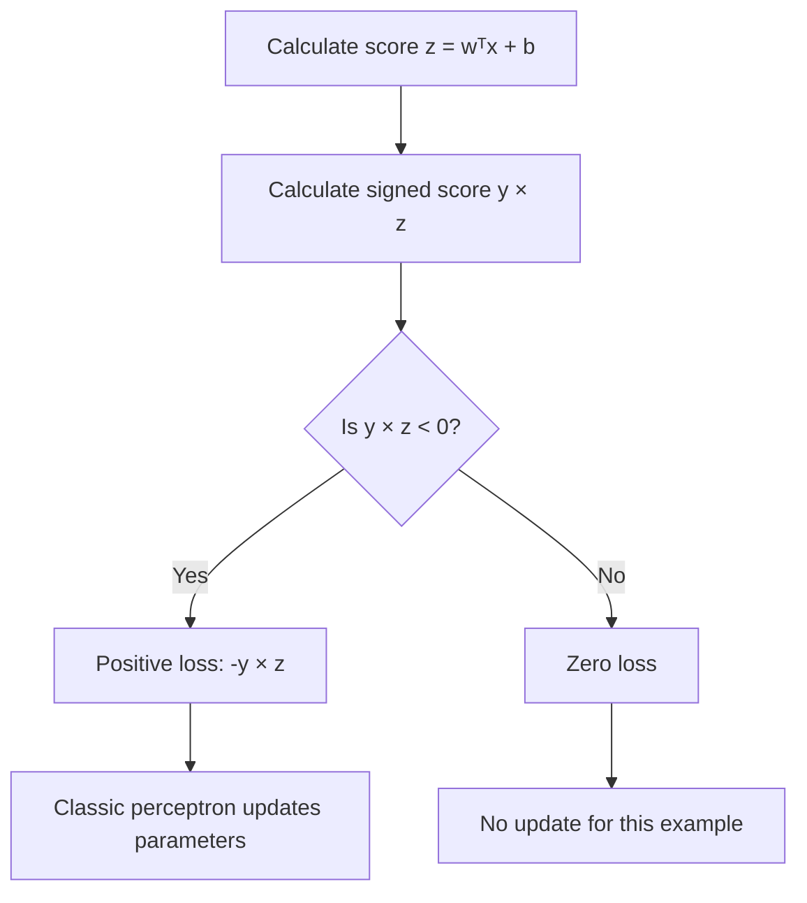
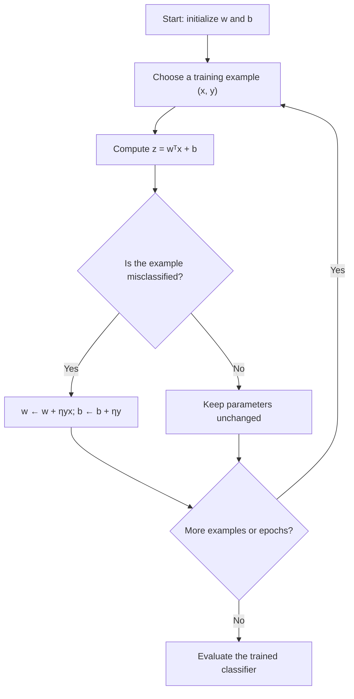
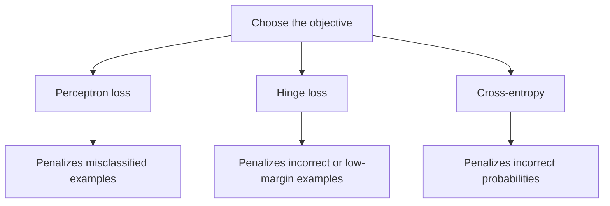
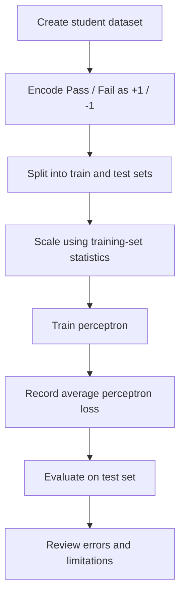
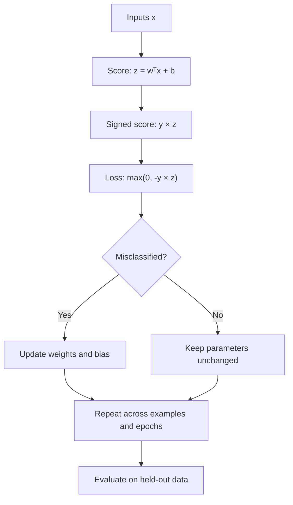

# Loss Function in Perceptron

## 📚 Table of Contents

1. [🎯 Introduction](#-introduction)
2. [🧠 Perceptron Fundamentals](#-perceptron-fundamentals)
3. [📌 What Is a Loss Function?](#-what-is-a-loss-function)
4. [⚙️ Perceptron Prediction and Decision Rule](#️-perceptron-prediction-and-decision-rule)
5. [📐 Loss Functions Used with a Perceptron](#-loss-functions-used-with-a-perceptron)
6. [🧮 Perceptron Loss: Formula and Interpretation](#-perceptron-loss-formula-and-interpretation)
7. [🔄 How Perceptron Learning Works](#-how-perceptron-learning-works)
8. [💻 Python Implementation from Scratch](#-python-implementation-from-scratch)
9. [🧪 Practical Example: Binary Classification](#-practical-example-binary-classification)
10. [📊 Comparing Loss Functions](#-comparing-loss-functions)
11. [🌍 Real-World Applications](#-real-world-applications)
12. [✅ Advantages and Limitations](#-advantages-and-limitations)
13. [🚧 Common Mistakes](#-common-mistakes)
14. [🧠 Advanced Concepts](#-advanced-concepts)
15. [🛠️ Mini-Project: Classify Whether a Student Passes](#️-mini-project-classify-whether-a-student-passes)
16. [🎤 Interview Questions and Answers](#-interview-questions-and-answers)
17. [🧭 Best Practices](#-best-practices)
18. [⚡ Quick Revision](#-quick-revision)

---

## 1. 🎯 Introduction

A **loss function** measures how far a model's prediction is from the desired outcome. In machine learning, it provides a numerical signal that helps us assess a model and, for many algorithms, improve its parameters during training.

A classic **Perceptron** is a simple binary linear classifier. It calculates a weighted sum of input features, adds a bias, and predicts one of two classes.

The original perceptron learning algorithm does not require a smooth, differentiable loss function. Instead, it updates its weights when it misclassifies a training example. The **perceptron loss** is a mathematical way to express this mistake-driven learning objective.

### 🎯 Learning objectives

After studying this topic, you should be able to:

- Explain what a loss function does.
- Derive the perceptron prediction rule.
- Write the perceptron loss formula for labels encoded as `-1` and `+1`.
- Explain how a misclassified example changes the weights.
- Distinguish perceptron loss from mean squared error, hinge loss, and cross-entropy.
- Implement and evaluate a perceptron in Python.
- Recognize the limitations of perceptron loss.

---

## 2. 🧠 Perceptron Fundamentals

### 2.1 What is a perceptron?

A perceptron is one of the earliest artificial-neuron models. It combines input features using weights, adds a bias, and applies a threshold-based activation rule.

For an input vector:

\[
\mathbf{x} = [x_1, x_2, \ldots, x_n]
\]

the linear score is:

\[
z = \mathbf{w}^{T}\mathbf{x} + b
  = \sum_{i=1}^{n} w_i x_i + b
\]

Where:

- \(x_i\): input feature.
- \(w_i\): weight associated with feature \(i\).
- \(b\): bias.
- \(z\): linear score before applying the decision rule.

For labels encoded as \(-1\) and \(+1\), the prediction is:

\[
\hat{y} =
\begin{cases}
+1 & \text{if } z \geq 0\\
-1 & \text{if } z < 0
\end{cases}
\]

### 2.2 Main components

| Component | Purpose |
|---|---|
| Input features | Describe each example |
| Weights | Determine each feature's influence |
| Bias | Shifts the decision boundary |
| Linear score | Combines weighted features and bias |
| Threshold rule | Converts the score into a class prediction |
| Learning rule | Updates weights when an example is misclassified |
| Loss function | Quantifies mistakes or violations of the classification objective |

### 2.3 Perceptron architecture



### 2.4 Decision boundary

The decision boundary is where the score is zero:

\[
\mathbf{w}^{T}\mathbf{x} + b = 0
\]

For two input features, this boundary is a line. For three features, it is a plane. In higher dimensions, it is a hyperplane.

A standard perceptron can learn a linear decision boundary. It cannot perfectly classify every dataset, especially data that is not linearly separable.

---

## 3. 📌 What Is a Loss Function?

A **loss function** assigns a numerical value to a model's prediction. A lower loss generally indicates that the prediction better satisfies the objective defined by the loss.

For a single example with true label \(y\) and predicted score \(z\), a loss can be written as:

\[
L(y,z)
\]

For a dataset of \(m\) examples, a common approach is to sum or average the individual losses:

\[
J(\mathbf{w},b) = \frac{1}{m}\sum_{i=1}^{m} L(y_i,z_i)
\]

The exact objective depends on the algorithm and loss definition.

### 3.1 Why do we need a loss function?

A loss function helps us:

1. Quantify prediction errors.
2. Compare model behavior during experiments.
3. Define the objective a training algorithm should improve.
4. Track whether training is progressing.
5. Express a mathematical criterion for acceptable predictions.

### 3.2 Loss versus accuracy

Loss and accuracy are related, but they are not the same.

| Metric | What it measures | Example |
|---|---|---|
| Loss | The penalty assigned by a particular objective | Perceptron loss of 0.8 |
| Accuracy | Fraction of predictions that are correct | 90% accuracy |
| Error rate | Fraction of predictions that are incorrect | 10% error rate |

Two models can have identical accuracy but different loss values because a loss may account for the score or margin, not just the final predicted class.

**Important:** The original perceptron algorithm updates parameters based on classification mistakes. It is not typically trained by taking gradients of a smooth loss, because perceptron loss is not differentiable everywhere and is flat for correctly classified examples with sufficient margin.

---

## 4. ⚙️ Perceptron Prediction and Decision Rule

### 4.1 Score calculation

Suppose an example has two features:

\[
\mathbf{x} = [2,3], \quad \mathbf{w} = [0.4,-0.2], \quad b = 0.1
\]

Then:

\[
z = (0.4)(2) + (-0.2)(3) + 0.1 = 0.3
\]

Since \(z \geq 0\), the predicted class is \(+1\).

### 4.2 Correctness depends on the true label

A positive score alone does not mean a prediction is correct. It is correct only when the true label is \(+1\). If the true label is \(-1\), the same score represents a mistake.

For labels \(y \in \{-1,+1\}\), define the **signed score**:

\[
yz = y(\mathbf{w}^{T}\mathbf{x}+b)
\]

Interpretation:

| Signed score \(yz\) | Meaning |
|---:|---|
| \(yz > 0\) | Correctly classified |
| \(yz = 0\) | Exactly on the decision boundary |
| \(yz < 0\) | Misclassified |

The signed score is central to understanding perceptron loss.

---

## 5. 📐 Loss Functions Used with a Perceptron

The word *perceptron loss* usually refers to the mistake-focused objective below. However, a perceptron model can also be evaluated or trained with other objectives in modified learning setups.

### 5.1 Perceptron loss

For labels \(y \in \{-1,+1\}\) and score \(z=\mathbf{w}^{T}\mathbf{x}+b\):

\[
\boxed{L_{\text{perc}}(y,z)=\max(0,-yz)}
\]

This loss is zero for examples classified correctly with a positive signed score. It is positive for misclassified examples. At the boundary \(yz=0\), the loss is also zero, although implementations may differ in whether they treat a zero score as positive or negative.

### 5.2 Example values

| True label \(y\) | Score \(z\) | Signed score \(yz\) | Perceptron loss |
|---:|---:|---:|---:|
| \(+1\) | \(2.0\) | \(2.0\) | \(0\) |
| \(+1\) | \(0.5\) | \(0.5\) | \(0\) |
| \(+1\) | \(-1.5\) | \(-1.5\) | \(1.5\) |
| \(-1\) | \(-2.0\) | \(2.0\) | \(0\) |
| \(-1\) | \(0.8\) | \(-0.8\) | \(0.8\) |

### 5.3 Why is the loss zero for correctly classified examples?

The classic perceptron focuses on fixing mistakes, rather than pushing every correct example farther away from the boundary. Once an example is classified correctly, its perceptron loss is zero, regardless of whether its positive margin is small or large.

This makes perceptron loss different from hinge loss, which continues to penalize correctly classified examples whose margin is smaller than a chosen threshold.

### 5.4 Alternative convention: labels 0 and 1

Some datasets use \(y \in \{0,1\}\). The classic signed perceptron loss formula cannot be applied directly to these labels. A common conversion is:

\[
y' = 2y - 1
\]

This maps:

- \(0 \rightarrow -1\)
- \(1 \rightarrow +1\)

Convert labels before applying the signed perceptron loss formula.

---

## 6. 🧮 Perceptron Loss: Formula and Interpretation

### 6.1 Mathematical definition

Let:

\[
z_i = \mathbf{w}^{T}\mathbf{x}_i+b
\]

For each training example:

\[
L_i = \max(0,-y_i z_i)
\]

The total or average empirical perceptron loss over \(m\) examples can be expressed as:

\[
J(\mathbf{w},b)=\frac{1}{m}\sum_{i=1}^{m}\max(0,-y_i(\mathbf{w}^{T}\mathbf{x}_i+b))
\]

The average is useful for monitoring the overall objective. The original online perceptron learning algorithm, however, is commonly implemented by processing individual examples and updating only when the prediction is wrong.

### 6.2 Piecewise form

\[
L_{\text{perc}}(y,z)=
\begin{cases}
0 & \text{if } yz \geq 0\\
-yz & \text{if } yz < 0
\end{cases}
\]

This is a piecewise linear loss. It is not differentiable at \(yz=0\), and it is flat for correctly classified examples with a strictly positive signed score.

### 6.3 Geometric interpretation

The signed score indicates which side of the decision boundary an example lies on, relative to its true class.

- If \(yz>0\), the example lies on the correct side.
- If \(yz<0\), the example lies on the wrong side.
- More negative \(yz\) means a larger loss.
- Perceptron loss does not reward increasing an already positive margin.

The signed score is not itself the perpendicular distance to the decision boundary. The geometric distance is:

\[
d = \frac{|\,\mathbf{w}^{T}\mathbf{x}+b\,|}{\|\mathbf{w}\|}
\]

for nonzero \(\mathbf{w}\).

### 6.4 Visual intuition



---

## 7. 🔄 How Perceptron Learning Works

### 7.1 The update rule

For learning rate \(\eta>0\), a commonly used perceptron update for labels \(-1,+1\) is:

\[
\mathbf{w} \leftarrow \mathbf{w}+\eta y\mathbf{x}
\]

\[
b \leftarrow b+\eta y
\]

Apply this update when an example is misclassified. Equivalently, a loss-based subgradient update can be written for examples with \(yz<0\). At the exact boundary, implementation details depend on the prediction convention and update condition.

For labels \(0\) and \(1\), first convert them to \(-1\) and \(+1\), or use a consistent alternative implementation.

### 7.2 Step-by-step workflow

1. Initialize weights and bias.
2. Select a training example.
3. Calculate the linear score.
4. Predict the class.
5. Compare the prediction with the true label.
6. If misclassified, update the weights and bias.
7. Repeat over the training data for multiple epochs.
8. Evaluate on held-out data.



### 7.3 Worked numerical example

Suppose:

\[
\mathbf{x}=[2,1], \quad y=+1,\quad \mathbf{w}=[0.1,0.2],\quad b=-0.8
\]

With learning rate \(\eta=0.5\):

**Step 1: Calculate the score**

\[
z=(0.1)(2)+(0.2)(1)-0.8=-0.4
\]

**Step 2: Calculate the signed score and loss**

\[
yz=(+1)(-0.4)=-0.4
\]

\[
L=\max(0,-(-0.4))=0.4
\]

The example is misclassified.

**Step 3: Update weights**

\[
\mathbf{w}_{new}=[0.1,0.2]+0.5(+1)[2,1]=[1.1,0.7]
\]

\[
b_{new}=-0.8+0.5(+1)=-0.3
\]

**Step 4: Recalculate the score**

\[
z_{new}=(1.1)(2)+(0.7)(1)-0.3=2.6
\]

The new score is positive, so the example is now correctly classified.

### 7.4 What does convergence mean?

The classic perceptron convergence theorem states that the algorithm will find a separating hyperplane after a finite number of mistakes when the training data is linearly separable and the standard assumptions hold.

If the data is not linearly separable, the algorithm may continue making mistakes and may not converge to a zero-training-error solution. A maximum epoch count and validation monitoring are therefore important in practical code.

---

## 8. 💻 Python Implementation from Scratch

The following examples use NumPy to calculate perceptron loss and implement a basic binary perceptron.

### 8.1 Calculate perceptron loss for one example

```python
import numpy as np

def perceptron_loss(y_true, score):
    """
    Perceptron loss for labels encoded as -1 and +1.
    y_true: true class label (-1 or +1)
    score: w.T @ x + b
    """
    if y_true not in (-1, 1):
        raise ValueError("y_true must be -1 or +1")

    return max(0.0, -y_true * score)


print(perceptron_loss(y_true=1, score=2.0))    # 0.0
print(perceptron_loss(y_true=1, score=-1.5))   # 1.5
print(perceptron_loss(y_true=-1, score=0.8))   # 0.8
```

**Explanation:** The loss is zero when the signed score is nonnegative and positive when the example is on the wrong side of the decision boundary.

### 8.2 Calculate average perceptron loss for a dataset

```python
import numpy as np

def average_perceptron_loss(X, y, weights, bias):
    """
    X: shape (n_samples, n_features)
    y: labels in {-1, +1}
    weights: shape (n_features,)
    bias: scalar
    """
    scores = X @ weights + bias
    losses = np.maximum(0, -y * scores)
    return float(np.mean(losses))


X = np.array([
    [1.0, 2.0],
    [2.0, 1.0],
    [-1.0, -2.0]
])

y = np.array([1, 1, -1])
weights = np.array([0.5, 0.2])
bias = 0.0

print("Average perceptron loss:", average_perceptron_loss(
    X, y, weights, bias
))
```

### 8.3 Train a perceptron from scratch

```python
import numpy as np

class Perceptron:
    def __init__(self, learning_rate=0.1, epochs=100):
        self.learning_rate = learning_rate
        self.epochs = epochs
        self.weights = None
        self.bias = 0.0
        self.loss_history = []

    def fit(self, X, y):
        X = np.asarray(X, dtype=float)
        y = np.asarray(y, dtype=int)

        if not np.all(np.isin(y, [-1, 1])):
            raise ValueError("Labels must be encoded as -1 and +1.")

        n_samples, n_features = X.shape
        self.weights = np.zeros(n_features, dtype=float)
        self.bias = 0.0
        self.loss_history = []

        for _ in range(self.epochs):
            mistakes = 0

            for xi, target in zip(X, y):
                score = np.dot(xi, self.weights) + self.bias
                prediction = 1 if score >= 0 else -1

                if prediction != target:
                    self.weights += self.learning_rate * target * xi
                    self.bias += self.learning_rate * target
                    mistakes += 1

            scores = X @ self.weights + self.bias
            epoch_loss = np.mean(np.maximum(0, -y * scores))
            self.loss_history.append(float(epoch_loss))

            if mistakes == 0:
                break

        return self

    def predict(self, X):
        X = np.asarray(X, dtype=float)
        scores = X @ self.weights + self.bias
        return np.where(scores >= 0, 1, -1)


# Simple linearly separable sample dataset
X = np.array([
    [2, 2],
    [3, 2],
    [2, 3],
    [-2, -1],
    [-3, -2],
    [-2, -3]
], dtype=float)

y = np.array([1, 1, 1, -1, -1, -1])

model = Perceptron(learning_rate=0.1, epochs=100)
model.fit(X, y)

predictions = model.predict(X)

print("Weights:", model.weights)
print("Bias:", model.bias)
print("Predictions:", predictions)
print("Training accuracy:", np.mean(predictions == y))
print("Final average perceptron loss:", model.loss_history[-1])
```

**Explanation:**

- The model initializes its weights to zero.
- It updates weights and bias when a training example is misclassified.
- It records average perceptron loss at the end of each epoch.
- It stops early if an epoch has no mistakes.
- This simple implementation is intended for learning; production code should include validation, reproducibility controls, and robust handling of data.

**Important distinction:** The recorded average loss is computed after each epoch. The algorithm itself uses the mistake-based update rule, rather than differentiating through a smooth loss.

### 8.4 Use scikit-learn

```python
from sklearn.datasets import make_classification
from sklearn.linear_model import Perceptron
from sklearn.model_selection import train_test_split
from sklearn.metrics import accuracy_score, classification_report

X, y = make_classification(
    n_samples=500,
    n_features=2,
    n_informative=2,
    n_redundant=0,
    n_clusters_per_class=1,
    class_sep=1.5,
    random_state=42
)

# Convert labels from {0, 1} to {-1, +1}
y = 2 * y - 1

X_train, X_test, y_train, y_test = train_test_split(
    X, y, test_size=0.2, random_state=42, stratify=y
)

model = Perceptron(
    max_iter=1000,
    eta0=0.1,
    tol=1e-3,
    random_state=42
)

model.fit(X_train, y_train)
predictions = model.predict(X_test)

print("Accuracy:", accuracy_score(y_test, predictions))
print(classification_report(y_test, predictions))
```

**Note:** Scikit-learn's `Perceptron` is a linear classifier trained with a perceptron-style update rule. Its implementation details and stopping behavior may differ from a minimal from-scratch implementation. Accuracy is an evaluation metric; it is not the same as perceptron loss.

---

## 9. 🧪 Practical Example: Binary Classification

Imagine classifying an email as spam or not spam using two simplified features:

- \(x_1\): number of suspicious keywords.
- \(x_2\): number of links.

Encode spam as \(+1\) and not spam as \(-1\).

Suppose:

\[
\mathbf{w}=[0.8,0.4], \quad b=-2.0
\]

For an email with \(x=[1,2]\):

\[
z=(0.8)(1)+(0.4)(2)-2.0=-0.4
\]

If the true label is \(+1\), then:

\[
L=\max(0,-(+1)(-0.4))=0.4
\]

The model has misclassified this spam email and receives a positive loss. The perceptron update increases the score for this positive example.

### Example interpretation

| Email | True label | Score | Prediction | Loss |
|---|---:|---:|---:|---:|
| A | \(+1\) | \(1.2\) | \(+1\) | \(0\) |
| B | \(+1\) | \(-0.4\) | \(-1\) | \(0.4\) |
| C | \(-1\) | \(-0.7\) | \(-1\) | \(0\) |
| D | \(-1\) | \(0.5\) | \(+1\) | \(0.5\) |

This is a simplified illustration, not a complete spam-detection system. Real spam detection generally needs more features, appropriate data handling, validation, and potentially probabilistic models.

---

## 10. 📊 Comparing Loss Functions

Different loss functions express different learning goals. They should not be treated as interchangeable.

### 10.1 Perceptron loss vs. hinge loss vs. cross-entropy

| Property | Perceptron loss | Hinge loss | Binary cross-entropy |
|---|---|---|---|
| Typical labels | \(-1,+1\) | \(-1,+1\) | \(0,1\) |
| Formula | \(\max(0,-yz)\) | \(\max(0,1-yz)\) | \(-[y\log p+(1-y)\log(1-p)]\) |
| Correct prediction with small positive margin | Zero loss | May have positive loss | Usually positive loss |
| Encourages a margin | No explicit positive margin target | Yes, margin of at least 1 | Not a fixed-margin objective |
| Probabilistic output | No | No | Yes, when paired with a suitable probability model |
| Common use | Classic perceptron learning | Support Vector Machines and margin classifiers | Logistic regression and binary neural-network outputs |

Here \(z\) is a raw score, \(y\in\{-1,+1\}\) for perceptron and hinge loss, and \(p\in(0,1)\) is a predicted probability for cross-entropy.

### 10.2 Perceptron loss vs. mean squared error

Mean squared error (MSE) is commonly used for regression:

\[
L_{\text{MSE}}=(y-\hat{y})^2
\]

MSE measures the squared difference between a numeric target and prediction. Perceptron loss instead focuses on the sign of the score relative to the class label. MSE can be used in custom classification setups, but it is not the standard objective for the classic perceptron.

### 10.3 Loss shape intuition



### 10.4 Which loss should you choose?

- Use **perceptron loss** when studying or implementing the classic mistake-driven perceptron.
- Use **hinge loss** when a margin-based classifier is desired.
- Use **cross-entropy** when learning probabilistic classification outputs, such as logistic regression or a neural network with a sigmoid output.
- Use **MSE** primarily for regression tasks, unless a specific classification formulation justifies it.

---

## 11. 🌍 Real-World Applications

The perceptron is mainly valuable as a foundational model and as a simple linear classifier. Its loss formulation helps explain mistake-driven learning.

| Application | Example features | Possible labels |
|---|---|---|
| Email filtering | Keyword counts, sender signals | Spam / not spam |
| Sentiment classification | Word or phrase features | Positive / negative |
| Basic image classification | Hand-engineered pixel or image features | Class A / class B |
| Quality inspection | Measured product properties | Pass / fail |
| Simple risk screening | Selected numeric indicators | Flag / do not flag |
| Educational demonstrations | Study hours, attendance | Pass / fail |

For complex tasks such as modern image recognition, medical diagnosis, or safety-critical decisions, a single perceptron is usually insufficient. More expressive models, careful validation, calibrated uncertainty, domain expertise, and appropriate human oversight may be necessary.

---

## 12. ✅ Advantages and Limitations

### 12.1 Advantages

- **Simple:** The loss formula is easy to understand.
- **Efficient:** Each update requires a weighted sum and a simple parameter adjustment.
- **Interpretable:** The sign of the score determines the predicted class.
- **Useful for learning:** It connects classification errors directly to weight updates.
- **Convergence guarantee under assumptions:** For linearly separable data, the classic perceptron converges after a finite number of mistakes under standard assumptions.

### 12.2 Limitations

- **Linear boundary:** A single perceptron cannot represent nonlinear decision boundaries without feature transformations.
- **No guaranteed convergence on nonseparable data:** It may keep making mistakes.
- **No probability estimate:** The raw score is not a calibrated probability.
- **No explicit margin maximization:** Correctly classified examples receive zero perceptron loss even if their margin is small.
- **Order sensitivity:** The sequence of training examples can affect the learned weights.
- **Sensitive to feature scales:** Features with large numerical ranges can dominate updates.
- **Loss is not differentiable at the boundary:** It has a kink at \(yz=0\); the classic algorithm avoids needing a standard smooth gradient calculation.

---

## 13. 🚧 Common Mistakes

| Mistake | Why it is wrong | Correct approach |
|---|---|---|
| Using labels \(0,1\) directly in \(\max(0,-yz)\) | The signed formula assumes labels \(-1,+1\) | Convert using \(y'=2y-1\) |
| Assuming every positive score is correct | Correctness depends on the true label | Check the sign of \(yz\) |
| Assuming zero loss means a large margin | Perceptron loss is zero for any nonnegative signed score | Use margin analysis or hinge loss if needed |
| Calling loss and error rate the same thing | Loss can depend on score magnitude | Report loss and accuracy separately |
| Expecting convergence on all datasets | Nonseparable data may cause repeated mistakes | Set an epoch limit and evaluate validation performance |
| Forgetting the bias update | The boundary may not shift as required | Update both weights and bias |
| Evaluating only on training data | Training results can overstate generalization | Use a held-out test set |
| Comparing losses without checking definitions | Objectives may use different labels and score conventions | State the formula and encoding explicitly |

---

## 14. 🧠 Advanced Concepts

### 14.1 Relationship between perceptron loss and subgradients

For an example with score \(z=\mathbf{w}^{T}\mathbf{x}+b\):

\[
L=\max(0,-yz)
\]

When \(yz<0\), the loss is locally linear:

\[
\frac{\partial L}{\partial \mathbf{w}}=-y\mathbf{x}
\]

\[
\frac{\partial L}{\partial b}=-y
\]

A gradient-descent-style step with learning rate \(\eta\) becomes:

\[
\mathbf{w}\leftarrow\mathbf{w}-\eta(-y\mathbf{x})
=\mathbf{w}+\eta y\mathbf{x}
\]

\[
b\leftarrow b+\eta y
\]

When \(yz>0\), the loss is locally flat and its gradient is zero. At \(yz=0\), the loss is not differentiable; a subgradient can be selected, but the classic perceptron implementation commonly relies on a discrete prediction/mistake condition.

### 14.2 Why is perceptron loss not a smooth loss?

The maximum operation creates a corner at \(yz=0\). Away from the boundary, the loss is linear on the misclassified side and flat on the correctly classified side. It is convex as a function of the model parameters for a fixed example, but not differentiable everywhere.

### 14.3 Perceptron loss and hinge loss

Perceptron loss:

\[
L_{\text{perc}}=\max(0,-yz)
\]

Hinge loss:

\[
L_{\text{hinge}}=\max(0,1-yz)
\]

The difference is the margin target. Perceptron loss stops penalizing an example once it is on the correct side of the boundary. Hinge loss continues to penalize it until its signed score reaches at least 1.

### 14.4 Regularization

A regularized objective may add a penalty on large weights:

\[
J(\mathbf{w},b)=\frac{1}{m}\sum_{i=1}^{m}\max(0,-y_i(\mathbf{w}^{T}\mathbf{x}_i+b))
+\lambda\|\mathbf{w}\|_2^2
\]

Here \(\lambda\geq0\) controls the strength of the regularization penalty. This is a modified optimization objective, not the unmodified classic perceptron algorithm. Regularization can discourage excessively large weights, but the training procedure must be designed to optimize the chosen objective.

### 14.5 Online learning and batch evaluation

The classic perceptron commonly updates parameters one example at a time. The average loss across all examples is often calculated after an epoch for monitoring. These are two separate operations:

- **Online update:** Corrects a current mistake.
- **Batch loss calculation:** Summarizes performance across a dataset.

### 14.6 Feature scaling and feature engineering

Since updates depend on \(\mathbf{x}\), feature magnitudes affect update sizes. Standardization or normalization can improve the behavior of the learning process, particularly when features have very different units.

A perceptron can also use transformed features. For example, adding polynomial features can create a linear boundary in the transformed feature space that corresponds to a nonlinear boundary in the original input space. The model is still linear in its parameters.

---

## 15. 🛠️ Mini-Project: Classify Whether a Student Passes

### 15.1 Project objective

Build a simple perceptron that predicts whether a student passes based on:

- Study hours.
- Attendance percentage.

This is a small educational example. It is not a validated real-world student assessment system.

### 15.2 Dataset

We will use a small synthetic dataset. Encode `Pass` as \(+1\) and `Fail` as \(-1\).

```python
import numpy as np
from sklearn.preprocessing import StandardScaler
from sklearn.metrics import accuracy_score, confusion_matrix
from sklearn.model_selection import train_test_split

# Features: [study_hours_per_day, attendance_percentage]
X = np.array([
    [1.0, 45],
    [1.5, 50],
    [2.0, 55],
    [2.5, 60],
    [3.0, 65],
    [3.5, 70],
    [4.0, 75],
    [4.5, 80],
    [5.0, 85],
    [1.0, 80],
    [2.0, 40],
    [5.0, 50]
], dtype=float)

# Fail = -1, Pass = +1
y = np.array([-1, -1, -1, -1, 1, 1, 1, 1, 1, -1, -1, 1])

X_train, X_test, y_train, y_test = train_test_split(
    X, y, test_size=0.25, random_state=42, stratify=y
)

# Fit scaling only on training data to avoid data leakage
scaler = StandardScaler()
X_train_scaled = scaler.fit_transform(X_train)
X_test_scaled = scaler.transform(X_test)

model = Perceptron(learning_rate=0.1, epochs=100)
model.fit(X_train_scaled, y_train)

y_pred = model.predict(X_test_scaled)

print("Predictions:", y_pred)
print("Actual labels:", y_test)
print("Accuracy:", accuracy_score(y_test, y_pred))
print("Confusion matrix:\n", confusion_matrix(y_test, y_pred, labels=[-1, 1]))
print("Loss history:", model.loss_history)
```

### 15.3 Mini-project workflow



### 15.4 Suggested extensions

1. Increase the dataset size and use realistic, responsibly collected data.
2. Compare results with logistic regression.
3. Plot the decision boundary for two features.
4. Compare performance with and without feature scaling.
5. Track training mistakes and average loss by epoch.
6. Test how the model behaves when the data is not linearly separable.
7. Compare perceptron loss with hinge loss on the same model scores.

### 15.5 Evaluation checklist

- [ ] Labels are encoded consistently.
- [ ] Train and test sets are separated.
- [ ] Scaling is fitted only on training data.
- [ ] Accuracy and confusion matrix are reported.
- [ ] Loss is calculated with the correct formula.
- [ ] Results are interpreted cautiously because the dataset is small and synthetic.

---

## 16. 🎤 Interview Questions and Answers

### Q1. What is perceptron loss?

Perceptron loss is a classification loss commonly defined as:

\[
L(y,z)=\max(0,-yz)
\]

where \(y\in\{-1,+1\}\) and \(z=\mathbf{w}^{T}\mathbf{x}+b\).

### Q2. When is perceptron loss zero?

It is zero when \(yz\geq0\), meaning the score is on the correct side of the boundary or exactly on the boundary under this formula. Prediction conventions at a zero score should be stated explicitly.

### Q3. Why does perceptron loss use labels \(-1\) and \(+1\)?

Multiplying the true label by the score creates a signed score. A positive value indicates the correct side of the boundary, while a negative value indicates a misclassification.

### Q4. What is the perceptron update rule?

For a misclassified example:

\[
\mathbf{w}\leftarrow\mathbf{w}+\eta y\mathbf{x}
\]

\[
b\leftarrow b+\eta y
\]

where \(\eta\) is the learning rate.

### Q5. Is perceptron loss differentiable?

It is not differentiable at \(yz=0\). It is piecewise linear and has a flat region for correctly classified examples and a linear penalty for misclassified examples.

### Q6. How does perceptron loss differ from hinge loss?

Perceptron loss is zero once an example is on the correct side of the decision boundary. Hinge loss, \(\max(0,1-yz)\), penalizes examples whose signed score is below the margin of 1.

### Q7. Does a lower perceptron loss always mean higher accuracy?

Not necessarily. Loss and accuracy measure different things. A lower average loss can occur without a change in the number of correctly classified examples.

### Q8. Does the perceptron always converge?

No. The classic convergence guarantee applies when the training data is linearly separable and standard assumptions hold. On nonseparable data, mistakes may continue.

### Q9. Can perceptron loss provide probabilities?

No. The perceptron score is not a probability. If calibrated probability estimates are needed, consider a probabilistic classifier such as logistic regression.

### Q10. Why scale features?

The update depends on feature values. Features with large scales can cause disproportionately large changes to weights, so scaling often helps.

### Q11. What is the average perceptron loss?

It is the mean of individual perceptron losses over a dataset:

\[
J=\frac{1}{m}\sum_{i=1}^{m}\max(0,-y_i z_i)
\]

### Q12. What is the main limitation of the perceptron?

It learns a linear decision boundary and cannot solve every classification problem, especially non-linearly separable problems, without additional feature transformations or a more expressive model.

---

## 17. 🧭 Best Practices

1. **State the label encoding.** The formula \(\max(0,-yz)\) assumes \(y\in\{-1,+1\}\).
2. **Keep score and prediction distinct.** A score is a real number; a prediction is a class label.
3. **Monitor multiple metrics.** Track loss, accuracy, and confusion matrix where appropriate.
4. **Scale features when needed.** Fit transformations only on training data.
5. **Set a maximum number of epochs.** Do not assume the algorithm will converge on arbitrary data.
6. **Use reproducible experiments.** Fix random seeds when random data splitting or shuffling is involved.
7. **Evaluate on held-out data.** Avoid using test data to tune the model.
8. **Understand the objective.** Perceptron loss is mistake-focused and does not maximize a positive margin.
9. **Compare against a baseline.** Logistic regression and other linear classifiers can provide useful reference points.
10. **Avoid overclaiming results.** A toy dataset or high training accuracy does not demonstrate real-world reliability.

---

## 18. ⚡ Quick Revision

### 18.1 Key points

- A perceptron is a linear binary classifier.
- Its score is \(z=\mathbf{w}^{T}\mathbf{x}+b\).
- The classic signed formulation uses labels \(y\in\{-1,+1\}\).
- The perceptron loss is \(L=\max(0,-yz)\).
- A negative signed score means the example is misclassified.
- The classic update for a mistake is \(\mathbf{w}\leftarrow\mathbf{w}+\eta y\mathbf{x}\) and \(b\leftarrow b+\eta y\).
- Perceptron loss is zero for nonnegative signed scores and does not explicitly reward a larger positive margin.
- The convergence theorem requires linearly separable data and standard assumptions.
- Loss, accuracy, and probability are different concepts.
- Feature scaling, held-out evaluation, and consistent label encoding are important.

### 18.2 Important formulas

| Concept | Formula |
|---|---|
| Linear score | \(z=\mathbf{w}^{T}\mathbf{x}+b\) |
| Prediction for signed labels | \(\hat{y}=+1\) if \(z\geq0\), otherwise \(-1\) |
| Signed score | \(yz\) |
| Perceptron loss | \(L=\max(0,-yz)\) |
| Average perceptron loss | \(J=\frac{1}{m}\sum_{i=1}^{m}\max(0,-y_i z_i)\) |
| Weight update on a mistake | \(\mathbf{w}\leftarrow\mathbf{w}+\eta y\mathbf{x}\) |
| Bias update on a mistake | \(b\leftarrow b+\eta y\) |
| Hinge loss | \(L=\max(0,1-yz)\) |
| Distance to boundary | \(d=\frac{|\,\mathbf{w}^{T}\mathbf{x}+b\,|}{\|\mathbf{w}\|}\) |

### 18.3 Loss interpretation at a glance

| Signed score \(yz\) | Classification status | Perceptron loss |
|---:|---|---:|
| \(2.0\) | Correct | \(0\) |
| \(0.2\) | Correct | \(0\) |
| \(0\) | On boundary | \(0\) |
| \(-0.2\) | Incorrect | \(0.2\) |
| \(-2.0\) | Incorrect | \(2.0\) |

### 18.4 Visual summary / roadmap



### 18.5 Final takeaway

**Perceptron loss measures how strongly a training example is misclassified relative to the model's signed score.** The classic perceptron uses a simple mistake-driven update rule to correct errors. Its simplicity makes it an excellent starting point for understanding linear classification, while its limitations motivate margin-based methods, probabilistic classifiers, and more expressive models.
