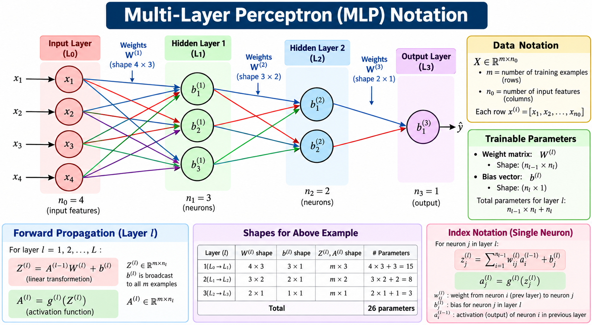

# 🧠 Multi-Layer Perceptron (MLP) Notation

> A practical reference for understanding the symbols, dimensions, forward propagation, and trainable parameters of a Multi-Layer Perceptron.

## 📑 Table of Contents

1. [MLP Architecture](#1-mlp-architecture)
2. [Data Notation](#2-data-notation)
3. [Layer and Neuron Notation](#3-layer-and-neuron-notation)
4. [Weights and Biases](#4-weights-and-biases)
5. [Forward Propagation](#5-forward-propagation)
6. [Single-Neuron Notation](#6-single-neuron-notation)
7. [Activation Functions](#7-activation-functions)
8. [Parameter Shapes and Counts](#8-parameter-shapes-and-counts)
9. [Worked Example](#9-worked-example)
10. [Notation Cheat Sheet](#10-notation-cheat-sheet)

---

## 1. MLP Architecture

A Multi-Layer Perceptron is a feedforward neural network made of an input layer, one or more hidden layers, and an output layer.

For the network shown in the diagram:

- Input features: 4
- First hidden layer: 3 neurons
- Second hidden layer: 2 neurons
- Output layer: 1 neuron

The layer sizes are:

$$
n_0 = 4, \qquad n_1 = 3, \qquad n_2 = 2, \qquad n_3 = 1
$$

Here, the input layer is indexed as layer 0. The trainable transformations are layers 1 through $L$.

---

## 2. Data Notation

Let the dataset contain $m$ training examples and $n_0$ input features.

$$
X \in \mathbb{R}^{m \times n_0}
$$

Where:

- $m$ = number of training examples (rows)
- $n_0$ = number of input features (columns)
- $X$ = complete input data matrix

The input for example $i$ is one row of the dataset:

$$
x^{(i)} = [x_1^{(i)}, x_2^{(i)}, \ldots, x_{n_0}^{(i)}]
$$

For the example network, $n_0 = 4$, so each example contains four features.

$$
x^{(i)} = [x_1^{(i)}, x_2^{(i)}, x_3^{(i)}, x_4^{(i)}]
$$

**Important:** In these notes, the examples are stored as rows. Therefore, the data matrix has shape $m \times n_0$.

---

## 3. Layer and Neuron Notation

| Symbol | Meaning |
|---|---|
| $l$ | Index of a trainable layer |
| $L$ | Number of trainable layers |
| $n_l$ | Number of neurons in layer $l$ |
| $n_0$ | Number of input features |
| $a^{(l)}$ | Activations produced by layer $l$ |
| $z^{(l)}$ | Linear or pre-activation values in layer $l$ |
| $a^{(0)}$ | Input activations, equal to $X$ |
| $\hat{Y}$ | Model predictions |

For the illustrated network, there are three trainable layers:

$$
L = 3
$$

The input activations are:

$$
A^{(0)} = X
$$

For a batch of $m$ examples, the activation matrix at layer $l$ has shape:

$$
A^{(l)} \in \mathbb{R}^{m \times n_l}
$$

The pre-activation matrix has the same shape:

$$
Z^{(l)} \in \mathbb{R}^{m \times n_l}
$$

---

## 4. Weights and Biases

Each trainable layer has a weight matrix and a bias vector.

### 4.1 Weight Matrix

The weight matrix connects neurons in the previous layer to neurons in the current layer.

$$
W^{(l)} \in \mathbb{R}^{n_{l-1} \times n_l}
$$

Its shape is:

$$
\text{Shape of } W^{(l)} = n_{l-1} \times n_l
$$

Here, $n_{l-1}$ is the number of inputs arriving from the previous layer, and $n_l$ is the number of neurons in the current layer.

### 4.2 Bias Vector

Each neuron in a trainable layer has one bias value.

$$
b^{(l)} \in \mathbb{R}^{n_l \times 1}
$$

When using row-wise batches, the bias vector is broadcast across all $m$ examples during forward propagation.

### 4.3 Trainable Parameters

The number of weights in layer $l$ is:

$$
n_{l-1} \times n_l
$$

The number of biases is:

$$
n_l
$$

Therefore, the total trainable parameters in layer $l$ are:

$$
P_l = n_{l-1}n_l + n_l
$$

Factoring this expression gives:

$$
P_l = (n_{l-1}+1)n_l
$$

---

## 5. Forward Propagation

Forward propagation computes predictions by passing input data through each layer.

For each trainable layer $l = 1, 2, \ldots, L$, the linear transformation is:

$$
Z^{(l)} = A^{(l-1)}W^{(l)} + b^{(l)}
$$

The activation function is then applied element-wise:

$$
A^{(l)} = g^{(l)}\left(Z^{(l)}\right)
$$

Where:

- $A^{(l-1)}$ = activations from the previous layer
- $W^{(l)}$ = weight matrix for the current layer
- $b^{(l)}$ = bias vector for the current layer
- $Z^{(l)}$ = pre-activation values
- $g^{(l)}$ = activation function used by the layer
- $A^{(l)}$ = output activations of the layer

### 5.1 Shape Check

For a batch of $m$ examples:

$$
A^{(l-1)}: \quad m \times n_{l-1}
$$

$$
W^{(l)}: \quad n_{l-1} \times n_l
$$

The matrix multiplication produces:

$$
A^{(l-1)}W^{(l)}: \quad m \times n_l
$$

After adding the broadcast bias:

$$
Z^{(l)}: \quad m \times n_l
$$

The activation matrix also has shape:

$$
A^{(l)}: \quad m \times n_l
$$

The dimensions match, so the forward propagation operation is valid.

---

## 6. Single-Neuron Notation

For neuron $j$ in layer $l$, its pre-activation value is:

$$
z_j^{(l)} =
\sum_{i=1}^{n_{l-1}}
a_i^{(l-1)}w_{ij}^{(l)}
+
b_j^{(l)}
$$

Its activation is:

$$
a_j^{(l)} = g^{(l)}\left(z_j^{(l)}\right)
$$

Where:

- $i$ = index of a neuron in the previous layer
- $j$ = index of a neuron in the current layer
- $w_{ij}^{(l)}$ = weight from previous-layer neuron $i$ to current-layer neuron $j$
- $b_j^{(l)}$ = bias of neuron $j$ in layer $l$
- $a_i^{(l-1)}$ = activation from previous-layer neuron $i$

### Example

For a neuron connected to four input features:

$$
z_j^{(1)} =
x_1w_{1j}^{(1)} +
x_2w_{2j}^{(1)} +
x_3w_{3j}^{(1)} +
x_4w_{4j}^{(1)} +
b_j^{(1)}
$$

The neuron's output is:

$$
a_j^{(1)} = g^{(1)}\left(z_j^{(1)}\right)
$$

---

## 7. Activation Functions

An activation function introduces non-linearity into a neural network.

| Function | Formula | Common use |
|---|---|---|
| ReLU | $g(z)=\max(0,z)$ | Hidden layers |
| Sigmoid | $g(z)=\frac{1}{1+e^{-z}}$ | Binary classification output |
| Tanh | $g(z)=\tanh(z)$ | Some hidden-layer designs |
| Softmax | $g(z_j)=\frac{e^{z_j}}{\sum_k e^{z_k}}$ | Multiclass classification output |
| Linear | $g(z)=z$ | Regression output |

### ReLU

$$
\operatorname{ReLU}(z) = \max(0,z)
$$

### Sigmoid

$$
\sigma(z) = \frac{1}{1+e^{-z}}
$$

### Softmax

For output class $j$ among $K$ classes:

$$
\operatorname{softmax}(z_j)
=
\frac{e^{z_j}}{\sum_{k=1}^{K}e^{z_k}}
$$

The output activation depends on the task. For example, sigmoid is common for binary classification, softmax for mutually exclusive multiclass classification, and a linear output for ordinary regression.

---

## 8. Parameter Shapes and Counts

For the architecture shown in the image:

$$
n_0=4,\qquad n_1=3,\qquad n_2=2,\qquad n_3=1
$$

| Layer | Connection | Weight shape | Bias shape | Activation shape | Parameters |
|---|---|---:|---:|---:|---:|
| 1 | Input → Hidden 1 | $4 \times 3$ | $3 \times 1$ | $m \times 3$ | $4(3)+3=15$ |
| 2 | Hidden 1 → Hidden 2 | $3 \times 2$ | $2 \times 1$ | $m \times 2$ | $3(2)+2=8$ |
| 3 | Hidden 2 → Output | $2 \times 1$ | $1 \times 1$ | $m \times 1$ | $2(1)+1=3$ |

The total number of trainable parameters is:

$$
P_{\text{total}} = 15 + 8 + 3 = 26
$$

In general:

$$
P_{\text{total}}
=
\sum_{l=1}^{L}
\left(n_{l-1}n_l+n_l\right)
$$

Or, equivalently:

$$
P_{\text{total}}
=
\sum_{l=1}^{L}(n_{l-1}+1)n_l
$$

---

## 9. Worked Example

Consider the first hidden layer, which has four input features and three neurons.

### Step 1: Identify the dimensions

$$
A^{(0)} \in \mathbb{R}^{m \times 4}
$$

$$
W^{(1)} \in \mathbb{R}^{4 \times 3}
$$

$$
b^{(1)} \in \mathbb{R}^{3 \times 1}
$$

### Step 2: Calculate the linear transformation

$$
Z^{(1)} = A^{(0)}W^{(1)}+b^{(1)}
$$

The result has shape:

$$
Z^{(1)} \in \mathbb{R}^{m \times 3}
$$

### Step 3: Apply the activation function

If ReLU is used:

$$
A^{(1)} = \operatorname{ReLU}(Z^{(1)})
$$

Thus:

$$
A^{(1)} \in \mathbb{R}^{m \times 3}
$$

### Step 4: Count the parameters

$$
P_1 = (4 \times 3)+3=15
$$

The first hidden layer contains 12 weights and 3 biases, giving 15 trainable parameters.

---

## 10. Notation Cheat Sheet

| Notation | Description | Typical shape |
|---|---|---|
| $X$ | Input dataset | $m \times n_0$ |
| $A^{(0)}$ | Input activations | $m \times n_0$ |
| $W^{(l)}$ | Layer $l$ weight matrix | $n_{l-1} \times n_l$ |
| $b^{(l)}$ | Layer $l$ bias vector | $n_l \times 1$ |
| $Z^{(l)}$ | Pre-activation matrix | $m \times n_l$ |
| $A^{(l)}$ | Activation matrix | $m \times n_l$ |
| $z_j^{(l)}$ | Pre-activation of neuron $j$ | Scalar |
| $a_j^{(l)}$ | Activation of neuron $j$ | Scalar |
| $w_{ij}^{(l)}$ | Connection weight from neuron $i$ to neuron $j$ | Scalar |
| $b_j^{(l)}$ | Bias of neuron $j$ | Scalar |
| $g^{(l)}$ | Activation function at layer $l$ | Function |
| $P_l$ | Parameters in layer $l$ | Scalar count |
| $P_{\text{total}}$ | Total trainable parameters | Scalar count |
| $\hat{Y}$ | Model predictions | Task-dependent |

---

## 11. Key Takeaways

- **Superscript $(l)$** identifies the layer; it is not an exponent.
- **Subscript $j$** identifies a neuron within a layer.
- **$Z^{(l)}$** stores values before the activation function.
- **$A^{(l)}$** stores values after the activation function.
- **$W^{(l)}$** connects layer $l-1$ to layer $l$.
- **$b^{(l)}$** contains one bias per neuron in layer $l$.
- For row-wise batches, $X$ has shape $m \times n_0$.
- The weight shape is $n_{l-1} \times n_l$.
- Each layer's parameter count is $(n_{l-1}+1)n_l$.
- The example network contains **26 trainable parameters**.

---

## 📚 Quick Revision

The two core equations of MLP forward propagation are:

$$
Z^{(l)} = A^{(l-1)}W^{(l)}+b^{(l)}
$$

$$
A^{(l)} = g^{(l)}\left(Z^{(l)}\right)
$$

The general parameter-count formula is:

$$
P_{\text{total}} =
\sum_{l=1}^{L}(n_{l-1}+1)n_l
$$

These formulas form the foundation for understanding MLP forward propagation and the dimensions of its trainable parameters.
