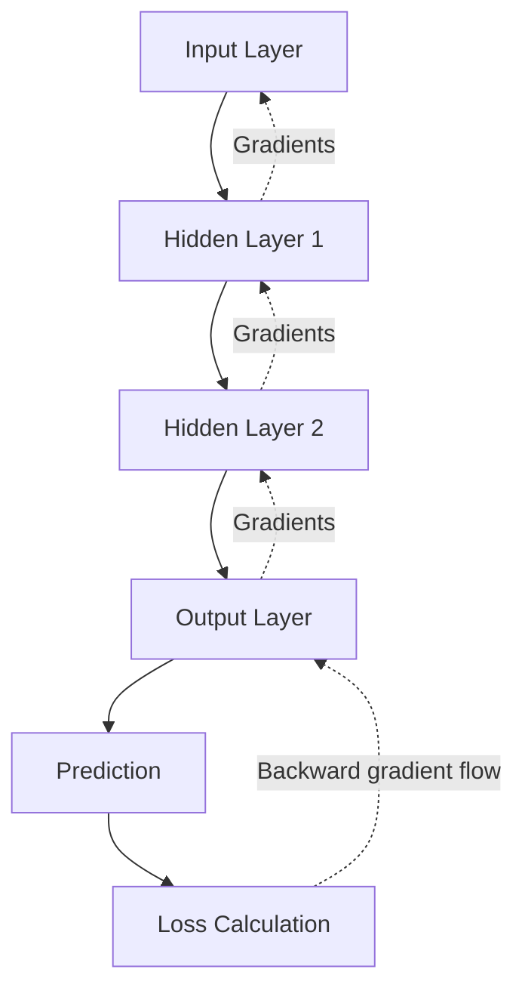
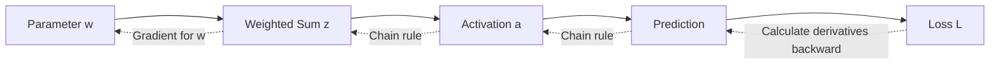
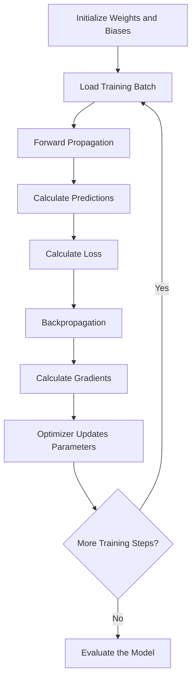
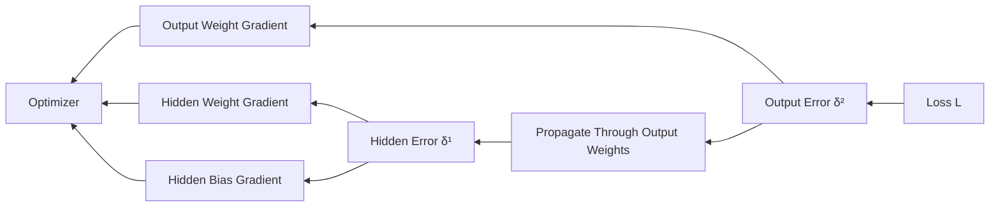
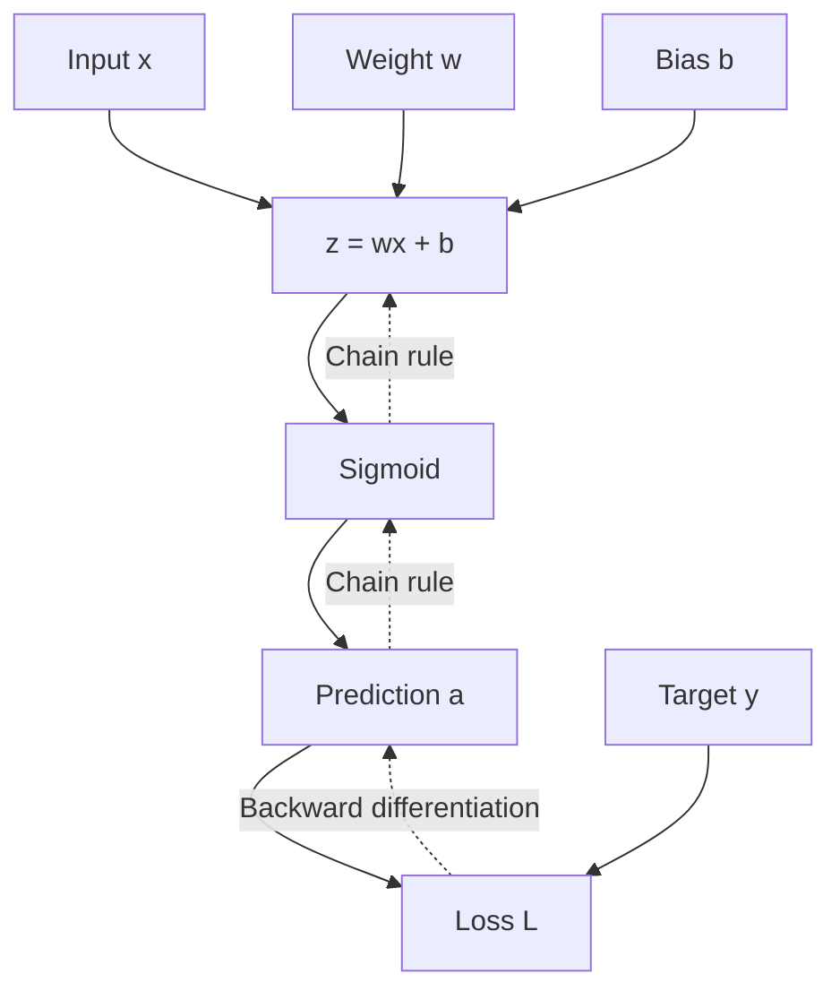
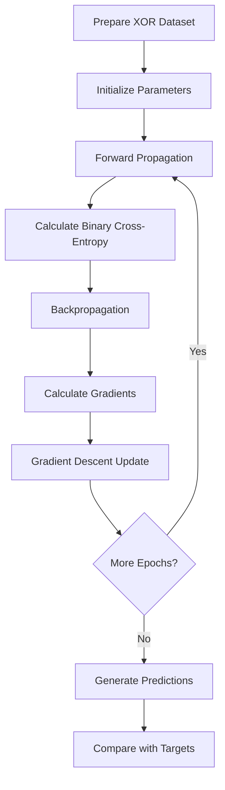
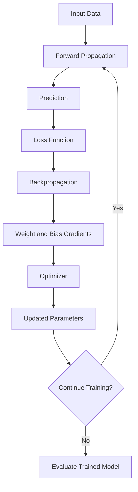
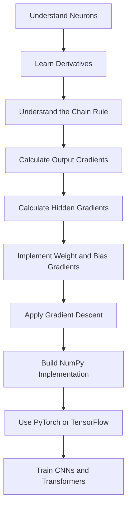

# ⬅️ Backpropagation in Neural Networks — Complete Notes

## 📚 Table of Contents

1. [Introduction to Backpropagation](#1--introduction-to-backpropagation)
2. [Why Backpropagation Is Important](#2--why-backpropagation-is-important)
3. [Fundamental Terminology](#3--fundamental-terminology)
4. [Prerequisites and Mathematical Foundations](#4--prerequisites-and-mathematical-foundations)
5. [The Chain Rule](#5--the-chain-rule)
6. [Complete Backpropagation Workflow](#6--complete-backpropagation-workflow)
7. [Loss Functions and Output-Layer Gradients](#7--loss-functions-and-output-layer-gradients)
8. [Backpropagation in a Single Neuron](#8--backpropagation-in-a-single-neuron)
9. [Backpropagation in a Multilayer Neural Network](#9--backpropagation-in-a-multilayer-neural-network)
10. [Important Backpropagation Formulas](#10--important-backpropagation-formulas)
11. [Complete Numerical Example](#11--complete-numerical-example)
12. [Backpropagation with Multiple Samples](#12--backpropagation-with-multiple-samples)
13. [Python Implementation from Scratch Using NumPy](#13--python-implementation-from-scratch-using-numpy)
14. [Backpropagation Using PyTorch](#14--backpropagation-using-pytorch)
15. [Backpropagation Using TensorFlow and Keras](#15--backpropagation-using-tensorflow-and-keras)
16. [Computational Graph and Automatic Differentiation](#16--computational-graph-and-automatic-differentiation)
17. [Backpropagation in Different Neural Network Architectures](#17--backpropagation-in-different-neural-network-architectures)
18. [Vanishing and Exploding Gradients](#18--vanishing-and-exploding-gradients)
19. [Gradient Descent and Parameter Updates](#19--gradient-descent-and-parameter-updates)
20. [Gradient Checking and Debugging](#20--gradient-checking-and-debugging)
21. [Advantages and Limitations](#21--advantages-and-limitations)
22. [Common Mistakes and Troubleshooting](#22--common-mistakes-and-troubleshooting)
23. [Best Practices](#23--best-practices)
24. [Practical Mini-Project: XOR Classification](#24--practical-mini-project-xor-classification)
25. [Interview Questions and Answers](#25--interview-questions-and-answers)
26. [Quick Revision](#26--quick-revision)

---

# 1. 🎯 Introduction to Backpropagation

## 1.1 What Is Backpropagation?

**Backpropagation**, short for backward propagation of errors, is an algorithm used to calculate the gradients of a neural network's loss function with respect to its trainable parameters.

It works by applying the chain rule of calculus to propagate derivative information backward through the computational graph.

These gradients indicate how the loss changes when the network's weights and biases change.

An optimizer, such as gradient descent or Adam, uses the calculated gradients to update the parameters.

### Definition

Backpropagation is an efficient gradient-computation algorithm that determines how each trainable parameter contributes to the loss of a neural network.

## 1.2 Why Is It Called Backpropagation?

During the forward pass, information flows from the input layer toward the output layer.

During backpropagation, gradient information starts at the loss and moves backward through the operations that produced the prediction.



The backward arrows represent the flow of derivatives, not a reversal of the original forward computation.

## 1.3 Main Objective

Backpropagation calculates derivatives such as:

$$
\frac{\partial L}{\partial w}
$$

and

$$
\frac{\partial L}{\partial b}
$$

Where:

- \(L\): Loss function.
- \(w\): Weight parameter.
- \(b\): Bias parameter.

These derivatives are used to determine suitable parameter updates.

## 1.4 Backpropagation vs. Forward Propagation

| Feature | Forward Propagation | Backpropagation |
|---|---|---|
| Main purpose | Calculate predictions | Calculate gradients |
| Direction | Input to output | Loss toward earlier operations |
| Main results | Activations and predictions | Weight and bias gradients |
| Uses weights and biases | Yes | Yes |
| Uses activation functions | Yes | Uses their derivatives |
| Requires a loss | Not for prediction alone | Yes, for loss gradients |
| Updates parameters | No | No, not by itself |
| Used during inference | Yes | Generally no |
| Used during gradient-based training | Yes | Yes |

**Important distinction:** Backpropagation calculates gradients. The optimizer updates the parameters.

---

# 2. 🧠 Why Backpropagation Is Important

A neural network may contain thousands, millions, or billions of trainable parameters. To train it, the learning algorithm needs to understand how each parameter affects the loss.

Calculating each derivative independently would be computationally expensive.

Backpropagation solves this problem by reusing intermediate derivatives and applying the chain rule systematically.

## 2.1 Main Purposes

- Calculate gradients for weights and biases.
- Efficiently train multilayer neural networks.
- Determine how errors propagate through hidden layers.
- Support gradient-based optimization.
- Enable training of CNNs, RNNs, transformers, and other differentiable architectures.
- Reduce the computational cost of calculating many parameter derivatives.

## 2.2 Real-World Analogy

Imagine a student answering a mathematics question.

1. The student produces an answer.
2. The teacher compares the answer with the correct answer.
3. The student examines which calculations contributed to the mistake.
4. The student adjusts their approach.
5. The student tries again.

In a neural network:

- Forward propagation produces the prediction.
- The loss function measures the prediction error.
- Backpropagation calculates how parameters influence that loss.
- The optimizer updates the parameters.

This analogy describes the training process, although backpropagation itself performs mathematical differentiation rather than reasoning about mistakes.

---

# 3. 📖 Fundamental Terminology

| Term | Symbol | Meaning |
|---|---|---|
| Loss | \(L\) | Numerical measure of prediction error |
| Gradient | \(\nabla_\theta L\) | Derivative of loss with respect to parameters |
| Weight | \(w\) | Trainable connection parameter |
| Bias | \(b\) | Trainable additive parameter |
| Logit | \(z\) | Raw model score before a probability transformation |
| Activation | \(a\) | Output of a neuron or layer |
| Error signal | \(\delta\) | Derivative of loss with respect to a neuron's pre-activation |
| Chain rule | — | Rule for differentiating composite functions |
| Learning rate | \(\eta\) | Controls the size of parameter updates |
| Optimizer | — | Algorithm that updates parameters |
| Computational graph | — | Representation of operations and dependencies |
| Epoch | — | One pass through the training dataset |
| Batch | — | Subset of training examples processed together |
| Gradient clipping | — | Technique for limiting large gradients |
| Automatic differentiation | — | Method for calculating derivatives through program operations |

## 3.1 What Is a Gradient?

A gradient measures how a function changes with respect to its inputs.

For a scalar parameter \(w\):

$$
\frac{\partial L}{\partial w}
$$

This derivative describes the local rate of change of the loss with respect to \(w\), holding other parameters fixed.

### Gradient Interpretation

| Gradient | Local Interpretation |
|---|---|
| Positive | Increasing the parameter slightly tends to increase the loss |
| Negative | Increasing the parameter slightly tends to decrease the loss |
| Zero | The first-order change is zero at the current point |
| Very small | The local loss is relatively insensitive to that parameter |
| Very large | The local loss is highly sensitive to that parameter |

These are local interpretations, not guarantees about large parameter changes.

## 3.2 What Is an Error Signal?

For layer \(l\), the error signal is commonly defined as:

$$
\boldsymbol{\delta}^{[l]}
=
\frac{\partial L}{\partial \mathbf{z}^{[l]}}
$$

It describes how the loss changes with respect to the pre-activation values of that layer.

The error signal is an intermediate quantity used to calculate gradients for the layer's weights, biases, and preceding activations.

---

# 4. 📐 Prerequisites and Mathematical Foundations

Backpropagation relies on derivatives, matrix operations, and the chain rule.

## 4.1 A Basic Neuron

A neuron computes a weighted sum:

$$
z=wx+b
$$

It then applies an activation function:

$$
a=f(z)
$$

For a loss \(L\), the training objective is to calculate:

$$
\frac{\partial L}{\partial w}
\qquad
\text{and}
\qquad
\frac{\partial L}{\partial b}
$$

## 4.2 Basic Derivatives

### Derivative of a Linear Function

If:

$$
y=wx+b
$$

Then:

$$
\frac{\partial y}{\partial w}=x
$$

and

$$
\frac{\partial y}{\partial b}=1
$$

### Derivative of ReLU

$$
\operatorname{ReLU}(z)=\max(0,z)
$$

Away from zero:

$$
\operatorname{ReLU}'(z)=
\begin{cases}
1, & z>0\\
0, & z<0
\end{cases}
$$

At zero, implementations choose a suitable subgradient convention.

### Derivative of Sigmoid

$$
\sigma(z)=\frac{1}{1+e^{-z}}
$$

Its derivative is:

$$
\sigma'(z)=\sigma(z)(1-\sigma(z))
$$

### Derivative of Tanh

$$
\tanh'(z)=1-\tanh^2(z)
$$

These derivatives are used to propagate gradients through activation functions.

---

# 5. 🔗 The Chain Rule

## 5.1 What Is the Chain Rule?

The chain rule is a calculus rule used to differentiate a composite function.

If:

$$
y=f(u)
$$

and

$$
u=g(x)
$$

then:

$$
\frac{dy}{dx}
=
\frac{dy}{du}
\frac{du}{dx}
$$

Backpropagation uses this principle to calculate how an early parameter influences the final loss through multiple intermediate operations.

## 5.2 Simple Example

Suppose:

$$
u=2x
$$

$$
y=u^2
$$

Substituting:

$$
y=(2x)^2=4x^2
$$

Direct differentiation gives:

$$
\frac{dy}{dx}=8x
$$

Using the chain rule:

$$
\frac{dy}{dx}
=
\frac{dy}{du}
\frac{du}{dx}
$$

Since:

$$
\frac{dy}{du}=2u
$$

and

$$
\frac{du}{dx}=2
$$

then:

$$
\frac{dy}{dx}=2u(2)=4u
$$

Because \(u=2x\):

$$
\frac{dy}{dx}=8x
$$

Both methods produce the same result.

## 5.3 Chain Rule in a Neural Network

Consider the sequence:

$$
w \rightarrow z \rightarrow a \rightarrow L
$$

The gradient with respect to the weight is:

$$
\frac{\partial L}{\partial w}
=
\frac{\partial L}{\partial a}
\frac{\partial a}{\partial z}
\frac{\partial z}{\partial w}
$$

This equation is the foundation of backpropagation.

## 5.4 Why the Chain Rule Makes Backpropagation Efficient

A deep neural network contains many connected operations.

Backpropagation calculates derivatives for later operations first, then reuses these results when computing derivatives for earlier operations.



This reuse avoids independently recalculating every complete derivative path.

---

# 6. 🔄 Complete Backpropagation Workflow

Backpropagation is one component of a larger neural network training process.

## 6.1 Training Workflow



## 6.2 Step-by-Step Explanation

### Step 1: Initialize Parameters

The network starts with initial weights and biases.

Initialization methods such as Xavier or He initialization are commonly used, depending on the architecture and activation functions.

### Step 2: Perform Forward Propagation

The input passes through the network to produce predictions.

$$
\hat{y}=f(x;\theta)
$$

Here, \(\theta\) represents all trainable parameters.

### Step 3: Calculate the Loss

The loss function measures the difference between the prediction and target.

For example, mean squared error is:

$$
L=(y-\hat{y})^2
$$

### Step 4: Calculate the Output Gradient

Calculate how the loss changes with respect to the output-layer values.

$$
\frac{\partial L}{\partial \hat{y}}
$$

The exact derivative depends on the selected loss function.

### Step 5: Propagate Gradients Backward

Use the chain rule to propagate derivatives through the output layer and hidden layers.

### Step 6: Calculate Parameter Gradients

Calculate the gradients of the loss with respect to weights and biases.

$$
\frac{\partial L}{\partial \mathbf{W}^{[l]}}
$$

$$
\frac{\partial L}{\partial \mathbf{b}^{[l]}}
$$

### Step 7: Update Parameters

The optimizer uses the gradients to modify the parameters.

For basic gradient descent:

$$
\theta_{\text{new}}
=
\theta_{\text{old}}
-
\eta\nabla_\theta L
$$

### Step 8: Repeat

The training process repeats across batches and epochs until the stopping criterion is met.

**Important:** Backpropagation calculates gradients; the optimizer performs the updates.

---

# 7. 📉 Loss Functions and Output-Layer Gradients

The output-layer gradient depends on the combination of output activation and loss function.

## 7.1 Mean Squared Error

For one sample:

$$
L=(y-\hat{y})^2
$$

The derivative with respect to the prediction is:

$$
\frac{\partial L}{\partial \hat{y}}
=
2(\hat{y}-y)
$$

For a batch of \(m\) examples using mean squared error:

$$
L_{\text{MSE}}
=
\frac{1}{m}
\sum_{i=1}^{m}
(\hat{y}_i-y_i)^2
$$

Then:

$$
\frac{\partial L_{\text{MSE}}}{\partial \hat{y}_i}
=
\frac{2}{m}(\hat{y}_i-y_i)
$$

## 7.2 Binary Cross-Entropy

For a binary target and a predicted probability:

$$
L=
-\left[
y\log(\hat{y})
+
(1-y)\log(1-\hat{y})
\right]
$$

Its derivative with respect to the probability is:

$$
\frac{\partial L}{\partial \hat{y}}
=
-\frac{y}{\hat{y}}
+
\frac{1-y}{1-\hat{y}}
$$

When sigmoid activation and binary cross-entropy are combined, the derivative with respect to the logit simplifies to:

$$
\frac{\partial L}{\partial z}
=
\hat{y}-y
$$

For mean loss across a batch, the gradient includes the corresponding averaging factor.

## 7.3 Multiclass Cross-Entropy

For a softmax output and one-hot targets, the derivative with respect to class logit \(z_k\) simplifies to:

$$
\frac{\partial L}{\partial z_k}
=
p_k-y_k
$$

For mean cross-entropy across multiple samples, average the corresponding per-example gradients.

## 7.4 Loss Function Comparison

| Loss Function | Task | Typical Output |
|---|---|---|
| Mean Squared Error | Regression | Linear output |
| Mean Absolute Error | Regression | Linear output |
| Binary Cross-Entropy | Binary classification | Sigmoid or logits-based loss |
| Categorical Cross-Entropy | Multiclass classification | Softmax or logits-based loss |
| Sparse Categorical Cross-Entropy | Multiclass classification with integer labels | Softmax or logits-based loss |

For numerical stability, logits-based loss functions are generally preferable when supported by the framework.

---

# 8. 🔢 Backpropagation in a Single Neuron

Consider a neuron with sigmoid activation and squared error loss.

Given:

$$
x=2,\quad w=0.5,\quad b=0.1
$$

Target:

$$
y=1
$$

## 8.1 Step 1: Forward Pass

Calculate the weighted sum:

$$
z=wx+b
$$

$$
z=(0.5)(2)+0.1=1.1
$$

Apply sigmoid:

$$
\hat{y}=\sigma(1.1)
$$

$$
\hat{y}\approx0.7503
$$

## 8.2 Step 2: Calculate the Loss

$$
L=(y-\hat{y})^2
$$

$$
L=(1-0.7503)^2
$$

$$
L\approx0.0624
$$

## 8.3 Step 3: Derivative of Loss with Respect to Prediction

$$
\frac{\partial L}{\partial \hat{y}}
=
2(\hat{y}-y)
$$

$$
\frac{\partial L}{\partial \hat{y}}
\approx-0.4994
$$

## 8.4 Step 4: Derivative of Sigmoid

$$
\frac{\partial \hat{y}}{\partial z}
=
\hat{y}(1-\hat{y})
$$

$$
\frac{\partial \hat{y}}{\partial z}
\approx0.7503(1-0.7503)
$$

$$
\frac{\partial \hat{y}}{\partial z}
\approx0.1874
$$

## 8.5 Step 5: Calculate the Error Signal

Using the chain rule:

$$
\frac{\partial L}{\partial z}
=
\frac{\partial L}{\partial \hat{y}}
\frac{\partial \hat{y}}{\partial z}
$$

$$
\frac{\partial L}{\partial z}
\approx(-0.4994)(0.1874)
$$

$$
\frac{\partial L}{\partial z}
\approx-0.0936
$$

## 8.6 Step 6: Calculate the Weight Gradient

Since:

$$
z=wx+b
$$

Then:

$$
\frac{\partial z}{\partial w}=x
$$

Therefore:

$$
\frac{\partial L}{\partial w}
=
\frac{\partial L}{\partial z}
\frac{\partial z}{\partial w}
$$

$$
\frac{\partial L}{\partial w}
=
(-0.0936)(2)
$$

$$
\boxed{\frac{\partial L}{\partial w}\approx-0.1872}
$$

## 8.7 Step 7: Calculate the Bias Gradient

Since:

$$
\frac{\partial z}{\partial b}=1
$$

Then:

$$
\frac{\partial L}{\partial b}
=
\frac{\partial L}{\partial z}
$$

$$
\boxed{\frac{\partial L}{\partial b}\approx-0.0936}
$$

## 8.8 Final Gradients

| Parameter | Gradient |
|---|---:|
| Weight \(w\) | Approximately \(-0.1872\) |
| Bias \(b\) | Approximately \(-0.0936\) |

These gradients can now be passed to an optimizer.

---

# 9. 🏗️ Backpropagation in a Multilayer Neural Network

Consider a network with one hidden layer and one output layer.

## 9.1 Forward Equations

Hidden layer:

$$
\mathbf{z}^{[1]}
=
\mathbf{W}^{[1]}\mathbf{x}
+
\mathbf{b}^{[1]}
$$

$$
\mathbf{a}^{[1]}
=
f^{[1]}(\mathbf{z}^{[1]})
$$

Output layer:

$$
\mathbf{z}^{[2]}
=
\mathbf{W}^{[2]}\mathbf{a}^{[1]}
+
\mathbf{b}^{[2]}
$$

$$
\hat{\mathbf{y}}
=
f^{[2]}(\mathbf{z}^{[2]})
$$

## 9.2 Output-Layer Error Signal

Define:

$$
\boldsymbol{\delta}^{[2]}
=
\frac{\partial L}{\partial \mathbf{z}^{[2]}}
$$

For sigmoid output with binary cross-entropy, the per-example output error is:

$$
\boldsymbol{\delta}^{[2]}
=
\hat{\mathbf{y}}-\mathbf{y}
$$

This simplified expression assumes the standard sigmoid-plus-binary-cross-entropy combination and a per-example loss. Batch reduction introduces its corresponding scaling.

## 9.3 Output-Layer Weight Gradient

The output layer receives the hidden activations as its input.

Its weight gradient is:

$$
\frac{\partial L}{\partial \mathbf{W}^{[2]}}
=
\boldsymbol{\delta}^{[2]}
\left(\mathbf{a}^{[1]}\right)^T
$$

The bias gradient is:

$$
\frac{\partial L}{\partial \mathbf{b}^{[2]}}
=
\boldsymbol{\delta}^{[2]}
$$

## 9.4 Propagate the Gradient to the Hidden Layer

First, calculate the derivative with respect to the hidden activation:

$$
\frac{\partial L}{\partial \mathbf{a}^{[1]}}
=
\left(\mathbf{W}^{[2]}\right)^T
\boldsymbol{\delta}^{[2]}
$$

Then apply the hidden activation derivative:

$$
\boldsymbol{\delta}^{[1]}
=
\left(\mathbf{W}^{[2]}\right)^T
\boldsymbol{\delta}^{[2]}
\odot
f'^{[1]}(\mathbf{z}^{[1]})
$$

Here, \(\odot\) means element-wise multiplication.

## 9.5 Hidden-Layer Weight Gradient

The hidden layer receives the original input vector.

Its weight gradient is:

$$
\frac{\partial L}{\partial \mathbf{W}^{[1]}}
=
\boldsymbol{\delta}^{[1]}\mathbf{x}^{T}
$$

Its bias gradient is:

$$
\frac{\partial L}{\partial \mathbf{b}^{[1]}}
=
\boldsymbol{\delta}^{[1]}
$$

## 9.6 Complete Backward Flow



The output-layer gradient is calculated first. The hidden-layer gradients are then computed using the error signal from the next layer.

---

# 10. 📌 Important Backpropagation Formulas

For layer \(l\), define the forward equations:

$$
\mathbf{z}^{[l]}
=
\mathbf{W}^{[l]}\mathbf{a}^{[l-1]}
+
\mathbf{b}^{[l]}
$$

$$
\mathbf{a}^{[l]}
=
f^{[l]}(\mathbf{z}^{[l]})
$$

## 10.1 Output-Layer Error Signal

The general formula is:

$$
\boldsymbol{\delta}^{[L]}
=
\frac{\partial L}{\partial \mathbf{z}^{[L]}}
$$

For an element-wise output activation:

$$
\boldsymbol{\delta}^{[L]}
=
\frac{\partial L}{\partial \mathbf{a}^{[L]}}
\odot
f'^{[L]}(\mathbf{z}^{[L]})
$$

For softmax with categorical cross-entropy, the combined derivative simplifies to the predicted probabilities minus the targets.

## 10.2 Hidden-Layer Error Signal

$$
\boldsymbol{\delta}^{[l]}
=
\left(\mathbf{W}^{[l+1]}\right)^T
\boldsymbol{\delta}^{[l+1]}
\odot
f'^{[l]}(\mathbf{z}^{[l]})
$$

This formula propagates the gradient from the next layer to the current layer.

## 10.3 Weight Gradient

$$
\boxed{
\frac{\partial L}{\partial \mathbf{W}^{[l]}}
=
\boldsymbol{\delta}^{[l]}
\left(\mathbf{a}^{[l-1]}\right)^T
}
$$

## 10.4 Bias Gradient

$$
\boxed{
\frac{\partial L}{\partial \mathbf{b}^{[l]}}
=
\boldsymbol{\delta}^{[l]}
}
$$

This bias-gradient formula is for a single example. For a batch, the error signals are summed or averaged over the batch according to the loss reduction.

## 10.5 Gradient Descent Update

$$
\mathbf{W}^{[l]}_{\text{new}}
=
\mathbf{W}^{[l]}_{\text{old}}
-
\eta
\frac{\partial L}{\partial \mathbf{W}^{[l]}}
$$

$$
\mathbf{b}^{[l]}_{\text{new}}
=
\mathbf{b}^{[l]}_{\text{old}}
-
\eta
\frac{\partial L}{\partial \mathbf{b}^{[l]}}
$$

## 10.6 General Gradient-Flow Relationship

For any differentiable operation, the gradient arriving from a later operation is multiplied by the appropriate local derivative to calculate the gradient for an earlier operation.

This principle applies throughout the computational graph, not only to dense neural network layers.

---

# 11. 🧮 Complete Numerical Example

Consider a neural network with:

- Two input features.
- Two hidden neurons.
- One sigmoid output neuron.
- ReLU activation in the hidden layer.
- Mean squared error for the output.

The example calculates the gradients for one training sample.

## 11.1 Given Inputs

$$
x_1=1,\qquad x_2=2
$$

Target:

$$
y=1
$$

Hidden-layer weights:

$$
\mathbf{W}^{[1]}
=
\begin{bmatrix}
0.1 & 0.3\\
0.2 & 0.4
\end{bmatrix}
$$

Hidden-layer biases:

$$
\mathbf{b}^{[1]}
=
\begin{bmatrix}
0.1\\
0.1
\end{bmatrix}
$$

Output-layer weights:

$$
\mathbf{W}^{[2]}
=
\begin{bmatrix}
0.5 & 0.6
\end{bmatrix}
$$

Output bias:

$$
b^{[2]}=0.2
$$

## 11.2 Step 1: Forward Propagation

The hidden-layer weighted sums are:

$$
z_1^{[1]}=(0.1)(1)+(0.3)(2)+0.1=0.8
$$

$$
z_2^{[1]}=(0.2)(1)+(0.4)(2)+0.1=1.1
$$

Apply ReLU:

$$
a_1^{[1]}=0.8,\qquad a_2^{[1]}=1.1
$$

The output logit is:

$$
z^{[2]}=(0.5)(0.8)+(0.6)(1.1)+0.2
$$

$$
z^{[2]}=1.26
$$

Apply sigmoid:

$$
\hat{y}=\sigma(1.26)
$$

$$
\hat{y}\approx0.7790
$$

## 11.3 Step 2: Calculate the Loss

$$
L=(y-\hat{y})^2
$$

$$
L=(1-0.7790)^2
$$

$$
L\approx0.0488
$$

## 11.4 Step 3: Output Error Signal

For squared error:

$$
\frac{\partial L}{\partial \hat{y}}
=
2(\hat{y}-y)
$$

Using the more precise prediction:

$$
\frac{\partial L}{\partial \hat{y}}
\approx-0.4420
$$

The sigmoid derivative is:

$$
\sigma'(z^{[2]})
=
\hat{y}(1-\hat{y})
$$

$$
\sigma'(z^{[2]})
\approx0.1722
$$

Therefore:

$$
\delta^{[2]}
=
\frac{\partial L}{\partial \hat{y}}
\sigma'(z^{[2]})
$$

$$
\delta^{[2]}
\approx-0.0761
$$

## 11.5 Step 4: Output-Layer Weight Gradients

For the first output weight:

$$
\frac{\partial L}{\partial w_1^{[2]}}
=
\delta^{[2]}a_1^{[1]}
$$

$$
\frac{\partial L}{\partial w_1^{[2]}}
\approx(-0.0761)(0.8)
$$

$$
\frac{\partial L}{\partial w_1^{[2]}}
\approx-0.0609
$$

For the second output weight:

$$
\frac{\partial L}{\partial w_2^{[2]}}
=
\delta^{[2]}a_2^{[1]}
$$

$$
\frac{\partial L}{\partial w_2^{[2]}}
\approx(-0.0761)(1.1)
$$

$$
\frac{\partial L}{\partial w_2^{[2]}}
\approx-0.0837
$$

The output bias gradient is:

$$
\frac{\partial L}{\partial b^{[2]}}
=
\delta^{[2]}
\approx-0.0761
$$

## 11.6 Step 5: Hidden-Layer Error Signals

For the first hidden neuron:

$$
\delta_1^{[1]}
=
w_1^{[2]}\delta^{[2]}
\operatorname{ReLU}'(z_1^{[1]})
$$

Since \(z_1^{[1]}=0.8>0\):

$$
\operatorname{ReLU}'(0.8)=1
$$

Therefore:

$$
\delta_1^{[1]}
\approx(0.5)(-0.0761)(1)
$$

$$
\delta_1^{[1]}\approx-0.0381
$$

For the second hidden neuron:

$$
\delta_2^{[1]}
=
w_2^{[2]}\delta^{[2]}
\operatorname{ReLU}'(z_2^{[1]})
$$

Since \(z_2^{[1]}=1.1>0\):

$$
\operatorname{ReLU}'(1.1)=1
$$

Therefore:

$$
\delta_2^{[1]}
\approx(0.6)(-0.0761)(1)
$$

$$
\delta_2^{[1]}\approx-0.0457
$$

## 11.7 Step 6: Hidden-Layer Weight Gradients

For the first hidden neuron:

$$
\frac{\partial L}{\partial w_{11}^{[1]}}
=
\delta_1^{[1]}x_1
$$

$$
\frac{\partial L}{\partial w_{11}^{[1]}}
\approx(-0.0381)(1)=-0.0381
$$

$$
\frac{\partial L}{\partial w_{12}^{[1]}}
=
\delta_1^{[1]}x_2
$$

$$
\frac{\partial L}{\partial w_{12}^{[1]}}
\approx(-0.0381)(2)=-0.0761
$$

For the second hidden neuron:

$$
\frac{\partial L}{\partial w_{21}^{[1]}}
=
\delta_2^{[1]}x_1
$$

$$
\frac{\partial L}{\partial w_{21}^{[1]}}
\approx-0.0457
$$

$$
\frac{\partial L}{\partial w_{22}^{[1]}}
=
\delta_2^{[1]}x_2
$$

$$
\frac{\partial L}{\partial w_{22}^{[1]}}
\approx-0.0913
$$

The hidden bias gradients are:

$$
\frac{\partial L}{\partial b_1^{[1]}}
=
\delta_1^{[1]}
\approx-0.0381
$$

$$
\frac{\partial L}{\partial b_2^{[1]}}
=
\delta_2^{[1]}
\approx-0.0457
$$

## 11.8 Summary of Gradients

| Parameter | Approximate Gradient |
|---|---:|
| Output weight 1 | -0.0609 |
| Output weight 2 | -0.0837 |
| Output bias | -0.0761 |
| Hidden weight 1, input 1 | -0.0381 |
| Hidden weight 1, input 2 | -0.0761 |
| Hidden weight 2, input 1 | -0.0457 |
| Hidden weight 2, input 2 | -0.0913 |
| Hidden bias 1 | -0.0381 |
| Hidden bias 2 | -0.0457 |

Values are rounded, so calculations using full precision may differ slightly.

## 11.9 Interpretation

Backpropagation has calculated how the loss changes with respect to every weight and bias.

The optimizer can now use these gradients to update all trainable parameters.

Because this example uses a single sample, the gradients are per-example gradients rather than batch averages.

---

# 12. 📦 Backpropagation with Multiple Samples

Training usually processes a batch of examples rather than one example at a time.

## 12.1 Batch Loss

For \(m\) examples, mean squared error is:

$$
L=
\frac{1}{m}
\sum_{i=1}^{m}
(\hat{y}_i-y_i)^2
$$

The gradient with respect to a parameter is the average of the corresponding per-example gradients:

$$
\frac{\partial L}{\partial \theta}
=
\frac{1}{m}
\sum_{i=1}^{m}
\frac{\partial L_i}{\partial \theta}
$$

This formula assumes the loss is the mean of the per-example losses and there are no additional batch-coupled operations affecting the derivative.

## 12.2 Matrix-Based Gradients

For a dense layer using a batch of \(m\) examples arranged as rows:

$$
\mathbf{Z}=\mathbf{X}\mathbf{W}+\mathbf{b}
$$

Let:

$$
\mathbf{D}=\frac{\partial L}{\partial \mathbf{Z}}
$$

Then the weight gradient is:

$$
\frac{\partial L}{\partial \mathbf{W}}
=
\mathbf{X}^{T}\mathbf{D}
$$

The bias gradient is:

$$
\frac{\partial L}{\partial \mathbf{b}}
=
\sum_{i=1}^{m}\mathbf{D}_{i,:}
$$

The preceding activation gradient is:

$$
\frac{\partial L}{\partial \mathbf{X}}
=
\mathbf{D}\mathbf{W}^{T}
$$

When \(L\) is a mean batch loss, the averaging factor is already reflected in \(\mathbf{D}\).

## 12.3 Why Batch Processing Is Useful

- Efficient matrix computation.
- Better hardware utilization.
- More stable gradient estimates than single-example updates in many settings.
- Easier integration with GPU-accelerated frameworks.

The batch size affects memory consumption and optimization behavior.

---

# 13. 🐍 Python Implementation from Scratch Using NumPy

This example implements forward propagation and backpropagation manually to solve the XOR classification problem.

## 13.1 XOR Dataset

| Input 1 | Input 2 | Target |
|---:|---:|---:|
| 0 | 0 | 0 |
| 0 | 1 | 1 |
| 1 | 0 | 1 |
| 1 | 1 | 0 |

XOR is not linearly separable, so a single linear neuron cannot represent it perfectly. A nonlinear hidden layer enables the network to learn the pattern.

## 13.2 Complete Code

```python
import numpy as np

np.random.seed(42)

# XOR input data
X = np.array([
    [0.0, 0.0],
    [0.0, 1.0],
    [1.0, 0.0],
    [1.0, 1.0]
])

y = np.array([
    [0.0],
    [1.0],
    [1.0],
    [0.0]
])

# Architecture: 2 input features, 4 hidden neurons, 1 output
input_size = 2
hidden_size = 4
output_size = 1

# Parameter initialization
W1 = np.random.randn(input_size, hidden_size) * 0.5
b1 = np.zeros((1, hidden_size))

W2 = np.random.randn(hidden_size, output_size) * 0.5
b2 = np.zeros((1, output_size))

learning_rate = 0.5
epochs = 20000
epsilon = 1e-9


def tanh(z):
    return np.tanh(z)


def sigmoid(z):
    z = np.clip(z, -500, 500)
    return 1.0 / (1.0 + np.exp(-z))


for epoch in range(epochs):

    # --------------------------------
    # 1. Forward propagation
    # --------------------------------
    Z1 = X @ W1 + b1
    A1 = tanh(Z1)

    Z2 = A1 @ W2 + b2
    A2 = sigmoid(Z2)

    # --------------------------------
    # 2. Binary cross-entropy loss
    # --------------------------------
    loss = -np.mean(
        y * np.log(A2 + epsilon)
        + (1 - y) * np.log(1 - A2 + epsilon)
    )

    # --------------------------------
    # 3. Backpropagation
    # --------------------------------

    # Output gradient:
    # Sigmoid + binary cross-entropy
    dZ2 = (A2 - y) / len(X)

    # Output-layer gradients
    dW2 = A1.T @ dZ2
    db2 = np.sum(dZ2, axis=0, keepdims=True)

    # Gradient flowing into hidden activations
    dA1 = dZ2 @ W2.T

    # Derivative of tanh
    dZ1 = dA1 * (1 - A1**2)

    # Hidden-layer gradients
    dW1 = X.T @ dZ1
    db1 = np.sum(dZ1, axis=0, keepdims=True)

    # --------------------------------
    # 4. Parameter updates
    # --------------------------------
    W2 -= learning_rate * dW2
    b2 -= learning_rate * db2

    W1 -= learning_rate * dW1
    b1 -= learning_rate * db1

    if epoch % 2000 == 0:
        print(f"Epoch {epoch:5d} | Loss: {loss:.6f}")


# Final forward pass
A1 = tanh(X @ W1 + b1)
probabilities = sigmoid(A1 @ W2 + b2)
predictions = (probabilities >= 0.5).astype(int)

print("\nFinal probabilities:")
print(probabilities)

print("\nPredicted classes:")
print(predictions)

print("\nActual classes:")
print(y.astype(int))
```

## 13.3 Explanation of Important Lines

| Code | Explanation |
|---|---|
| `Z1 = X @ W1 + b1` | Hidden-layer weighted sums |
| `A1 = tanh(Z1)` | Hidden-layer activations |
| `Z2 = A1 @ W2 + b2` | Output logits |
| `A2 = sigmoid(Z2)` | Output probabilities |
| `dZ2 = (A2 - y) / len(X)` | Output error signal for mean binary cross-entropy |
| `dW2 = A1.T @ dZ2` | Output weight gradients |
| `dA1 = dZ2 @ W2.T` | Gradient flowing into the hidden activations |
| `dZ1 = dA1 * (1 - A1**2)` | Hidden error signal |
| `dW1 = X.T @ dZ1` | Hidden weight gradients |
| `W1 -= learning_rate * dW1` | Hidden weight update |

The code demonstrates how gradients move backward through the output layer and hidden layer.

Convergence depends on initialization, learning rate, and the number of training iterations.

---

# 14. 🔥 Backpropagation Using PyTorch

PyTorch provides automatic differentiation through its autograd system.

You define the forward computation and loss; PyTorch calculates the gradients.

## 14.1 Complete Example

```python
import torch
import torch.nn as nn
import torch.optim as optim

torch.manual_seed(42)

# XOR dataset
X = torch.tensor([
    [0.0, 0.0],
    [0.0, 1.0],
    [1.0, 0.0],
    [1.0, 1.0]
])

y = torch.tensor([
    [0.0],
    [1.0],
    [1.0],
    [0.0]
])

# Neural network
model = nn.Sequential(
    nn.Linear(2, 8),
    nn.Tanh(),
    nn.Linear(8, 1)
)

# Logits-based binary classification loss
criterion = nn.BCEWithLogitsLoss()

# Optimizer
optimizer = optim.Adam(
    model.parameters(),
    lr=0.03
)

epochs = 5000

for epoch in range(epochs):

    # Forward propagation
    logits = model(X)

    # Calculate loss
    loss = criterion(logits, y)

    # Clear previous gradients
    optimizer.zero_grad()

    # Backpropagation
    loss.backward()

    # Update parameters
    optimizer.step()

    if epoch % 1000 == 0:
        print(
            f"Epoch {epoch:4d} | "
            f"Loss: {loss.item():.6f}"
        )

# Inference
model.eval()

with torch.no_grad():
    probabilities = torch.sigmoid(model(X))
    predictions = (probabilities >= 0.5).int()

print("\nProbabilities:")
print(probabilities)

print("\nPredictions:")
print(predictions)
```

## 14.2 Important PyTorch Commands

| Command | Purpose |
|---|---|
| `model(X)` | Performs forward propagation |
| `criterion(logits, y)` | Calculates the loss |
| `optimizer.zero_grad()` | Clears previous gradients |
| `loss.backward()` | Computes gradients using automatic differentiation |
| `optimizer.step()` | Updates parameters |
| `model.eval()` | Switches to evaluation behavior |
| `torch.no_grad()` | Disables gradient recording |

## 14.3 How `loss.backward()` Works

When you call:

```python
loss.backward()
```

PyTorch traverses the recorded computational graph in reverse and calculates the gradients of the loss with respect to the relevant trainable tensors.

The gradients are typically stored in each parameter's `.grad` attribute.

Example:

```python
for name, parameter in model.named_parameters():
    if parameter.grad is not None:
        print(name, parameter.grad.norm().item())
```

This can help inspect whether gradients are present and whether their magnitudes appear reasonable.

---

# 15. 🧰 Backpropagation Using TensorFlow and Keras

TensorFlow provides automatic differentiation through `tf.GradientTape`.

## 15.1 Example Using GradientTape

```python
import tensorflow as tf

# Create trainable parameters
w = tf.Variable(3.0)
b = tf.Variable(1.0)

# Input
x = tf.constant(2.0)

# Target
y = tf.constant(10.0)

with tf.GradientTape() as tape:

    # Forward propagation
    prediction = w * x + b

    # Mean squared error for one example
    loss = tf.square(prediction - y)

# Backpropagation
gradients = tape.gradient(loss, [w, b])

print("Prediction:", prediction.numpy())
print("Loss:", loss.numpy())
print("Gradient of w:", gradients[0].numpy())
print("Gradient of b:", gradients[1].numpy())
```

## 15.2 Mathematical Verification

The forward calculation is:

$$
\hat{y}=wx+b
$$

$$
\hat{y}=3(2)+1=7
$$

The loss is:

$$
L=(7-10)^2=9
$$

The gradients are:

$$
\frac{\partial L}{\partial w}
=
2(\hat{y}-y)x
$$

$$
\frac{\partial L}{\partial w}
=
2(7-10)(2)=-12
$$

For the bias:

$$
\frac{\partial L}{\partial b}
=
2(\hat{y}-y)
$$

$$
\frac{\partial L}{\partial b}
=
2(7-10)=-6
$$

Expected values:

```text
Prediction: 7.0
Loss: 9.0
Gradient of w: -12.0
Gradient of b: -6.0
```

## 15.3 Manual Gradient Calculation vs. Automatic Differentiation

| Feature | Manual NumPy | PyTorch / TensorFlow |
|---|---|---|
| Forward pass | Implemented manually | Defined with framework operations |
| Derivatives | Calculated manually | Calculated automatically |
| Optimizer | Implemented manually | Provided by framework |
| Best use | Learning mathematical foundations | Training practical models |
| Risk of derivative errors | Higher | Lower, but model-logic errors remain possible |

---

# 16. 🕸️ Computational Graph and Automatic Differentiation

## 16.1 What Is a Computational Graph?

A computational graph represents the operations used to calculate a result and the dependencies between those operations.

For example:

$$
z=wx+b
$$

$$
a=\sigma(z)
$$

$$
L=(a-y)^2
$$

The graph records how the loss depends on the weight, bias, and input.



## 16.2 Automatic Differentiation

Automatic differentiation computes derivatives by applying derivative rules to operations in a computational graph.

It differs from:

- **Symbolic differentiation:** Produces symbolic derivative expressions.
- **Numerical differentiation:** Estimates derivatives through small numerical perturbations.
- **Automatic differentiation:** Combines local derivative rules to compute derivatives of the executed operations.

Backpropagation is a form of reverse-mode automatic differentiation commonly used for neural-network training.

## 16.3 Why Reverse-Mode Differentiation Is Useful

Neural networks usually have many parameters but a scalar loss.

Reverse-mode differentiation calculates gradients of the scalar loss with respect to many parameters efficiently.

## 16.4 Computational Graph vs. Neural Network Architecture

A neural network architecture describes the layers and connections of a model.

A computational graph describes the operations actually used to calculate a result.

For complex architectures, the computational graph may contain operations beyond simple neuron-to-neuron connections, including normalization, attention, residual additions, and reshaping.

---

# 17. 🏛️ Backpropagation in Different Neural Network Architectures

## 17.1 Multilayer Perceptron

MLPs use dense layers.

Backpropagation computes the gradients of the loss with respect to their weights and biases using matrix operations and activation derivatives.

Applications:

- Tabular classification.
- Regression.
- General-purpose prediction.

## 17.2 Convolutional Neural Networks

CNNs use convolution filters to extract local patterns.

Backpropagation calculates gradients for:

- Convolution filters.
- Biases.
- Earlier feature maps.
- Dense layers, when present.

Applications:

- Image classification.
- Object detection.
- Medical image analysis.

## 17.3 Recurrent Neural Networks

RNNs maintain hidden states across time steps.

Backpropagation Through Time (BPTT) applies gradient computation across the unrolled sequence.

A simplified recurrent operation is:

$$
\mathbf{h}_t
=
f\left(
\mathbf{W}_x\mathbf{x}_t
+
\mathbf{W}_h\mathbf{h}_{t-1}
+
\mathbf{b}
\right)
$$

The loss gradient can flow through earlier hidden states.

Applications:

- Time-series prediction.
- Sequential classification.
- Traditional recurrent language models.

## 17.4 LSTM and GRU

LSTM and GRU networks use gates to control the flow of information across time steps.

Backpropagation calculates gradients through the gates and state updates.

These architectures can help preserve useful information over longer sequences, but do not eliminate all gradient instability.

## 17.5 Transformers

Transformers use self-attention and feed-forward layers.

Backpropagation calculates gradients through attention scores, softmax, value aggregation, projections, normalization, and residual connections.

Applications:

- Large language models.
- Machine translation.
- Text classification.
- Vision transformers.
- Multimodal AI.

## 17.6 Architecture Comparison

| Architecture | Forward Operation | Gradient Computation |
|---|---|---|
| MLP | Dense transformations | Standard backpropagation |
| CNN | Convolutions and activations | Gradients through convolution operations |
| RNN | Recurrent state updates | Backpropagation Through Time |
| LSTM/GRU | Gated recurrent updates | Backpropagation Through Time |
| Transformer | Attention and feed-forward operations | Reverse-mode automatic differentiation |
| Autoencoder | Encoder and decoder | Backpropagation through both components |

---

# 18. ⚠️ Vanishing and Exploding Gradients

## 18.1 Vanishing Gradients

Vanishing gradients occur when gradient magnitudes become very small as they propagate through many layers or time steps.

Consequences:

- Earlier layers learn slowly.
- Parameter updates become very small.
- Deep networks may be difficult to optimize.

Common causes:

- Saturating activation functions.
- Poor initialization.
- Long chains of small derivatives.
- Deep or recurrent architectures.

Possible solutions:

- Suitable weight initialization.
- ReLU-family or other appropriate activations.
- Residual connections.
- Normalization where appropriate.
- Gated recurrent architectures for sequence modeling.

## 18.2 Exploding Gradients

Exploding gradients occur when gradient magnitudes become excessively large.

Consequences:

- Unstable parameter updates.
- Large loss fluctuations.
- Numerical overflow or `NaN` values.

Possible solutions:

- Gradient clipping.
- Appropriate learning rates.
- Suitable initialization.
- Monitoring gradient norms.
- Architecture and normalization choices appropriate to the model.

## 18.3 Gradient Clipping

A commonly used norm-based clipping rule is:

$$
\mathbf{g}_{\text{clipped}}
=
\mathbf{g}
\min\left(1,\frac{\tau}{\|\mathbf{g}\|}\right)
$$

Where:

- \(\mathbf{g}\): Original gradient.
- \(\tau\): Maximum gradient norm.
- \(\mathbf{g}_{\text{clipped}}\): Clipped gradient.

In PyTorch:

```python
torch.nn.utils.clip_grad_norm_(
    model.parameters(),
    max_norm=1.0
)
```

Apply this after `loss.backward()` and before `optimizer.step()`.

---

# 19. 📈 Gradient Descent and Parameter Updates

Backpropagation provides gradients, while an optimizer uses them to update parameters.

## 19.1 Gradient Descent

For a parameter \(\theta\):

$$
\theta_{\text{new}}
=
\theta_{\text{old}}
-
\eta\frac{\partial L}{\partial\theta}
$$

Where \(\eta\) is the learning rate.

## 19.2 Numerical Example

Suppose:

$$
w=0.5
$$

$$
\frac{\partial L}{\partial w}=-0.2
$$

$$
\eta=0.1
$$

The update is:

$$
w_{\text{new}}
=
0.5-(0.1)(-0.2)
$$

$$
w_{\text{new}}=0.52
$$

The weight increases because its gradient is negative.

## 19.3 Common Optimizers

| Optimizer | Main Idea |
|---|---|
| SGD | Uses the gradient for parameter updates |
| Momentum | Uses a running direction estimate |
| RMSprop | Adapts updates using squared-gradient statistics |
| Adam | Combines first- and second-moment estimates |
| AdamW | Uses decoupled weight decay with Adam-style updates |

## 19.4 Complete Training Step

```python
# Forward propagation
predictions = model(X_batch)

# Calculate loss
loss = criterion(predictions, y_batch)

# Clear previous gradients
optimizer.zero_grad()

# Backpropagation
loss.backward()

# Optional gradient clipping
torch.nn.utils.clip_grad_norm_(
    model.parameters(),
    max_norm=1.0
)

# Update parameters
optimizer.step()
```

Gradient clipping is optional and should be used when appropriate for the model and training behavior.

---

# 20. 🧪 Gradient Checking and Debugging

Gradient checking helps verify whether manually implemented gradients are correct.

## 20.1 Numerical Gradient Approximation

For a scalar parameter \(\theta\), a central finite-difference approximation is:

$$
\frac{\partial L}{\partial\theta}
\approx
\frac{L(\theta+\epsilon)-L(\theta-\epsilon)}
{2\epsilon}
$$

Where \(\epsilon\) is a small perturbation.

## 20.2 Why Gradient Checking Is Useful

It helps identify:

- Incorrect derivatives.
- Missing chain-rule terms.
- Shape and broadcasting errors.
- Incorrect loss scaling.
- Bugs in manually implemented backpropagation.

## 20.3 Practical Example

```python
import numpy as np

def loss_function(w):
    return (w**2 + 3*w + 2)

w = 2.0
epsilon = 1e-5

# Numerical gradient
numerical_gradient = (
    loss_function(w + epsilon)
    - loss_function(w - epsilon)
) / (2 * epsilon)

# Analytical gradient
analytical_gradient = 2*w + 3

print("Numerical gradient:", numerical_gradient)
print("Analytical gradient:", analytical_gradient)
```

Expected result:

```text
Numerical gradient: approximately 7.0
Analytical gradient: 7.0
```

For real neural networks, use a small test model and double precision when checking gradients.

---

# 21. ⚖️ Advantages and Limitations

## 21.1 Advantages

1. **Efficient gradient computation:** Reuses intermediate derivatives.
2. **Scalability:** Supports networks with many trainable parameters.
3. **Broad applicability:** Works with dense layers, convolutions, attention, and many other differentiable operations.
4. **Optimizer integration:** Provides gradients for SGD, Adam, and other optimization algorithms.
5. **Framework support:** PyTorch and TensorFlow automate derivative calculations.
6. **End-to-end learning:** Enables trainable components to be optimized jointly through a differentiable computation.

## 21.2 Limitations

1. **Vanishing gradients:** Gradients can become too small.
2. **Exploding gradients:** Gradients can become too large.
3. **Memory consumption:** Training may require storing intermediate activations.
4. **Differentiability requirements:** Standard backpropagation works most naturally with differentiable operations or suitable subgradient rules.
5. **Optimization challenges:** Correct gradients do not guarantee a global optimum.
6. **Data dependence:** Backpropagation cannot compensate for inadequate or unrepresentative training data.
7. **Implementation errors:** Incorrect tensor shapes, derivatives, or loss scaling can cause training problems.
8. **Computational expense:** Large models can require substantial hardware and energy.

## 21.3 Backpropagation vs. Gradient Descent

| Feature | Backpropagation | Gradient Descent |
|---|---|---|
| Main responsibility | Calculate gradients | Update parameters |
| Uses derivatives | Yes | Uses calculated gradients |
| Changes parameters | No, not by itself | Yes |
| Depends on a loss | Yes | Uses the loss gradients |
| Role in training | Gradient computation | Optimization |

---

# 22. 🛠️ Common Mistakes and Troubleshooting

## 22.1 Forgetting to Clear Gradients

PyTorch accumulates gradients by default.

Incorrect:

```python
loss.backward()
optimizer.step()
```

Correct training pattern:

```python
optimizer.zero_grad()
loss.backward()
optimizer.step()
```

## 22.2 Using the Wrong Derivative

For sigmoid:

$$
\sigma'(z)=\sigma(z)(1-\sigma(z))
$$

For tanh:

$$
\tanh'(z)=1-\tanh^2(z)
$$

Using an incorrect activation derivative produces incorrect gradients.

## 22.3 Applying Sigmoid Before a Logits-Based Loss

`BCEWithLogitsLoss` expects raw logits.

Correct:

```python
logits = model(X)
loss = criterion(logits, y)
```

Do not apply sigmoid before passing the output to this loss.

## 22.4 Confusing Gradients with Updated Parameters

`loss.backward()` calculates gradients but does not ordinarily update weights.

The optimizer performs the update.

## 22.5 Incorrect Batch Scaling

A batch loss may be defined as a sum or a mean.

The gradient magnitude depends on that choice, so the loss reduction and learning rate must be consistent with the implementation.

## 22.6 Incorrect Tensor Shapes

Gradient calculations require compatible tensor dimensions.

Check the shapes of:

- Predictions.
- Targets.
- Weight matrices.
- Bias vectors.
- Intermediate activations.
- Gradients.

## 22.7 Troubleshooting Table

| Symptom | Possible Cause | Recommended Action |
|---|---|---|
| Loss does not decrease | Incorrect gradients or learning rate | Inspect loss and gradient values |
| Gradients are always zero | Saturating activation or disconnected graph | Inspect activation values and graph connectivity |
| Gradients are extremely large | Exploding gradients | Inspect gradient norms and consider clipping |
| Loss becomes `NaN` | Numerical instability | Check input ranges, loss functions, and learning rate |
| Parameters do not change | Optimizer not called or gradients missing | Check `.grad` values and `optimizer.step()` |
| Gradients seem unexpectedly large | Accumulation or incorrect scaling | Clear gradients and verify loss reduction |
| Manual gradients differ from autograd | Derivative or implementation bug | Perform gradient checking |

---

# 23. ✅ Best Practices

## 23.1 Mathematical Best Practices

- Understand the chain rule before implementing backpropagation.
- Separate pre-activations from activations.
- Derive output-layer gradients from the actual loss function.
- Keep matrix dimensions consistent.
- Verify gradients on a small example.
- Account for the batch loss reduction.

## 23.2 Training Best Practices

- Start with suitable parameter initialization.
- Use an appropriate optimizer and learning rate.
- Clear gradients before each new training step.
- Monitor training and validation loss.
- Inspect gradient norms when training becomes unstable.
- Use gradient clipping when justified.
- Save checkpoints and record training configurations.

## 23.3 Debugging Best Practices

- Begin with a tiny dataset.
- Compare analytical and numerical gradients for manual implementations.
- Check for missing gradients.
- Verify that parameters actually change.
- Inspect intermediate activations.
- Confirm that the model and loss function use compatible output formats.
- Test whether the model can overfit a small dataset before scaling up.

## 23.4 Evaluation Best Practices

- Separate training, validation, and test data.
- Avoid preprocessing leakage.
- Select metrics appropriate to the task.
- Inspect per-class performance for imbalanced datasets.
- Do not assume decreasing training loss guarantees generalization.

---

# 24. 🧪 Practical Mini-Project: XOR Classification

## 24.1 Objective

Build a neural network that learns the XOR function using forward propagation, backpropagation, and gradient descent.

## 24.2 Requirements

- Python 3.9 or later.
- NumPy.
- Basic knowledge of matrix multiplication.
- Understanding of activation and loss functions.

Install NumPy:

```bash
pip install numpy
```

## 24.3 Project Workflow



## 24.4 Expected Learning Outcomes

After completing the project, you should be able to:

1. Implement forward propagation manually.
2. Derive and calculate gradients.
3. Understand output and hidden-layer error signals.
4. Update weights and biases.
5. Observe the loss decrease during training.
6. Understand why a nonlinear hidden layer is useful for XOR.
7. Compare manual differentiation with framework-based automatic differentiation.

## 24.5 Suggested Extensions

- Replace tanh with ReLU.
- Compare sigmoid and tanh hidden activations.
- Experiment with different learning rates.
- Plot loss against training epochs.
- Compare manual gradients with PyTorch autograd.
- Implement gradient clipping.
- Add a validation dataset to a larger classification experiment.

---

# 25. 🎤 Interview Questions and Answers

## Q1. What is backpropagation?

Backpropagation is an algorithm that calculates the gradients of a neural network's loss with respect to its trainable parameters using the chain rule.

## Q2. Why is backpropagation needed?

It efficiently determines how weights and biases influence the loss, enabling gradient-based optimization.

## Q3. What is the chain rule?

The chain rule calculates derivatives of composite functions by multiplying the relevant local derivatives.

$$
\frac{dy}{dx}
=
\frac{dy}{du}
\frac{du}{dx}
$$

## Q4. Does backpropagation update weights?

No. It calculates gradients. An optimizer uses those gradients to update the parameters.

## Q5. What is an error signal?

An error signal is commonly defined as the derivative of the loss with respect to a layer's pre-activation.

$$
\boldsymbol{\delta}^{[l]}
=
\frac{\partial L}{\partial\mathbf{z}^{[l]}}
$$

## Q6. What is the weight-gradient formula for a dense layer?

For one example using column vectors:

$$
\frac{\partial L}{\partial\mathbf{W}^{[l]}}
=
\boldsymbol{\delta}^{[l]}
\left(\mathbf{a}^{[l-1]}\right)^T
$$

## Q7. What is the bias-gradient formula?

For one example:

$$
\frac{\partial L}{\partial\mathbf{b}^{[l]}}
=
\boldsymbol{\delta}^{[l]}
$$

For a batch, sum or average the per-example error signals according to the loss reduction.

## Q8. What is the vanishing-gradient problem?

It occurs when gradients become extremely small as they propagate through a deep network or long sequence, making earlier parameters difficult to train.

## Q9. What is the exploding-gradient problem?

It occurs when gradient magnitudes become excessively large, causing unstable updates.

## Q10. How can exploding gradients be controlled?

Possible approaches include gradient clipping, suitable initialization, appropriate learning rates, and architecture choices that improve gradient flow.

## Q11. What is automatic differentiation?

Automatic differentiation calculates derivatives by combining local derivative rules through a computational graph.

## Q12. What is the difference between automatic and numerical differentiation?

Automatic differentiation calculates derivatives through program operations. Numerical differentiation estimates derivatives using small perturbations.

## Q13. What is Backpropagation Through Time?

BPTT applies gradient computation through the unrolled time steps of recurrent networks.

## Q14. Why is sigmoid combined with binary cross-entropy?

The combination gives a simple output-logit gradient:

$$
\frac{\partial L}{\partial z}=\hat{y}-y
$$

It is also commonly implemented in a numerically stable logits-based loss.

## Q15. Why are gradients cleared in PyTorch?

Gradients accumulate by default. Clearing them prevents unintended accumulation across separate training steps.

## Q16. What is gradient clipping?

Gradient clipping limits gradient values or their norm before the optimizer update.

## Q17. Why does a neural network need nonlinear activations?

Without nonlinear activations, a stack of ordinary linear layers is equivalent to one linear transformation.

## Q18. What is the difference between loss and gradient?

Loss measures prediction error. A gradient measures how the loss changes with respect to a parameter or intermediate value.

## Q19. Can backpropagation guarantee a global minimum?

No. It computes gradients, but the optimization process may converge to a local minimum, saddle point, or another solution depending on the model and training conditions.

## Q20. What is gradient checking?

Gradient checking compares analytical gradients with numerical approximations to detect mistakes in a manually implemented gradient calculation.

## Q21. What is the role of the optimizer?

The optimizer uses the gradients to update the model's parameters.

## Q22. Why are batches used during training?

Batches enable efficient vectorized computation and provide gradient estimates based on multiple examples.

## Q23. Why might gradients be zero?

Possible causes include saturated activations, ReLU units with negative pre-activations, disconnected computations, or incorrectly configured gradient tracking.

## Q24. How does backpropagation work in CNNs?

It calculates gradients through convolutional and other operations, updating filters and other trainable parameters through the optimizer.

## Q25. Explain one training step.

1. Run forward propagation.
2. Calculate the loss.
3. Clear previous gradients.
4. Compute gradients using backpropagation.
5. Update parameters with the optimizer.
6. Repeat for subsequent batches.

---

# 26. ⚡ Quick Revision

## 26.1 Key Concepts

| Concept | Quick Explanation |
|---|---|
| Backpropagation | Calculates loss gradients |
| Chain rule | Combines derivatives through connected operations |
| Loss | Measures prediction error |
| Error signal | Derivative with respect to pre-activation |
| Weight gradient | Measures loss sensitivity to a weight |
| Bias gradient | Measures loss sensitivity to a bias |
| Gradient descent | Updates parameters opposite to the gradient |
| Optimizer | Applies the parameter-update rule |
| Vanishing gradient | Gradients become too small |
| Exploding gradient | Gradients become too large |
| Gradient clipping | Limits large gradients |
| Automatic differentiation | Computes derivatives through program operations |

## 26.2 Important Formulas

### Neuron

$$
z=wx+b
$$

$$
a=f(z)
$$

### Chain Rule

$$
\frac{\partial L}{\partial w}
=
\frac{\partial L}{\partial a}
\frac{\partial a}{\partial z}
\frac{\partial z}{\partial w}
$$

### Sigmoid Derivative

$$
\sigma'(z)=\sigma(z)(1-\sigma(z))
$$

### Tanh Derivative

$$
\tanh'(z)=1-\tanh^2(z)
$$

### Output Error Signal

$$
\boldsymbol{\delta}^{[L]}
=
\frac{\partial L}{\partial\mathbf{z}^{[L]}}
$$

### Hidden Error Signal

$$
\boldsymbol{\delta}^{[l]}
=
\left(\mathbf{W}^{[l+1]}\right)^T
\boldsymbol{\delta}^{[l+1]}
\odot
f'^{[l]}(\mathbf{z}^{[l]})
$$

### Weight Gradient

$$
\frac{\partial L}{\partial\mathbf{W}^{[l]}}
=
\boldsymbol{\delta}^{[l]}
\left(\mathbf{a}^{[l-1]}\right)^T
$$

### Bias Gradient

$$
\frac{\partial L}{\partial\mathbf{b}^{[l]}}
=
\boldsymbol{\delta}^{[l]}
$$

### Gradient Descent Update

$$
\theta_{\text{new}}
=
\theta_{\text{old}}
-
\eta\nabla_\theta L
$$

### Binary Cross-Entropy with Sigmoid

$$
\frac{\partial L}{\partial z}
=
\hat{y}-y
$$

This simplified expression assumes the usual sigmoid-plus-binary-cross-entropy combination.

## 26.3 Important PyTorch Commands

| Command | Purpose |
|---|---|
| `model(X)` | Forward propagation |
| `criterion(predictions, targets)` | Calculate loss |
| `optimizer.zero_grad()` | Clear previous gradients |
| `loss.backward()` | Calculate gradients |
| `parameter.grad` | Access a parameter's gradient |
| `optimizer.step()` | Update parameters |
| `torch.no_grad()` | Disable gradient recording |
| `torch.nn.utils.clip_grad_norm_()` | Clip gradient norms |

## 26.4 Complete Training Pattern

```python
for X_batch, y_batch in train_loader:

    # 1. Forward propagation
    predictions = model(X_batch)

    # 2. Calculate loss
    loss = criterion(predictions, y_batch)

    # 3. Clear previous gradients
    optimizer.zero_grad()

    # 4. Backpropagation
    loss.backward()

    # 5. Update parameters
    optimizer.step()
```

## 26.5 Visual Summary



## 26.6 Learning Roadmap



## 26.7 Final Takeaways

- Backpropagation calculates gradients of the loss with respect to neural network parameters.
- It relies on the chain rule of calculus.
- The output-layer error signal is calculated first.
- Gradients are propagated backward through hidden layers.
- Weight gradients depend on both the error signal and the preceding activations.
- Bias gradients depend on the error signal.
- An optimizer uses gradients to update weights and biases.
- Automatic differentiation makes gradient computation practical for large neural networks.
- Vanishing and exploding gradients are important training challenges.
- Correct gradients are necessary, but good generalization also depends on data, architecture, optimization, and evaluation.

**Golden Rule:**

$$
\boxed{
\text{Prediction}
\rightarrow
\text{Loss}
\rightarrow
\text{Backward Gradients}
\rightarrow
\text{Optimizer Update}
}
$$

Backpropagation calculates how each parameter influences the loss; the optimizer uses that information to improve the model through training.
