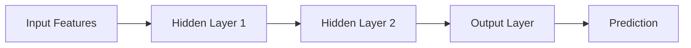
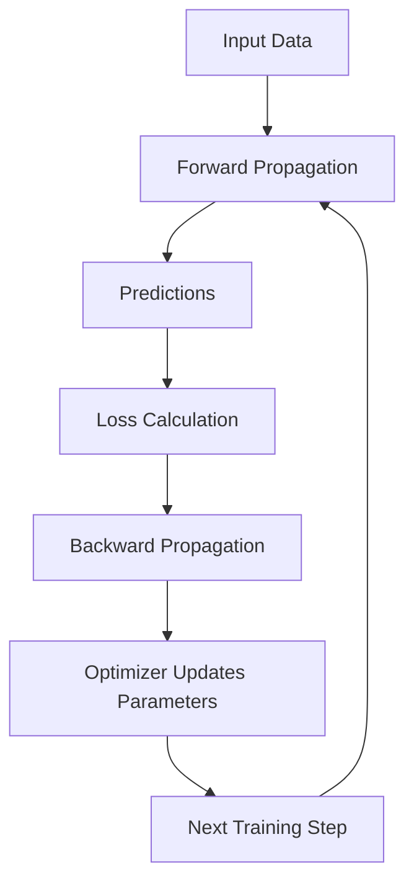
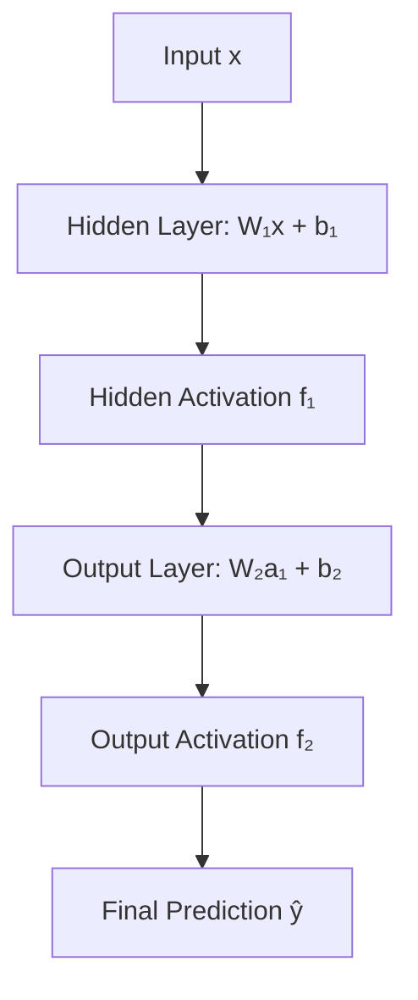
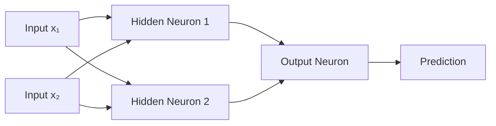
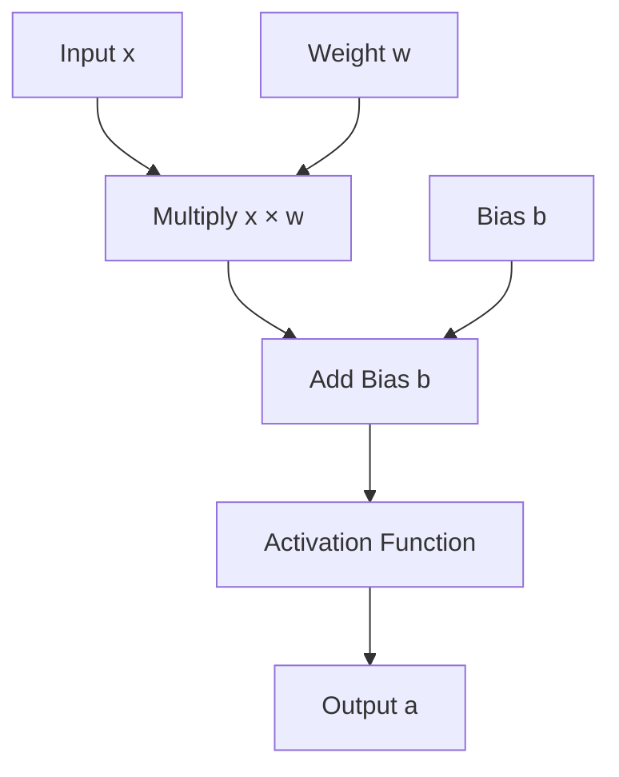
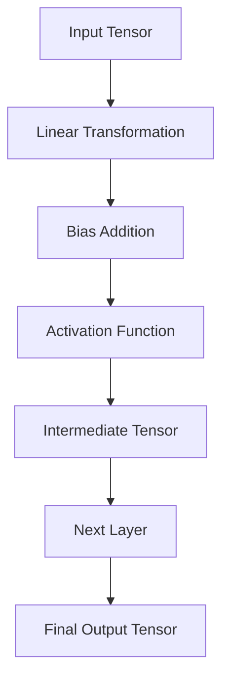
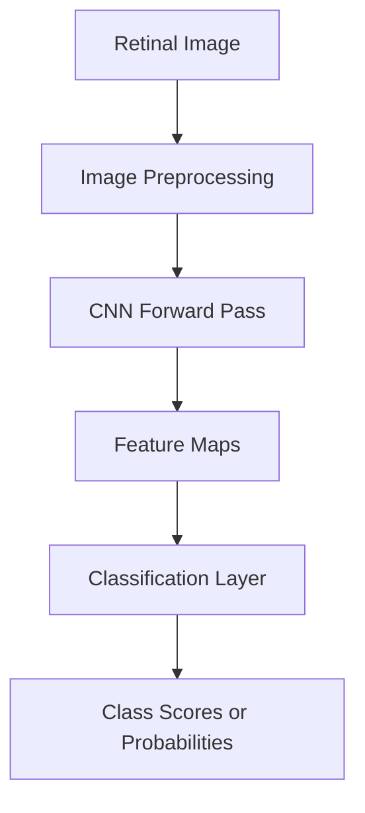
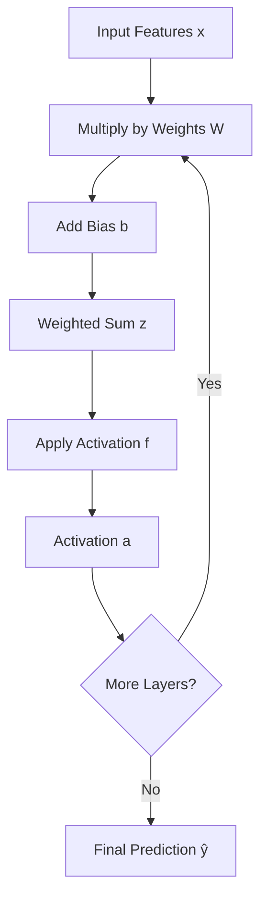
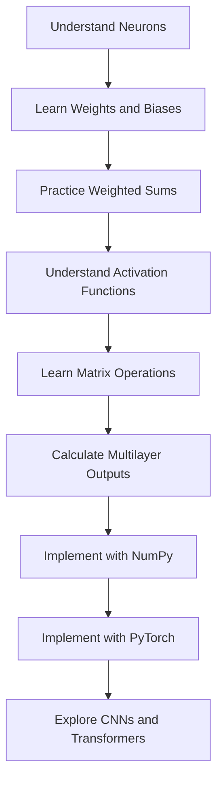

# ➡️ Forward Propagation in Neural Networks — Complete Notes

## 📚 Table of Contents

1. [Introduction to Forward Propagation](#1--introduction-to-forward-propagation)
2. [Why Forward Propagation Is Important](#2--why-forward-propagation-is-important)
3. [Fundamental Terminology](#3--fundamental-terminology)
4. [Artificial Neuron Fundamentals](#4--artificial-neuron-fundamentals)
5. [Mathematical Foundations](#5--mathematical-foundations)
6. [Step-by-Step Forward Propagation](#6--step-by-step-forward-propagation)
7. [Forward Propagation in a Single Neuron](#7--forward-propagation-in-a-single-neuron)
8. [Forward Propagation in a Multilayer Neural Network](#8--forward-propagation-in-a-multilayer-neural-network)
9. [Activation Functions in Forward Propagation](#9--activation-functions-in-forward-propagation)
10. [Forward Propagation with Multiple Inputs and Batches](#10--forward-propagation-with-multiple-inputs-and-batches)
11. [Numerical Example: Complete Neural Network](#11--numerical-example-complete-neural-network)
12. [Forward Propagation for Different Tasks](#12--forward-propagation-for-different-tasks)
13. [Python Implementation Using NumPy](#13--python-implementation-using-numpy)
14. [Forward Propagation Using PyTorch](#14--forward-propagation-using-pytorch)
15. [Forward Propagation Using TensorFlow and Keras](#15--forward-propagation-using-tensorflow-and-keras)
16. [Computational Graph and Data Flow](#16--computational-graph-and-data-flow)
17. [Forward Propagation in Different Architectures](#17--forward-propagation-in-different-architectures)
18. [Applications and Real-World Examples](#18--applications-and-real-world-examples)
19. [Advantages and Limitations](#19--advantages-and-limitations)
20. [Common Mistakes and Troubleshooting](#20--common-mistakes-and-troubleshooting)
21. [Best Practices](#21--best-practices)
22. [Interview Questions and Answers](#22--interview-questions-and-answers)
23. [Quick Revision](#23--quick-revision)

---

# 1. 🎯 Introduction to Forward Propagation

## 1.1 What Is Forward Propagation?

**Forward propagation** is the process of passing input data through a neural network, layer by layer, to calculate an output or prediction.

During this process, every neuron performs mathematical operations on its inputs using weights, biases, and activation functions.

The information flows from the input layer toward the output layer.

Forward propagation is also called the **forward pass** or **forward computation**.

### Definition

Forward propagation is a computational procedure in which input features are transformed through successive neural network layers to generate predictions.

## 1.2 Basic Working Principle

A neural network typically performs the following operations during forward propagation:

1. Receives input features.
2. Multiplies inputs by their corresponding weights.
3. Adds a bias.
4. Applies an activation function.
5. Passes the resulting activations to the next layer.
6. Repeats these operations until the output layer is reached.
7. Produces a final prediction.

## 1.3 Basic Architecture



Each layer transforms the information received from the previous layer.

## 1.4 Simple Real-World Analogy

Imagine a system predicting a student's examination result using:

- Study hours.
- Attendance percentage.
- Previous examination marks.

The network receives these values and combines them using learned weights and biases.

Hidden layers transform the input into intermediate representations, and the output layer generates the predicted result.

The entire sequence of calculations is forward propagation.

## 1.5 Forward Propagation vs. Backpropagation

| Feature | Forward Propagation | Backpropagation |
|---|---|---|
| Purpose | Calculate predictions | Calculate gradients |
| Direction | Input to output | Loss toward earlier operations |
| Main output | Activations and predictions | Gradients |
| Uses weights and biases | Yes | Yes |
| Applies activation functions | Yes | Uses their derivatives when calculating gradients |
| Updates parameters | No | No, not by itself |
| Used during inference | Yes | Generally no |
| Used during training | Yes | Yes, for gradient-based learning |

**Important:** Forward propagation computes the output. It does not independently learn or update the network's weights.

---

# 2. 🧠 Why Forward Propagation Is Important

Forward propagation is fundamental because every neural network must calculate an output before that output can be evaluated or used.

## 2.1 Main Purposes

- Generate predictions from input data.
- Transform raw inputs into useful internal representations.
- Calculate probabilities for classification tasks.
- Generate continuous values for regression tasks.
- Produce intermediate activations for subsequent layers.
- Provide the predictions needed to calculate training loss.

## 2.2 During Training

A typical training workflow is:



Forward propagation is performed using the current parameter values. After the optimizer updates those parameters, the next forward pass may produce different predictions.

## 2.3 During Inference

Inference means using a trained model to make predictions on new data.


During ordinary inference, the model performs forward propagation without computing training gradients or updating weights.

---

# 3. 📖 Fundamental Terminology

| Term | Symbol | Meaning |
|---|---|---|
| Input feature | \(x\) | A value supplied to the network |
| Weight | \(w\) | Parameter that controls the influence of an input |
| Bias | \(b\) | Trainable offset added to the weighted sum |
| Weighted sum | \(z\) | Combination of inputs, weights, and bias |
| Activation function | \(f\) | Function applied to the weighted sum |
| Activation | \(a\) | Output of a neuron or layer |
| Input layer | — | Receives input features |
| Hidden layer | — | Transforms intermediate representations |
| Output layer | — | Produces the final model output |
| Logit | \(z\) | Raw output score before a probability transformation |
| Prediction | \(\hat{y}\) | Model's estimated output |
| Parameter | — | A trainable weight or bias |
| Batch | — | A group of input examples processed together |

## 3.1 Weights

Weights determine how strongly each input influences a neuron's weighted sum.

A larger absolute weight means that a change in the corresponding input can have a larger direct effect on the weighted sum, holding other inputs fixed.

Weights can be positive, negative, or zero.

## 3.2 Bias

The bias is an additional trainable parameter that shifts the weighted sum.

Without a bias, the weighted sum of a neuron is constrained to be zero when all its inputs are zero.

## 3.3 Activation

An activation is the value produced by a neuron after applying its activation function.

The activation of one layer becomes the input to the next layer.

## 3.4 Logits and Predictions

For binary classification, a neuron may first produce a logit \(z\). A sigmoid function can then convert that logit into a probability-like value.

For multiclass classification, the output layer may produce multiple logits, which can be transformed using softmax.

For regression, the final output may remain a continuous numerical value.

---

# 4. 🔬 Artificial Neuron Fundamentals

An artificial neuron is the basic computational unit of a neural network.

## 4.1 Structure of a Neuron

<pre>
       Input x₁ ─── Weight w₁ ──┐
                                │
       Input x₂ ─── Weight w₂ ──┼──► Weighted Sum
                                │       z = Σ(wx) + b
       Input x₃ ─── Weight w₃ ──┘
                                        │
                                        ▼
                                Activation Function
                                        │
                                        ▼
                                  Neuron Output
</pre>

## 4.2 Mathematical Formula

For a neuron with \(n\) inputs:

$$
z=\sum_{i=1}^{n}w_ix_i+b
$$

The activation is:

$$
a=f(z)
$$

Combining both expressions:

$$
a=f\left(\sum_{i=1}^{n}w_ix_i+b\right)
$$

This is the fundamental formula for forward propagation through a single neuron.

## 4.3 Components Explained

Suppose a neuron receives three inputs:

$$
x_1=2,\quad x_2=3,\quad x_3=1
$$

Its weights are:

$$
w_1=0.4,\quad w_2=0.2,\quad w_3=0.5
$$

The bias is:

$$
b=0.1
$$

The weighted sum becomes:

$$
z=(2)(0.4)+(3)(0.2)+(1)(0.5)+0.1
$$

$$
z=0.8+0.6+0.5+0.1
$$

$$
z=2.0
$$

If ReLU is used:

$$
a=\max(0,2.0)=2.0
$$

Therefore, the neuron's output is \(2.0\).

---

# 5. 📐 Mathematical Foundations

## 5.1 Scalar Representation

For one neuron:

$$
z=wx+b
$$

The output is:

$$
a=f(z)
$$

Here, \(x\), \(w\), \(b\), and \(z\) are scalars.

## 5.2 Vector Representation

For multiple inputs, the neuron can be represented using vectors:

$$
\mathbf{x}=
\begin{bmatrix}
x_1\\
x_2\\
\vdots\\
x_n
\end{bmatrix}
$$

$$
\mathbf{w}=
\begin{bmatrix}
w_1\\
w_2\\
\vdots\\
w_n
\end{bmatrix}
$$

The weighted sum is:

$$
z=\mathbf{w}^{T}\mathbf{x}+b
$$

The activation is:

$$
a=f(z)
$$

The dot product combines all input-weight pairs into one number.

## 5.3 Matrix Representation for a Layer

A hidden layer usually contains multiple neurons. Instead of calculating each neuron separately, matrix multiplication calculates their weighted sums together.

For a layer with \(n\) input features and \(k\) neurons:

$$
\mathbf{z}=\mathbf{W}\mathbf{x}+\mathbf{b}
$$

$$
\mathbf{a}=f(\mathbf{z})
$$

Dimensions:

| Quantity | Shape |
|---|---|
| Input vector \(\mathbf{x}\) | \(n\times1\) |
| Weight matrix \(\mathbf{W}\) | \(k\times n\) |
| Bias vector \(\mathbf{b}\) | \(k\times1\) |
| Weighted-sum vector \(\mathbf{z}\) | \(k\times1\) |
| Activation vector \(\mathbf{a}\) | \(k\times1\) |

The activation function is applied element-wise unless the function, such as softmax, operates on a vector of outputs.

## 5.4 Forward Propagation Across Multiple Layers

Let:

$$
\mathbf{a}^{[0]}=\mathbf{x}
$$

For every layer \(l\):

$$
\mathbf{z}^{[l]}
=
\mathbf{W}^{[l]}\mathbf{a}^{[l-1]}
+
\mathbf{b}^{[l]}
$$

$$
\mathbf{a}^{[l]}
=
f^{[l]}(\mathbf{z}^{[l]})
$$

For a network with \(L\) layers, the final prediction is:

$$
\hat{\mathbf{y}}=\mathbf{a}^{[L]}
$$

Where:

- \(l\): Current layer number.
- \(L\): Total number of trainable layers.
- \(\mathbf{W}^{[l]}\): Weight matrix of layer \(l\).
- \(\mathbf{b}^{[l]}\): Bias vector of layer \(l\).
- \(\mathbf{z}^{[l]}\): Weighted sums of layer \(l\).
- \(\mathbf{a}^{[l]}\): Activations of layer \(l\).

The activation from the previous layer is the input to the next layer.

---

# 6. 🪜 Step-by-Step Forward Propagation

Consider a neural network with one input layer, one hidden layer, and one output layer.

## Step 1: Receive the Input

The network receives input features:

$$
\mathbf{x}=
\begin{bmatrix}
x_1\\
x_2
\end{bmatrix}
$$

## Step 2: Calculate the Hidden-Layer Weighted Sum

$$
\mathbf{z}^{[1]}
=
\mathbf{W}^{[1]}\mathbf{x}
+
\mathbf{b}^{[1]}
$$

Each hidden neuron calculates its own weighted sum.

## Step 3: Apply the Hidden-Layer Activation

$$
\mathbf{a}^{[1]}
=
f^{[1]}(\mathbf{z}^{[1]})
$$

For example, ReLU can be applied to every element of the weighted-sum vector.

## Step 4: Pass Activations to the Output Layer

The hidden-layer activations become the input to the output layer.

$$
\mathbf{z}^{[2]}
=
\mathbf{W}^{[2]}\mathbf{a}^{[1]}
+
\mathbf{b}^{[2]}
$$

## Step 5: Apply the Output Activation

$$
\hat{\mathbf{y}}
=
f^{[2]}(\mathbf{z}^{[2]})
$$

The final activation depends on the problem being solved.

## Step 6: Return the Prediction

The network returns the output value or values.

For example:

- Regression: Predicted price.
- Binary classification: Predicted probability.
- Multiclass classification: Probability distribution across classes.

### Complete Workflow



---

# 7. 🔢 Forward Propagation in a Single Neuron

Consider a neuron that predicts an output from two input features.

Given:

$$
x_1=2,\quad x_2=3
$$

$$
w_1=0.5,\quad w_2=0.2
$$

$$
b=-0.1
$$

## Step 1: Multiply Inputs by Weights

$$
x_1w_1=(2)(0.5)=1.0
$$

$$
x_2w_2=(3)(0.2)=0.6
$$

## Step 2: Add the Weighted Inputs

$$
z=x_1w_1+x_2w_2+b
$$

$$
z=1.0+0.6-0.1
$$

$$
z=1.5
$$

## Step 3: Apply ReLU

$$
\operatorname{ReLU}(z)=\max(0,z)
$$

$$
a=\max(0,1.5)=1.5
$$

## Final Result

The neuron produces:

$$
\boxed{a=1.5}
$$

This output can be used as the input to another neuron or layer.

---

# 8. 🏗️ Forward Propagation in a Multilayer Neural Network

A multilayer neural network contains several layers of neurons.

The output of each hidden layer is used as input to the next layer.

## 8.1 Architecture

Consider a network with:

- Two input features.
- Two hidden neurons.
- One output neuron.



## 8.2 Hidden-Layer Calculation

The first hidden neuron calculates:

$$
z_1^{[1]}=w_{11}^{[1]}x_1+w_{12}^{[1]}x_2+b_1^{[1]}
$$

The second hidden neuron calculates:

$$
z_2^{[1]}=w_{21}^{[1]}x_1+w_{22}^{[1]}x_2+b_2^{[1]}
$$

Apply the activation function:

$$
a_1^{[1]}=f(z_1^{[1]})
$$

$$
a_2^{[1]}=f(z_2^{[1]})
$$

The hidden-layer output is:

$$
\mathbf{a}^{[1]}=
\begin{bmatrix}
a_1^{[1]}\\
a_2^{[1]}
\end{bmatrix}
$$

## 8.3 Output-Layer Calculation

The output neuron combines the hidden activations:

$$
z^{[2]}=w_1^{[2]}a_1^{[1]}+w_2^{[2]}a_2^{[1]}+b^{[2]}
$$

The final prediction is:

$$
\hat{y}=f^{[2]}(z^{[2]})
$$

The output activation depends on whether the task is regression, binary classification, or multiclass classification.

---

# 9. ⚡ Activation Functions in Forward Propagation

An activation function transforms a neuron's weighted sum.

Activation functions are essential because nonlinear activations allow neural networks to represent nonlinear relationships.

## 9.1 ReLU

ReLU stands for Rectified Linear Unit.

Formula:

$$
f(z)=\max(0,z)
$$

Examples:

| Input \(z\) | Output |
|---:|---:|
| -3 | 0 |
| -1 | 0 |
| 0 | 0 |
| 2 | 2 |
| 5 | 5 |

Common use: Hidden layers in many neural networks.

## 9.2 Sigmoid

Formula:

$$
\sigma(z)=\frac{1}{1+e^{-z}}
$$

Sigmoid transforms a scalar logit into a value between zero and one.

Examples:

| Input \(z\) | Approximate Output |
|---:|---:|
| -5 | 0.0067 |
| -2 | 0.1192 |
| 0 | 0.5000 |
| 2 | 0.8808 |
| 5 | 0.9933 |

Common use: Binary classification output when probabilities are required.

## 9.3 Tanh

Formula:

$$
\tanh(z)=\frac{e^z-e^{-z}}{e^z+e^{-z}}
$$

The output lies between \(-1\) and \(1\).

Common use: Some hidden layers and recurrent neural networks.

## 9.4 Softmax

Softmax converts multiple logits into a probability distribution.

For class \(i\):

$$
p_i=\frac{e^{z_i}}{\sum_{j=1}^{K}e^{z_j}}
$$

Where \(K\) is the number of classes.

For example, suppose a model produces three logits:

$$
\mathbf{z}=[2.0,\ 1.0,\ 0.1]
$$

Applying softmax gives approximately:

$$
\mathbf{p}=[0.659,\ 0.242,\ 0.099]
$$

The probabilities sum to approximately one.

Softmax is commonly used for mutually exclusive multiclass classification.

## 9.5 Linear Activation

Formula:

$$
f(z)=z
$$

The output is the weighted sum itself.

Common use: Regression tasks in which the prediction must be an unrestricted continuous value.

## 9.6 Activation Function Comparison

| Function | Output Range | Typical Use |
|---|---|---|
| ReLU | \(0\) to infinity | Hidden layers |
| Sigmoid | \(0\) to \(1\) | Binary classification output |
| Tanh | \(-1\) to \(1\) | Selected hidden layers |
| Softmax | Probabilities summing to \(1\) | Multiclass classification |
| Linear | All real numbers | Regression |

## 9.7 Why Nonlinearity Matters

Suppose a network has multiple linear layers but no nonlinear activations.

The first layer computes:

$$
\mathbf{h}=\mathbf{W}_1\mathbf{x}+\mathbf{b}_1
$$

The second layer computes:

$$
\mathbf{y}=\mathbf{W}_2\mathbf{h}+\mathbf{b}_2
$$

Substituting the first expression into the second:

$$
\mathbf{y}
=
\mathbf{W}_2\mathbf{W}_1\mathbf{x}
+
\mathbf{W}_2\mathbf{b}_1
+
\mathbf{b}_2
$$

This is still a linear transformation with a bias.

Therefore, stacking linear layers without nonlinearities does not provide the same expressive power as a nonlinear neural network.

---

# 10. 📦 Forward Propagation with Multiple Inputs and Batches

Forward propagation is usually implemented using vectorized operations rather than separate calculations for each example.

## 10.1 Single Example

Using column vectors:

$$
\mathbf{z}=\mathbf{W}\mathbf{x}+\mathbf{b}
$$

For \(n\) inputs and \(k\) neurons:

$$
\mathbf{x}\in\mathbb{R}^{n\times1}
$$

$$
\mathbf{W}\in\mathbb{R}^{k\times n}
$$

$$
\mathbf{b}\in\mathbb{R}^{k\times1}
$$

The output is:

$$
\mathbf{z}\in\mathbb{R}^{k\times1}
$$

## 10.2 Multiple Examples

Suppose a batch contains \(m\) examples.

Using the convention that examples occupy rows:

$$
\mathbf{X}\in\mathbb{R}^{m\times n}
$$

The weight matrix has shape:

$$
\mathbf{W}\in\mathbb{R}^{n\times k}
$$

The forward computation becomes:

$$
\mathbf{Z}=\mathbf{X}\mathbf{W}+\mathbf{b}
$$

The output shape is:

$$
\mathbf{Z}\in\mathbb{R}^{m\times k}
$$

The bias vector is broadcast across the batch dimension.

The activation is:

$$
\mathbf{A}=f(\mathbf{Z})
$$

## 10.3 Why Vectorization Is Useful

Vectorization:

- Processes multiple examples efficiently.
- Uses optimized numerical libraries.
- Reduces the need for explicit Python loops.
- Supports GPU acceleration.
- Simplifies implementation of matrix-based neural networks.

## 10.4 Example with NumPy

```python
import numpy as np

# Three samples, two features each
X = np.array([
    [1.0, 2.0],
    [3.0, 4.0],
    [5.0, 6.0]
])

# Two inputs connected to two neurons
W = np.array([
    [0.2, 0.5],
    [0.4, 0.3]
])

b = np.array([0.1, -0.2])

# Forward propagation
Z = X @ W + b

# ReLU activation
A = np.maximum(0, Z)

print("Weighted sums:")
print(Z)

print("Activations:")
print(A)

print("Output shape:", A.shape)
```

Expected output:

```text
Weighted sums:
[[1.1 1.1]
 [2.1 2.7]
 [3.1 4.3]]

Activations:
[[1.1 1.1]
 [2.1 2.7]
 [3.1 4.3]]

Output shape: (3, 2)
```

The three rows represent the three samples, and the two columns represent the two neurons.

---

# 11. 🧮 Numerical Example: Complete Neural Network

This example demonstrates forward propagation through a network with two input neurons, two hidden neurons, and one output neuron.

## 11.1 Given Inputs

$$
x_1=1,\quad x_2=2
$$

Use ReLU in the hidden layer and sigmoid in the output layer.

### Hidden-Layer Weights

$$
\mathbf{W}^{[1]}=
\begin{bmatrix}
0.1 & 0.3\\
0.2 & 0.4
\end{bmatrix}
$$

$$
\mathbf{b}^{[1]}=
\begin{bmatrix}
0.1\\
0.1
\end{bmatrix}
$$

### Output-Layer Weights

$$
\mathbf{W}^{[2]}=
\begin{bmatrix}
0.5 & 0.6
\end{bmatrix}
$$

$$
b^{[2]}=0.2
$$

## 11.2 Step 1: Input Vector

$$
\mathbf{x}=
\begin{bmatrix}
1\\
2
\end{bmatrix}
$$

## 11.3 Step 2: Calculate Hidden-Layer Weighted Sums

$$
\mathbf{z}^{[1]}
=
\mathbf{W}^{[1]}\mathbf{x}
+
\mathbf{b}^{[1]}
$$

Substitute the values:

$$
\mathbf{z}^{[1]}
=
\begin{bmatrix}
0.1 & 0.3\\
0.2 & 0.4
\end{bmatrix}
\begin{bmatrix}
1\\
2
\end{bmatrix}
+
\begin{bmatrix}
0.1\\
0.1
\end{bmatrix}
$$

For the first neuron:

$$
z_1^{[1]}=(0.1)(1)+(0.3)(2)+0.1
$$

$$
z_1^{[1]}=0.8
$$

For the second neuron:

$$
z_2^{[1]}=(0.2)(1)+(0.4)(2)+0.1
$$

$$
z_2^{[1]}=1.1
$$

Therefore:

$$
\mathbf{z}^{[1]}=
\begin{bmatrix}
0.8\\
1.1
\end{bmatrix}
$$

## 11.4 Step 3: Apply ReLU

$$
\mathbf{a}^{[1]}
=
\operatorname{ReLU}(\mathbf{z}^{[1]})
$$

Both values are positive, so:

$$
\mathbf{a}^{[1]}=
\begin{bmatrix}
0.8\\
1.1
\end{bmatrix}
$$

## 11.5 Step 4: Calculate the Output-Layer Weighted Sum

$$
z^{[2]}
=
\mathbf{W}^{[2]}\mathbf{a}^{[1]}+b^{[2]}
$$

Substitute the values:

$$
z^{[2]}=(0.5)(0.8)+(0.6)(1.1)+0.2
$$

$$
z^{[2]}=0.4+0.66+0.2
$$

$$
z^{[2]}=1.26
$$

## 11.6 Step 5: Apply Sigmoid

$$
\hat{y}=\sigma(1.26)
$$

$$
\hat{y}=\frac{1}{1+e^{-1.26}}
$$

$$
\hat{y}\approx0.7790
$$

## 11.7 Final Prediction

The network produces:

$$
\boxed{\hat{y}\approx0.7790}
$$

If this output represents a binary classification probability, it corresponds to approximately \(77.9\%\) for the positive class under the model's sigmoid output.

The predicted class at a threshold of \(0.5\) would be class \(1\).

**Important:** The numerical output illustrates the calculations only. The weights and biases are chosen for demonstration and are not necessarily trained or meaningful for a real classification task.

---

# 12. 🎯 Forward Propagation for Different Tasks

The internal calculations of forward propagation depend on the architecture, while the final activation depends on the prediction task.

## 12.1 Regression

Regression predicts a continuous numerical value.

Examples:

- House price prediction.
- Temperature forecasting.
- Sales prediction.
- Estimating product demand.

A common output is:

$$
\hat{y}=z^{[L]}
$$

A linear output is suitable when predictions can take any real value.

## 12.2 Binary Classification

Binary classification predicts one of two classes.

Examples:

- Spam or not spam.
- Fraudulent or legitimate transaction.
- Disease-positive or disease-negative classification.

The sigmoid output is:

$$
\hat{y}=\frac{1}{1+e^{-z}}
$$

A decision threshold can convert the output into a class label:

$$
\hat{c}=
\begin{cases}
1, & \hat{y}\geq t\\
0, & \hat{y}<t
\end{cases}
$$

Where \(t\) is the selected threshold, commonly \(0.5\).

The threshold may need adjustment depending on the costs of false positives and false negatives.

## 12.3 Multiclass Classification

Multiclass classification selects among mutually exclusive classes.

Examples:

- Cat, dog, or bird classification.
- Classifying handwritten digits.
- Identifying one of several image categories.

The output layer produces one logit per class:

$$
\mathbf{z}^{[L]}=
\begin{bmatrix}
z_1\\
z_2\\
\vdots\\
z_K
\end{bmatrix}
$$

Softmax converts the logits into probabilities:

$$
p_i=\frac{e^{z_i}}{\sum_{j=1}^{K}e^{z_j}}
$$

The predicted class is usually:

$$
\hat{c}=\operatorname*{arg\,max}_{i}p_i
$$

## 12.4 Task Comparison

| Task | Typical Output Layer | Output Meaning |
|---|---|---|
| Regression | Linear | Continuous prediction |
| Binary classification | Sigmoid or raw logit | Positive-class probability or logit |
| Multiclass classification | Softmax or raw logits | Class probabilities or scores |
| Multilabel classification | Independent sigmoid outputs | Probability for each label |

---

# 13. 🐍 Python Implementation Using NumPy

This example implements forward propagation for a neural network without using a deep learning framework.

## 13.1 Complete Code

```python
import numpy as np

# Input features
X = np.array([
    [1.0, 2.0]
])

# Hidden-layer parameters
W1 = np.array([
    [0.1, 0.3],
    [0.2, 0.4]
])

b1 = np.array([0.1, 0.1])

# Output-layer parameters
W2 = np.array([
    [0.5],
    [0.6]
])

b2 = np.array([0.2])


def relu(z):
    return np.maximum(0, z)


def sigmoid(z):
    # Numerically stable sigmoid
    z = np.clip(z, -500, 500)
    return 1.0 / (1.0 + np.exp(-z))


def forward_propagation(X):
    # Hidden layer
    Z1 = X @ W1 + b1
    A1 = relu(Z1)

    # Output layer
    Z2 = A1 @ W2 + b2
    A2 = sigmoid(Z2)

    return Z1, A1, Z2, A2


Z1, A1, Z2, prediction = forward_propagation(X)

print("Hidden weighted sums:")
print(Z1)

print("\nHidden activations:")
print(A1)

print("\nOutput logit:")
print(Z2)

print("\nFinal prediction:")
print(prediction)
```

## 13.2 Expected Output

```text
Hidden weighted sums:
[[0.8 1.1]]

Hidden activations:
[[0.8 1.1]]

Output logit:
[[1.26]]

Final prediction:
[[0.77902611]]
```

## 13.3 Code Explanation

- `X`: Contains the input features.
- `W1` and `b1`: Define the hidden-layer parameters.
- `Z1 = X @ W1 + b1`: Calculates hidden-layer weighted sums.
- `A1 = relu(Z1)`: Applies the hidden activation function.
- `Z2 = A1 @ W2 + b2`: Calculates the output logit.
- `A2 = sigmoid(Z2)`: Converts the output logit into a probability-like value.
- `return`: Provides intermediate values and the final prediction.

The `@` operator performs matrix multiplication.

This implementation demonstrates the mathematical operations that a deep learning framework performs internally.

---

# 14. 🔥 Forward Propagation Using PyTorch

PyTorch provides neural network layers that automatically implement their forward calculations.

## 14.1 Example

```python
import torch
import torch.nn as nn

# Input: one sample with two features
X = torch.tensor([[1.0, 2.0]])

# Define a neural network
model = nn.Sequential(
    nn.Linear(2, 2),
    nn.ReLU(),
    nn.Linear(2, 1),
    nn.Sigmoid()
)

# Forward propagation
prediction = model(X)

print("Prediction:")
print(prediction)
```

The model generates an output using its current parameters.

Because the model's weights and biases are randomly initialized by default, the prediction will generally differ from the earlier numerical example.

## 14.2 Manual Forward Pass with PyTorch Layers

```python
import torch
import torch.nn as nn

X = torch.tensor([[1.0, 2.0]])

hidden_layer = nn.Linear(2, 2)
output_layer = nn.Linear(2, 1)

# Forward propagation
Z1 = hidden_layer(X)
A1 = torch.relu(Z1)

Z2 = output_layer(A1)
prediction = torch.sigmoid(Z2)

print("Hidden weighted sums:", Z1)
print("Hidden activations:", A1)
print("Output logit:", Z2)
print("Prediction:", prediction)
```

This version exposes the intermediate values, making it easier to understand each operation.

## 14.3 Important PyTorch Concepts

| Operation | Purpose |
|---|---|
| `nn.Linear(2, 2)` | Creates a fully connected layer with two inputs and two outputs |
| `torch.relu(Z1)` | Applies ReLU |
| `torch.sigmoid(Z2)` | Applies sigmoid |
| `model(X)` | Runs the model's forward computation |
| `model.eval()` | Switches modules to evaluation behavior |
| `torch.no_grad()` | Disables gradient recording |

## 14.4 Inference Example

```python
model.eval()

with torch.no_grad():
    prediction = model(X)

print(prediction)
```

For ordinary inference, this avoids recording the operations needed for gradient computation and can reduce memory usage.

---

# 15. 🧰 Forward Propagation Using TensorFlow and Keras

TensorFlow and Keras provide high-level APIs for defining and running neural networks.

## 15.1 Example

```python
import numpy as np
import tensorflow as tf

# Input sample
X = np.array([
    [1.0, 2.0]
], dtype=np.float32)

# Define neural network
model = tf.keras.Sequential([
    tf.keras.layers.Input(shape=(2,)),
    tf.keras.layers.Dense(2, activation="relu"),
    tf.keras.layers.Dense(1, activation="sigmoid")
])

# Forward propagation
prediction = model(X, training=False)

print("Prediction:")
print(prediction.numpy())
```

## 15.2 Explanation

- `Input(shape=(2,))`: Defines two input features.
- `Dense(2, activation="relu")`: Creates a hidden layer with two neurons.
- `Dense(1, activation="sigmoid")`: Creates a single sigmoid output neuron.
- `model(X, training=False)`: Performs forward propagation using inference behavior.

The framework initializes the weights and biases automatically unless explicit initializers are provided.

## 15.3 Inspecting Intermediate Activations

```python
import numpy as np
import tensorflow as tf

X = np.array([[1.0, 2.0]], dtype=np.float32)

model = tf.keras.Sequential([
    tf.keras.layers.Input(shape=(2,)),
    tf.keras.layers.Dense(2, activation="relu"),
    tf.keras.layers.Dense(1, activation="sigmoid")
])

hidden_model = tf.keras.Model(
    inputs=model.inputs,
    outputs=model.layers[0].output
)

hidden_activations = hidden_model(X, training=False)
predictions = model(X, training=False)

print("Hidden activations:")
print(hidden_activations.numpy())

print("Final predictions:")
print(predictions.numpy())
```

Inspecting intermediate activations is useful when debugging a network or understanding how information is transformed across layers.

---

# 16. 🕸️ Computational Graph and Data Flow

## 16.1 What Is a Computational Graph?

A computational graph represents mathematical operations and their dependencies.

For a single neuron:

$$
z=wx+b
$$

$$
a=f(z)
$$

The graph describes how the input and parameters are used to produce the output.



## 16.2 Layer-by-Layer Data Flow



The exact operations depend on the architecture. For example, a CNN uses convolution operations, while a transformer uses attention and feed-forward operations.

## 16.3 Computational Graph in Deep Learning Frameworks

Frameworks such as PyTorch and TensorFlow execute tensor operations to calculate predictions.

During training, they can also track relevant operations for gradient computation.

During inference, gradient tracking is often disabled to reduce unnecessary computation and memory usage.

---

# 17. 🏛️ Forward Propagation in Different Architectures

## 17.1 Multilayer Perceptron

An MLP uses fully connected layers.

A layer computes:

$$
\mathbf{a}^{[l]}
=
f^{[l]}
\left(
\mathbf{W}^{[l]}\mathbf{a}^{[l-1]}
+
\mathbf{b}^{[l]}
\right)
$$

Applications:

- Tabular classification.
- Regression.
- General-purpose feature learning.

## 17.2 Convolutional Neural Network

A CNN uses convolution filters to extract local patterns from images or other structured data.

Its forward pass can involve:

1. Convolution.
2. Activation.
3. Pooling or downsampling.
4. Additional convolutional blocks.
5. Fully connected or task-specific output layers.

Applications:

- Image classification.
- Object detection.
- Image segmentation.
- Medical image analysis.

## 17.3 Recurrent Neural Network

An RNN processes sequential information using a hidden state.

A simplified forward equation is:

$$
\mathbf{h}_t
=
f\left(
\mathbf{W}_x\mathbf{x}_t
+
\mathbf{W}_h\mathbf{h}_{t-1}
+
\mathbf{b}
\right)
$$

The current hidden state depends on the current input and the previous hidden state.

Applications:

- Time-series forecasting.
- Sequence classification.
- Some language-processing tasks.

## 17.4 Transformer

A transformer uses attention mechanisms to combine information across tokens.

A simplified scaled dot-product attention calculation is:

$$
\operatorname{Attention}(Q,K,V)
=
\operatorname{softmax}
\left(
\frac{QK^T}{\sqrt{d_k}}
\right)V
$$

Where:

- \(Q\): Query matrix.
- \(K\): Key matrix.
- \(V\): Value matrix.
- \(d_k\): Dimension of the key vectors.

The transformer forward pass typically combines embeddings, attention layers, feed-forward networks, residual connections, and normalization.

Applications:

- Large language models.
- Machine translation.
- Text classification.
- Vision transformers.
- Multimodal AI.

## 17.5 Architecture Comparison

| Architecture | Main Forward Operation | Common Application |
|---|---|---|
| MLP | Dense matrix multiplication | Tabular data |
| CNN | Convolution | Image analysis |
| RNN | Recurrent hidden-state updates | Sequential data |
| LSTM/GRU | Gated recurrent operations | Time series and sequences |
| Transformer | Self-attention and feed-forward operations | Language and multimodal tasks |
| Autoencoder | Encoder followed by decoder | Representation learning |

---

# 18. 🌍 Applications and Real-World Examples

## 18.1 House Price Prediction

Input features:

- Area.
- Number of bedrooms.
- Property age.
- Location-related features.

Forward propagation transforms these features through the network to produce a predicted price.

## 18.2 Eye Disease Image Classification

A CNN receives a retinal image and produces class scores or probabilities.

A simplified workflow is:



In a medical application, model predictions require appropriate clinical validation and should not independently replace professional diagnosis.

## 18.3 Spam Detection

Input features or token representations pass through a model to generate a spam probability.

The prediction can then be compared with a decision threshold.

## 18.4 Object Detection

A detection model processes an image and produces predictions such as:

- Bounding-box coordinates.
- Class scores.
- Confidence scores.

The exact output format depends on the model architecture.

## 18.5 Recommendation Systems

A recommendation model processes user and item representations to estimate relevance or preference.

Forward propagation produces a score or probability that can be used to rank candidate items.

---

# 19. ⚖️ Advantages and Limitations

## 19.1 Advantages

1. **Straightforward computation:** Each layer applies defined mathematical operations.
2. **Efficient vectorization:** Matrix operations process many neurons and samples together.
3. **Scalability:** The same principle works across small and large neural networks.
4. **Flexible outputs:** Supports regression, binary classification, multiclass classification, and other tasks.
5. **Framework support:** PyTorch and TensorFlow provide optimized implementations.
6. **Reusable architecture:** Layer operations can be composed into deep neural networks.
7. **Inference support:** Trained models use forward propagation to generate predictions.

## 19.2 Limitations

1. **Depends on parameters:** Poorly trained weights can produce inaccurate predictions.
2. **Computational cost:** Deep networks may require substantial processing power.
3. **Memory usage:** Large intermediate tensors can consume significant memory.
4. **Numerical stability:** Some operations, such as direct exponentiation in softmax, require stable implementations.
5. **No learning by itself:** Forward propagation does not calculate training gradients or update parameters.
6. **Data dependence:** The model cannot reliably predict patterns that it has not learned or that differ substantially from its training distribution.
7. **Interpretability:** Intermediate activations do not automatically provide a complete explanation of a prediction.

---

# 20. 🛠️ Common Mistakes and Troubleshooting

## 20.1 Incorrect Matrix Dimensions

Matrix multiplication requires compatible dimensions.

If:

$$
\mathbf{X}\in\mathbb{R}^{m\times n}
$$

And:

$$
\mathbf{W}\in\mathbb{R}^{n\times k}
$$

Then:

$$
\mathbf{X}\mathbf{W}\in\mathbb{R}^{m\times k}
$$

The number of columns in the input matrix must equal the number of rows in the weight matrix.

## 20.2 Forgetting the Bias

Incorrect:

```python
Z = X @ W
```

Correct when a bias is part of the layer:

```python
Z = X @ W + b
```

## 20.3 Applying the Wrong Activation Function

The output activation must match the task.

| Problem | Typical Output |
|---|---|
| Regression | Linear |
| Binary classification | Sigmoid or raw logit |
| Multiclass classification | Softmax or raw logits |
| Multilabel classification | Independent sigmoid outputs |

## 20.4 Confusing Logits and Probabilities

Logits are raw model scores. Probabilities are values transformed into a probability representation.

For binary classification:

$$
p=\sigma(z)
$$

Do not apply sigmoid twice to the same logit.

## 20.5 Ignoring Input Preprocessing

If a model is trained on standardized inputs, its inference inputs must use the same transformation.

For standardization:

$$
x_{\text{scaled}}=\frac{x-\mu}{\sigma}
$$

The mean and standard deviation should be calculated from the training data and reused during inference.

## 20.6 Incorrect Batch Dimensions

A model may expect a batch dimension even when processing one sample.

For example, a dense layer may expect an input shaped like:

```python
X = torch.tensor([[1.0, 2.0]])
```

Here, the shape is `(1, 2)`: one sample with two features.

## 20.7 Numerical Instability

Directly calculating exponentials of very large logits can cause overflow.

Use numerically stable framework functions such as:

- `torch.sigmoid`
- `torch.softmax`
- `torch.nn.BCEWithLogitsLoss`
- `torch.nn.CrossEntropyLoss`

For manual softmax, subtract the maximum logit first:

$$
p_i=
\frac{e^{z_i-z_{\max}}}
{\sum_j e^{z_j-z_{\max}}}
$$

This does not change the softmax probabilities but improves numerical stability.

## 20.8 Troubleshooting Table

| Problem | Likely Cause | Solution |
|---|---|---|
| Matrix multiplication error | Incompatible shapes | Check tensor dimensions |
| Unexpected output values | Incorrect weights or biases | Inspect model parameters |
| Negative values after ReLU | ReLU not applied correctly | Verify the activation operation |
| Probabilities do not sum to one | Incorrect softmax axis or function | Apply softmax across the class dimension |
| Output is always nearly constant | Untrained or unsuitable parameters | Check model training and input scaling |
| Overflow or `NaN` | Unstable numerical operations | Use stable functions and inspect input ranges |
| Different predictions from NumPy and PyTorch | Different parameters or activation order | Match all weights, biases, and operations |

---

# 21. ✅ Best Practices

## 21.1 Mathematical Best Practices

- Clearly define the shape of every input, weight, and bias.
- Keep matrix dimensions consistent across layers.
- Distinguish weighted sums from activations.
- Choose output activations appropriate to the prediction task.
- Use stable implementations for sigmoid and softmax.
- Verify intermediate numerical results with small examples.

## 21.2 Coding Best Practices

- Use vectorized matrix operations where practical.
- Prefer framework-provided layers for production models.
- Use meaningful variable names such as `Z1`, `A1`, `logits`, and `predictions`.
- Inspect intermediate activations when debugging.
- Keep training and inference preprocessing consistent.
- Use inference mode or disable gradient tracking when appropriate.

## 21.3 Model Evaluation Best Practices

- Use representative input data.
- Validate the preprocessing pipeline.
- Keep training, validation, and test data separate.
- Evaluate the model with task-appropriate metrics.
- Monitor for distribution shifts after deployment.
- Do not interpret a probability output as a guarantee of correctness.

---

# 22. 🎤 Interview Questions and Answers

## Q1. What is forward propagation?

Forward propagation is the process of passing input data through a neural network layer by layer to calculate activations and produce a prediction.

## Q2. What is the basic formula of a neuron?

$$
z=\sum_{i=1}^{n}w_ix_i+b
$$

$$
a=f(z)
$$

## Q3. What is the difference between a weighted sum and an activation?

The weighted sum combines inputs, weights, and bias. The activation is the result of applying an activation function to that weighted sum.

## Q4. Why are weights used?

Weights control the influence of individual inputs on a neuron's weighted sum.

## Q5. Why is bias required?

Bias provides an adjustable offset that allows a neuron to shift its response independently of the weighted input sum.

## Q6. What is the role of an activation function?

An activation function transforms a neuron's weighted sum. Nonlinear activation functions allow networks to learn nonlinear relationships.

## Q7. What happens if hidden layers use only linear activations?

A stack of ordinary linear layers remains equivalent to a single linear transformation, limiting the network's ability to represent nonlinear functions.

## Q8. What is the difference between an input layer and a hidden layer?

The input layer receives the features. A hidden layer transforms those features using trainable parameters and activation functions.

## Q9. What is the output layer?

The output layer produces the final model output, such as a regression value, class logits, or probabilities.

## Q10. What is the difference between logits and probabilities?

Logits are raw model scores. Probabilities are transformed scores, commonly produced using sigmoid or softmax.

## Q11. Why is sigmoid used in binary classification?

Sigmoid transforms a scalar logit into a value between zero and one, which can represent the estimated probability of the positive class.

## Q12. Why is softmax used in multiclass classification?

Softmax converts class logits into nonnegative values that sum to one, producing a categorical probability distribution.

## Q13. Does forward propagation update weights?

No. Forward propagation calculates activations and predictions using the current parameters.

## Q14. What is vectorization?

Vectorization performs operations on arrays or matrices instead of using explicit loops for individual calculations. It often improves computational efficiency.

## Q15. What is broadcasting?

Broadcasting allows compatible arrays, such as a bias vector and a batch of weighted sums, to participate in operations without manually copying the smaller array.

## Q16. What is the difference between training and inference forward passes?

Both compute model outputs. Training may use training-specific behavior, such as dropout or batch-normalization batch statistics. Inference uses evaluation behavior and generally does not record gradients.

## Q17. What happens if the input dimensions are incorrect?

Matrix operations may fail because their dimensions are incompatible, or data may be interpreted incorrectly if dimensions are accidentally arranged in the wrong order.

## Q18. Why should input preprocessing remain consistent?

The model learns from the feature representation used during training. Different scaling or encoding during inference can change the input distribution and reduce prediction quality.

## Q19. How does forward propagation work in a CNN?

A CNN performs convolution operations, activation functions, and other architectural operations to produce feature maps and task-specific outputs.

## Q20. How does forward propagation work in a transformer?

A transformer processes token representations through attention, feed-forward layers, normalization, and residual connections to produce contextual representations and final outputs.

## Q21. What is the role of forward propagation in training?

It produces predictions and intermediate values used to calculate the loss. The loss then supplies the objective for gradient computation.

## Q22. Can forward propagation be used without backpropagation?

Yes. A trained model can perform forward propagation during inference without computing gradients or updating parameters.

## Q23. What is the computational cost of a dense layer?

For a batch of \(m\) examples, an input dimension of \(n\), and an output dimension of \(k\), the main matrix multiplication typically requires work proportional to:

$$
O(mnk)
$$

## Q24. What is an intermediate activation?

An intermediate activation is the output of a hidden layer that becomes input to a later layer.

## Q25. Explain forward propagation in one sentence.

Forward propagation transforms input features through successive neural network operations to generate a prediction.

---

# 23. ⚡ Quick Revision

## 23.1 Key Concepts

| Concept | Quick Explanation |
|---|---|
| Forward propagation | Input-to-output computation |
| Weight | Controls input influence |
| Bias | Shifts the weighted sum |
| Weighted sum | Input-weight combination plus bias |
| Activation function | Transforms the weighted sum |
| Activation | Output of a neuron or layer |
| Hidden layer | Learns intermediate representations |
| Output layer | Produces the final result |
| Logit | Raw output score |
| Sigmoid | Binary probability transformation |
| Softmax | Multiclass probability transformation |
| Vectorization | Efficient array and matrix computation |
| Inference | Prediction using trained parameters |

## 23.2 Important Formulas

### Single Neuron

$$
z=\sum_{i=1}^{n}w_ix_i+b
$$

$$
a=f(z)
$$

### Dense Layer

$$
\mathbf{z}=\mathbf{W}\mathbf{x}+\mathbf{b}
$$

$$
\mathbf{a}=f(\mathbf{z})
$$

### Multiple Layers

$$
\mathbf{z}^{[l]}
=
\mathbf{W}^{[l]}\mathbf{a}^{[l-1]}
+
\mathbf{b}^{[l]}
$$

$$
\mathbf{a}^{[l]}
=
f^{[l]}(\mathbf{z}^{[l]})
$$

### Final Prediction

$$
\hat{\mathbf{y}}=\mathbf{a}^{[L]}
$$

### ReLU

$$
\operatorname{ReLU}(z)=\max(0,z)
$$

### Sigmoid

$$
\sigma(z)=\frac{1}{1+e^{-z}}
$$

### Softmax

$$
p_i=\frac{e^{z_i}}{\sum_{j=1}^{K}e^{z_j}}
$$

### Standardization

$$
x_{\text{scaled}}=\frac{x-\mu}{\sigma}
$$

## 23.3 Important Python Operations

| Operation | Purpose |
|---|---|
| `X @ W` | Matrix multiplication |
| `X @ W + b` | Weighted sums with bias |
| `np.maximum(0, Z)` | ReLU using NumPy |
| `torch.relu(Z)` | ReLU using PyTorch |
| `torch.sigmoid(Z)` | Sigmoid using PyTorch |
| `torch.softmax(Z, dim=1)` | Softmax across classes |
| `model(X)` | Runs a model's forward pass |
| `model.eval()` | Enables evaluation behavior |
| `torch.no_grad()` | Disables gradient recording |

## 23.4 Visual Summary



## 23.5 Learning Roadmap



## 23.6 Final Takeaways

- Forward propagation is the process of calculating a neural network's output from input data.
- Each neuron computes a weighted sum and applies an activation function.
- Matrix multiplication makes multilayer forward computation efficient.
- Hidden layers transform input features into intermediate representations.
- The output layer produces the final prediction.
- The output activation should match the prediction task.
- Forward propagation is necessary for both training and inference.
- During training, the predictions are used to calculate loss; during inference, they are returned to the user or application.
- Forward propagation itself does not update weights or biases.

**Golden Rule:**

$$
\boxed{
\text{Input}
\rightarrow
\text{Weighted Sum}
\rightarrow
\text{Activation}
\rightarrow
\text{Next Layer}
\rightarrow
\text{Prediction}
}
$$
