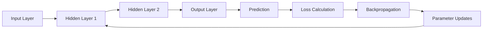
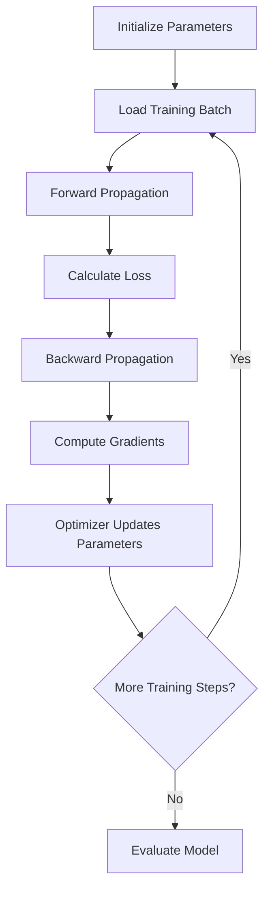
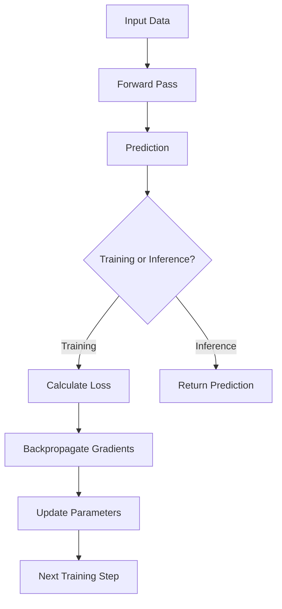
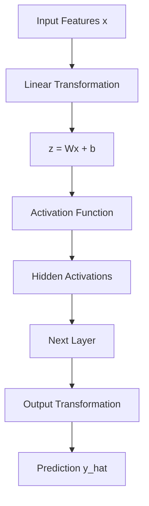
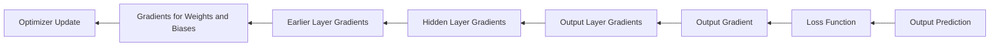
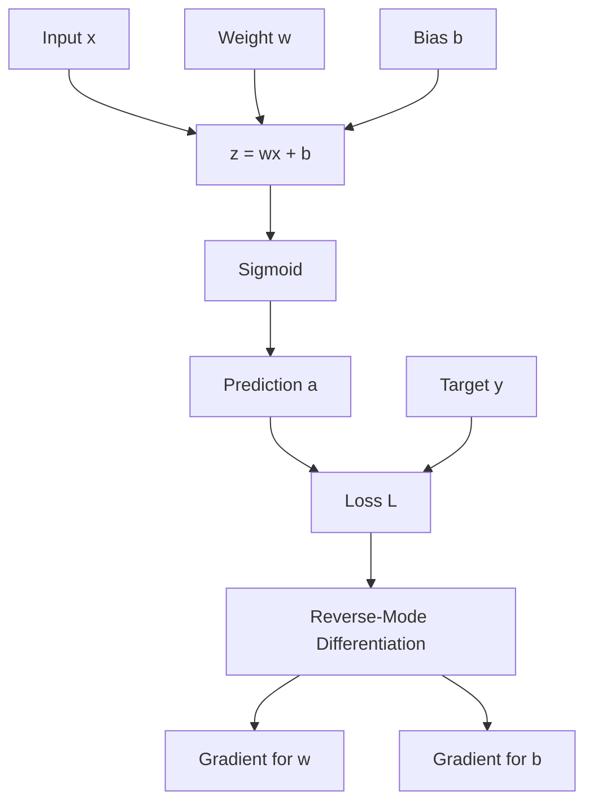
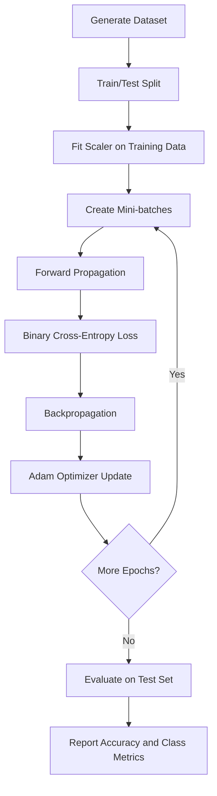
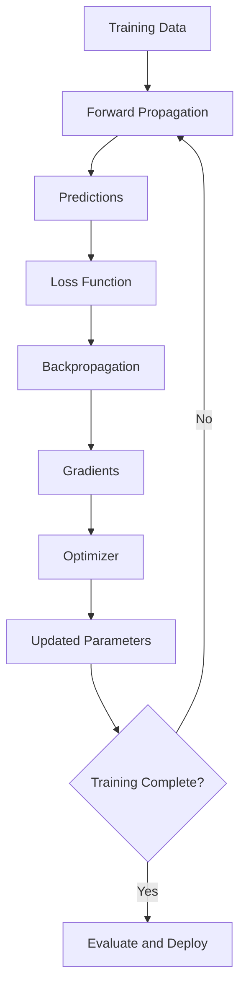
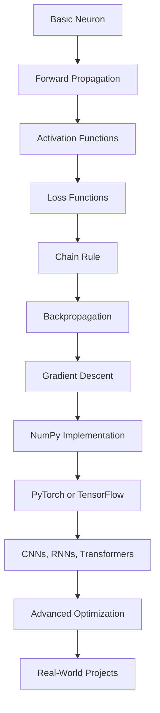

# 🔄 Propagation

## 📚 Table of Contents

1. [Introduction to Propagation](#1--introduction-to-propagation)
2. [Fundamentals of Propagation](#2--fundamentals-of-propagation)
3. [Types of Propagation](#3--types-of-propagation)
4. [Forward Propagation](#4--forward-propagation)
5. [Backward Propagation](#5--backward-propagation)
6. [Mathematical Foundations](#6--mathematical-foundations)
7. [Activation Functions and Their Role](#7--activation-functions-and-their-role)
8. [Loss Functions and Gradients](#8--loss-functions-and-gradients)
9. [Gradient Descent and Parameter Updates](#9--gradient-descent-and-parameter-updates)
10. [Worked Numerical Example](#10--worked-numerical-example)
11. [Propagation in Different Neural Networks](#11--propagation-in-different-neural-networks)
12. [Python Implementation from Scratch](#12--python-implementation-from-scratch)
13. [Propagation Using TensorFlow and PyTorch](#13--propagation-using-tensorflow-and-pytorch)
14. [Computational Graphs and Automatic Differentiation](#14--computational-graphs-and-automatic-differentiation)
15. [Advanced Concepts](#15--advanced-concepts)
16. [Applications and Real-World Use Cases](#16--applications-and-real-world-use-cases)
17. [Advantages and Limitations](#17--advantages-and-limitations)
18. [Common Mistakes and Troubleshooting](#18--common-mistakes-and-troubleshooting)
19. [Best Practices](#19--best-practices)
20. [Practical Mini-Project: Binary Classification](#20--practical-mini-project-binary-classification)
21. [Interview Questions and Answers](#21--interview-questions-and-answers)
22. [Quick Revision](#22--quick-revision)

---

# 1. 🎯 Introduction to Propagation

## 1.1 What Is Propagation?

Propagation is the process of transmitting information through a system. In artificial neural networks, it describes how inputs, activations, errors, and gradients move between network layers.

In deep learning, propagation is primarily discussed in two forms:

- **Forward propagation:** Computes predictions by passing input data through the network.
- **Backward propagation:** Computes gradients by propagating derivatives backward through the network.

These two processes work together to train neural networks.

## 1.2 Why Is Propagation Important?

A neural network must perform two essential operations during supervised training:

1. Produce predictions from input data.
2. Measure prediction errors and determine how to adjust the parameters.

Forward propagation performs the first operation, while backpropagation supports the second.

Without forward propagation, the network cannot calculate predictions or loss. Without gradient computation, gradient-based training cannot determine how its parameters should change.

## 1.3 Basic Neural Network Architecture



The diagram represents a training cycle. Parameter updates change the network's behavior, so another forward pass can produce a different prediction.

## 1.4 A Simple Analogy

Imagine a student solving a mathematics problem.

- Forward propagation: The student calculates an answer.
- Loss calculation: The teacher compares the answer with the correct solution.
- Backpropagation: The student identifies which calculation contributed to the error.
- Parameter update: The student adjusts their approach.
- Repetition: The student solves similar problems more accurately.

A neural network follows a related learning process, but uses numerical optimization rather than human reasoning.

---

# 2. 🧠 Fundamentals of Propagation

## 2.1 What Is an Artificial Neuron?

An artificial neuron receives inputs, assigns importance to them using weights, adds a bias, and applies an activation function.

Its mathematical representation is:

$$
z = \sum_{i=1}^{n} w_i x_i + b
$$

The neuron then computes its output:

$$
a = f(z)
$$

Where:

- \(x_i\): Input feature.
- \(w_i\): Weight associated with an input.
- \(b\): Bias parameter.
- \(z\): Weighted sum before activation.
- \(f\): Activation function.
- \(a\): Neuron activation or output.

## 2.2 Important Terminology

| Term | Meaning |
|---|---|
| Input | Data supplied to the neural network |
| Weight | Trainable parameter controlling the influence of an input |
| Bias | Trainable offset added to the weighted sum |
| Logit | Raw model score before a final probability transformation |
| Activation | Output produced by a neuron or layer |
| Activation function | Function applied to the weighted sum |
| Forward pass | Computation from inputs to predictions |
| Loss | Numerical measure of prediction error |
| Gradient | Derivative of a quantity with respect to a parameter |
| Backpropagation | Algorithm for computing gradients using the chain rule |
| Optimizer | Algorithm that updates trainable parameters |
| Learning rate | Controls the size of optimization steps |
| Epoch | One complete pass through the training dataset |
| Batch | Subset of training examples processed together |
| Training step | Usually one optimizer update using a batch |
| Computational graph | Representation of operations and their dependencies |

## 2.3 Parameters and Hyperparameters

Parameters are learned from training data, whereas hyperparameters are configured before or during training.

| Parameters | Hyperparameters |
|---|---|
| Weights | Learning rate |
| Biases | Batch size |
| Learned embedding values | Number of layers |
| Convolution filters | Number of epochs |
| Trainable normalization parameters | Optimizer choice |

## 2.4 The Training Cycle



Important distinction: backpropagation computes gradients, while the optimizer uses those gradients to update parameters.

---

# 3. 🔀 Types of Propagation

## 3.1 Forward Propagation

Forward propagation moves information from the input layer toward the output layer.

Its main purpose is to compute the network's output.

Typical operations include:

- Multiplication of inputs by weights.
- Addition of biases.
- Application of activation functions.
- Computation of output probabilities or regression values.

## 3.2 Backward Propagation

Backward propagation calculates derivatives of the loss with respect to trainable parameters.

It proceeds from the loss toward earlier operations, applying the chain rule to combine local derivatives.

Typical operations include:

- Calculating the derivative of the loss.
- Computing gradients of output-layer parameters.
- Propagating derivatives through hidden layers.
- Accumulating gradients for weights and biases.

## 3.3 Forward vs. Backward Propagation

| Feature | Forward Propagation | Backward Propagation |
|---|---|---|
| Main purpose | Compute predictions | Compute gradients |
| Direction | Input to output | Loss toward inputs |
| Main output | Activations and predictions | Parameter gradients |
| Uses target labels | Only when needed for loss calculation | Indirectly through the loss |
| Uses chain rule | Not typically described as reverse differentiation | Yes |
| Changes parameters | No | No, not by itself |
| Required during training | Yes | Yes, for gradient-based learning |
| Required during inference | Yes | No |

## 3.4 Inference vs. Training

During inference, the network usually performs forward propagation only.

During training, the network generally performs forward propagation, loss calculation, gradient computation, and parameter updates.



---

# 4. ➡️ Forward Propagation

## 4.1 Mathematical Explanation

Consider a fully connected neural network with an input layer, one hidden layer, and an output layer.

Let the input vector be:

$$
\mathbf{x} \in \mathbb{R}^{n}
$$

For the hidden layer:

$$
\mathbf{z}^{[1]} = \mathbf{W}^{[1]}\mathbf{x} + \mathbf{b}^{[1]}
$$

$$
\mathbf{a}^{[1]} = f^{[1]}(\mathbf{z}^{[1]})
$$

For the output layer:

$$
\mathbf{z}^{[2]} = \mathbf{W}^{[2]}\mathbf{a}^{[1]} + \mathbf{b}^{[2]}
$$

$$
\hat{\mathbf{y}} = f^{[2]}(\mathbf{z}^{[2]})
$$

Here:

- \(\mathbf{W}^{[1]}\): Hidden-layer weight matrix.
- \(\mathbf{b}^{[1]}\): Hidden-layer bias vector.
- \(\mathbf{a}^{[1]}\): Hidden-layer activations.
- \(\hat{\mathbf{y}}\): Predicted output.

## 4.2 Forward Propagation Workflow



## 4.3 Example: One Neuron

Suppose:

$$
x_1 = 2,\quad x_2 = 3
$$

$$
w_1 = 0.5,\quad w_2 = 0.2,\quad b = -0.1
$$

The weighted sum is:

$$
z = (0.5)(2) + (0.2)(3) - 0.1
$$

$$
z = 1 + 0.6 - 0.1 = 1.5
$$

If the activation function is ReLU:

$$
\operatorname{ReLU}(z) = \max(0,z)
$$

Then:

$$
a = \max(0,1.5) = 1.5
$$

The neuron's output is \(1.5\).

## 4.4 Forward Propagation for Multiple Samples

For a batch containing \(m\) examples, inputs can be arranged as a matrix.

Using the convention that each example occupies one column:

$$
\mathbf{X} \in \mathbb{R}^{n \times m}
$$

The hidden-layer calculation becomes:

$$
\mathbf{Z}^{[1]} = \mathbf{W}^{[1]}\mathbf{X} + \mathbf{b}^{[1]}
$$

The bias is broadcast across the batch.

Vectorized operations are generally more efficient than processing each example through separate Python loops.

## 4.5 Practical Example: Predicting House Prices

Suppose a model uses:

- House area.
- Number of bedrooms.
- Property age.

The network combines these features through weighted sums and nonlinear transformations to predict a house price.

For a regression model, the output layer often uses a linear activation:

$$
\hat{y} = z^{[L]}
$$

The output is a continuous numerical value rather than a class probability.

---

# 5. ⬅️ Backward Propagation

## 5.1 What Is Backpropagation?

Backpropagation is an algorithm for efficiently computing derivatives of a loss function with respect to the parameters of a computational graph.

It applies the chain rule from calculus, starting at the loss and moving backward through the network's operations.

Backpropagation does not independently decide the best parameter values. It provides gradients that an optimizer can use.

## 5.2 Why Is Backpropagation Necessary?

Suppose a network contains thousands or millions of trainable parameters.

To improve the model, training needs to estimate how changing each parameter affects the loss.

Calculating every derivative independently would be inefficient. Backpropagation reuses intermediate derivatives, making gradient computation practical for large networks.

## 5.3 The Chain Rule

For a composite function:

$$
y = f(g(x))
$$

The derivative is:

$$
\frac{dy}{dx}
=
\frac{dy}{dg}\frac{dg}{dx}
$$

For a longer computational chain:

$$
x \rightarrow u \rightarrow v \rightarrow L
$$

The loss derivative is:

$$
\frac{dL}{dx}
=
\frac{dL}{dv}
\frac{dv}{du}
\frac{du}{dx}
$$

Each local derivative is combined with the gradient arriving from later operations.

## 5.4 Backpropagation in a Neural Network



The reverse direction represents the flow of derivative information, not a reversal of the original forward calculations.

## 5.5 Backpropagation Equations

For a network with layers numbered from \(1\) to \(L\):

$$
\mathbf{z}^{[l]}
=
\mathbf{W}^{[l]}\mathbf{a}^{[l-1]}
+
\mathbf{b}^{[l]}
$$

$$
\mathbf{a}^{[l]}
=
f^{[l]}(\mathbf{z}^{[l]})
$$

Let the output-layer error signal be:

$$
\boldsymbol{\delta}^{[L]}
=
\frac{\partial L}{\partial \mathbf{z}^{[L]}}
$$

For a hidden layer:

$$
\boldsymbol{\delta}^{[l]}
=
\left(\mathbf{W}^{[l+1]}\right)^T
\boldsymbol{\delta}^{[l+1]}
\odot
f'^{[l]}(\mathbf{z}^{[l]})
$$

Here, \(\odot\) represents element-wise multiplication.

The weight gradient is:

$$
\frac{\partial L}{\partial \mathbf{W}^{[l]}}
=
\boldsymbol{\delta}^{[l]}
\left(\mathbf{a}^{[l-1]}\right)^T
$$

The bias gradient is:

$$
\frac{\partial L}{\partial \mathbf{b}^{[l]}}
=
\boldsymbol{\delta}^{[l]}
$$

For a batch, the gradients are accumulated across examples, and the loss reduction determines the corresponding scaling.

## 5.6 The Meaning of a Gradient

A gradient measures how a quantity changes when a parameter changes locally.

For a parameter \(w\):

$$
\frac{\partial L}{\partial w}
$$

- Positive gradient: Increasing the parameter slightly tends to increase the loss.
- Negative gradient: Increasing the parameter slightly tends to decrease the loss.
- Zero gradient: The first-order change is zero at the current point.

These interpretations assume other parameters are held fixed and describe local behavior.

---

# 6. 📐 Mathematical Foundations

## 6.1 Linear Transformation

A fully connected layer computes:

$$
\mathbf{z} = \mathbf{W}\mathbf{x} + \mathbf{b}
$$

Its gradient depends on the dimensions and the orientation of the input and weight matrices.

For a scalar loss \(L\):

$$
\frac{\partial L}{\partial \mathbf{W}}
=
\frac{\partial L}{\partial \mathbf{z}}
\mathbf{x}^{T}
$$

$$
\frac{\partial L}{\partial \mathbf{x}}
=
\mathbf{W}^{T}
\frac{\partial L}{\partial \mathbf{z}}
$$

These equations assume column-vector inputs and compatible matrix dimensions.

## 6.2 Derivative of a Scalar Neuron

For a neuron:

$$
z = wx+b
$$

$$
a=f(z)
$$

The loss derivative with respect to the weight is:

$$
\frac{\partial L}{\partial w}
=
\frac{\partial L}{\partial a}
\frac{\partial a}{\partial z}
\frac{\partial z}{\partial w}
$$

Since:

$$
\frac{\partial z}{\partial w}=x
$$

We obtain:

$$
\frac{\partial L}{\partial w}
=
\frac{\partial L}{\partial a}f'(z)x
$$

Similarly:

$$
\frac{\partial L}{\partial b}
=
\frac{\partial L}{\partial a}f'(z)
$$

## 6.3 Jacobian Matrices

For vector-valued functions, derivatives can be represented by Jacobian matrices.

If:

$$
\mathbf{y}=f(\mathbf{x})
$$

Then the Jacobian is:

$$
\mathbf{J}
=
\frac{\partial \mathbf{y}}{\partial \mathbf{x}}
$$

In deep learning, the chain rule combines Jacobians across multiple operations. Implementations generally avoid constructing unnecessarily large Jacobian matrices explicitly.

## 6.4 Vector-Jacobian Products

Backpropagation commonly computes a vector-Jacobian product.

For an upstream gradient \(\mathbf{v}\):

$$
\mathbf{v}^{T}\mathbf{J}
$$

This operation efficiently propagates derivatives backward without explicitly calculating every element of the Jacobian.

## 6.5 Computational Complexity

For a dense layer with input dimension \(n\) and output dimension \(k\), the main forward computation has approximately:

$$
O(nk)
$$

time complexity per example.

Backward propagation for the input and weights also has computational cost proportional to the size of the layer's matrix operations.

For a batch of \(m\) examples, dense-layer matrix operations generally scale approximately as:

$$
O(mnk)
$$

The exact cost depends on architecture, hardware, precision, and implementation.

---

# 7. ⚡ Activation Functions and Their Role

Activation functions introduce nonlinear behavior into neural networks.

Without nonlinear activations between ordinary dense layers, a stack of linear transformations remains equivalent to a single linear transformation.

## 7.1 Common Activation Functions

### Sigmoid

$$
\sigma(z)=\frac{1}{1+e^{-z}}
$$

Derivative:

$$
\sigma'(z)=\sigma(z)(1-\sigma(z))
$$

Range: \(0\) to \(1\).

Common uses:

- Binary classification output.
- Probability-like outputs for independent binary labels.

Limitation: Its derivative becomes very small for strongly positive or negative inputs.

### Tanh

$$
\tanh(z)=\frac{e^z-e^{-z}}{e^z+e^{-z}}
$$

Derivative:

$$
\tanh'(z)=1-\tanh^2(z)
$$

Range: \(-1\) to \(1\).

Limitation: It can also suffer from vanishing gradients when saturated.

### ReLU

$$
\operatorname{ReLU}(z)=\max(0,z)
$$

Derivative, away from zero:

$$
\operatorname{ReLU}'(z)=
\begin{cases}
1, & z>0\\
0, & z<0
\end{cases}
$$

At zero, an implementation typically chooses a defined subgradient.

Advantages:

- Computationally simple.
- Often helps reduce saturation for positive activations.

Limitation: A neuron that consistently receives negative pre-activations may stop receiving useful gradients through that ReLU.

### Leaky ReLU

$$
f(z)=
\begin{cases}
z, & z\geq 0\\
\alpha z, & z<0
\end{cases}
$$

Here, \(\alpha\) is a small positive constant.

It allows a small gradient for negative inputs.

### Softmax

For class logits \(z_1,\ldots,z_K\):

$$
p_i
=
\frac{e^{z_i}}
{\sum_{j=1}^{K}e^{z_j}}
$$

Softmax converts a vector of logits into a probability distribution across mutually exclusive classes.

In practice, stable implementations subtract the largest logit before exponentiation.

## 7.2 Activation Function Comparison

| Function | Output Range | Common Application | Main Limitation |
|---|---|---|---|
| Sigmoid | \(0\) to \(1\) | Binary output | Saturation |
| Tanh | \(-1\) to \(1\) | Some recurrent networks | Saturation |
| ReLU | \(0\) to infinity | Hidden layers | Dead neurons |
| Leaky ReLU | Negative and positive values | Hidden layers | Requires a negative slope choice |
| Softmax | Probabilities summing to 1 | Multiclass output | Can be poorly calibrated despite normalization |
| GELU | Negative and positive values | Transformer architectures | More computationally involved than ReLU |

## 7.3 Choosing an Activation Function

| Task | Typical Choice |
|---|---|
| Hidden layers in a basic MLP | ReLU |
| Binary classification | Sigmoid output |
| Mutually exclusive multiclass classification | Softmax output |
| Regression with unrestricted real-valued targets | Linear output |
| Transformer hidden layers | GELU or another architecture-appropriate activation |

The final choice should match the model architecture, target representation, and loss function.

---

# 8. 📉 Loss Functions and Gradients

A loss function measures the discrepancy between model predictions and target values.

## 8.1 Mean Squared Error

For regression:

$$
L_{\text{MSE}}
=
\frac{1}{m}
\sum_{i=1}^{m}
(y_i-\hat{y}_i)^2
$$

Derivative with respect to the prediction:

$$
\frac{\partial L_{\text{MSE}}}{\partial \hat{y}_i}
=
\frac{2}{m}(\hat{y}_i-y_i)
$$

MSE penalizes large errors more heavily because the errors are squared.

## 8.2 Binary Cross-Entropy

For binary classification with probability predictions:

$$
L_{\text{BCE}}
=
-\frac{1}{m}
\sum_{i=1}^{m}
\left[
y_i\log(\hat{y}_i)
+
(1-y_i)\log(1-\hat{y}_i)
\right]
$$

Here, \(y_i\) is either \(0\) or \(1\).

Binary cross-entropy strongly penalizes confident predictions that assign low probability to the correct class.

For numerical stability, implementations should generally use logits-based loss functions when available.

## 8.3 Categorical Cross-Entropy

For mutually exclusive multiclass classification:

$$
L_{\text{CE}}
=
-\frac{1}{m}
\sum_{i=1}^{m}
\sum_{k=1}^{K}
y_{ik}\log(p_{ik})
$$

Where:

- \(K\): Number of classes.
- \(y_{ik}\): Target indicator for class \(k\).
- \(p_{ik}\): Predicted probability for class \(k\).

## 8.4 Loss Function Comparison

| Loss Function | Problem Type | Typical Output |
|---|---|---|
| Mean Squared Error | Regression | Linear output |
| Mean Absolute Error | Regression | Linear output |
| Binary Cross-Entropy | Binary classification | Sigmoid or logits-based formulation |
| Categorical Cross-Entropy | Multiclass classification | Softmax or logits-based formulation |
| Sparse Categorical Cross-Entropy | Multiclass classification with integer labels | Softmax or logits-based formulation |
| Huber Loss | Regression with reduced sensitivity to large residuals | Linear output |

## 8.5 Loss and Output-Layer Gradients

For sigmoid output combined with binary cross-entropy, the derivative with respect to the logit simplifies to:

$$
\frac{\partial L}{\partial z}
=
\hat{y}-y
$$

For softmax combined with categorical cross-entropy, using the usual one-hot target representation:

$$
\frac{\partial L}{\partial z_k}
=
p_k-y_k
$$

These simplified expressions are one reason the combinations are widely used.

---

# 9. 📈 Gradient Descent and Parameter Updates

## 9.1 Gradient Descent

Gradient descent updates parameters in the direction opposite to the gradient.

For a parameter \(w\):

$$
w_{\text{new}}
=
w_{\text{old}}
-
\eta
\frac{\partial L}{\partial w}
$$

For a bias parameter:

$$
b_{\text{new}}
=
b_{\text{old}}
-
\eta
\frac{\partial L}{\partial b}
$$

Here, \(\eta\) is the learning rate.

## 9.2 Learning Rate

The learning rate controls the magnitude of parameter updates.

| Learning Rate | Possible Effect |
|---|---|
| Too small | Slow learning |
| Appropriate | Stable progress toward a useful solution |
| Too large | Oscillation, instability, or divergence |
| Adaptively adjusted | May improve optimization across different training stages |

## 9.3 Optimization Algorithms

| Optimizer | Main Idea | Typical Consideration |
|---|---|---|
| Batch Gradient Descent | Uses the full dataset per update | Expensive for large datasets |
| Stochastic Gradient Descent | Uses one example per update | Noisy updates |
| Mini-batch SGD | Uses a subset of examples | Efficient and widely used |
| Momentum | Uses a running direction estimate | Can accelerate consistent progress |
| RMSprop | Adapts updates using squared-gradient statistics | Useful in some nonstationary optimization settings |
| Adam | Combines first- and second-moment estimates | Strong general-purpose baseline |
| AdamW | Separates weight decay from Adam's gradient update | Often preferred for modern deep learning |

## 9.4 Training Loop

```python
for epoch in range(num_epochs):
    for X_batch, y_batch in train_loader:
        # 1. Forward propagation
        predictions = model(X_batch)

        # 2. Calculate loss
        loss = loss_function(predictions, y_batch)

        # 3. Clear previous gradients
        optimizer.zero_grad()

        # 4. Backpropagation
        loss.backward()

        # 5. Update parameters
        optimizer.step()
```

This example uses PyTorch. The exact loss and output configuration must match the task.

---

# 10. 🧮 Worked Numerical Example

Consider a single neuron with a sigmoid activation and mean squared error loss.

Given:

$$
x=2,\quad w=0.5,\quad b=0.1,\quad y=1
$$

Use a learning rate of:

$$
\eta=0.1
$$

## 10.1 Step 1: Forward Propagation

Calculate the weighted sum:

$$
z=wx+b
$$

$$
z=(0.5)(2)+0.1=1.1
$$

Apply the sigmoid function:

$$
\hat{y}=\sigma(1.1)
$$

$$
\hat{y}\approx 0.7503
$$

## 10.2 Step 2: Calculate the Loss

For one example, MSE is:

$$
L=(y-\hat{y})^2
$$

$$
L=(1-0.7503)^2
$$

$$
L\approx 0.0624
$$

## 10.3 Step 3: Calculate the Derivative of the Loss

The derivative with respect to the prediction is:

$$
\frac{\partial L}{\partial \hat{y}}
=
2(\hat{y}-y)
$$

$$
\frac{\partial L}{\partial \hat{y}}
\approx -0.4994
$$

The sigmoid derivative is:

$$
\frac{\partial \hat{y}}{\partial z}
=
\hat{y}(1-\hat{y})
$$

$$
\frac{\partial \hat{y}}{\partial z}
\approx 0.1874
$$

Using the chain rule:

$$
\frac{\partial L}{\partial z}
=
\frac{\partial L}{\partial \hat{y}}
\frac{\partial \hat{y}}{\partial z}
$$

$$
\frac{\partial L}{\partial z}
\approx -0.0936
$$

## 10.4 Step 4: Calculate Weight and Bias Gradients

Because:

$$
z=wx+b
$$

The weight gradient is:

$$
\frac{\partial L}{\partial w}
=
\frac{\partial L}{\partial z}x
$$

$$
\frac{\partial L}{\partial w}
\approx (-0.0936)(2)=-0.1872
$$

The bias gradient is:

$$
\frac{\partial L}{\partial b}
=
\frac{\partial L}{\partial z}
\approx -0.0936
$$

## 10.5 Step 5: Update Parameters

Update the weight:

$$
w_{\text{new}}
=
0.5-(0.1)(-0.1872)
$$

$$
w_{\text{new}}\approx 0.51872
$$

Update the bias:

$$
b_{\text{new}}
=
0.1-(0.1)(-0.0936)
$$

$$
b_{\text{new}}\approx 0.10936
$$

## 10.6 Interpretation

Both gradients are negative, so gradient descent increases the weight and bias for this example.

The new parameters should be evaluated with another forward pass to determine whether the loss has decreased.

This example uses MSE with a sigmoid output. Binary cross-entropy is often a more appropriate loss for binary classification.

---

# 11. 🏗️ Propagation in Different Neural Networks

## 11.1 Multilayer Perceptron

An MLP uses fully connected layers.

Forward propagation:

$$
\mathbf{a}^{[l]}
=
f^{[l]}
\left(
\mathbf{W}^{[l]}\mathbf{a}^{[l-1]}
+
\mathbf{b}^{[l]}
\right)
$$

Backpropagation calculates the gradients of each dense layer and activation.

Common uses:

- Tabular classification.
- Regression.
- Basic pattern recognition.

## 11.2 Convolutional Neural Networks

CNNs apply convolution filters to local regions of an input.

Forward propagation performs convolution, activation, and often pooling or normalization.

Backpropagation computes gradients for filters, biases, and preceding activations.

Common uses:

- Image classification.
- Object detection.
- Medical image analysis.
- Image segmentation.

## 11.3 Recurrent Neural Networks

RNNs process sequential data using a hidden state.

A simplified recurrence is:

$$
\mathbf{h}_t
=
f(\mathbf{W}_x\mathbf{x}_t+
\mathbf{W}_h\mathbf{h}_{t-1}+
\mathbf{b})
$$

The loss gradient must flow through the sequence of hidden states.

**Backpropagation Through Time (BPTT)** applies backpropagation across unrolled time steps.

Common uses:

- Time-series modeling.
- Sequence classification.
- Language processing in traditional recurrent architectures.

## 11.4 LSTM and GRU

LSTM and GRU architectures introduce gates to control information flow through recurrent networks.

Their gates help manage dependencies over longer sequences, although they do not eliminate every vanishing- or exploding-gradient problem.

## 11.5 Transformer Networks

Transformers use self-attention and feed-forward layers.

Forward propagation computes attention scores, attention outputs, and subsequent representations.

Backpropagation computes gradients through attention, projections, normalization, and feed-forward operations.

Common uses:

- Large language models.
- Text classification.
- Machine translation.
- Vision transformers.
- Multimodal AI.

## 11.6 Architecture Comparison

| Architecture | Main Forward Operation | Gradient Method | Typical Use |
|---|---|---|---|
| MLP | Dense transformations | Standard backpropagation | Tabular data |
| CNN | Convolutions and activations | Standard backpropagation | Images |
| RNN | Recurrent state updates | BPTT | Sequential data |
| LSTM/GRU | Gated recurrent operations | BPTT | Time series and sequences |
| Transformer | Self-attention and feed-forward layers | Standard reverse-mode differentiation | Language and multimodal tasks |
| Autoencoder | Encoder and decoder | Standard backpropagation | Representation learning |

---

# 12. 🐍 Python Implementation from Scratch

This section implements forward propagation, backpropagation, and gradient descent without a deep learning framework.

The example trains a small neural network to learn the XOR function.

## 12.1 XOR Dataset

The XOR function produces \(1\) when its two binary inputs differ and \(0\) otherwise.

| Input 1 | Input 2 | Output |
|---:|---:|---:|
| 0 | 0 | 0 |
| 0 | 1 | 1 |
| 1 | 0 | 1 |
| 1 | 1 | 0 |

XOR is not linearly separable, so a single linear neuron cannot learn it perfectly. A hidden layer with a nonlinear activation allows the network to model the relationship.

## 12.2 Complete NumPy Implementation

```python
import numpy as np

# Reproducible random initialization
np.random.seed(42)

# XOR dataset
X = np.array([
    [0.0, 0.0],
    [0.0, 1.0],
    [1.0, 0.0],
    [1.0, 1.0]
])

y = np.array([
    [0.0],
    [1.0],
    [1.0],
    [0.0]
])

# Network architecture: 2 inputs, 4 hidden neurons, 1 output
input_size = 2
hidden_size = 4
output_size = 1

# Initialize weights and biases
W1 = np.random.randn(input_size, hidden_size) * 0.5
b1 = np.zeros((1, hidden_size))

W2 = np.random.randn(hidden_size, output_size) * 0.5
b2 = np.zeros((1, output_size))

learning_rate = 0.5
epochs = 20000
epsilon = 1e-9


def sigmoid(z):
    # Numerically stable sigmoid
    z = np.clip(z, -500, 500)
    return 1.0 / (1.0 + np.exp(-z))


for epoch in range(epochs):

    # ---------------------------------
    # 1. Forward propagation
    # ---------------------------------
    Z1 = X @ W1 + b1
    A1 = np.tanh(Z1)

    Z2 = A1 @ W2 + b2
    A2 = sigmoid(Z2)

    # ---------------------------------
    # 2. Binary cross-entropy loss
    # ---------------------------------
    loss = -np.mean(
        y * np.log(A2 + epsilon)
        + (1 - y) * np.log(1 - A2 + epsilon)
    )

    # ---------------------------------
    # 3. Backpropagation
    # ---------------------------------
    # Sigmoid output + binary cross-entropy
    dZ2 = (A2 - y) / len(X)

    dW2 = A1.T @ dZ2
    db2 = np.sum(dZ2, axis=0, keepdims=True)

    # Gradient flowing into the hidden layer
    dA1 = dZ2 @ W2.T

    # Derivative of tanh
    dZ1 = dA1 * (1 - A1**2)

    dW1 = X.T @ dZ1
    db1 = np.sum(dZ1, axis=0, keepdims=True)

    # ---------------------------------
    # 4. Gradient descent updates
    # ---------------------------------
    W2 -= learning_rate * dW2
    b2 -= learning_rate * db2

    W1 -= learning_rate * dW1
    b1 -= learning_rate * db1

    if epoch % 2000 == 0:
        print(f"Epoch {epoch:5d} | Loss: {loss:.6f}")


# Final forward pass
hidden_output = np.tanh(X @ W1 + b1)
predictions = sigmoid(hidden_output @ W2 + b2)

print("\nFinal predictions:")
for inputs, prediction, target in zip(X, predictions, y):
    print(
        f"Input: {inputs.astype(int)}, "
        f"Probability: {prediction[0]:.4f}, "
        f"Target: {int(target[0])}"
    )

print("\nPredicted classes:")
print((predictions >= 0.5).astype(int))
```

## 12.3 Explanation

- `X @ W1 + b1`: Computes hidden-layer weighted sums.
- `np.tanh(Z1)`: Produces hidden-layer activations.
- `A1 @ W2 + b2`: Computes output logits.
- `sigmoid(Z2)`: Produces binary probability predictions.
- `dZ2 = (A2 - y) / len(X)`: Computes the output gradient for mean binary cross-entropy.
- `dW2` and `db2`: Calculate output-layer gradients.
- `dZ1`: Propagates the gradient through the hidden activation.
- `W1 -= learning_rate * dW1`: Updates the hidden-layer weights.

The printed loss should generally decrease, and the predictions should approach the XOR targets. Exact convergence depends on initialization, learning rate, and the number of iterations.

## 12.4 Why NumPy Is Useful

Implementing propagation with NumPy helps you understand the mathematics before using automatic differentiation.

However, production deep learning typically relies on frameworks that provide optimized tensor operations, GPU support, automatic differentiation, and numerical safeguards.

---

# 13. 🔥 Propagation Using TensorFlow and PyTorch

## 13.1 PyTorch Example

```python
import torch
import torch.nn as nn
import torch.optim as optim

# Reproducibility
torch.manual_seed(42)

# XOR data
X = torch.tensor([
    [0.0, 0.0],
    [0.0, 1.0],
    [1.0, 0.0],
    [1.0, 1.0]
])

y = torch.tensor([
    [0.0],
    [1.0],
    [1.0],
    [0.0]
])

# Define model
model = nn.Sequential(
    nn.Linear(2, 8),
    nn.Tanh(),
    nn.Linear(8, 1)
)

# Logits-based binary classification loss
criterion = nn.BCEWithLogitsLoss()

# Optimizer
optimizer = optim.Adam(model.parameters(), lr=0.03)

for epoch in range(5000):
    # Forward propagation
    logits = model(X)

    # Calculate loss
    loss = criterion(logits, y)

    # Clear old gradients
    optimizer.zero_grad()

    # Backpropagation
    loss.backward()

    # Update parameters
    optimizer.step()

    if epoch % 1000 == 0:
        print(f"Epoch {epoch}, Loss: {loss.item():.6f}")

# Inference
model.eval()

with torch.no_grad():
    probabilities = torch.sigmoid(model(X))
    predictions = (probabilities >= 0.5).int()

print("Probabilities:")
print(probabilities)

print("Predicted classes:")
print(predictions)
```

### Important PyTorch Concepts

| Code | Purpose |
|---|---|
| `model(X)` | Runs the forward pass |
| `criterion(logits, y)` | Calculates the loss |
| `optimizer.zero_grad()` | Clears accumulated gradients |
| `loss.backward()` | Computes gradients |
| `optimizer.step()` | Updates parameters |
| `model.eval()` | Switches modules to evaluation behavior |
| `torch.no_grad()` | Disables gradient recording for inference |

**Important:** `BCEWithLogitsLoss` expects raw logits. Do not apply sigmoid to the model output before passing it to this loss function.

## 13.2 TensorFlow and Keras Example

```python
import numpy as np
import tensorflow as tf

tf.random.set_seed(42)

X = np.array([
    [0.0, 0.0],
    [0.0, 1.0],
    [1.0, 0.0],
    [1.0, 1.0]
], dtype=np.float32)

y = np.array([
    [0.0],
    [1.0],
    [1.0],
    [0.0]
], dtype=np.float32)

model = tf.keras.Sequential([
    tf.keras.layers.Input(shape=(2,)),
    tf.keras.layers.Dense(8, activation="tanh"),
    tf.keras.layers.Dense(1, activation="sigmoid")
])

model.compile(
    optimizer=tf.keras.optimizers.Adam(learning_rate=0.03),
    loss="binary_crossentropy",
    metrics=["accuracy"]
)

model.fit(
    X,
    y,
    epochs=2000,
    batch_size=4,
    verbose=0
)

probabilities = model.predict(X, verbose=0)
predictions = (probabilities >= 0.5).astype(int)

print("Probabilities:")
print(probabilities)

print("Predicted classes:")
print(predictions)
```

Keras automatically performs differentiation and optimizer updates during training.

## 13.3 Manual vs. Automatic Differentiation

| Feature | Manual NumPy | PyTorch/TensorFlow |
|---|---|---|
| Forward propagation | Implemented manually | Defined using framework operations |
| Gradient calculation | Implemented manually | Automatic differentiation |
| Parameter updates | Implemented manually | Optimizer |
| GPU support | Requires additional tooling | Built-in framework support |
| Best use | Learning fundamentals | Practical model development |
| Risk of derivative mistakes | High | Lower, but incorrect model logic remains possible |

---

# 14. 🕸️ Computational Graphs and Automatic Differentiation

## 14.1 What Is a Computational Graph?

A computational graph represents mathematical operations and the dependencies between their inputs and outputs.

Consider:

$$
z=wx+b
$$

$$
a=\sigma(z)
$$

$$
L=(a-y)^2
$$

The graph records how the loss depends on the weight, bias, and input.



## 14.2 Automatic Differentiation

Automatic differentiation applies derivative rules to the operations in a computational graph.

It is different from:

- **Symbolic differentiation:** Produces symbolic derivative expressions.
- **Numerical differentiation:** Estimates derivatives using small numerical perturbations.
- **Automatic differentiation:** Calculates derivatives by composing local derivative rules during program execution.

Backpropagation is a form of reverse-mode automatic differentiation specialized to the dependency structure of neural-network training.

## 14.3 Reverse-Mode vs. Forward-Mode Differentiation

| Feature | Forward Mode | Reverse Mode |
|---|---|---|
| Derivative propagation | From inputs toward outputs | From outputs toward inputs |
| Efficient when | Few inputs and many outputs | Many inputs and few outputs |
| Typical neural-network training | Less common for full parameter gradients | Very common |
| Example application | Certain scientific and sensitivity computations | Loss gradients for millions of parameters |

## 14.4 PyTorch Autograd Example

```python
import torch

x = torch.tensor(2.0)
w = torch.tensor(3.0, requires_grad=True)
b = torch.tensor(1.0, requires_grad=True)

z = w * x + b
loss = z**2

loss.backward()

print("Loss:", loss.item())
print("Gradient of w:", w.grad.item())
print("Gradient of b:", b.grad.item())
```

The mathematical expressions are:

$$
z=3(2)+1=7
$$

$$
L=z^2=49
$$

The gradients are:

$$
\frac{\partial L}{\partial w}
=
2z\frac{\partial z}{\partial w}
=
2(7)(2)=28
$$

$$
\frac{\partial L}{\partial b}
=
2z\frac{\partial z}{\partial b}
=
2(7)(1)=14
$$

Expected output:

```text
Loss: 49.0
Gradient of w: 28.0
Gradient of b: 14.0
```

PyTorch calculates these derivatives automatically.

---

# 15. 🚀 Advanced Concepts

## 15.1 Vanishing Gradients

Vanishing gradients occur when gradients become extremely small as they propagate through many layers or time steps.

The earlier layers then receive weak learning signals.

A simplified gradient through multiple layers contains products of local derivatives:

$$
\frac{\partial L}{\partial \mathbf{a}^{[l]}}
\propto
\prod_{k=l+1}^{L}
\frac{\partial \mathbf{a}^{[k]}}
{\partial \mathbf{a}^{[k-1]}}
$$

If the magnitudes of these derivatives are repeatedly small, the resulting gradient may shrink dramatically.

### Causes

- Saturating activation functions.
- Poor weight initialization.
- Very deep computational paths.
- Long recurrent sequences.

### Mitigation

- Use suitable initialization.
- Consider ReLU-family or other appropriate activations.
- Use residual connections where appropriate.
- Use normalization when justified.
- Consider gated recurrent architectures for sequence tasks.

## 15.2 Exploding Gradients

Exploding gradients occur when gradient magnitudes grow excessively during backward propagation.

Possible consequences include unstable updates, extremely large loss values, and numerical overflow.

### Mitigation

- Gradient clipping.
- Suitable initialization.
- Appropriate learning rates.
- Residual architectures and normalization where appropriate.
- Monitoring gradient norms.

Gradient clipping can be applied as:

$$
\mathbf{g}_{\text{clipped}}
=
\mathbf{g}
\min\left(1,\frac{\tau}{\|\mathbf{g}\|}\right)
$$

Where \(\tau\) is the maximum allowed gradient norm.

## 15.3 Residual Connections

A residual block can be represented as:

$$
\mathbf{y}=F(\mathbf{x})+\mathbf{x}
$$

The identity path allows information and gradients to pass around the transformation \(F\), helping optimization in many deep architectures.

When the dimensions differ, a projection may be required to make the addition valid.

## 15.4 Batch Normalization

Batch normalization normalizes intermediate activations using batch statistics during training and running statistics during inference.

A simplified normalization is:

$$
\hat{x}
=
\frac{x-\mu_B}
{\sqrt{\sigma_B^2+\epsilon}}
$$

A learnable scale and shift are then applied:

$$
y=\gamma\hat{x}+\beta
$$

Batch normalization can improve optimization in many settings, but it does not guarantee faster or better training in every architecture.

## 15.5 Layer Normalization

Layer normalization computes normalization statistics across features within an individual example, according to the selected axes.

It is widely used in transformer architectures.

Unlike batch normalization, its normalized statistics do not depend on the other examples in the current batch.

## 15.6 Weight Initialization

Poor initialization can cause activations and gradients to become too small or too large.

Common approaches include:

- **Xavier/Glorot initialization:** Often used with tanh-like activations.
- **He/Kaiming initialization:** Commonly used with ReLU-family activations.
- **Architecture-specific initialization:** Used for recurrent networks, attention layers, and specialized architectures.

## 15.7 Gradient Clipping

Gradient clipping limits large gradient values or norms before an optimizer update.

It is particularly useful in training setups where exploding gradients are observed.

It should not be treated as a replacement for diagnosing unstable training.

## 15.8 Gradient Checking

Gradient checking compares analytical gradients with numerical approximations.

For a parameter \(\theta\), a central finite-difference estimate is:

$$
\frac{\partial L}{\partial \theta}
\approx
\frac{L(\theta+\epsilon)-L(\theta-\epsilon)}
{2\epsilon}
$$

A relative error measure is:

$$
\text{Relative Error}
=
\frac{|g_{\text{analytic}}-g_{\text{numeric}}|}
{|g_{\text{analytic}}|+|g_{\text{numeric}}|+\epsilon}
$$

Use double precision and a small test network for gradient checking. Numerical approximations can be unreliable near nondifferentiable points or with an unsuitable perturbation size.

## 15.9 Gradient Accumulation

Gradient accumulation combines gradients from multiple smaller batches before an optimizer update.

It can approximate the gradient of a larger batch when the loss scaling and accumulation procedure are handled correctly.

It does not always produce results identical to a true larger batch, especially when batch-dependent layers or stochastic operations are involved.

## 15.10 Mixed-Precision Training

Mixed-precision training uses lower-precision arithmetic for selected operations to improve speed and reduce memory usage.

Some training configurations use loss scaling to reduce gradient underflow.

Care is required because lower precision can introduce numerical issues.

## 15.11 Distributed Training

Distributed training spreads model computation or training data across multiple devices.

Common strategies include:

- Data parallelism.
- Tensor parallelism.
- Pipeline parallelism.
- Hybrid parallelism.

Gradient synchronization and communication overhead are important factors in distributed training efficiency.

## 15.12 Higher-Order Gradients

Ordinary backpropagation typically computes first-order derivatives.

Some applications require derivatives of gradients, such as Hessian-vector products or second-order optimization methods.

Higher-order differentiation is also useful in meta-learning and certain scientific machine-learning tasks.

## 15.13 Attention and Gradient Flow

In transformer models, gradients flow through attention score calculations, softmax operations, value aggregation, output projections, and subsequent layers.

Residual connections and normalization help manage optimization in deep transformer stacks.

Attention weights should not automatically be interpreted as a complete explanation of model behavior.

---

# 16. 🌍 Applications and Real-World Use Cases

## 16.1 Image Classification

A CNN receives an image and produces class scores.

Forward propagation calculates feature maps and output scores. Backpropagation adjusts convolution filters and other parameters using classification loss.

Example: Classifying an image as normal or containing a particular visual abnormality.

## 16.2 Medical Image Analysis

A model can be trained to identify patterns in retinal images, X-rays, or other medical images.

Propagation allows the network to learn visual representations from labeled examples.

Important considerations include:

- Patient-level data separation.
- Class imbalance.
- Independent external validation.
- Clinician oversight.
- Privacy and security.
- Evaluation of false negatives and false positives.

A model's prediction must not be treated as a definitive medical diagnosis without appropriate validation and clinical processes.

## 16.3 Object Detection

Object detection models predict object classes and bounding boxes.

Their losses may include classification, localization, and objectness or related confidence components, depending on the architecture.

Backpropagation distributes the combined loss gradients across the trainable components.

## 16.4 Natural Language Processing

Language models process token representations through embeddings, attention layers, and feed-forward blocks.

During training, the loss compares predicted token distributions with target tokens.

Backpropagation adjusts the model parameters to improve next-token prediction or another training objective.

## 16.5 Fraud Detection

A neural network can estimate fraud risk using transaction features.

Propagation allows the model to learn nonlinear relationships between transaction attributes and labeled outcomes.

Practical concerns include changing fraud patterns, class imbalance, delayed labels, and the cost of false positives.

## 16.6 Time-Series Forecasting

Sequence models learn temporal relationships between historical observations and future values.

BPTT or the relevant automatic differentiation procedure calculates gradients through time-dependent operations.

## 16.7 Recommendation Systems

Recommendation models can learn user and item embeddings and predict relevance or preference.

Backpropagation updates the embeddings and other parameters using objectives such as ranking loss or classification loss.

---

# 17. ⚖️ Advantages and Limitations

## 17.1 Advantages

1. **Efficient gradient computation:** Reuses intermediate derivatives instead of calculating each parameter derivative independently.
2. **Scalability:** Supports networks with many trainable parameters.
3. **General applicability:** Works across dense, convolutional, recurrent, and transformer architectures.
4. **Automatic optimization support:** Integrates with gradient-based optimizers.
5. **Flexible objectives:** Supports classification, regression, representation learning, and other differentiable objectives.
6. **Framework support:** Libraries such as PyTorch and TensorFlow automate most gradient calculations.

## 17.2 Limitations

1. **Vanishing gradients:** Earlier layers may learn slowly.
2. **Exploding gradients:** Updates may become unstable.
3. **Differentiability requirements:** Standard gradient-based training generally requires differentiable operations or suitable derivative approximations.
4. **Memory consumption:** Intermediate activations may need to be retained for backward computation.
5. **Dependence on optimization:** Correct gradients do not guarantee finding a global optimum.
6. **Data dependence:** Poor-quality, biased, or insufficient data can limit model performance.
7. **Computational expense:** Large networks may require substantial hardware and energy.
8. **Implementation errors:** Incorrect tensor shapes, loss scaling, or gradient handling can produce invalid training results.

## 17.3 Propagation vs. Optimization

| Component | Responsibility |
|---|---|
| Forward propagation | Calculates predictions and intermediate activations |
| Loss function | Measures prediction error |
| Backpropagation | Computes gradients |
| Optimizer | Updates trainable parameters |
| Validation | Helps select models and training configurations |
| Testing | Estimates final generalization performance |

Correct backpropagation does not guarantee good generalization. Model quality also depends on data, architecture, optimization, and evaluation.

---

# 18. 🛠️ Common Mistakes and Troubleshooting

## 18.1 Forgetting to Clear Gradients

In PyTorch, gradients accumulate by default.

Incorrect pattern:

```python
loss.backward()
optimizer.step()
```

Repeatedly calling `backward()` without clearing gradients can cause unintended accumulation.

Typical training pattern:

```python
optimizer.zero_grad()
loss.backward()
optimizer.step()
```

## 18.2 Applying Softmax Before a Logits-Based Loss

For example, PyTorch's `CrossEntropyLoss` expects raw class logits.

Incorrect:

```python
probabilities = torch.softmax(model(X), dim=1)
loss = criterion(probabilities, targets)
```

Correct:

```python
logits = model(X)
loss = criterion(logits, targets)
```

## 18.3 Using the Wrong Output Shape

For binary classification, predictions and targets must have compatible shapes.

For multiclass classification, logits typically have shape:

$$
(\text{batch size},\text{number of classes})
$$

Check the framework's loss-function requirements for target shapes and data types.

## 18.4 Using an Inappropriate Learning Rate

Symptoms include:

- Loss oscillates dramatically.
- Loss becomes `NaN`.
- Loss barely changes.
- Training becomes unstable.

Possible remedies include reducing the learning rate, checking input scaling, inspecting gradients, and verifying the loss configuration.

## 18.5 Incorrect Derivatives

A wrong derivative can prevent the network from learning.

For a tanh activation:

$$
\frac{d}{dz}\tanh(z)=1-\tanh^2(z)
$$

Using an incorrect derivative such as \(1-\tanh(z)\) leads to incorrect gradient updates.

## 18.6 Updating Parameters Before Completing Backpropagation

All gradients for a training step should generally be computed using the intended parameter state before the optimizer updates those parameters.

Updating parameters prematurely in a manual implementation can make gradient calculations inconsistent.

## 18.7 Incorrect Loss Scaling

Averaging gradients across a batch and summing them produce different magnitudes.

The implementation must use a consistent reduction convention and learning rate.

## 18.8 Confusing Gradients with Updated Weights

`loss.backward()` computes gradients; it does not ordinarily update the parameters.

The optimizer performs the update.

## 18.9 Incorrect Evaluation Mode

For models using dropout or batch normalization, evaluation behavior can differ from training behavior.

In PyTorch:

```python
model.eval()

with torch.no_grad():
    predictions = model(X)
```

In TensorFlow/Keras, use the model's evaluation or prediction interfaces as appropriate.

## 18.10 Troubleshooting Table

| Symptom | Possible Cause | Recommended Check |
|---|---|---|
| Loss does not decrease | Incorrect learning rate or gradients | Inspect loss and gradient values |
| Loss becomes NaN | Numerical instability | Check inputs, logits, and learning rate |
| Predictions are nearly identical | Poor initialization or weak gradients | Inspect activation and gradient distributions |
| Earlier layers learn slowly | Vanishing gradients | Examine gradient norms by layer |
| Gradients become huge | Exploding gradients | Inspect gradient norms and consider clipping |
| Runtime memory error | Large batches or retained activations | Reduce batch size or use suitable memory techniques |
| Validation performance is poor | Overfitting or distribution mismatch | Inspect data splits and generalization |
| Gradient values appear doubled | Gradients were accumulated | Clear gradients before each backward pass |

---

# 19. ✅ Best Practices

## 19.1 Model Design

- Select output activations and loss functions together.
- Use appropriate parameter initialization.
- Add nonlinear activations where needed.
- Use residual connections when justified by the architecture.
- Keep tensor shapes explicit and consistent.

## 19.2 Training

- Normalize or standardize input features when appropriate.
- Start with a reasonable learning rate.
- Monitor training and validation loss.
- Use mini-batches where appropriate.
- Use gradient clipping when exploding gradients are observed.
- Save model checkpoints and training configurations.
- Set random seeds when reproducibility is important.

## 19.3 Evaluation

- Keep test data separate from model selection.
- Avoid data leakage during preprocessing.
- Use metrics appropriate to the task.
- Examine per-class performance when classes are imbalanced.
- Compare against a simple baseline.
- Validate on representative data before deployment.

## 19.4 Debugging

- Test on a tiny dataset first.
- Verify gradients with finite differences for small manual models.
- Check gradients for missing or non-finite values.
- Inspect parameter updates.
- Confirm that optimizer updates actually occur.
- Record the learning rate, loss, and important metrics.

---

# 20. 🧪 Practical Mini-Project: Binary Classification

## 20.1 Project Objective

Build a small neural network that predicts whether a sample belongs to class \(0\) or class \(1\).

This project demonstrates:

- Data generation.
- Forward propagation.
- Binary cross-entropy loss.
- Backpropagation.
- Gradient-based optimization.
- Model evaluation.

## 20.2 Install Dependencies

```bash
pip install numpy scikit-learn torch
```

## 20.3 Complete Project Code

```python
import numpy as np
import torch
import torch.nn as nn
from torch.utils.data import TensorDataset, DataLoader

from sklearn.datasets import make_moons
from sklearn.model_selection import train_test_split
from sklearn.preprocessing import StandardScaler
from sklearn.metrics import accuracy_score, classification_report

# Reproducibility
np.random.seed(42)
torch.manual_seed(42)

# 1. Generate a nonlinear binary classification dataset
X, y = make_moons(
    n_samples=1000,
    noise=0.2,
    random_state=42
)

# 2. Split data before fitting preprocessing
X_train, X_test, y_train, y_test = train_test_split(
    X,
    y,
    test_size=0.2,
    random_state=42,
    stratify=y
)

# 3. Standardize using training data only
scaler = StandardScaler()

X_train = scaler.fit_transform(X_train)
X_test = scaler.transform(X_test)

# 4. Convert to PyTorch tensors
X_train = torch.tensor(X_train, dtype=torch.float32)
X_test = torch.tensor(X_test, dtype=torch.float32)

y_train = torch.tensor(
    y_train.reshape(-1, 1),
    dtype=torch.float32
)

# 5. Create mini-batches
dataset = TensorDataset(X_train, y_train)

train_loader = DataLoader(
    dataset,
    batch_size=32,
    shuffle=True
)

# 6. Define neural network
model = nn.Sequential(
    nn.Linear(2, 16),
    nn.ReLU(),
    nn.Linear(16, 8),
    nn.ReLU(),
    nn.Linear(8, 1)
)

# 7. Configure loss and optimizer
criterion = nn.BCEWithLogitsLoss()

optimizer = torch.optim.Adam(
    model.parameters(),
    lr=0.01
)

# 8. Training
epochs = 100

for epoch in range(epochs):
    model.train()
    total_loss = 0.0

    for X_batch, y_batch in train_loader:
        # Forward propagation
        logits = model(X_batch)

        # Loss calculation
        loss = criterion(logits, y_batch)

        # Backpropagation and parameter update
        optimizer.zero_grad()
        loss.backward()
        optimizer.step()

        total_loss += loss.item() * len(X_batch)

    average_loss = total_loss / len(dataset)

    if (epoch + 1) % 10 == 0:
        print(
            f"Epoch {epoch + 1:03d} | "
            f"Loss: {average_loss:.4f}"
        )

# 9. Evaluate on held-out test data
model.eval()

with torch.no_grad():
    test_logits = model(X_test)
    probabilities = torch.sigmoid(test_logits)
    predictions = (probabilities >= 0.5).int().numpy().ravel()

true_labels = y_test

print("\nTest Accuracy:")
print(accuracy_score(true_labels, predictions))

print("\nClassification Report:")
print(classification_report(true_labels, predictions))
```

## 20.4 Project Workflow



## 20.5 Expected Learning Outcomes

After completing the project, you should be able to:

1. Explain how input features pass through a neural network.
2. Describe how a loss function measures prediction error.
3. Explain how backpropagation calculates gradients.
4. Distinguish gradients from parameter updates.
5. Use PyTorch's automatic differentiation.
6. Evaluate a trained classifier using a held-out test set.

## 20.6 Suggested Extensions

- Compare SGD, Adam, and AdamW.
- Compare ReLU and tanh.
- Experiment with different learning rates.
- Plot training loss over epochs.
- Record gradient norms for each layer.
- Add validation data and early stopping.
- Compare a neural network with logistic regression.
- Investigate how the number of hidden neurons affects model performance.

---

# 21. 🎤 Interview Questions and Answers

## Q1. What is propagation in neural networks?

Propagation refers to the movement of computations through a neural network. Forward propagation computes activations and predictions, while backward propagation computes gradients of the loss with respect to model parameters.

## Q2. What is forward propagation?

Forward propagation passes input data through the network to calculate predictions.

For a dense layer:

$$
\mathbf{a}=f(\mathbf{W}\mathbf{x}+\mathbf{b})
$$

## Q3. What is backpropagation?

Backpropagation computes gradients of the loss with respect to parameters by applying the chain rule backward through the computational graph.

## Q4. What is the difference between backpropagation and gradient descent?

Backpropagation calculates gradients. Gradient descent uses those gradients to update parameters.

## Q5. Why is the chain rule important?

The chain rule calculates derivatives of composite functions. Neural networks contain many connected mathematical operations, so the chain rule enables efficient gradient computation across layers.

## Q6. What is a gradient?

A gradient describes the direction and rate of local change of a function with respect to its input variables.

In training, gradients indicate how the loss changes with respect to each parameter.

## Q7. Why are nonlinear activation functions needed?

Without nonlinear activations, a stack of ordinary linear layers is equivalent to one linear transformation. Nonlinear activations allow the network to learn more complex relationships.

## Q8. What is the vanishing-gradient problem?

It occurs when gradients become very small as they propagate through a deep network or long recurrent sequence. Earlier parameters then receive weak learning signals.

## Q9. What is the exploding-gradient problem?

It occurs when gradients become excessively large, causing unstable parameter updates. Gradient clipping is one possible mitigation.

## Q10. What happens if the learning rate is too high?

Updates may overshoot useful parameter values, causing oscillation, instability, or divergence.

## Q11. What happens if the learning rate is too low?

Training may progress very slowly and require many more optimization steps.

## Q12. Does backpropagation update weights?

No. Backpropagation computes gradients. An optimizer performs the parameter updates.

## Q13. Why are gradients cleared in PyTorch?

PyTorch accumulates gradients by default. Clearing them before each new backward pass prevents unintended accumulation across training steps.

## Q14. What is automatic differentiation?

Automatic differentiation calculates derivatives by applying local derivative rules to operations in a computational graph. It is not the same as finite-difference numerical differentiation.

## Q15. Why is reverse-mode differentiation useful in deep learning?

A typical model has many parameters but a scalar loss. Reverse-mode differentiation computes gradients of that loss with respect to many parameters efficiently.

## Q16. What is backpropagation through time?

Backpropagation Through Time unrolls a recurrent computation over time steps and propagates gradients through the resulting sequence of operations.

## Q17. What is gradient clipping?

Gradient clipping limits gradient magnitudes or norms before parameter updates to reduce instability caused by exploding gradients.

## Q18. What is the role of a loss function?

A loss function quantifies the discrepancy between predictions and targets and supplies the objective whose gradients guide training.

## Q19. Why are logits-based losses useful?

They combine operations such as sigmoid or softmax with the corresponding loss in numerically stable implementations, reducing the risk of numerical errors.

## Q20. Can a neural network learn without backpropagation?

Yes. Alternative approaches exist, including evolutionary methods and some local-learning algorithms. However, backpropagation remains the standard gradient-computation approach for many modern neural networks.

## Q21. What is the difference between a parameter and a hyperparameter?

Parameters, such as weights and biases, are learned during training. Hyperparameters, such as learning rate and batch size, are selected or configured to control the training process.

## Q22. What is gradient checking?

Gradient checking compares analytical gradients against numerical approximations to help detect mistakes in a manual differentiation implementation.

## Q23. What is the difference between training and inference?

Training typically includes forward propagation, loss calculation, gradient computation, and parameter updates. Inference generally uses forward propagation with fixed parameters.

## Q24. Why can a model have decreasing training loss but poor test performance?

Possible causes include overfitting, data leakage, distribution mismatch, insufficient data, or an inappropriate evaluation procedure.

## Q25. Explain one complete neural-network training step.

A typical step includes:

1. Load a training batch.
2. Compute predictions using forward propagation.
3. Calculate the loss.
4. Clear old gradients.
5. Compute gradients using backpropagation.
6. Update parameters using an optimizer.
7. Record metrics and continue.

---

# 22. ⚡ Quick Revision

## 22.1 Essential Concepts

| Concept | Remember |
|---|---|
| Forward propagation | Computes activations and predictions |
| Loss | Measures prediction error |
| Backpropagation | Computes loss gradients |
| Chain rule | Connects derivatives across operations |
| Gradient descent | Updates parameters opposite to the gradient |
| Learning rate | Controls update magnitude |
| Optimizer | Applies parameter-update rules |
| Vanishing gradient | Gradient becomes too small |
| Exploding gradient | Gradient becomes too large |
| Gradient clipping | Limits gradient magnitude or norm |
| Automatic differentiation | Computes derivatives through program operations |
| Inference | Uses learned parameters to make predictions |

## 22.2 Important Formulas

### Neuron Output

$$
z=\mathbf{w}^{T}\mathbf{x}+b
$$

$$
a=f(z)
$$

### Forward Propagation

$$
\mathbf{z}^{[l]}
=
\mathbf{W}^{[l]}\mathbf{a}^{[l-1]}
+
\mathbf{b}^{[l]}
$$

$$
\mathbf{a}^{[l]}=f^{[l]}(\mathbf{z}^{[l]})
$$

### Chain Rule

$$
\frac{dL}{dx}
=
\frac{dL}{dy}
\frac{dy}{dx}
$$

### Hidden-Layer Error Signal

$$
\boldsymbol{\delta}^{[l]}
=
\left(\mathbf{W}^{[l+1]}\right)^T
\boldsymbol{\delta}^{[l+1]}
\odot
f'^{[l]}(\mathbf{z}^{[l]})
$$

### Weight Gradient

$$
\frac{\partial L}{\partial \mathbf{W}^{[l]}}
=
\boldsymbol{\delta}^{[l]}
\left(\mathbf{a}^{[l-1]}\right)^T
$$

### Bias Gradient

$$
\frac{\partial L}{\partial \mathbf{b}^{[l]}}
=
\boldsymbol{\delta}^{[l]}
$$

### Gradient Descent

$$
\theta_{\text{new}}
=
\theta_{\text{old}}
-
\eta\nabla_{\theta}L
$$

### ReLU

$$
\operatorname{ReLU}(z)=\max(0,z)
$$

### Sigmoid

$$
\sigma(z)=\frac{1}{1+e^{-z}}
$$

### Mean Squared Error

$$
L_{\text{MSE}}
=
\frac{1}{m}
\sum_{i=1}^{m}
(y_i-\hat{y}_i)^2
$$

### Binary Cross-Entropy

$$
L_{\text{BCE}}
=
-\frac{1}{m}
\sum_{i=1}^{m}
\left[
y_i\log(\hat{y}_i)
+
(1-y_i)\log(1-\hat{y}_i)
\right]
$$

## 22.3 Important PyTorch Commands

| Command | Purpose |
|---|---|
| `model(X)` | Forward propagation |
| `criterion(predictions, targets)` | Calculate loss |
| `optimizer.zero_grad()` | Clear accumulated gradients |
| `loss.backward()` | Calculate gradients |
| `optimizer.step()` | Update parameters |
| `model.train()` | Enable training behavior |
| `model.eval()` | Enable evaluation behavior |
| `torch.no_grad()` | Disable gradient recording |
| `torch.sigmoid(logits)` | Convert binary logits to probabilities |
| `torch.softmax(logits, dim=1)` | Convert class logits to probabilities |

## 22.4 Common Training Pattern

```python
model.train()

for X_batch, y_batch in train_loader:
    # Forward pass
    predictions = model(X_batch)

    # Loss
    loss = criterion(predictions, y_batch)

    # Clear previous gradients
    optimizer.zero_grad()

    # Backpropagation
    loss.backward()

    # Parameter update
    optimizer.step()
```

## 22.5 Visual Summary



## 22.6 Learning Roadmap



## 22.7 Final Takeaways

- Forward propagation calculates predictions.
- A loss function measures how predictions differ from targets.
- Backpropagation calculates gradients using the chain rule.
- An optimizer uses gradients to update trainable parameters.
- Automatic differentiation makes gradient computation practical for large neural networks.
- Vanishing and exploding gradients are important optimization challenges.
- Appropriate loss functions, initialization, learning rates, and evaluation procedures are essential.
- Understanding propagation mathematically makes deep learning frameworks easier to use and debug.

**Golden Rule:** Forward propagation calculates the answer, backpropagation calculates how the parameters influence the error, and the optimizer updates the parameters to improve future predictions.
