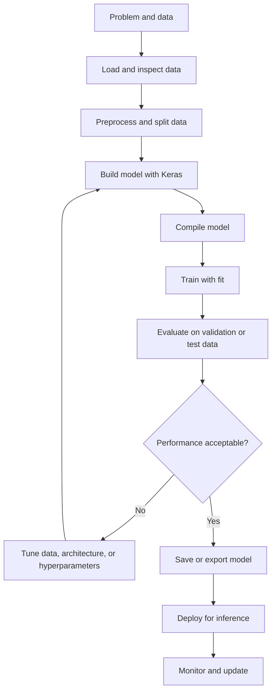
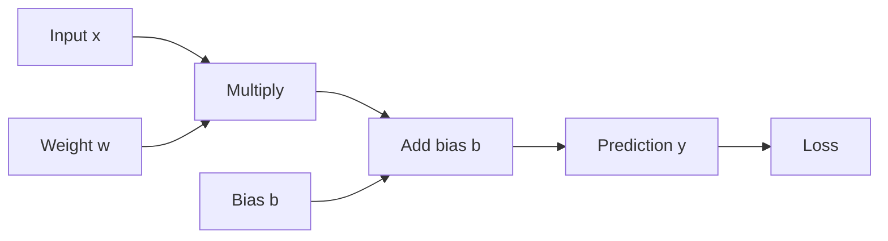
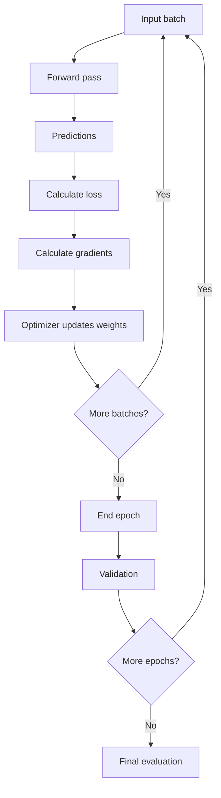
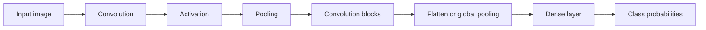
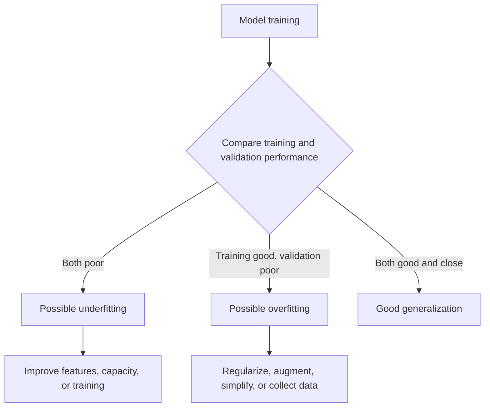
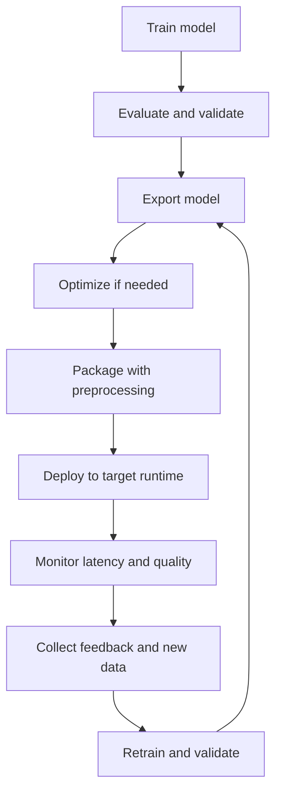
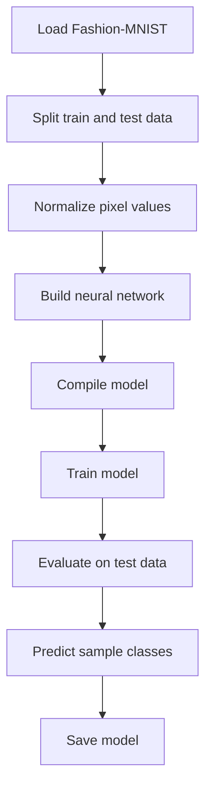
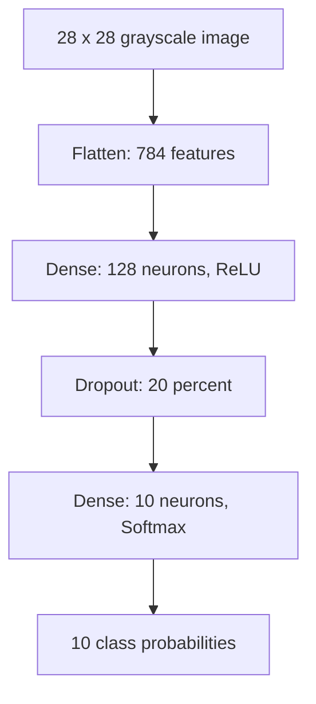
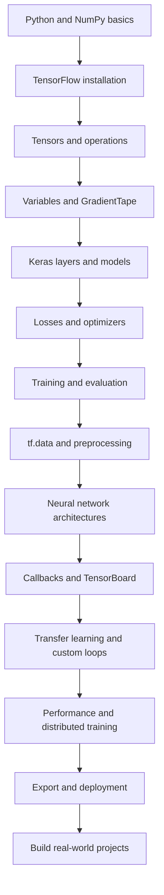

# TensorFlow: Complete Learning Notes

> A structured learning resource covering TensorFlow fundamentals, model
> development, deployment, and advanced topics.

## Table of Contents

1.  [Introduction to TensorFlow](#1--introduction-to-tensorflow)
2.  [Installation and Environment
    Setup](#2--installation-and-environment-setup)
3.  [Core Fundamentals](#3--core-fundamentals)
4.  [Tensors and Tensor Operations](#4--tensors-and-tensor-operations)
5.  [Variables, Automatic Differentiation, and
    Gradients](#5--variables-automatic-differentiation-and-gradients)
6.  [Building Models with Keras](#6--building-models-with-keras)
7.  [Training, Evaluation, and
    Prediction](#7--training-evaluation-and-prediction)
8.  [Data Loading and Preprocessing](#8--data-loading-and-preprocessing)
9.  [Neural Network Concepts](#9--neural-network-concepts)
10. [Model Saving, Loading, and
    Export](#10--model-saving-loading-and-export)
11. [Visualization and Debugging](#11--visualization-and-debugging)
12. [Performance and Hardware
    Acceleration](#12--performance-and-hardware-acceleration)
13. [Advanced TensorFlow Concepts](#13--advanced-tensorflow-concepts)
14. [Deployment and the TensorFlow
    Ecosystem](#14--deployment-and-the-tensorflow-ecosystem)
15. [Real-World Use Cases](#15--real-world-use-cases)
16. [Advantages and Limitations](#16--advantages-and-limitations)
17. [Best Practices](#17--best-practices)
18. [Common Mistakes and
    Troubleshooting](#18--common-mistakes-and-troubleshooting)
19. [Practical Mini-Project: Image
    Classification](#19--practical-mini-project-image-classification)
20. [Interview Preparation](#20--interview-preparation)
21. [Quick Revision](#21--quick-revision)

------------------------------------------------------------------------

# 1. 🌐 Introduction to TensorFlow

## 1.1 What is TensorFlow?

**TensorFlow** is an open-source machine learning framework used to
build, train, evaluate, and deploy machine learning and deep learning
models. It provides APIs for numerical computation, automatic
differentiation, neural networks, data pipelines, and production
deployment.

TensorFlow was originally developed by Google and is maintained as an
open-source project. Its high-level modeling API is **Keras**, which
provides a convenient interface for defining and training neural
networks.

## 1.2 Why use TensorFlow?

-   Build models for regression, classification, forecasting, and
    generative tasks.
-   Run numerical operations on CPUs, GPUs, and supported accelerators.
-   Automatically calculate gradients for optimization.
-   Process large datasets through efficient input pipelines.
-   Export models for servers, browsers, mobile devices, and edge
    environments.
-   Scale training and inference using distributed strategies.

## 1.3 TensorFlow workflow



## 1.4 TensorFlow and related tools

  -----------------------------------------------------------------------
  Tool                                Purpose
  ----------------------------------- -----------------------------------
  TensorFlow                          Numerical computation and machine
                                      learning framework

  Keras                               High-level API for defining and
                                      training models

  `tf.data`                           Input pipelines and dataset
                                      transformations

  TensorBoard                         Training visualization and
                                      profiling

  TensorFlow Lite                     On-device and edge inference

  TensorFlow.js                       Machine learning in JavaScript
                                      environments

  TensorFlow Serving                  Production model serving

  TensorFlow Hub                      Reusable pretrained models

  TensorFlow Probability              Probabilistic modeling and
                                      statistical computation
  -----------------------------------------------------------------------

------------------------------------------------------------------------

# 2. 🛠️ Installation and Environment Setup

## 2.1 Recommended setup

Use a supported Python version and consult the official TensorFlow
installation guide for platform-specific requirements, especially for
GPU support. Install packages inside a virtual environment to avoid
dependency conflicts.

``` bash
python -m venv tf-env
```

Activate the environment:

``` bash
# Windows PowerShell
.\tf-env\Scripts\Activate.ps1

# macOS or Linux
source tf-env/bin/activate
```

Install TensorFlow:

``` bash
python -m pip install --upgrade pip
python -m pip install tensorflow
```

Install optional tools:

``` bash
python -m pip install matplotlib pandas scikit-learn jupyter
```

## 2.2 Verify installation

``` python
import tensorflow as tf

print("TensorFlow version:", tf.__version__)
print("Available devices:", tf.config.list_physical_devices())
print("GPUs:", tf.config.list_physical_devices("GPU"))
```

A GPU appears only when the hardware, drivers, and installed TensorFlow
build are compatible.

## 2.3 Basic project structure

``` text
tensorflow-project/
├── data/
├── notebooks/
├── src/
│   ├── data_pipeline.py
│   ├── model.py
│   └── train.py
├── models/
├── logs/
├── tests/
├── requirements.txt
└── README.md
```

------------------------------------------------------------------------

# 3. 🧠 Core Fundamentals

## 3.1 Important terms

  -----------------------------------------------------------------------
  Term                                Meaning
  ----------------------------------- -----------------------------------
  Tensor                              Multidimensional array used as
                                      TensorFlow's primary data structure

  Rank                                Number of dimensions in a tensor

  Shape                               Size along each dimension

  Axis                                A particular dimension of a tensor

  Dtype                               Data type, such as `float32` or
                                      `int32`

  Model                               A parameterized function that maps
                                      inputs to outputs

  Layer                               A reusable computation inside a
                                      model

  Parameter                           A value learned during training

  Loss function                       Measures prediction error

  Optimizer                           Updates model parameters to reduce
                                      loss

  Epoch                               One complete pass through the
                                      training dataset

  Batch                               A subset of examples processed
                                      together

  Learning rate                       Controls the size of optimizer
                                      updates

  Inference                           Using a trained model to make
                                      predictions
  -----------------------------------------------------------------------

## 3.2 Eager execution and graph execution

TensorFlow normally supports **eager execution**, where operations run
immediately and return concrete results. `tf.function` can trace Python
functions and execute their TensorFlow operations as graphs.

``` python
import tensorflow as tf

x = tf.constant(5)
y = tf.constant(3)

print(x + y)  # tf.Tensor(8, ...)
```

Graph compilation example:

``` python
@tf.function
def add_numbers(a, b):
    return a + b

print(add_numbers(tf.constant(5), tf.constant(3)))
```

  -----------------------------------------------------------------------
  Eager execution                     Graph execution
  ----------------------------------- -----------------------------------
  Operations execute immediately      TensorFlow traces operations into a
                                      graph

  Easier interactive debugging        Can improve performance and
                                      portability

  Python control flow is natural      Tracing and graph constraints must
                                      be understood

  Useful for experimentation          Useful for optimized execution and
                                      deployment
  -----------------------------------------------------------------------

## 3.3 Computational graph

A computational graph represents operations and dependencies between
tensors.



For a simple linear model:

$$
y = wx + b
$$

Here, `x` is the input, `w` is the weight, and `b` is the bias.

------------------------------------------------------------------------

# 4. 🔢 Tensors and Tensor Operations

## 4.1 What is a tensor?

A tensor is a multidimensional data structure. Scalars, vectors,
matrices, and higher-dimensional arrays are all tensors.

  Tensor kind   Example              Shape           Rank
  ------------- -------------------- ------------- ------
  Scalar        `7`                  `()`               0
  Vector        `[1, 2, 3]`          `(3,)`             1
  Matrix        `[[1, 2], [3, 4]]`   `(2, 2)`           2
  3-D tensor    Batch of matrices    `(2, 3, 4)`        3

## 4.2 Creating tensors

``` python
import tensorflow as tf

scalar = tf.constant(10)
vector = tf.constant([1, 2, 3])
matrix = tf.constant([[1, 2], [3, 4]])
zeros = tf.zeros((2, 3))
ones = tf.ones((2, 3))
random_values = tf.random.normal((2, 3))

print("Value:", matrix)
print("Shape:", matrix.shape)
print("Rank:", tf.rank(matrix))
print("Dtype:", matrix.dtype)
```

## 4.3 Common tensor operations

``` python
a = tf.constant([[1, 2], [3, 4]])
b = tf.constant([[5, 6], [7, 8]])

print(a + b)                 # Element-wise addition
print(a * b)                 # Element-wise multiplication
print(tf.matmul(a, b))       # Matrix multiplication
print(tf.reduce_sum(a))      # Sum of all elements
print(tf.reduce_mean(a))     # Mean of all elements
print(tf.transpose(a))       # Transpose
print(tf.reshape(a, (4,)))   # Reshape
```

### Element-wise multiplication vs matrix multiplication

For matrices `A` and `B`:

-   Element-wise multiplication multiplies corresponding elements.
-   Matrix multiplication combines rows and columns according to linear
    algebra rules.

For compatible matrices:

$$
C_{ij} = \sum_k A_{ik}B_{kj}
$$

## 4.4 Shape, reshape, and broadcasting

``` python
x = tf.constant([[1, 2, 3], [4, 5, 6]])

print(x.shape)                 # (2, 3)
print(tf.reshape(x, (3, 2)))   # (3, 2)
print(tf.expand_dims(x, 0).shape)  # (1, 2, 3)
print(tf.squeeze(tf.expand_dims(x, 0)).shape)  # (2, 3)
```

**Broadcasting** allows compatible tensors with different shapes to
participate in an operation without explicitly copying the smaller
tensor.

``` python
matrix = tf.constant([[1, 2, 3], [4, 5, 6]])
bias = tf.constant([10, 20, 30])

print(matrix + bias)
```

Broadcasting aligns dimensions from the right. Each pair of dimensions
must be equal or one of them must be `1`.

## 4.5 Indexing and slicing

``` python
x = tf.constant([[10, 20, 30], [40, 50, 60]])

print(x[0])       # First row
print(x[:, 1])    # Second column
print(x[0, 2])    # Element at row 0, column 2
```

## 4.6 Tensor conversion

``` python
import numpy as np
import tensorflow as tf

array = np.array([1, 2, 3], dtype=np.float32)
tensor = tf.convert_to_tensor(array)

back_to_numpy = tensor.numpy()
```

Use `.numpy()` mainly in eager execution and debugging. It is not
generally available as a normal graph operation inside a traced
`tf.function`.

------------------------------------------------------------------------

# 5. ⚙️ Variables, Automatic Differentiation, and Gradients

## 5.1 Tensor vs Variable

  -----------------------------------------------------------------------
  Feature                 `tf.Tensor`             `tf.Variable`
  ----------------------- ----------------------- -----------------------
  Mutability              Immutable               Mutable

  Typical role            Inputs and intermediate Trainable model state
                          values                  

  Assignment              Not directly assignable Supports `assign()`

  Gradient tracking       Can be watched by a     Trainable variables are
                          tape                    commonly watched
                                                  automatically
  -----------------------------------------------------------------------

Example:

``` python
weight = tf.Variable(2.0)
weight.assign(5.0)
print(weight)
```

## 5.2 Automatic differentiation

TensorFlow's `tf.GradientTape` records operations and calculates
derivatives using automatic differentiation.

For:

$$
y = x^2
$$

The derivative is:

$$
\frac{dy}{dx} = 2x
$$

Code:

``` python
import tensorflow as tf

x = tf.Variable(3.0)

with tf.GradientTape() as tape:
    y = x ** 2

gradient = tape.gradient(y, x)
print(gradient.numpy())  # 6.0
```

## 5.3 Gradient descent

Gradient descent updates parameters in the direction that reduces the
loss.

$$
\theta_{t+1} = \theta_t - \eta \nabla_\theta L(\theta_t)
$$

Where:

-   `theta` represents model parameters.
-   `eta` is the learning rate.
-   `L` is the loss function.
-   `nabla` represents the gradient.

A simple manual update:

``` python
w = tf.Variable(5.0)
learning_rate = 0.1

for step in range(10):
    with tf.GradientTape() as tape:
        loss = (w - 2.0) ** 2

    grad = tape.gradient(loss, w)
    w.assign_sub(learning_rate * grad)

print("Learned value:", w.numpy())
```

## 5.4 GradientTape options

-   `persistent=True`: allows multiple gradient calculations from one
    tape; delete the tape when finished.
-   `watch_accessed_variables=False`: disables automatic watching of
    accessed trainable variables.
-   `tape.watch(tensor)`: explicitly watches a tensor.
-   `tape.gradient(target, sources)`: computes gradients of a target
    with respect to sources.

------------------------------------------------------------------------

# 6. 🏗️ Building Models with Keras

Keras is TensorFlow's high-level API for defining neural network models.

## 6.1 Sequential API

Use `Sequential` when the model is a simple linear stack of layers.

``` python
import tensorflow as tf

model = tf.keras.Sequential([
    tf.keras.layers.Input(shape=(10,)),
    tf.keras.layers.Dense(64, activation="relu"),
    tf.keras.layers.Dense(32, activation="relu"),
    tf.keras.layers.Dense(1)
])

model.summary()
```

## 6.2 Functional API

Use the Functional API for multiple inputs, multiple outputs, shared
layers, or non-linear model connections.

``` python
inputs = tf.keras.Input(shape=(20,))
x = tf.keras.layers.Dense(64, activation="relu")(inputs)
x = tf.keras.layers.Dropout(0.2)(x)
outputs = tf.keras.layers.Dense(3, activation="softmax")(x)

model = tf.keras.Model(inputs=inputs, outputs=outputs)
```

## 6.3 Subclassing API

Subclass `tf.keras.Model` when custom forward-pass logic is needed.

``` python
class CustomModel(tf.keras.Model):
    def __init__(self):
        super().__init__()
        self.hidden = tf.keras.layers.Dense(32, activation="relu")
        self.output_layer = tf.keras.layers.Dense(1)

    def call(self, inputs, training=False):
        x = self.hidden(inputs)
        return self.output_layer(x)

model = CustomModel()
```

  API           Best suited for        Main benefit
  ------------- ---------------------- ------------------------------------
  Sequential    Simple layer stacks    Concise and readable
  Functional    Complex connectivity   Flexible graph of layers
  Subclassing   Custom behavior        Maximum control over forward logic

## 6.4 Common layers

  -----------------------------------------------------------------------
  Layer                               Purpose
  ----------------------------------- -----------------------------------
  `Dense`                             Fully connected transformation

  `Input`                             Defines expected model input

  `Flatten`                           Converts multidimensional features
                                      into a vector

  `Dropout`                           Randomly drops activations during
                                      training

  `BatchNormalization`                Normalizes activations using batch
                                      statistics during training

  `Conv2D`                            Learns spatial filters for
                                      image-like data

  `MaxPooling2D`                      Downsamples feature maps

  `Embedding`                         Maps integer IDs to dense vectors

  `LSTM`                              Processes sequential information
                                      using gated memory

  `GRU`                               Gated recurrent sequence layer

  `LayerNormalization`                Normalizes activations across
                                      configured features
  -----------------------------------------------------------------------

## 6.5 Activations

  Activation   Typical use
  ------------ ----------------------------------------------
  ReLU         Hidden layers in many deep networks
  Leaky ReLU   Allows a small negative-side gradient
  Sigmoid      Binary probability output
  Softmax      Mutually exclusive multi-class probabilities
  Tanh         Outputs values between -1 and 1
  Linear       Regression output

Common formulas:

Sigmoid:

$$
\sigma(x) = \frac{1}{1 + e^{-x}}
$$

ReLU:

$$
ReLU(x) = \max(0, x)
$$

Softmax for class `i`:

$$
softmax(z_i) = \frac{e^{z_i}}{\sum_j e^{z_j}}
$$

## 6.6 Compile a model

The `compile()` method configures the optimizer, loss function, and
metrics.

``` python
model.compile(
    optimizer=tf.keras.optimizers.Adam(learning_rate=0.001),
    loss="sparse_categorical_crossentropy",
    metrics=["accuracy"]
)
```

Choose the loss based on the task and label format:

  -----------------------------------------------------------------------------------
  Task                    Output layer            Common loss
  ----------------------- ----------------------- -----------------------------------
  Binary classification   One sigmoid unit        `binary_crossentropy`

  Multi-class, integer    Softmax with `C` units  `sparse_categorical_crossentropy`
  labels                                          

  Multi-class, one-hot    Softmax with `C` units  `categorical_crossentropy`
  labels                                          

  Regression              Linear output           `mean_squared_error` or
                                                  `mean_absolute_error`
  -----------------------------------------------------------------------------------

------------------------------------------------------------------------

# 7. 📈 Training, Evaluation, and Prediction

## 7.1 The training process



## 7.2 Example training workflow

``` python
import tensorflow as tf

# Example synthetic data: 1,000 samples, 10 features, 3 classes
x_train = tf.random.normal((1000, 10))
y_train = tf.random.uniform((1000,), maxval=3, dtype=tf.int32)

x_valid = tf.random.normal((200, 10))
y_valid = tf.random.uniform((200,), maxval=3, dtype=tf.int32)

model = tf.keras.Sequential([
    tf.keras.layers.Input(shape=(10,)),
    tf.keras.layers.Dense(64, activation="relu"),
    tf.keras.layers.Dense(3, activation="softmax")
])

model.compile(
    optimizer="adam",
    loss="sparse_categorical_crossentropy",
    metrics=["accuracy"]
)

history = model.fit(
    x_train,
    y_train,
    validation_data=(x_valid, y_valid),
    epochs=10,
    batch_size=32
)
```

The synthetic labels above are randomly generated and do not encode a
learnable relationship. This code demonstrates the API, not a meaningful
model-quality result.

## 7.3 Important training arguments

  Argument             Meaning
  -------------------- ------------------------------------------------
  `epochs`             Number of passes through the training data
  `batch_size`         Number of samples per batch
  `validation_data`    Data used to evaluate during training
  `validation_split`   Fraction of array data reserved for validation
  `callbacks`          Hooks for monitoring and controlling training
  `shuffle`            Whether to shuffle training examples
  `verbose`            Controls training progress output

## 7.4 Evaluate and predict

``` python
test_loss, test_accuracy = model.evaluate(x_valid, y_valid, verbose=0)
print("Test loss:", test_loss)
print("Test accuracy:", test_accuracy)

probabilities = model.predict(x_valid[:5])
predicted_classes = tf.argmax(probabilities, axis=1)
print(predicted_classes.numpy())
```

For a fair final estimate, keep a separate test set that was not used
for training or model selection.

## 7.5 Callbacks

Callbacks automate common training tasks.

``` python
callbacks = [
    tf.keras.callbacks.EarlyStopping(
        monitor="val_loss",
        patience=3,
        restore_best_weights=True
    ),
    tf.keras.callbacks.ModelCheckpoint(
        "best_model.keras",
        monitor="val_loss",
        save_best_only=True
    ),
    tf.keras.callbacks.TensorBoard(log_dir="logs")
]

history = model.fit(
    x_train,
    y_train,
    validation_data=(x_valid, y_valid),
    epochs=30,
    callbacks=callbacks
)
```

------------------------------------------------------------------------

# 8. 🧹 Data Loading and Preprocessing

## 8.1 Why preprocessing matters

Model quality depends heavily on data quality. Typical steps include:

1.  Inspect labels, missing values, class balance, and data ranges.
2.  Split data into training, validation, and test sets.
3.  Normalize or standardize numerical features.
4.  Encode categorical labels.
5.  Resize or augment images when appropriate.
6.  Tokenize and pad text sequences when appropriate.
7.  Prevent data leakage by fitting preprocessing only on training data.

## 8.2 `tf.data.Dataset`

`tf.data` provides composable input pipelines.

``` python
import tensorflow as tf

features = tf.random.normal((1000, 10))
labels = tf.random.uniform((1000,), maxval=2, dtype=tf.int32)

dataset = tf.data.Dataset.from_tensor_slices((features, labels))

train_dataset = (
    dataset
    .shuffle(buffer_size=1000)
    .batch(32)
    .prefetch(tf.data.AUTOTUNE)
)
```

## 8.3 Common dataset transformations

  Method                   Purpose
  ------------------------ ------------------------------------------------
  `from_tensor_slices()`   Creates a dataset from tensor slices
  `map()`                  Applies a transformation to each element
  `shuffle()`              Randomizes element order
  `batch()`                Groups elements into batches
  `cache()`                Caches data to reduce repeated work
  `repeat()`               Repeats the dataset
  `prefetch()`             Overlaps input preparation and model execution
  `take()`                 Selects a limited number of elements

## 8.4 Normalization

Min-max scaling:

$$
x' = \frac{x - x_{min}}{x_{max} - x_{min}}
$$

Standardization:

$$
z = \frac{x - \mu}{\sigma}
$$

Use training-set statistics for validation and test data. Do not
calculate normalization statistics from the full dataset before
splitting.

## 8.5 Image preprocessing example

``` python
import tensorflow as tf

image = tf.io.read_file("image.jpg")
image = tf.image.decode_jpeg(image, channels=3)
image = tf.image.resize(image, (224, 224))
image = tf.cast(image, tf.float32) / 255.0
```

## 8.6 Data augmentation

``` python
augmentation = tf.keras.Sequential([
    tf.keras.layers.RandomFlip("horizontal"),
    tf.keras.layers.RandomRotation(0.1),
    tf.keras.layers.RandomZoom(0.1)
])

augmented_images = augmentation(images, training=True)
```

Augmentation should preserve the label. For example, horizontal flipping
may be inappropriate for text images or objects where orientation
changes the class.

------------------------------------------------------------------------

# 9. 🧬 Neural Network Concepts

## 9.1 Artificial neuron

A neuron computes a weighted sum, adds a bias, and applies an activation
function.

$$
z = \sum_{i=1}^{n} w_i x_i + b
$$

$$
a = f(z)
$$

Where `x` is the input, `w` is the weight, `b` is the bias, and `f` is
the activation function.

## 9.2 Common neural network architectures

  -----------------------------------------------------------------------
  Architecture            Main idea               Typical applications
  ----------------------- ----------------------- -----------------------
  Feedforward network     Information flows       Tabular classification
  (MLP)                   through dense layers    and regression

  CNN                     Learns local spatial    Image and video
                          patterns with           analysis
                          convolution             

  RNN                     Processes sequences     Sequence modeling
                          recurrently             

  LSTM                    Uses gates and cell     Time series and
                          state for longer        sequence tasks
                          dependencies            

  GRU                     Simplified gated        Sequence tasks
                          recurrent architecture  

  Autoencoder             Learns compressed       Denoising and anomaly
                          representations         detection

  Transformer             Uses attention to model Language, vision, and
                          relationships           multimodal tasks

  GAN                     Generator and           Synthetic data
                          discriminator compete   generation
  -----------------------------------------------------------------------

## 9.3 CNN architecture



## 9.4 Loss functions

  -----------------------------------------------------------------------
  Loss                                Typical purpose
  ----------------------------------- -----------------------------------
  Mean squared error (MSE)            Regression

  Mean absolute error (MAE)           Regression, less sensitive to large
                                      errors than MSE

  Binary cross-entropy                Binary classification

  Categorical cross-entropy           Multi-class classification with
                                      one-hot labels

  Sparse categorical cross-entropy    Multi-class classification with
                                      integer labels

  Huber loss                          Regression with a transition
                                      between squared and absolute error
  -----------------------------------------------------------------------

MSE:

$$
MSE = \frac{1}{n}\sum_{i=1}^{n}(y_i-\hat{y}_i)^2
$$

Binary cross-entropy:

$$
L = -\frac{1}{n}\sum_{i=1}^{n}
[y_i\log(\hat{y}_i)+(1-y_i)\log(1-\hat{y}_i)]
$$

## 9.5 Optimizers

  Optimizer           Characteristics
  ------------------- ------------------------------------------------------
  SGD                 Basic gradient-based updates
  SGD with momentum   Smooths updates using accumulated direction
  RMSprop             Adapts learning rates using recent squared gradients
  Adam                Combines momentum-like and adaptive scaling behavior
  AdamW               Adam-style optimization with decoupled weight decay

A good starting point is often Adam, but optimizer choice should be
validated for the task.

## 9.6 Overfitting and underfitting

-   **Overfitting:** The model performs well on training data but poorly
    on unseen data.
-   **Underfitting:** The model fails to learn important patterns even
    on training data.
-   **Generalization:** Performance on data not used for fitting.



Common remedies for overfitting include dropout, weight decay, data
augmentation, early stopping, and more representative training data.

------------------------------------------------------------------------

# 10. 💾 Model Saving, Loading, and Export

## 10.1 Save a complete Keras model

``` python
model.save("classifier.keras")
```

Load it:

``` python
loaded_model = tf.keras.models.load_model("classifier.keras")
```

The `.keras` format is a recommended format for saving complete Keras
models in current Keras workflows.

## 10.2 Save weights only

``` python
model.save_weights("classifier.weights.h5")
```

Restore weights into a compatible model architecture:

``` python
model.load_weights("classifier.weights.h5")
```

## 10.3 Export for serving

For TensorFlow serving workflows, export a SavedModel artifact using the
export mechanism supported by the installed Keras version.

``` python
model.export("exported_model")
```

For older or different TensorFlow/Keras workflows, consult the
version-specific API documentation. Model saving and serving formats are
not interchangeable in every toolchain.

## 10.4 Checkpointing

Checkpoints preserve model state during training and help recover from
interruptions.

``` python
checkpoint = tf.train.Checkpoint(
    optimizer=optimizer,
    model=model
)

manager = tf.train.CheckpointManager(
    checkpoint,
    directory="checkpoints",
    max_to_keep=3
)

manager.save()
```

------------------------------------------------------------------------

# 11. 📊 Visualization and Debugging

## 11.1 Plot training history

``` python
import matplotlib.pyplot as plt

plt.plot(history.history["loss"], label="Training loss")
if "val_loss" in history.history:
    plt.plot(history.history["val_loss"], label="Validation loss")

plt.xlabel("Epoch")
plt.ylabel("Loss")
plt.legend()
plt.show()
```

## 11.2 TensorBoard

TensorBoard helps inspect loss curves, metrics, model graphs,
histograms, and profiling information.

``` bash
tensorboard --logdir logs
```

Open the local address printed by TensorBoard in a browser.

## 11.3 Debugging checklist

-   Print tensor shapes and dtypes.
-   Check for `NaN` and infinite values.
-   Verify that labels match the output layer and loss function.
-   Confirm that the model receives the expected input range.
-   Inspect training and validation metrics separately.
-   Start with a small dataset to verify that the model can learn.
-   Check whether gradients are missing or exploding.
-   Use TensorBoard or the profiler to identify performance bottlenecks.

------------------------------------------------------------------------

# 12. 🚀 Performance and Hardware Acceleration

## 12.1 CPU vs GPU

  -----------------------------------------------------------------------
  CPU                                 GPU
  ----------------------------------- -----------------------------------
  General-purpose processor           Highly parallel processor

  Often effective for small workloads Often effective for large tensor
  and preprocessing                   operations

  Lower setup complexity              Requires compatible hardware and
                                      software

  May be faster for small models due  Benefits depend on workload size
  to lower overhead                   and memory transfer
  -----------------------------------------------------------------------

Check available devices:

``` python
import tensorflow as tf

print(tf.config.list_physical_devices("CPU"))
print(tf.config.list_physical_devices("GPU"))
```

## 12.2 Performance practices

-   Use batches sized appropriately for available memory.
-   Build efficient `tf.data` pipelines with parallel mapping and
    prefetching.
-   Profile before optimizing.
-   Avoid unnecessary Python work inside performance-critical loops.
-   Use graph execution with `tf.function` where it helps.
-   Consider mixed precision on supported hardware.
-   Avoid repeatedly transferring tensors between CPU and accelerator
    memory.
-   Measure end-to-end throughput, not just model execution time.

## 12.3 Mixed precision

Mixed precision uses lower-precision arithmetic for selected operations
to improve speed or reduce memory use on supported hardware.

``` python
from tensorflow.keras import mixed_precision

mixed_precision.set_global_policy("mixed_float16")
```

For numerical stability, some outputs or loss computations may need
float32. Validate accuracy and numerical behavior after enabling mixed
precision.

## 12.4 Distributed training

TensorFlow provides distribution strategies for multi-device and
multi-worker training.

``` python
strategy = tf.distribute.MirroredStrategy()

with strategy.scope():
    model = tf.keras.Sequential([
        tf.keras.layers.Input(shape=(20,)),
        tf.keras.layers.Dense(64, activation="relu"),
        tf.keras.layers.Dense(1)
    ])
    model.compile(optimizer="adam", loss="mse")
```

Common strategies:

  -----------------------------------------------------------------------
  Strategy                            Use
  ----------------------------------- -----------------------------------
  `DefaultStrategy`                   Standard single-device execution

  `MirroredStrategy`                  Synchronous training across
                                      multiple local GPUs

  `MultiWorkerMirroredStrategy`       Synchronous training across
                                      multiple workers

  `TPUStrategy`                       Training on supported TPUs

  `ParameterServerStrategy`           Parameter-server style distributed
                                      training
  -----------------------------------------------------------------------

------------------------------------------------------------------------

# 13. 🧪 Advanced TensorFlow Concepts

## 13.1 Custom training loop

Use a custom loop when `model.fit()` does not provide enough control
over the training process.

``` python
optimizer = tf.keras.optimizers.Adam()
loss_fn = tf.keras.losses.MeanSquaredError()

for x_batch, y_batch in train_dataset:
    with tf.GradientTape() as tape:
        predictions = model(x_batch, training=True)
        loss = loss_fn(y_batch, predictions)

    gradients = tape.gradient(loss, model.trainable_variables)
    optimizer.apply_gradients(zip(gradients, model.trainable_variables))
```

For production-quality loops, track metrics, handle regularization
losses, define validation steps, and manage checkpoints.

## 13.2 Custom layer

``` python
class ScaleLayer(tf.keras.layers.Layer):
    def __init__(self, initial_scale=1.0):
        super().__init__()
        self.initial_scale = initial_scale

    def build(self, input_shape):
        self.scale = self.add_weight(
            name="scale",
            shape=(),
            initializer=tf.keras.initializers.Constant(self.initial_scale),
            trainable=True
        )

    def call(self, inputs):
        return inputs * self.scale
```

## 13.3 Custom loss function

``` python
def mean_absolute_percentage_error(y_true, y_pred):
    epsilon = tf.keras.backend.epsilon()
    denominator = tf.maximum(tf.abs(y_true), epsilon)
    return tf.reduce_mean(tf.abs((y_true - y_pred) / denominator)) * 100
```

Be careful with percentage-based losses when targets are near zero.

## 13.4 Attention mechanism

Attention allows a model to weight different elements of an input
according to their relevance.

Scaled dot-product attention:

$$
Attention(Q,K,V) =
softmax\left(\frac{QK^T}{\sqrt{d_k}}\right)V
$$

Where:

-   `Q` is the query matrix.
-   `K` is the key matrix.
-   `V` is the value matrix.
-   `d_k` is the key dimension.

TensorFlow provides attention-related layers such as
`tf.keras.layers.Attention` and `tf.keras.layers.MultiHeadAttention`.

## 13.5 Transfer learning

Transfer learning reuses a model pretrained on a large dataset.

Typical workflow:

1.  Load a pretrained backbone.
2.  Freeze its layers initially.
3.  Add a task-specific classification or regression head.
4.  Train the new head.
5.  Optionally unfreeze selected backbone layers.
6.  Fine-tune with a smaller learning rate.

``` python
base_model = tf.keras.applications.MobileNetV2(
    input_shape=(224, 224, 3),
    include_top=False,
    weights="imagenet"
)
base_model.trainable = False

inputs = tf.keras.Input(shape=(224, 224, 3))
x = tf.keras.applications.mobilenet_v2.preprocess_input(inputs)
x = base_model(x, training=False)
x = tf.keras.layers.GlobalAveragePooling2D()(x)
outputs = tf.keras.layers.Dense(5, activation="softmax")(x)

transfer_model = tf.keras.Model(inputs, outputs)
```

When fine-tuning, recompile after changing trainability and use a
suitably small learning rate.

## 13.6 Quantization and pruning

-   **Quantization:** Reduces numerical precision to lower model size or
    improve inference efficiency.
-   **Pruning:** Removes or zeros less important weights to encourage a
    sparse model.
-   **Knowledge distillation:** Trains a smaller student model to
    reproduce useful behavior of a larger teacher model.

These techniques can improve deployment efficiency, but the actual
benefit depends on hardware, runtime support, and model architecture.

## 13.7 Reproducibility

``` python
import tensorflow as tf
import random
import numpy as np

seed = 42
tf.keras.utils.set_random_seed(seed)
```

Reproducibility can still vary across hardware, kernels, distributed
execution, and software versions. Record package versions, data
versions, preprocessing, and training configuration.

------------------------------------------------------------------------

# 14. 📦 Deployment and the TensorFlow Ecosystem

## 14.1 Deployment options

  Technology           Target
  -------------------- ---------------------------------------------
  TensorFlow Serving   Scalable server-side inference
  TensorFlow Lite      Mobile, embedded, and edge devices
  TensorFlow.js        Browser and Node.js environments
  SavedModel export    TensorFlow-compatible serving and tooling
  TensorFlow Hub       Reuse and share pretrained model components

## 14.2 Typical deployment pipeline



## 14.3 Production considerations

-   Validate input schema, shape, dtype, and value range.
-   Version models and preprocessing code together.
-   Monitor latency, throughput, errors, and resource usage.
-   Monitor data drift and model quality where ground truth becomes
    available.
-   Protect model endpoints and sensitive data.
-   Test rollback and recovery procedures.
-   Keep a reproducible record of training data and configuration.

------------------------------------------------------------------------

# 15. 🌍 Real-World Use Cases

  -----------------------------------------------------------------------
  Domain                  Example                 TensorFlow approach
  ----------------------- ----------------------- -----------------------
  Healthcare research     Medical image           CNNs and transfer
                          classification          learning

  Finance                 Transaction anomaly     Dense networks,
                          detection               autoencoders

  Retail                  Product recommendations Embeddings and ranking
                                                  models

  Manufacturing           Predictive maintenance  Time-series models

  Agriculture             Plant disease           Image classification
                          recognition             

  Transport               Traffic forecasting     Sequence and
                                                  spatiotemporal models

  Language                Text classification     Embeddings and
                                                  Transformer models

  Security                Visual inspection       Object detection and
                                                  segmentation

  Energy                  Demand forecasting      Regression and sequence
                                                  models

  Mobile apps             On-device image         TensorFlow Lite
                          recognition             
  -----------------------------------------------------------------------

A real-world system also requires representative data, domain
validation, privacy safeguards, monitoring, and human oversight where
decisions have significant consequences.

------------------------------------------------------------------------

# 16. ⚖️ Advantages and Limitations

## 16.1 Advantages

-   Open-source ecosystem and broad community.
-   High-level Keras API and low-level tensor operations.
-   Automatic differentiation.
-   CPU and accelerator support.
-   Data pipeline and visualization tools.
-   Multiple deployment options.
-   Distributed training capabilities.
-   Large collection of pretrained models and learning resources.

## 16.2 Limitations

-   API and packaging differences across TensorFlow, Keras, and version
    combinations can create compatibility challenges.
-   GPU setup may require careful driver and runtime configuration.
-   Debugging traced graphs can be less straightforward than eager code.
-   Deep learning can require substantial compute, memory, and data.
-   Model performance depends on data quality and careful
    experimentation.
-   Small workloads may not benefit from GPU acceleration.
-   Deployment formats and operators may differ across target runtimes.

## 16.3 TensorFlow vs PyTorch

  -----------------------------------------------------------------------
  Feature                 TensorFlow              PyTorch
  ----------------------- ----------------------- -----------------------
  Main ecosystem          TensorFlow and Keras    PyTorch ecosystem

  Model development       Keras APIs and custom   `torch.nn` and
                          TensorFlow code         Python-first workflows

  Automatic               `tf.GradientTape`       `torch.autograd`
  differentiation                                 

  Data pipeline           `tf.data`               `Dataset` and
                                                  `DataLoader`

  Visualization           TensorBoard             TensorBoard support and
                                                  other tools

  Deployment              Serving, Lite,.js       Torch ecosystem and
                                                  export/runtime options

  Typical strength        Integrated production   Flexible research and
                          and deployment          Python-native
                          ecosystem               experimentation
  -----------------------------------------------------------------------

Both frameworks are capable. Choose based on project requirements, team
expertise, hardware, deployment targets, and ecosystem constraints.

------------------------------------------------------------------------

# 17. ✅ Best Practices

## 17.1 Data and experiment practices

-   Split data before fitting preprocessing transformations.
-   Keep the test set untouched until final evaluation.
-   Check class balance and use suitable metrics.
-   Document feature engineering and label definitions.
-   Track random seeds, versions, hyperparameters, and dataset
    revisions.
-   Build a simple baseline before a complex architecture.

## 17.2 Modeling practices

-   Start with a small, understandable model.
-   Match the output activation and loss to the target format.
-   Monitor validation metrics, not training metrics alone.
-   Use early stopping and checkpointing where appropriate.
-   Tune learning rate before making the architecture unnecessarily
    complex.
-   Prefer transfer learning when suitable pretrained models exist.
-   Inspect errors by class or data subgroup.

## 17.3 Engineering practices

-   Separate data loading, model definition, training, and evaluation
    code.
-   Use `tf.data` for scalable input pipelines.
-   Profile before optimizing.
-   Save model artifacts and configuration together.
-   Test model loading and inference in a clean environment.
-   Validate performance on the actual deployment hardware.

------------------------------------------------------------------------

# 18. 🧯 Common Mistakes and Troubleshooting

  ---------------------------------------------------------------------------
  Problem                 Likely cause            Suggested fix
  ----------------------- ----------------------- ---------------------------
  Shape mismatch          Incorrect input shape   Inspect tensor shapes and
                          or batch dimensions     layer expectations

  Wrong loss behavior     Loss does not match     Match
                          label encoding          sparse/categorical/binary
                                                  loss to labels

  Accuracy stuck near     Label, preprocessing,   Inspect labels, class
  chance                  or model issue          balance, and predictions

  `NaN` loss              Too-high learning rate  Check inputs, gradients,
                          or invalid values       and learning rate

  Out-of-memory error     Batch/model too large   Reduce batch size or model
                                                  size

  GPU not detected        Incompatible            Follow official
                          driver/runtime/build    installation instructions

  Overfitting             Model memorizes         Add regularization,
                          training examples       augmentation, or data

  Slow input pipeline     Data loading bottleneck Use parallel `map`,
                                                  `cache`, and `prefetch`
                                                  appropriately

  Poor inference speed    Unoptimized model or    Profile and test
                          data transfers          target-specific
                                                  optimization

  `None` gradients        Disconnected            Inspect graph path and
                          computation or          gradient tape usage
                          unwatched source        
  ---------------------------------------------------------------------------

## 18.1 Frequent conceptual mistakes

1.  Confusing tensor rank with the number of elements.
2.  Using `categorical_crossentropy` with integer class IDs instead of
    sparse categorical loss.
3.  Applying softmax twice when the selected loss already expects
    logits.
4.  Using test data repeatedly for hyperparameter tuning.
5.  Normalizing the full dataset before splitting and causing leakage.
6.  Forgetting to set `training=False` when manually calling certain
    layers during inference.
7.  Assuming GPU availability guarantees faster execution.
8.  Saving only weights and forgetting the model architecture or
    preprocessing configuration.

------------------------------------------------------------------------

# 19. 🧪 Practical Mini-Project: Image Classification

## 19.1 Objective

Build a small image classifier using the Fashion-MNIST dataset. The
dataset contains grayscale images of clothing items across ten classes.

The project demonstrates:

-   Loading a built-in dataset.
-   Normalizing image pixels.
-   Defining a neural network.
-   Compiling and training the model.
-   Evaluating performance.
-   Predicting a class for a sample image.
-   Saving the trained model.

## 19.2 Project workflow



## 19.3 Complete code

``` python
import tensorflow as tf
import numpy as np
import matplotlib.pyplot as plt

# 1. Load dataset
fashion_mnist = tf.keras.datasets.fashion_mnist
(x_train, y_train), (x_test, y_test) = fashion_mnist.load_data()

class_names = [
    "T-shirt/top", "Trouser", "Pullover", "Dress", "Coat",
    "Sandal", "Shirt", "Sneaker", "Bag", "Ankle boot"
]

# 2. Normalize pixels from [0, 255] to [0, 1]
x_train = x_train.astype("float32") / 255.0
x_test = x_test.astype("float32") / 255.0

# 3. Build model
model = tf.keras.Sequential([
    tf.keras.layers.Input(shape=(28, 28)),
    tf.keras.layers.Flatten(),
    tf.keras.layers.Dense(128, activation="relu"),
    tf.keras.layers.Dropout(0.2),
    tf.keras.layers.Dense(10, activation="softmax")
])

# 4. Compile model
model.compile(
    optimizer="adam",
    loss="sparse_categorical_crossentropy",
    metrics=["accuracy"]
)

# 5. Train model
early_stopping = tf.keras.callbacks.EarlyStopping(
    monitor="val_loss",
    patience=3,
    restore_best_weights=True
)

history = model.fit(
    x_train,
    y_train,
    epochs=15,
    batch_size=64,
    validation_split=0.1,
    callbacks=[early_stopping]
)

# 6. Evaluate model
test_loss, test_accuracy = model.evaluate(x_test, y_test, verbose=0)
print(f"Test loss: {test_loss:.4f}")
print(f"Test accuracy: {test_accuracy:.4f}")

# 7. Predict one image
sample = x_test[:1]
probabilities = model.predict(sample, verbose=0)
predicted_index = int(np.argmax(probabilities[0]))

print("Predicted class:", class_names[predicted_index])
print("Actual class:", class_names[int(y_test[0])])

plt.imshow(x_test[0], cmap="gray")
plt.title(f"Prediction: {class_names[predicted_index]}")
plt.axis("off")
plt.show()

# 8. Save complete model
model.save("fashion_classifier.keras")
```

## 19.4 Understanding the architecture



## 19.5 Improvements to try

-   Replace the dense network with a CNN using `Conv2D` and
    `MaxPooling2D`.
-   Compare Adam with SGD and momentum.
-   Experiment with batch sizes and learning rates.
-   Plot training and validation accuracy.
-   Inspect a confusion matrix to identify commonly confused classes.
-   Add data augmentation where appropriate.
-   Export and benchmark a lightweight version for edge inference.

------------------------------------------------------------------------

# 20. 🎯 Interview Preparation

## 20.1 Frequently asked questions

### Q1. What is TensorFlow?

TensorFlow is an open-source framework for numerical computation and
machine learning. It supports tensors, automatic differentiation, neural
network construction, training, and deployment.

### Q2. What is a tensor?

A tensor is a multidimensional array. Its rank indicates the number of
dimensions, its shape describes dimension sizes, and its dtype describes
the element type.

### Q3. What is the difference between a tensor and a variable?

A tensor is immutable. A `tf.Variable` is mutable and is commonly used
to store trainable parameters.

### Q4. What is `GradientTape`?

`tf.GradientTape` records operations and computes derivatives
automatically. It is central to implementing gradient-based learning.

### Q5. What is the difference between `fit()` and a custom training loop?

`fit()` provides a high-level training workflow with callbacks and
validation support. A custom loop provides explicit control over forward
passes, losses, gradients, and updates.

### Q6. What is an epoch?

An epoch is one complete pass through the training dataset.

### Q7. What is a batch?

A batch is a group of training examples processed together in one step.

### Q8. What is overfitting?

Overfitting occurs when a model learns training-specific patterns and
does not generalize well to unseen data.

### Q9. What is the purpose of dropout?

Dropout randomly disables a fraction of activations during training to
reduce co-adaptation and help regularize a model.

### Q10. What is the difference between sparse and categorical cross-entropy?

Categorical cross-entropy generally expects one-hot encoded labels.
Sparse categorical cross-entropy expects integer class IDs.

### Q11. What is `tf.data`?

`tf.data` is TensorFlow's API for building input pipelines that
transform, batch, shuffle, cache, and prefetch data.

### Q12. What is transfer learning?

Transfer learning reuses knowledge from a pretrained model and adapts it
to a new task, often with less data and training time.

### Q13. What is TensorBoard?

TensorBoard is a visualization and profiling tool for inspecting
metrics, graphs, histograms, and performance.

### Q14. What is the purpose of `tf.function`?

It traces TensorFlow operations into a graph representation that can
enable optimized execution and graph-based workflows.

### Q15. What is the difference between training and inference?

Training updates model parameters using data and an optimization
process. Inference uses learned parameters to generate predictions.

## 20.2 Important interview comparisons

  -----------------------------------------------------------------------
  Comparison                          Key distinction
  ----------------------------------- -----------------------------------
  Rank vs shape                       Number of dimensions vs size of
                                      each dimension

  Epoch vs batch                      Full dataset pass vs subset of
                                      samples

  Parameter vs hyperparameter         Learned value vs configuration
                                      selected outside training

  Training vs inference               Parameter updates vs prediction

  Loss vs metric                      Optimization objective vs
                                      evaluation measurement

  CNN vs RNN                          Spatial pattern processing vs
                                      recurrent sequence processing

  Validation vs test                  Model selection vs final unbiased
                                      evaluation

  Eager vs graph                      Immediate execution vs traced graph
                                      execution
  -----------------------------------------------------------------------

## 20.3 Practical interview exercises

1.  Create a tensor and print its rank, shape, and dtype.
2.  Calculate the gradient of a scalar function with `GradientTape`.
3.  Build a binary classifier using Keras.
4.  Explain why a validation set is needed.
5.  Construct a `tf.data` pipeline with shuffle, batch, and prefetch.
6.  Save a model and load it for inference.
7.  Diagnose a model whose training accuracy rises while validation
    accuracy falls.

------------------------------------------------------------------------

# 21. ⚡ Quick Revision

## 21.1 Key points

-   TensorFlow is a framework for machine learning and numerical
    computation.
-   Tensors are the core data structure.
-   `tf.Variable` stores mutable state such as trainable weights.
-   `tf.GradientTape` computes gradients automatically.
-   Keras provides Sequential, Functional, and subclassing model APIs.
-   `compile()` configures optimizer, loss, and metrics.
-   `fit()` trains a model; `evaluate()` measures performance;
    `predict()` generates outputs.
-   `tf.data` builds scalable input pipelines.
-   Callbacks support early stopping, checkpointing, and logging.
-   TensorBoard supports visualization and profiling.
-   Transfer learning reuses pretrained representations.
-   TensorFlow supports multiple deployment targets, including mobile
    and browser environments.

## 21.2 Essential commands

  Command                                  Purpose
  ---------------------------------------- ---------------------------------------
  `tf.constant(value)`                     Create an immutable tensor
  `tf.Variable(value)`                     Create a mutable variable
  `tf.zeros(shape)`                        Create a tensor filled with zeros
  `tf.ones(shape)`                         Create a tensor filled with ones
  `tf.reshape(x, shape)`                   Reshape a tensor
  `tf.transpose(x)`                        Transpose a tensor
  `tf.matmul(a, b)`                        Matrix multiplication
  `tf.reduce_mean(x)`                      Calculate mean
  `tf.GradientTape()`                      Record operations for differentiation
  `tf.function`                            Trace a function for graph execution
  `tf.data.Dataset.from_tensor_slices()`   Build a dataset
  `model.compile()`                        Configure training
  `model.fit()`                            Train a model
  `model.evaluate()`                       Evaluate a model
  `model.predict()`                        Generate predictions
  `model.save()`                           Save a Keras model
  `tf.keras.models.load_model()`           Load a saved Keras model
  `tf.config.list_physical_devices()`      List available devices

## 21.3 Important formulas

Linear neuron:

$$
z = wx + b
$$

Mean squared error:

$$
MSE = \frac{1}{n}\sum_{i=1}^{n}(y_i-\hat{y}_i)^2
$$

Gradient descent:

$$
\theta_{t+1} = \theta_t - \eta \nabla_\theta L(\theta_t)
$$

Sigmoid:

$$
\sigma(x) = \frac{1}{1+e^{-x}}
$$

ReLU:

$$
ReLU(x) = \max(0,x)
$$

Softmax:

$$
softmax(z_i) = \frac{e^{z_i}}{\sum_j e^{z_j}}
$$

Standardization:

$$
z = \frac{x-\mu}{\sigma}
$$

## 21.4 Visual learning roadmap



## 21.5 Suggested learning sequence

  -----------------------------------------------------------------------
  Stage                   Focus                   Practice outcome
  ----------------------- ----------------------- -----------------------
  Beginner                Python, tensors,        Manipulate tensors
                          operations              confidently

  Beginner                Variables and gradients Understand automatic
                                                  differentiation

  Intermediate            Keras and model         Build regression and
                          training                classification models

  Intermediate            Data pipelines          Prepare efficient
                                                  datasets

  Intermediate            CNNs and sequence       Solve image and
                          models                  time-series tasks

  Advanced                Custom loops and layers Implement specialized
                                                  training logic

  Advanced                Transfer learning and   Improve model quality
                          optimization            and efficiency

  Deployment              Export and serving      Run models outside the
                                                  training notebook
  -----------------------------------------------------------------------

## 21.6 Final checklist

-   [ ] I can explain tensors, rank, shape, and dtype.
-   [ ] I can create tensors and perform common operations.
-   [ ] I understand variables and automatic differentiation.
-   [ ] I can build models with the Keras APIs.
-   [ ] I can select an appropriate loss and output activation.
-   [ ] I can train, validate, evaluate, and predict.
-   [ ] I can build a `tf.data` pipeline.
-   [ ] I can recognize overfitting and underfitting.
-   [ ] I can save and reload a model.
-   [ ] I can use TensorBoard and basic callbacks.
-   [ ] I understand transfer learning and deployment options.
-   [ ] I have completed at least one end-to-end project.

------------------------------------------------------------------------

## 📚 Official Learning Resources

-   TensorFlow documentation: https://www.tensorflow.org/learn
-   TensorFlow tutorials: https://www.tensorflow.org/tutorials
-   TensorFlow API reference: https://www.tensorflow.org/api_docs
-   Keras documentation: https://keras.io/
-   TensorBoard guide: https://www.tensorflow.org/tensorboard
-   TensorFlow Lite guide: https://www.tensorflow.org/lite
-   TensorFlow.js: https://www.tensorflow.org/js

> **Learning advice:** Understand the tensor and gradient fundamentals
> first. Then build small Keras models, learn reliable data pipelines,
> and progress to transfer learning, performance optimization, and
> deployment. Practical experimentation is essential for developing
> strong TensorFlow skills.
