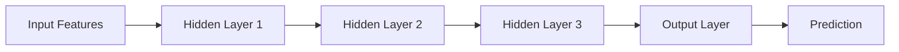
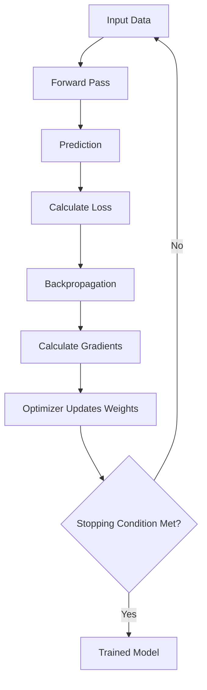
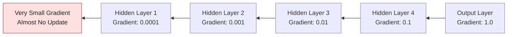
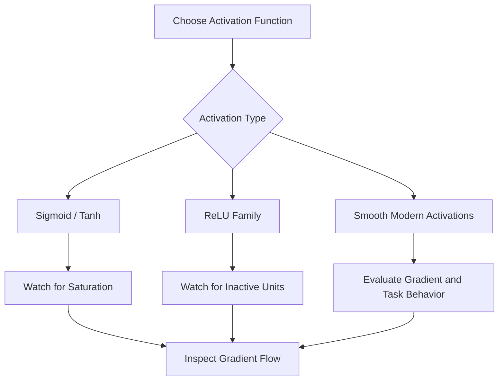
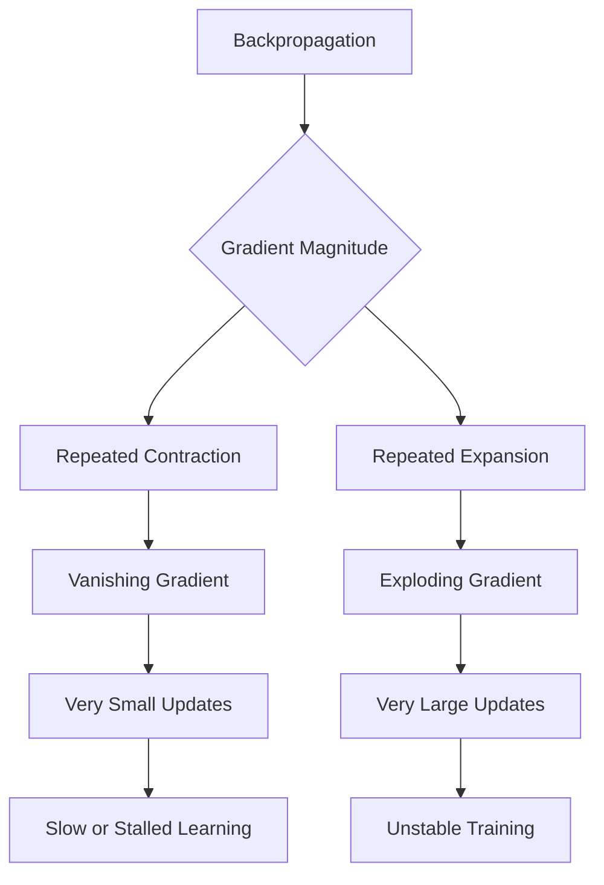
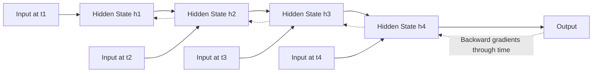
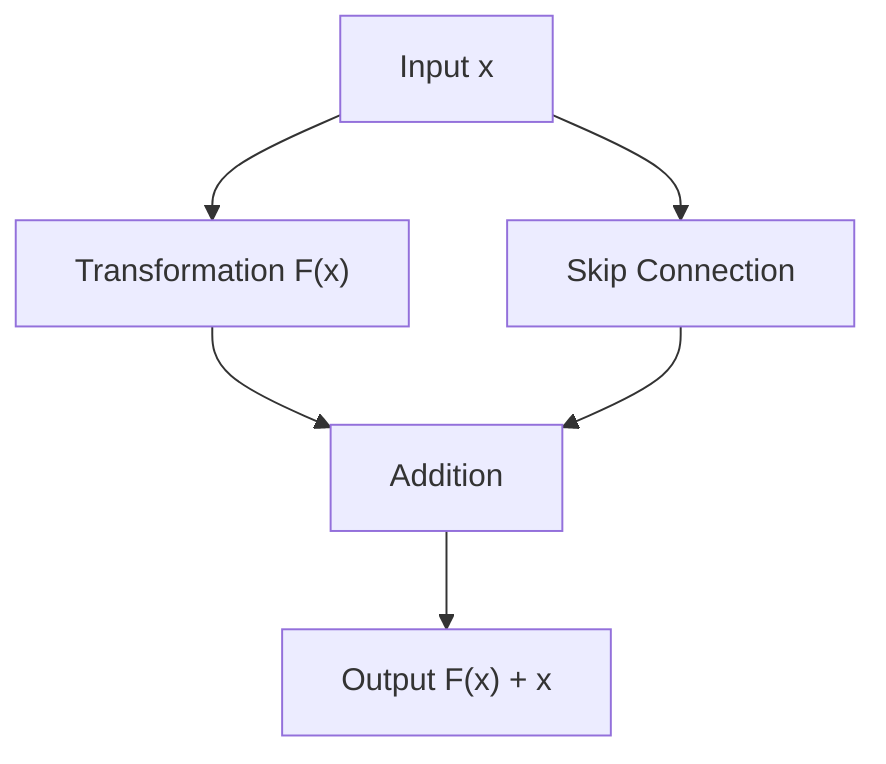
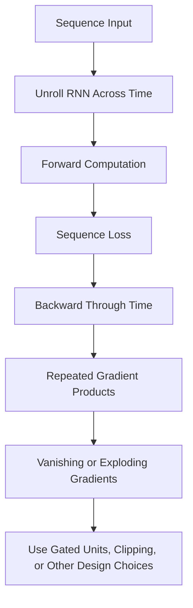
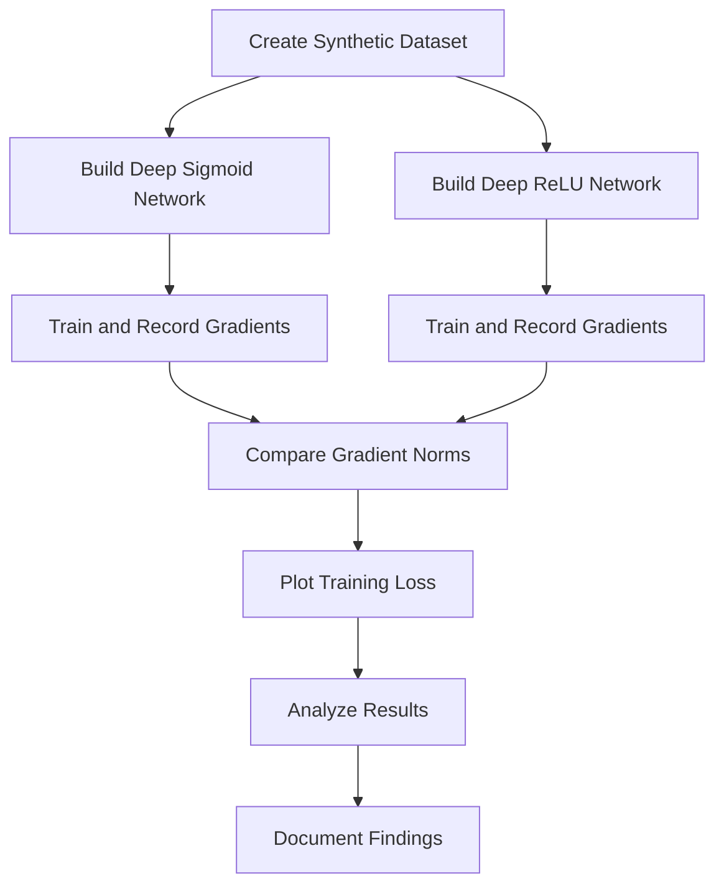
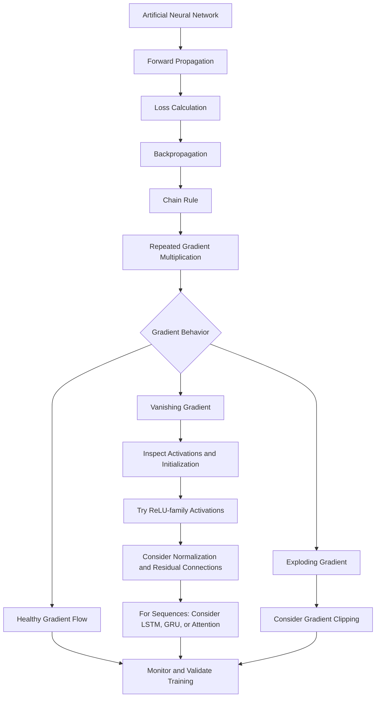

# Vanishing Gradient Problem in Artificial Neural Networks (ANN)

## 📚 Table of Contents

1.  [Introduction](#1--introduction)
2.  [Fundamentals of Neural Network
    Learning](#2--fundamentals-of-neural-network-learning)
3.  [What Is the Vanishing Gradient
    Problem?](#3--what-is-the-vanishing-gradient-problem)
4.  [Mathematical Explanation](#4--mathematical-explanation)
5.  [Why Vanishing Gradients Occur](#5--why-vanishing-gradients-occur)
6.  [Role of Activation Functions](#6--role-of-activation-functions)
7.  [How Vanishing Gradients Affect
    Training](#7--how-vanishing-gradients-affect-training)
8.  [Vanishing Gradient vs. Exploding
    Gradient](#8--vanishing-gradient-vs-exploding-gradient)
9.  [Where the Problem Appears](#9--where-the-problem-appears)
10. [Techniques to Solve or Reduce
    It](#10--techniques-to-solve-or-reduce-it)
11. [Practical Python Examples](#11--practical-python-examples)
12. [Real-World Applications and
    Examples](#12--real-world-applications-and-examples)
13. [Advantages and Limitations of Mitigation
    Techniques](#13--advantages-and-limitations-of-mitigation-techniques)
14. [Best Practices](#14--best-practices)
15. [Common Mistakes](#15--common-mistakes)
16. [Advanced Concepts](#16--advanced-concepts)
17. [Practical Mini-Project](#17--practical-mini-project)
18. [Interview Questions and
    Answers](#18--interview-questions-and-answers)
19. [Quick Revision](#19--quick-revision)

------------------------------------------------------------------------

## 1. 🎯 Introduction

The **Vanishing Gradient Problem** is a major optimization challenge in
deep Artificial Neural Networks (ANNs), especially networks containing
many layers and recurrent neural networks (RNNs).

Neural networks learn by adjusting their weights and biases to reduce a
loss function. They commonly use **backpropagation** and a
gradient-based optimizer to determine how each parameter should change.

During backpropagation, gradients are propagated from the output layer
toward earlier layers. If these gradients become extremely small, the
earlier layers receive almost no useful learning signal. Their weights
therefore change very slowly or may appear not to change at all.

### 1.1 Why this topic matters

-   Deep networks need useful gradients to learn representations across
    many layers.
-   Early layers may learn slowly when gradients shrink during
    backpropagation.
-   Long-sequence RNNs can struggle to learn relationships between
    distant time steps.
-   Architecture, activation functions, initialization, normalization,
    and optimization choices can influence gradient flow.

### 1.2 Learning objectives

After studying this topic, you should be able to:

-   Define gradients, backpropagation, and the vanishing gradient
    problem.
-   Explain the mathematical reason gradients can shrink.
-   Identify activation functions and network designs that contribute to
    the issue.
-   Distinguish vanishing gradients from exploding gradients.
-   Apply practical techniques to improve gradient flow.
-   Diagnose gradient behavior in a neural network using Python.

------------------------------------------------------------------------

## 2. 🧠 Fundamentals of Neural Network Learning

### 2.1 What is an Artificial Neural Network?

An Artificial Neural Network is a machine learning model inspired by
interconnected neurons. It contains layers of computational units that
transform input data into predictions.

A typical feed-forward ANN contains:

1.  **Input layer:** Receives input features.
2.  **Hidden layers:** Learn intermediate patterns and representations.
3.  **Output layer:** Produces the final prediction.



### 2.2 How does an artificial neuron work?

A neuron calculates a weighted sum of its inputs, adds a bias, and
applies an activation function.

$$
z = \sum_{i=1}^{n} w_i x_i + b
$$

$$
a = f(z)
$$

Where:

  Symbol    Meaning
  --------- ----------------------------------
  $$x_i$$   Input feature
  $$w_i$$   Weight associated with the input
  $$b$$     Bias
  $$z$$     Weighted sum before activation
  $$f$$     Activation function
  $$a$$     Neuron output or activation

### 2.3 What is a loss function?

A loss function measures the difference between a model's prediction and
the expected target.

For example, Mean Squared Error (MSE) for regression is:

$$
MSE = \frac{1}{N}\sum_{i=1}^{N}(y_i-\hat{y}_i)^2
$$

A training algorithm attempts to minimize this loss.

### 2.4 What is a gradient?

A gradient represents the rate and direction of change of a function
with respect to its parameters.

For a loss function and weight:

$$
\frac{\partial L}{\partial w}
$$

The gradient tells the optimizer how the loss changes when the weight
changes.

### 2.5 What is backpropagation?

Backpropagation applies the chain rule of calculus to calculate
gradients of the loss with respect to model parameters.



The typical weight update using gradient descent is:

$$
w_{\text{new}} = w_{\text{old}} - \eta \frac{\partial L}{\partial w}
$$

Where:

-   $$\eta$$ is the learning rate.
-   $$\frac{\partial L}{\partial w}$$ is the gradient of the loss with
    respect to the weight.

**Important:** Backpropagation calculates gradients; the optimizer uses
those gradients to update parameters.

------------------------------------------------------------------------

## 3. ⚠️ What Is the Vanishing Gradient Problem?

The vanishing gradient problem occurs when gradients become
progressively smaller as they are propagated backward through a deep
network or across many time steps.

When the gradient reaching an early layer is extremely close to zero,
the corresponding parameters receive very small updates. As a result,
those layers learn slowly or fail to learn useful features within the
available training time.

### 3.1 Simple intuition

Imagine passing a learning signal backward through 20 layers. If each
layer reduces the gradient by a factor of 0.1, the gradient becomes tiny
after repeated multiplication.

$$
0.1^{20} = 0.0000000000000001
$$

This is an illustrative example, not a universal gradient reduction
factor. Real networks have different derivatives and weight matrices at
every layer.

### 3.2 Visual representation



The values in this diagram are simplified illustrative values.

### 3.3 Key characteristics

-   Gradients become smaller during backward propagation.
-   Earlier layers may receive weak learning signals.
-   Weight updates in affected layers become very small.
-   Training may become slow or stagnate.
-   In recurrent networks, long-term dependencies can become difficult
    to learn.

### 3.4 Is a small gradient always bad?

No. A small gradient is not automatically evidence of a problem. Some
parameters may naturally have small gradients near a local optimum or
because of the scale of the loss.

The concern is a systematic loss of useful gradient signal across depth
or time, especially when early layers fail to learn while later layers
continue to update.

------------------------------------------------------------------------

## 4. 📐 Mathematical Explanation

The mathematical foundation of vanishing gradients comes from the
**chain rule**.

### 4.1 Chain rule

If one function depends on another function, the derivative of the
combined function is the product of their derivatives.

For a simple composition:

$$
y = f(g(x))
$$

$$
\frac{dy}{dx} = \frac{df}{dg}\frac{dg}{dx}
$$

A deep neural network contains many nested transformations. Therefore,
its gradients involve repeated multiplication of derivatives and
weight-related terms.

### 4.2 Gradient propagation through layers

Consider a network with layers indexed by $$l$$:

$$
z^{(l)} = W^{(l)}a^{(l-1)} + b^{(l)}
$$

$$
a^{(l)} = f(z^{(l)})
$$

For a simplified single-neuron chain, the gradient propagated across
layers contains a product of weight values and activation derivatives:

$$
\frac{\partial L}{\partial a^{(l-1)}} =
\frac{\partial L}{\partial a^{(l)}}
\cdot w^{(l)} \cdot f'(z^{(l)})
$$

Across multiple layers, the repeated products can shrink or grow.

### 4.3 Repeated multiplication

Suppose each layer contributes an average gradient multiplier of 0.5.
After 10 layers:

$$
0.5^{10} = 0.0009765625
$$

After 20 layers:

$$
0.5^{20} = 0.00000095367431640625
$$

This demonstrates how repeated multiplication by values below one can
make a gradient very small.

### 4.4 A more general view

For a sequence of layer transformations, the gradient depends on
products of Jacobian matrices:

$$
\frac{\partial L}{\partial a^{(l)}} =
\frac{\partial L}{\partial a^{(L)}}
\prod_{k=l+1}^{L}
\frac{\partial a^{(k)}}{\partial a^{(k-1)}}
$$

If the relevant Jacobian products repeatedly contract vector magnitudes,
gradients can vanish. If they repeatedly expand magnitudes, gradients
can explode.

### 4.5 Why depth matters

  -----------------------------------------------------------------------
  Network depth                       Potential behavior
  ----------------------------------- -----------------------------------
  Shallow network                     Fewer repeated gradient
                                      transformations

  Moderately deep network             Gradient flow depends on activation
                                      and initialization

  Very deep network                   Repeated transformations can cause
                                      unstable or weak gradients

  Recurrent network over long         Repeated time-step transformations
  sequences                           can weaken long-range learning
                                      signals
  -----------------------------------------------------------------------

Depth alone does not guarantee vanishing gradients. Proper
initialization, architecture, activation functions, and normalization
can help maintain useful gradient flow.

------------------------------------------------------------------------

## 5. 🔍 Why Vanishing Gradients Occur

### 5.1 Repeated multiplication by small derivatives

During backpropagation, gradients are multiplied by derivatives from
each layer. If many derivatives have magnitudes below one, the product
may shrink rapidly.

### 5.2 Saturating activation functions

Sigmoid and tanh can enter saturated regions where their derivatives are
close to zero.

### 5.3 Poor weight initialization

If weights are initialized with unsuitable scales, activations and
gradients may become too small or too large as they pass through layers.

### 5.4 Very deep architectures

A large number of sequential transformations creates more opportunities
for gradient contraction.

### 5.5 Long sequences in RNNs

RNNs reuse a recurrent transformation at each time step. Backpropagation
through many time steps repeatedly multiplies related derivatives, which
can make long-range gradients vanish.

### 5.6 Unhelpful architecture or normalization choices

Poorly configured normalization, activation placement, or network blocks
can contribute to unstable signal propagation.

### 5.7 Summary of causes

  -----------------------------------------------------------------------
  Cause                   Why it matters          Possible response
  ----------------------- ----------------------- -----------------------
  Saturating activations  Derivatives approach    Consider ReLU-family or
                          zero in saturated       other suitable
                          regions                 activations

  Poor initialization     Signal scale may shrink Use activation-aware
                          or grow                 initialization

  Excessive depth         More transformations    Use residual or skip
                          are multiplied          connections

  Long recurrent          Gradients pass through  Consider LSTM, GRU,
  sequences               many time steps         attention, or suitable
                                                  sequence designs

  Unstable architecture   Signal propagation may  Review normalization
                          be poorly conditioned   and block design
  -----------------------------------------------------------------------

------------------------------------------------------------------------

## 6. ⚡ Role of Activation Functions

Activation functions introduce non-linearity into neural networks. Their
derivatives directly influence gradient propagation.

### 6.1 Sigmoid

The sigmoid function maps real-valued inputs into the range from zero to
one.

$$
\sigma(x) = \frac{1}{1+e^{-x}}
$$

Its derivative is:

$$
\sigma'(x) = \sigma(x)(1-\sigma(x))
$$

The maximum derivative is 0.25, and the derivative approaches zero for
very large positive or negative inputs.

**Why it can contribute to vanishing gradients:**

-   Its output saturates near zero and one.
-   Its derivative becomes very small in saturated regions.
-   Repeated multiplication of these derivatives can shrink gradients.

### 6.2 Tanh

The hyperbolic tangent function maps inputs into the range from negative
one to positive one.

$$
\tanh(x) = \frac{e^x-e^{-x}}{e^x+e^{-x}}
$$

Its derivative is:

$$
\tanh'(x) = 1-\tanh^2(x)
$$

Tanh is zero-centered, but it also saturates at large positive and
negative inputs.

### 6.3 ReLU

The Rectified Linear Unit is defined as:

$$
ReLU(x) = \max(0,x)
$$

Its derivative, away from the point of non-differentiability at zero,
is:

$$
ReLU'(x) =
\begin{cases}
0, & x < 0 \\
1, & x > 0
\end{cases}
$$

ReLU avoids the positive-side saturation of sigmoid and tanh because its
derivative is one for positive inputs. However, neurons that remain in
the negative region can stop receiving gradient through that activation.
This is known as the **dying ReLU problem**.

### 6.4 Leaky ReLU

Leaky ReLU allows a small, non-zero slope for negative inputs.

$$
LeakyReLU(x) =
\begin{cases}
x, & x \geq 0 \\
\alpha x, & x < 0
\end{cases}
$$

Here, $$\alpha$$ is a small positive constant.

It can reduce the risk of permanently inactive ReLU units, though it
does not guarantee that gradients will remain healthy throughout a deep
network.

### 6.5 Activation function comparison

  -----------------------------------------------------------------------
  Activation        Output range      Gradient behavior Common use
  ----------------- ----------------- ----------------- -----------------
  Sigmoid           0 to 1            Can become very   Binary output
                                      small in          layer
                                      saturation        

  Tanh              -1 to 1           Can become very   Some recurrent
                                      small in          architectures
                                      saturation        

  ReLU              0 to infinity     Derivative is 1   Hidden layers in
                                      on positive       many deep
                                      inputs and 0 on   networks
                                      negative inputs   

  Leaky ReLU        Negative and      Small non-zero    Hidden layers
                    positive values   negative-side     
                                      slope             

  GELU              Unbounded, smooth Smooth            Transformers and
                                      derivative;       modern deep
                                      behavior depends  networks
                                      on input          

  Swish / SiLU      Unbounded, smooth Smooth            Deep learning
                                      derivative;       architectures
                                      behavior depends  
                                      on input          
  -----------------------------------------------------------------------

### 6.6 Conceptual comparison



**Important:** ReLU-family activations can help with some
vanishing-gradient scenarios, but they are not a complete solution to
every gradient-flow problem.

------------------------------------------------------------------------

## 7. 📉 How Vanishing Gradients Affect Training

### 7.1 Slow learning in early layers

Early layers may receive very small gradients, so their weights update
slowly.

### 7.2 Poor feature learning

Early layers in deep networks often learn foundational representations.
Weak gradient signals can prevent these layers from adapting effectively
to the task.

### 7.3 Training stagnation

The loss may stop improving even though the model has not reached a
useful solution.

### 7.4 Difficulty learning long-term dependencies

In a standard RNN, information from an earlier time step must influence
later outputs through repeated recurrent transformations. Vanishing
gradients make it difficult to learn dependencies across long time
intervals.

### 7.5 Possible symptoms

-   Later layers show noticeable parameter updates while early layers
    show almost none.
-   Gradient norms decrease sharply toward the input side of the
    network.
-   Training loss improves very slowly or plateaus.
-   A sequence model learns short-range patterns but misses long-range
    relationships.

These symptoms are clues, not proof. Also inspect data quality, learning
rate, loss scaling, optimizer configuration, and model capacity.

------------------------------------------------------------------------

## 8. ⚖️ Vanishing Gradient vs. Exploding Gradient

Both problems concern unstable gradient propagation, but they have
opposite behaviors.

  -----------------------------------------------------------------------
  Feature                 Vanishing gradient      Exploding gradient
  ----------------------- ----------------------- -----------------------
  Gradient magnitude      Becomes extremely small Becomes extremely large

  Weight updates          Too small to learn      May become excessively
                          effectively             large

  Training behavior       Slow learning or        Unstable loss or
                          stagnation              divergence

  Common numerical        Gradient norms near     Very large norms or
  symptom                 zero                    non-finite values

  Typical responses       Better initialization,  Gradient clipping,
                          activations, residual   suitable
                          paths, gated            initialization,
                          architectures           normalization,
                                                  learning-rate tuning
  -----------------------------------------------------------------------

### 8.1 Visual comparison



### 8.2 Can both happen in the same network?

Yes. Different layers, parameters, or training stages can exhibit
different gradient behaviors. A model may have vanishing gradients in
one part and exploding gradients in another.

------------------------------------------------------------------------

## 9. 🏗️ Where the Problem Appears

### 9.1 Deep Feed-Forward Networks

In a deep ANN, gradients pass through many hidden layers. If repeated
derivatives and weight transformations contract the gradient, early
layers may learn slowly.

### 9.2 Convolutional Neural Networks

CNNs can experience gradient-flow issues when they become very deep or
are poorly initialized. Residual architectures such as ResNet use skip
connections to improve information and gradient flow.

### 9.3 Recurrent Neural Networks

A basic RNN repeatedly applies a recurrent transformation over time.
Backpropagation through time (BPTT) propagates gradients across these
time steps.



As the sequence becomes longer, the backward path becomes longer too.
This can make it difficult for a basic RNN to learn distant
dependencies.

### 9.4 Transformers

Transformers use attention and residual connections rather than a simple
recurrent chain across sequence positions. They are generally less
affected by the classic long-time-step vanishing-gradient issue of basic
RNNs, but they can still experience optimization and gradient-flow
challenges in very deep models.

------------------------------------------------------------------------

## 10. 🛠️ Techniques to Solve or Reduce It

There is no single universal fix. The appropriate method depends on the
architecture, task, and observed gradient behavior.

### 10.1 Use ReLU-family activation functions

ReLU and variants such as Leaky ReLU can reduce saturation-related
gradient shrinkage in hidden layers.

``` python
import torch
import torch.nn as nn

model = nn.Sequential(
    nn.Linear(100, 128),
    nn.ReLU(),
    nn.Linear(128, 64),
    nn.ReLU(),
    nn.Linear(64, 10)
)
```

**Use when:** Building many feed-forward or convolutional hidden layers
where ReLU-family activations are appropriate.

**Watch out:** ReLU can produce inactive units. Check activation
statistics and consider Leaky ReLU or another activation if needed.

### 10.2 Xavier / Glorot initialization

Xavier initialization is designed to keep activation and gradient scales
reasonably controlled across layers, particularly for symmetric
activations such as tanh.

For a uniform Xavier distribution:

$$
W \sim U\left(-\sqrt{\frac{6}{n_{in}+n_{out}}},\sqrt{\frac{6}{n_{in}+n_{out}}}\right)
$$

Where:

-   $$n_{in}$$ is the number of input units.
-   $$n_{out}$$ is the number of output units.

PyTorch example:

``` python
import torch.nn as nn

layer = nn.Linear(128, 64)
nn.init.xavier_uniform_(layer.weight)
nn.init.zeros_(layer.bias)
```

### 10.3 He / Kaiming initialization

He initialization is commonly used with ReLU-family activations.

A common variance target is:

$$
Var(W) = \frac{2}{n_{in}}
$$

PyTorch example:

``` python
import torch.nn as nn

layer = nn.Linear(128, 64)
nn.init.kaiming_normal_(
    layer.weight,
    mode="fan_in",
    nonlinearity="relu"
)
nn.init.zeros_(layer.bias)
```

### 10.4 Batch Normalization

Batch Normalization normalizes intermediate activations using mini-batch
statistics and learnable scale and shift parameters.

A simplified normalization expression is:

$$
\hat{x} = \frac{x-\mu_B}{\sqrt{\sigma_B^2+\epsilon}}
$$

$$
y = \gamma\hat{x}+\beta
$$

Where:

-   $$\mu_B$$ is the batch mean.
-   $$\sigma_B^2$$ is the batch variance.
-   $$\epsilon$$ is a small numerical constant.
-   $$\gamma$$ and $$\beta$$ are learnable parameters.

Batch Normalization can improve optimization and make training more
stable, but it is not a guaranteed cure for vanishing gradients.

### 10.5 Residual / Skip Connections

Residual connections create a direct path that allows information and
gradients to bypass one or more transformations.

A residual block can be expressed as:

$$
y = F(x) + x
$$

Where:

-   $$x$$ is the input.
-   $$F(x)$$ is the transformation learned by the block.
-   $$y$$ is the combined output.



Residual connections are a central idea in ResNet and many other deep
architectures.

### 10.6 LSTM and GRU

Long Short-Term Memory (LSTM) and Gated Recurrent Unit (GRU) networks
use gates to regulate information flow through time.

They provide paths that can preserve useful information and gradients
over longer intervals than a basic RNN in many tasks.

**Use when:** Working with sequential data such as time series, sensor
readings, or text using recurrent architectures.

### 10.7 Attention mechanisms

Attention lets a model directly relate different positions in a sequence
instead of relying only on a long chain of recurrent transitions.

It is a central component of Transformer architectures.

### 10.8 Gradient clipping

Gradient clipping is mainly used to control exploding gradients, not to
fix vanishing gradients.

For global norm clipping:

$$
g_{\text{clipped}} =
g \cdot \min\left(1,\frac{c}{\|g\|}\right)
$$

Where:

-   $$g$$ is the gradient.
-   $$c$$ is the maximum permitted norm.

PyTorch example:

``` python
torch.nn.utils.clip_grad_norm_(model.parameters(), max_norm=1.0)
```

### 10.9 Technique comparison

  ---------------------------------------------------------------------------
  Technique         Main purpose         Typical context    Important
                                                            limitation
  ----------------- -------------------- ------------------ -----------------
  ReLU / Leaky ReLU Reduce               Deep feed-forward  ReLU can create
                    saturation-related   and CNN models     inactive units
                    shrinkage                               

  Xavier            Control signal scale Tanh or            Must match
  initialization                         sigmoid-oriented   architecture and
                                         networks           activation
                                                            assumptions

  He initialization Support ReLU-family  Deep networks      Not a guarantee
                    signal propagation   using ReLU         of healthy
                                                            gradients

  Batch             Stabilize            CNNs and           Depends on batch
  Normalization     intermediate         feed-forward       behavior and
                    activation           networks           architecture
                    distributions                           

  Residual          Provide shorter      Very deep networks Requires suitable
  connections       gradient paths                          block design

  LSTM / GRU        Improve information  Sequence modeling  More complex than
                    flow across time                        a basic RNN

  Attention         Provide direct       Sequence and       Can require
                    relationships        language models    substantial
                    between positions                       computation and
                                                            memory

  Gradient clipping Limit excessively    RNNs and unstable  Does not repair
                    large gradients      training           gradients that
                                                            are already too
                                                            small
  ---------------------------------------------------------------------------

------------------------------------------------------------------------

## 11. 💻 Practical Python Examples

### 11.1 Install dependencies

``` bash
pip install torch matplotlib numpy
```

### 11.2 Example 1: Compare sigmoid and ReLU derivatives

This example plots the derivatives of sigmoid, tanh, and ReLU to show
why saturation can reduce gradient magnitude.

``` python
import numpy as np
import matplotlib.pyplot as plt

x = np.linspace(-8, 8, 500)

# Sigmoid derivative
sigmoid = 1 / (1 + np.exp(-x))
sigmoid_derivative = sigmoid * (1 - sigmoid)

# Tanh derivative
tanh_values = np.tanh(x)
tanh_derivative = 1 - tanh_values**2

# ReLU derivative (using a conventional value at x = 0)
relu_derivative = np.where(x > 0, 1.0, 0.0)

plt.figure(figsize=(10, 6))
plt.plot(x, sigmoid_derivative, label="Sigmoid derivative")
plt.plot(x, tanh_derivative, label="Tanh derivative")
plt.plot(x, relu_derivative, label="ReLU derivative")
plt.xlabel("Input")
plt.ylabel("Derivative")
plt.title("Activation Function Derivatives")
plt.legend()
plt.grid(True)
plt.show()
```

**What to observe:**

-   Sigmoid and tanh derivatives approach zero in saturated regions.
-   ReLU has a derivative of one for positive inputs.
-   ReLU has a zero derivative for negative inputs.

### 11.3 Example 2: Observe gradients in a deep neural network

The following PyTorch example builds a deep network with sigmoid
activations and records the gradient norm of each layer.

``` python
import torch
import torch.nn as nn

torch.manual_seed(42)

class DeepSigmoidNetwork(nn.Module):
    def __init__(self, input_size=100, hidden_size=64, depth=15):
        super().__init__()

        layers = []
        in_features = input_size

        for _ in range(depth):
            layers.append(nn.Linear(in_features, hidden_size))
            layers.append(nn.Sigmoid())
            in_features = hidden_size

        layers.append(nn.Linear(hidden_size, 1))
        self.network = nn.Sequential(*layers)

    def forward(self, x):
        return self.network(x)


model = DeepSigmoidNetwork()
criterion = nn.MSELoss()

X = torch.randn(32, 100)
y = torch.randn(32, 1)

prediction = model(X)
loss = criterion(prediction, y)

loss.backward()

print("Loss:", loss.item())
print("\nGradient norms:")

for name, parameter in model.named_parameters():
    if parameter.grad is not None:
        print(name, parameter.grad.norm().item())
```

**What to observe:**

-   Compare gradient norms from layers near the output with those near
    the input.
-   A pattern of much smaller gradients in early layers can indicate
    weak gradient flow.
-   Results depend on initialization, input distribution, architecture,
    and random seed. Do not assume every run will show the same values.

### 11.4 Example 3: Replace sigmoid with ReLU

``` python
import torch
import torch.nn as nn

class DeepReLUNetwork(nn.Module):
    def __init__(self, input_size=100, hidden_size=64, depth=15):
        super().__init__()

        layers = []
        in_features = input_size

        for _ in range(depth):
            layers.extend([
                nn.Linear(in_features, hidden_size),
                nn.ReLU()
            ])
            in_features = hidden_size

        layers.append(nn.Linear(hidden_size, 1))
        self.network = nn.Sequential(*layers)

    def forward(self, x):
        return self.network(x)


model = DeepReLUNetwork()
```

This changes the activation function, but a fair comparison should also
consider initialization, training settings, loss curves, and gradient
norms.

### 11.5 Example 4: Inspect gradient norms with hooks

A gradient hook can help inspect gradients during backpropagation.

``` python
import torch
import torch.nn as nn

class GradientMonitor:
    def __init__(self):
        self.gradients = {}

    def attach(self, model):
        for name, parameter in model.named_parameters():
            if parameter.requires_grad:
                parameter.register_hook(self._make_hook(name))

    def _make_hook(self, name):
        def hook(gradient):
            self.gradients[name] = gradient.detach().norm().item()
            return gradient
        return hook


model = nn.Sequential(
    nn.Linear(20, 64),
    nn.Sigmoid(),
    nn.Linear(64, 64),
    nn.Sigmoid(),
    nn.Linear(64, 1)
)

monitor = GradientMonitor()
monitor.attach(model)

x = torch.randn(16, 20)
target = torch.randn(16, 1)

loss = nn.MSELoss()(model(x), target)
loss.backward()

for name, norm in monitor.gradients.items():
    print(f"{name}: {norm:.8f}")
```

**Note:** Hooks should be used carefully in larger projects. Avoid
retaining computational graphs or storing large tensors unnecessarily.

------------------------------------------------------------------------

## 12. 🌍 Real-World Applications and Examples

### 12.1 Image classification

Very deep image classifiers need early convolutional layers to learn
useful visual features. Residual connections help train deep CNNs by
providing shorter paths for information and gradients.

**Example:** A model that classifies vehicles, animals, or medical
images may use a ResNet architecture.

### 12.2 Natural Language Processing

A basic RNN may struggle to connect words that are far apart in a long
sentence because the learning signal must pass through many time steps.

**Example:** In a sentence, the meaning of a later word may depend on a
subject or condition introduced much earlier.

LSTM, GRU, and Transformer architectures provide alternative mechanisms
for learning sequence relationships.

### 12.3 Time-series forecasting

In sensor monitoring, energy forecasting, or financial time series, a
model may need to learn relationships across distant time steps.

A basic RNN can struggle with long-range dependencies. LSTM, GRU, and
attention-based approaches are common alternatives.

### 12.4 Speech recognition

Speech signals contain temporal patterns. Models must capture
relationships between nearby and distant acoustic events. Recurrent
gating and attention mechanisms can help model such dependencies.

### 12.5 Medical image analysis

Deep CNNs are used for tasks such as detecting patterns in X-rays,
retinal images, and other medical images. Residual networks and suitable
initialization can support training deeper models.

### 12.6 Application summary

  -----------------------------------------------------------------------
  Application             Potential challenge     Common architectural
                                                  response
  ----------------------- ----------------------- -----------------------
  Image classification    Deep feature extractor  ResNet and other
                                                  residual CNNs

  Text sequence modeling  Long-distance           LSTM, GRU, Transformer
                          dependencies            

  Time-series forecasting Long temporal context   LSTM, GRU, temporal
                                                  attention

  Speech recognition      Long acoustic context   Recurrent or
                                                  attention-based models

  Medical image analysis  Deep feature learning   Residual CNNs and
                                                  carefully initialized
                                                  networks
  -----------------------------------------------------------------------

------------------------------------------------------------------------

## 13. ✅ Advantages and Limitations of Mitigation Techniques

The vanishing gradient problem itself is a training difficulty, not an
advantage. However, the methods used to reduce it have benefits and
trade-offs.

### 13.1 Benefits

-   Better gradient flow can make deep networks easier to optimize.
-   Residual connections support the training of very deep
    architectures.
-   ReLU-family activations can reduce saturation in hidden layers.
-   LSTM and GRU gates can improve learning across longer sequences.
-   Initialization strategies can improve the scale of signals at the
    start of training.
-   Gradient monitoring helps identify optimization problems early.

### 13.2 Limitations

-   No technique guarantees that every layer will receive useful
    gradients.
-   ReLU can lead to inactive neurons.
-   Batch Normalization may be sensitive to batch size and
    training/inference behavior.
-   Residual connections add architectural complexity.
-   LSTM and GRU models can be computationally more expensive than
    simple RNNs.
-   Attention can require substantial memory and computation for long
    sequences.
-   Gradient clipping addresses large gradients, not gradients that have
    already vanished.

### 13.3 Choosing a technique

  -----------------------------------------------------------------------
  Situation                           Technique to investigate first
  ----------------------------------- -----------------------------------
  Deep MLP with sigmoid hidden layers Test ReLU-family activations and
                                      suitable initialization

  Deep CNN                            Consider residual blocks and
                                      activation-aware initialization

  Basic RNN fails on long             Compare LSTM, GRU, or
  dependencies                        attention-based models

  Gradient norms are extremely large  Investigate gradient clipping and
                                      learning-rate settings

  Training is unstable across layers  Inspect initialization,
                                      normalization, and gradient
                                      statistics
  -----------------------------------------------------------------------

------------------------------------------------------------------------

## 14. 🧭 Best Practices

1.  **Choose activations deliberately:** Match the activation function
    to the layer and task.
2.  **Use suitable initialization:** Xavier is often appropriate for
    tanh-like activations; He initialization is commonly used with
    ReLU-family activations.
3.  **Monitor gradient norms:** Inspect gradients at multiple depths
    during training.
4.  **Track activation distributions:** Look for saturation, dead
    activations, and unusual scales.
5.  **Use residual connections where appropriate:** Especially in deep
    architectures.
6.  **Select sequence architectures carefully:** Use LSTM, GRU, or
    attention when long-range relationships matter.
7.  **Normalize thoughtfully:** Batch Normalization or Layer
    Normalization may help, depending on architecture.
8.  **Use a stable learning rate:** A learning rate that is too high or
    too low can create other optimization problems.
9.  **Compare controlled experiments:** Change one major factor at a
    time.
10. **Track more than accuracy:** Monitor training loss, validation
    loss, gradient norms, and per-layer behavior.
11. **Set random seeds:** Improve reproducibility when comparing
    experiments.
12. **Keep a validation set:** Do not select a model using test-set
    performance.

### 14.1 A practical diagnostic checklist

-   [ ] Is the training loss decreasing?
-   [ ] Are gradients finite?
-   [ ] Are early-layer gradient norms much smaller than later-layer
    norms?
-   [ ] Are sigmoid or tanh units saturated?
-   [ ] Are many ReLU units inactive?
-   [ ] Is the initialization suitable for the activation?
-   [ ] Would residual or gated connections fit the task?
-   [ ] Are normalization layers configured correctly?
-   [ ] Have learning rate and loss scaling been checked?

------------------------------------------------------------------------

## 15. 🚫 Common Mistakes

  -----------------------------------------------------------------------
  Mistake                 Why it is incorrect     Better approach
  ----------------------- ----------------------- -----------------------
  Assuming all small      Small gradients can be  Inspect gradient
  gradients indicate      normal near convergence patterns across layers
  vanishing gradients                             and training stages

  Assuming ReLU           ReLU can still have     Monitor gradients and
  completely solves the   inactive units and      activations
  problem                 other gradient issues   

  Using gradient clipping Clipping limits large   Use it for exploding
  to fix vanishing        gradients               gradients; investigate
  gradients                                       other causes for
                                                  vanishing gradients

  Ignoring initialization Poor initialization can Use activation-aware
                          worsen signal           initialization
                          propagation             

  Making a network deeper Extra depth can         Compare depth and
  without checking        increase optimization   gradient behavior
  trainability            difficulty              

  Assuming Batch          It does not guarantee   Evaluate it within the
  Normalization is a      healthy gradients       complete architecture
  universal fix                                   

  Comparing models with   Results may be          Keep data splits and
  different training      confounded              training settings
  conditions                                      controlled

  Looking only at final   Accuracy does not       Track loss, gradient
  accuracy                reveal gradient         norms, and activation
                          behavior                statistics
  -----------------------------------------------------------------------

------------------------------------------------------------------------

## 16. 🚀 Advanced Concepts

### 16.1 Jacobian matrices

A Jacobian matrix contains the partial derivatives of a vector-valued
function with respect to its inputs.

For a layer transformation:

$$
J = \frac{\partial a^{(l)}}{\partial a^{(l-1)}}
$$

The product of Jacobians across many layers determines how gradients
propagate through the network.

If repeated Jacobian products contract relevant directions, gradients
can vanish. If they expand relevant directions, gradients can explode.

### 16.2 Singular values and conditioning

The singular values of a Jacobian describe how it scales different
directions in the input space.

-   Singular values much smaller than one can shrink signals in
    corresponding directions.
-   Singular values much larger than one can amplify signals.
-   A broad range of singular values can create poorly conditioned
    optimization behavior.

Maintaining well-behaved signal propagation is one motivation behind
careful initialization and architecture design.

### 16.3 Dynamical isometry

Dynamical isometry is a desirable property in which the singular values
of input-output Jacobians are concentrated near one.

This can help preserve signal magnitudes through deep networks. It is a
theoretical and practical design consideration, not a guarantee supplied
by one initialization rule in every architecture.

### 16.4 Backpropagation Through Time (BPTT)

BPTT applies backpropagation to recurrent networks by unrolling the
network across time steps.



### 16.5 LSTM gates

An LSTM uses gates to regulate information flow. Its main components
include:

-   Forget gate
-   Input gate
-   Candidate cell state
-   Output gate
-   Cell state

The forget gate is:

$$
f_t = \sigma(W_f[h_{t-1},x_t]+b_f)
$$

The input gate is:

$$
i_t = \sigma(W_i[h_{t-1},x_t]+b_i)
$$

The candidate cell state is:

$$
\tilde{C}_t = \tanh(W_C[h_{t-1},x_t]+b_C)
$$

The cell state update is:

$$
C_t = f_t \odot C_{t-1} + i_t \odot \tilde{C}_t
$$

The output gate is:

$$
o_t = \sigma(W_o[h_{t-1},x_t]+b_o)
$$

The hidden state is:

$$
h_t = o_t \odot \tanh(C_t)
$$

The additive cell-state path can help preserve information and gradients
over time, although LSTMs do not eliminate every optimization
difficulty.

### 16.6 GRU gates

A GRU uses update and reset gates to control information flow.

The update gate is:

$$
z_t = \sigma(W_z x_t + U_z h_{t-1})
$$

The reset gate is:

$$
r_t = \sigma(W_r x_t + U_r h_{t-1})
$$

A candidate hidden state is:

$$
\tilde{h}_t = \tanh(W_h x_t + U_h(r_t \odot h_{t-1}))
$$

The hidden state update is:

$$
h_t = (1-z_t)\odot h_{t-1}+z_t\odot\tilde{h}_t
$$

Implementations may use different conventions for the update gate and
candidate-state equations.

### 16.7 Residual networks and identity paths

A residual block adds its input to a learned transformation:

$$
y = F(x,W)+x
$$

The identity path provides a direct route through the block. This can
make it easier for gradients to travel through deep networks.

### 16.8 Normalization choices

  -----------------------------------------------------------------------
  Method                  Main idea               Common use
  ----------------------- ----------------------- -----------------------
  Batch Normalization     Uses batch statistics   CNNs and many
                          to normalize            feed-forward models
                          activations             

  Layer Normalization     Normalizes across       Transformers and
                          features within an      sequence models
                          individual example      

  Group Normalization     Normalizes channel      Vision models,
                          groups                  including small-batch
                                                  settings
  -----------------------------------------------------------------------

Normalization can improve training behavior, but the correct method
depends on the model and data.

------------------------------------------------------------------------

## 17. 🧪 Practical Mini-Project: Gradient Flow Analyzer

### 17.1 Project objective

Build a small experiment that compares gradient flow in deep neural
networks using different activation functions and initialization
strategies.

### 17.2 Project goals

-   Build deep networks with sigmoid and ReLU activations.
-   Train each model on the same synthetic dataset.
-   Record gradient norms layer by layer.
-   Compare training loss.
-   Visualize gradient behavior.
-   Explain which configuration provides healthier gradient flow in the
    experiment.

### 17.3 Project workflow



### 17.4 Complete PyTorch example

``` python
import random
import numpy as np
import torch
import torch.nn as nn
import torch.optim as optim
import matplotlib.pyplot as plt

# Reproducibility
SEED = 42
random.seed(SEED)
np.random.seed(SEED)
torch.manual_seed(SEED)

# Synthetic binary classification dataset
X = torch.randn(1000, 20)
true_weights = torch.randn(20, 1)
logits = X @ true_weights
y = (logits > 0).float()

# Train/validation split
X_train, X_val = X[:800], X[800:]
y_train, y_val = y[:800], y[800:]


class DeepNetwork(nn.Module):
    def __init__(self, activation="relu", depth=10):
        super().__init__()

        layers = []
        input_size = 20
        hidden_size = 64

        for _ in range(depth):
            linear = nn.Linear(input_size, hidden_size)

            if activation == "relu":
                nn.init.kaiming_normal_(
                    linear.weight,
                    nonlinearity="relu"
                )
                layers.extend([linear, nn.ReLU()])
            elif activation == "sigmoid":
                nn.init.xavier_uniform_(linear.weight)
                layers.extend([linear, nn.Sigmoid()])
            else:
                raise ValueError("Unsupported activation")

            nn.init.zeros_(linear.bias)
            input_size = hidden_size

        layers.append(nn.Linear(hidden_size, 1))
        self.network = nn.Sequential(*layers)

    def forward(self, x):
        return self.network(x)


def train_model(activation, epochs=30):
    model = DeepNetwork(activation=activation)
    optimizer = optim.Adam(model.parameters(), lr=0.001)
    criterion = nn.BCEWithLogitsLoss()

    history = []
    gradient_history = []

    for epoch in range(epochs):
        model.train()
        optimizer.zero_grad()

        predictions = model(X_train)
        loss = criterion(predictions, y_train)

        loss.backward()

        # Record gradient norms before optimizer updates
        epoch_gradients = []
        for name, parameter in model.named_parameters():
            if parameter.grad is not None and "weight" in name:
                epoch_gradients.append(
                    parameter.grad.detach().norm().item()
                )

        gradient_history.append(epoch_gradients)

        optimizer.step()
        history.append(loss.item())

    model.eval()
    with torch.no_grad():
        val_logits = model(X_val)
        val_predictions = (torch.sigmoid(val_logits) >= 0.5).float()
        accuracy = (val_predictions == y_val).float().mean().item()

    return model, history, gradient_history, accuracy


sigmoid_results = train_model("sigmoid")
relu_results = train_model("relu")

print("Sigmoid validation accuracy:", sigmoid_results[3])
print("ReLU validation accuracy:", relu_results[3])

# Plot training losses
plt.figure(figsize=(9, 5))
plt.plot(sigmoid_results[1], label="Sigmoid")
plt.plot(relu_results[1], label="ReLU")
plt.xlabel("Epoch")
plt.ylabel("Training Loss")
plt.title("Training Loss Comparison")
plt.legend()
plt.grid(True)
plt.show()

# Compare gradient norms in the final epoch
plt.figure(figsize=(9, 5))
plt.plot(
    sigmoid_results[2][-1],
    marker="o",
    label="Sigmoid"
)
plt.plot(
    relu_results[2][-1],
    marker="o",
    label="ReLU"
)
plt.xlabel("Layer Index")
plt.ylabel("Gradient Norm")
plt.title("Gradient Norm by Layer - Final Epoch")
plt.legend()
plt.grid(True)
plt.show()
```

### 17.5 Expected analysis

Do not assume a fixed result before running the experiment. Analyze the
actual output.

  -----------------------------------------------------------------------
  Metric                              What to examine
  ----------------------------------- -----------------------------------
  Training loss                       Does loss decrease consistently?

  Validation accuracy                 Does the model generalize to unseen
                                      validation data?

  Gradient norms                      Are early-layer gradients much
                                      smaller than later-layer gradients?

  Gradient stability                  Are gradients finite and reasonably
                                      stable across epochs?

  Activation behavior                 Are sigmoid units saturated or ReLU
                                      units inactive?
  -----------------------------------------------------------------------

### 17.6 Suggested project extensions

-   Compare depths such as 5, 10, 20, and 30 layers.
-   Compare Xavier and He initialization under controlled conditions.
-   Add Batch Normalization.
-   Add residual blocks.
-   Track activation distributions.
-   Save plots and experiment configuration.
-   Repeat with multiple random seeds and report mean and standard
    deviation.

### 17.7 Suggested folder structure

``` text
gradient-flow-analyzer/
│
├── data/
├── notebooks/
│   └── gradient_analysis.ipynb
│
├── src/
│   ├── models.py
│   ├── train.py
│   ├── gradient_monitor.py
│   └── visualization.py
│
├── results/
│   ├── loss_comparison.png
│   └── gradient_norms.png
│
├── docs/
│   └── experiment_report.md
│
├── requirements.txt
└── README.md
```

------------------------------------------------------------------------

## 18. 🎤 Interview Questions and Answers

### Q1. What is the vanishing gradient problem?

It is a problem in deep neural networks where gradients become extremely
small during backpropagation. Earlier layers then receive weak learning
signals and update their parameters very slowly.

### Q2. Why does the vanishing gradient problem occur?

It commonly occurs because backpropagation repeatedly multiplies
derivatives and weight-related terms. When many of these factors have
magnitudes below one, their product can shrink toward zero.

### Q3. Which activation functions are associated with vanishing gradients?

Sigmoid and tanh can contribute because their derivatives approach zero
in saturated regions. Other activation functions can also experience
gradient-flow problems depending on the architecture and input
distribution.

### Q4. Why is sigmoid problematic in deep hidden layers?

Its derivative has a maximum value of 0.25 and becomes close to zero for
strongly positive or negative inputs. Repeated multiplication of small
derivatives can shrink gradients.

### Q5. Does ReLU solve the vanishing gradient problem?

ReLU can reduce saturation-related gradient shrinkage on its positive
side because its derivative is one there. However, it does not solve
every gradient-flow problem and can produce inactive neurons.

### Q6. What is the difference between vanishing and exploding gradients?

Vanishing gradients become extremely small and lead to weak parameter
updates. Exploding gradients become extremely large and can cause
unstable updates or numerical problems.

### Q7. How does weight initialization help?

Suitable initialization aims to maintain reasonable activation and
gradient scales as signals pass through layers. Xavier is commonly
associated with tanh-like activations, while He initialization is
commonly associated with ReLU-family activations.

### Q8. What is the role of Batch Normalization?

Batch Normalization normalizes intermediate activations using mini-batch
statistics and learnable parameters. It can improve optimization and
training stability, but it is not a universal solution.

### Q9. How do residual connections help?

Residual connections add an identity or shortcut path around a
transformation. This provides a shorter route for information and
gradients through deep networks.

### Q10. Why do basic RNNs struggle with long-term dependencies?

Backpropagation through time repeatedly applies recurrent
transformations. The gradient can shrink across many time steps, making
earlier events difficult to connect to later outputs.

### Q11. How do LSTM networks help?

LSTMs use gates and a cell-state pathway to regulate information flow.
Their additive cell-state update can help preserve information and
gradients over longer sequences.

### Q12. What is gradient clipping?

Gradient clipping limits gradient magnitude, often by clipping the
global norm. It is primarily used to control exploding gradients rather
than vanishing gradients.

### Q13. What is the chain rule's role in backpropagation?

The chain rule calculates derivatives through nested functions.
Backpropagation applies it repeatedly to determine how the loss changes
with respect to parameters in earlier layers.

### Q14. How can you detect vanishing gradients?

Record gradient norms for parameters at different depths during
backpropagation. If gradients consistently shrink toward earlier layers,
investigate whether gradient flow is becoming ineffective.

### Q15. Can Transformers experience vanishing gradients?

Yes. Residual connections and attention change the gradient paths
compared with basic RNNs, but very deep Transformer models can still
face optimization and gradient-flow challenges.

### 18.1 Important interview keywords

-   Backpropagation
-   Chain rule
-   Gradient descent
-   Saturation
-   Sigmoid
-   Tanh
-   ReLU
-   Xavier initialization
-   He initialization
-   Batch Normalization
-   Residual connections
-   Skip connections
-   LSTM
-   GRU
-   Backpropagation Through Time
-   Jacobian matrix
-   Gradient norm
-   Exploding gradients

------------------------------------------------------------------------

## 19. ⚡ Quick Revision

### 19.1 Key points

-   The vanishing gradient problem occurs when gradients become
    extremely small during backpropagation.
-   Earlier layers may receive insufficient learning signals.
-   Repeated multiplication of small derivatives is a central
    mathematical cause.
-   Sigmoid and tanh can saturate and produce very small derivatives.
-   ReLU-family activations can reduce some saturation-related problems
    but have their own limitations.
-   Xavier and He initialization help control signal scales.
-   Batch Normalization can improve training stability.
-   Residual connections create shorter paths for gradient propagation.
-   LSTM and GRU architectures help with long-range dependencies in
    recurrent models.
-   Gradient clipping is mainly used to control exploding gradients.
-   Gradient norms are useful diagnostic measurements.

### 19.2 Important formulas

**Neuron computation**

$$
z = Wx+b
$$

$$
a = f(z)
$$

**Gradient descent update**

$$
w_{\text{new}} = w_{\text{old}}-\eta\frac{\partial L}{\partial w}
$$

**Chain rule**

$$
\frac{d}{dx}f(g(x))=f'(g(x))g'(x)
$$

**Sigmoid**

$$
\sigma(x)=\frac{1}{1+e^{-x}}
$$

**Sigmoid derivative**

$$
\sigma'(x)=\sigma(x)(1-\sigma(x))
$$

**Tanh derivative**

$$
\tanh'(x)=1-\tanh^2(x)
$$

**ReLU**

$$
ReLU(x)=\max(0,x)
$$

**Residual connection**

$$
y=F(x)+x
$$

**Xavier uniform initialization limits**

$$
W \sim U\left(-\sqrt{\frac{6}{n_{in}+n_{out}}},\sqrt{\frac{6}{n_{in}+n_{out}}}\right)
$$

**He initialization variance target**

$$
Var(W)=\frac{2}{n_{in}}
$$

### 19.3 Important PyTorch commands

  Command                        Purpose
  ------------------------------ -------------------------------------
  `loss.backward()`              Compute gradients
  `optimizer.step()`             Update model parameters
  `optimizer.zero_grad()`        Clear accumulated gradients
  `parameter.grad`               Access a parameter's gradient
  `parameter.grad.norm()`        Calculate gradient norm
  `nn.init.xavier_uniform_()`    Apply Xavier uniform initialization
  `nn.init.kaiming_normal_()`    Apply Kaiming normal initialization
  `nn.BatchNorm1d()`             Add 1D Batch Normalization
  `nn.BatchNorm2d()`             Add 2D Batch Normalization
  `nn.ReLU()`                    Add ReLU activation
  `nn.LeakyReLU()`               Add Leaky ReLU activation
  `nn.utils.clip_grad_norm_()`   Clip gradients by global norm

### 19.4 Quick comparison

  -----------------------------------------------------------------------
  Concept                             Main idea
  ----------------------------------- -----------------------------------
  Vanishing gradient                  Gradients become too small

  Exploding gradient                  Gradients become too large

  Backpropagation                     Calculates parameter gradients

  Chain rule                          Enables derivative calculation
                                      through layers

  ReLU                                Keeps a unit derivative for
                                      positive inputs

  Xavier initialization               Controls signal scale for suitable
                                      activations

  He initialization                   Supports ReLU-family activations

  Batch Normalization                 Normalizes intermediate activations

  Residual connection                 Adds a shortcut path

  LSTM / GRU                          Uses gates to regulate sequential
                                      information
  -----------------------------------------------------------------------

### 19.5 Visual summary and learning roadmap



### 19.6 Recommended learning roadmap

1.  Understand neurons, layers, weights, and biases.
2.  Learn forward propagation and loss functions.
3.  Study derivatives and the chain rule.
4.  Understand backpropagation in a shallow network.
5.  Compare sigmoid, tanh, ReLU, and Leaky ReLU.
6.  Study Xavier and He initialization.
7.  Learn gradient norms and inspect gradients in PyTorch.
8.  Understand residual connections and ResNet.
9.  Study BPTT, RNN, LSTM, and GRU.
10. Explore Jacobians, singular values, and advanced gradient-flow
    research.

### 19.7 Final takeaway

The vanishing gradient problem occurs when the learning signal becomes
too weak as it travels backward through a deep network or across a long
sequence. Understanding the chain rule, activation derivatives,
initialization, and architecture makes it possible to diagnose the
problem and select appropriate solutions.

**Remember:** Healthy gradient flow is essential for effective deep
learning. Monitor gradients, choose suitable architecture and
initialization, and validate improvements through controlled
experiments.
