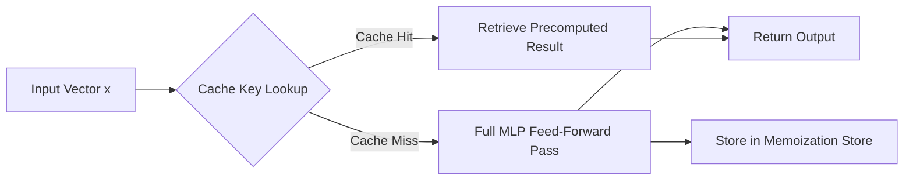
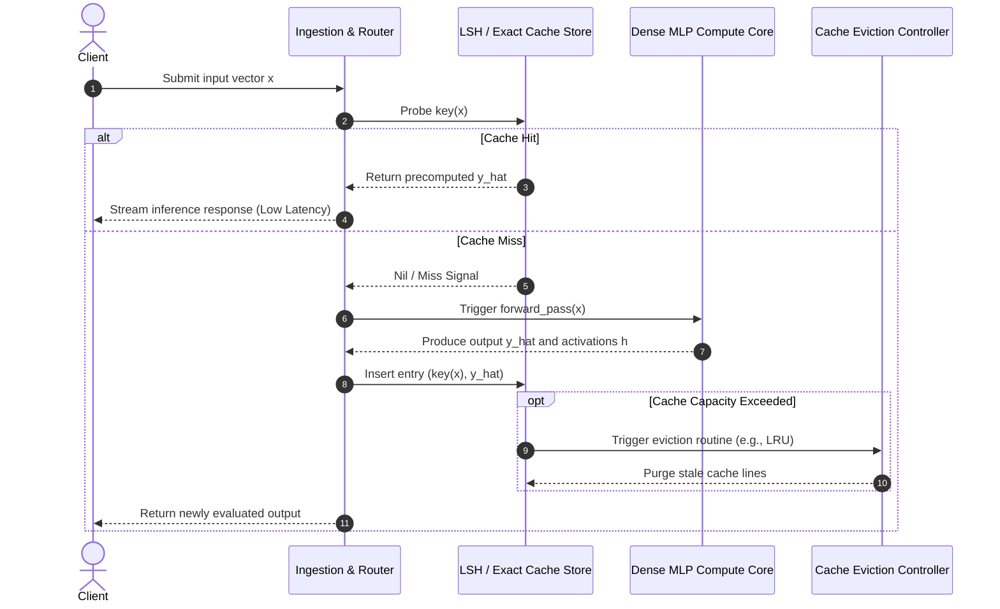
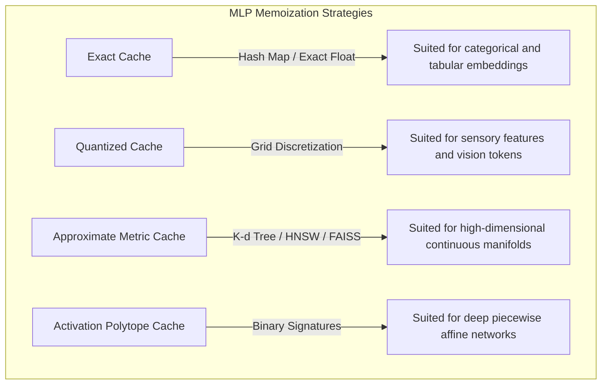
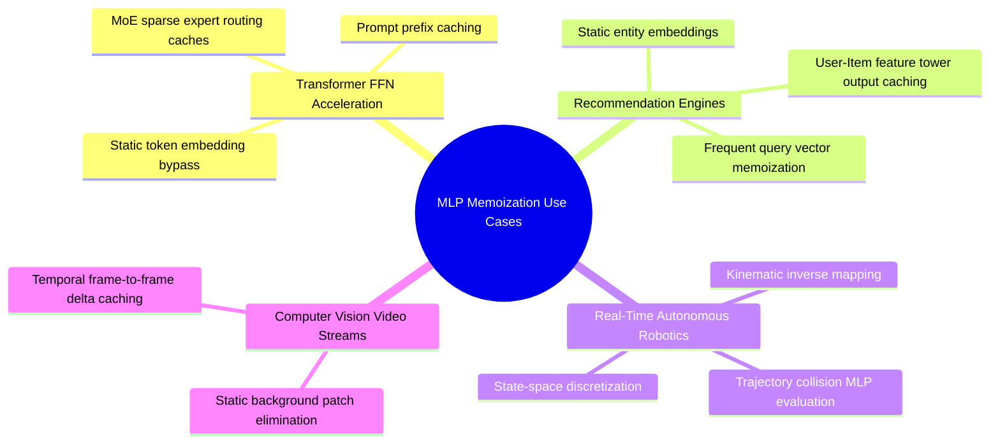
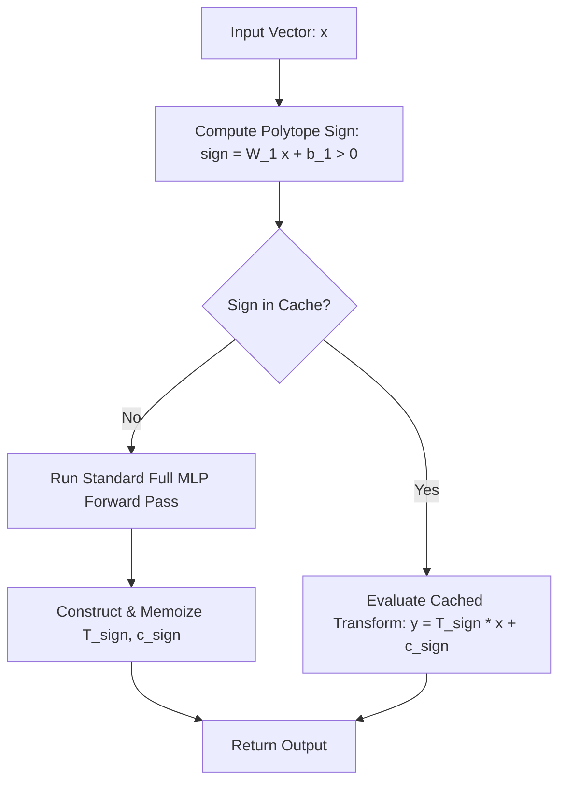
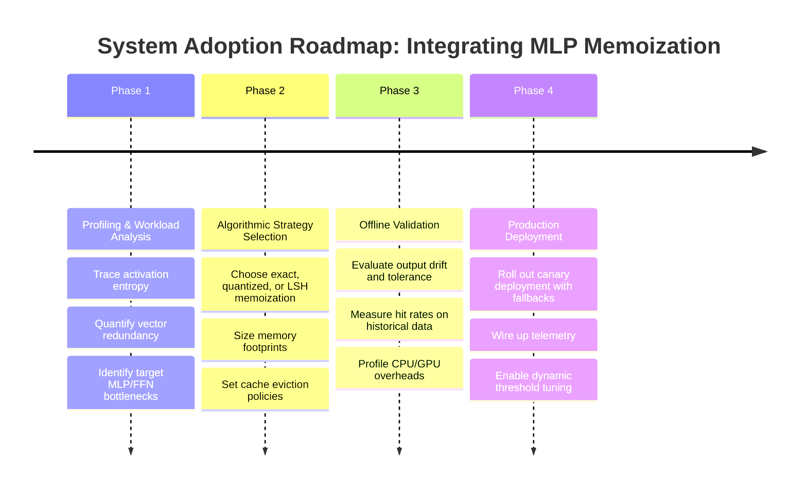

# 🧠 Multi-Layer Perceptron (MLP) Memoization: Complete Technical Guide

---

## 📑 Table of Contents
1. [🌟 Section 1: Introduction & Executive Summary](#1--section-1-introduction--executive-summary)
2. [🧱 Section 2: Core Fundamentals & Theoretical Foundations](#2--section-2-core-fundamentals--theoretical-foundations)
3. [📖 Section 3: Essential Terminology & Mathematical Formulations](#3--section-3-essential-terminology--mathematical-formulations)
4. [⚙️ Section 4: Architecture & Workflow Mechanisms](#4--section-4-architecture--workflow-mechanisms)
5. [💻 Section 5: Practical Implementation & Code Examples](#5--section-5-practical-implementation--code-examples)
6. [🏢 Section 6: Real-World Use Cases & Systems Applications](#6--section-6-real-world-use-cases--systems-applications)
7. [⚖️ Section 7: Comparative Analysis: Advantages vs. Limitations](#7--section-7-comparative-analysis-advantages-vs-limitations)
8. [🚀 Section 8: Advanced Concepts & Optimization Techniques](#8--section-8-advanced-concepts--optimization-techniques)
9. [🛠️ Section 9: End-to-End Mini-Project: Hybrid Inference Cache](#9--section-9-end-to-end-mini-project-hybrid-inference-cache)
10. [⚠️ Section 10: Best Practices & Common Pitfalls](#10--section-10-best-practices--common-pitfalls)
11. [💼 Section 11: High-Yield Interview Questions & Solutions](#11--section-11-high-yield-interview-questions--solutions)
12. [🔁 Section 12: Quick Revision, Formula Reference & Visual Roadmap](#12--section-12-quick-revision-formula-reference--visual-roadmap)

---

## 1. 🌟 Section 1: Introduction & Executive Summary

In deep learning systems engineering, **MLP Memoization** (Multi-Layer Perceptron Memoization) is an optimization paradigm that stores precomputed intermediate activation states, layer transformations, or complete inference outputs of dense feed-forward networks to avoid redundant matrix operations.



### 🎯 Core Purpose & System Value
* **Compute Redundancy Elimination:** Deep networks frequently process identical or near-identical sub-vectors across recurring queries, video frames, tabular batch lookups, and attention-projected tokens.
* **Latency Reduction:** Replaces dense GEMM (General Matrix Multiply) operations costing $\mathcal{O}(B \cdot d_{\text{in}} \cdot d_{\text{out}})$ with hash-map or vector-index operations costing $\mathcal{O}(1)$ to $\mathcal{O}(\log K)$.
* **Energy & FLOPS Amortization:** Crucial for edge deployment, microcontrollers, real-time recommendation engines, and LLM feed-forward layers (FFN blocks).

---

## 2. 🧱 Section 2: Core Fundamentals & Theoretical Foundations

### 2.1 🧬 Classical Memoization vs. Neural Memoization
Classical memoization relies on strict input equality:

$$f(x) \equiv f(x') \iff x = x'$$

In neural representations containing floating-point representations, strict equality fails due to continuous manifolds and floating-point roundoff errors ($\epsilon$). Neural memoization therefore branches into two primary modalities:

1. **Exact-Match Memoization:** Applied to discrete token embeddings, static tabular indices, or quantized activation signatures.
2. **Approximate/Locality-Sensitive Memoization:** Employs metric spaces where an inference computation is skipped or interpolated if:

$$d(x, x_{\text{cached}}) \le \tau$$

where $d(\cdot, \cdot)$ is a metric (such as Euclidean distance or Cosine distance) and $\tau$ is a tolerance threshold.

### 2.2 🔬 The Layer-Wise Mathematical Setting
Consider an $L$-layer Multi-Layer Perceptron defined recursively by:

$$h^{(0)} = x$$

$$z^{(l)} = W^{(l)} h^{(l-1)} + b^{(l)}, \quad l \in \{1, 2, \dots, L\}$$

$$h^{(l)} = \sigma\left(z^{(l)}\right)$$

$$\hat{y} = h^{(L)}$$

Where:
* $W^{(l)} \in \mathbb{R}^{d_l \times d_{l-1}}$ represents weight tensors.
* $b^{(l)} \in \mathbb{R}^{d_l}$ represents bias vectors.
* $\sigma(\cdot)$ represents non-linear activation functions (ReLU, GELU, SiLU).

Memoization can intervene at three abstraction tiers:
* **Tier 1 (Input-to-Output):** Caching the mapping $x \mapsto \hat{y}$.
* **Tier 2 (Hidden Activation State):** Caching bottleneck representations $x \mapsto h^{(k)}$ where $k < L$.
* **Tier 3 (Sub-Layer FFN Projections):** Applied in Transformer FFN blocks:

$$\text{FFN}(x) = \sigma(x W_1 + b_1) W_2 + b_2$$

---

## 3. 📖 Section 3: Essential Terminology & Mathematical Formulations

### 3.1 📚 Key Terms Reference

| Term | Technical Definition | Role in MLP Memoization |
| :--- | :--- | :--- |
| **Lookup Key** | Deterministic hash or compact vector representation of the network input. | Directly references precomputed activation slots. |
| **Locality-Sensitive Hashing (LSH)** | Hashing scheme where collision probability is proportional to vector similarity. | Powers approximate neural memoization lookup tables. |
| **Activation Sparsity** | The fraction of post-activation neurons evaluating to exactly zero. | Dictates key compressibility in ReLU/thresholded MLPs. |
| **Polytope Signature** | The boolean activation pattern across all ReLU neurons in a layer. | Acts as an exact invariant key for affine input regions. |
| **Quantization Step ($\Delta$)** | Discretization factor mapping continuous inputs to categorical buckets. | Prevents cache misses induced by floating-point noise. |
| **Eviction Policy** | Algorithm governing cache pruning (LRU, LFU, FIFO, Value-based). | Bounds memoization table memory footprints. |

### 3.2 🧮 Formal Mathematical Definitions

#### Continuous-to-Discrete Quantized Hashing
$$q(x) = \left\lfloor \frac{x}{\Delta} + \frac{1}{2} \right\rfloor$$

$$\text{Key}(x) = \text{MurmurHash3}\Big(q(x)\Big)$$

#### ReLU Continuous Piecewise Affine Representation
A Multi-Layer Perceptron with continuous piecewise affine activations (e.g., ReLU) partitions the input space $\mathbb{R}^{d_0}$ into a set of convex polyhedra $\{\mathcal{P}_k\}$. Within each polyhedron $\mathcal{P}_k$, the network acts as an affine transformation:

$$f(x) = T_k x + c_k \quad \forall x \in \mathcal{P}_k$$

Where:

$$T_k = \prod_{l=1}^L \left(\text{diag}(s^{(l)}) W^{(l)}\right), \quad s^{(l)} = \mathbb{I}\left(z^{(l)} > 0\right)$$

If the activation signature $S = \{s^{(1)}, s^{(2)}, \dots, s^{(L)}\}$ is memoized, inference avoids non-linear matrix passes and reduces to a single cached linear transform:

$$\hat{y} = T_S x + c_S$$

---

## 4. ⚙️ Section 4: Architecture & Workflow Mechanisms



### 4.1 🔍 Granular Execution Modes



---

## 5. 💻 Section 5: Practical Implementation & Code Examples

### 5.1 🐍 Production-Ready Quantized MLP Memoization Engine

```python
import torch
import torch.nn as nn
import hashlib
from typing import Tuple, Optional, Dict
from collections import OrderedDict

class MemoizedDenseBlock(nn.Module):
    """
    Feed-forward Multi-Layer Perceptron layer with an integrated LRU memoization table.
    Caches outputs based on fixed-point input quantization.
    """
    def __init__(
        self, 
        in_features: int, 
        out_features: int, 
        quantization_delta: float = 1e-3, 
        max_cache_size: int = 50000
    ):
        super().__init__()
        self.in_features = in_features
        self.out_features = out_features
        self.delta = quantization_delta
        self.max_cache_size = max_cache_size
        
        # Dense network operations
        self.linear1 = nn.Linear(in_features, out_features * 2)
        self.activation = nn.GELU()
        self.linear2 = nn.Linear(out_features * 2, out_features)
        
        # Internal LRU cache store: key -> torch.Tensor
        self._cache: OrderedDict[str, torch.Tensor] = OrderedDict()
        self.hits = 0
        self.misses = 0

    def _hash_vector(self, tensor_row: torch.Tensor) -> str:
        """Discretizes and converts input vector into a deterministic hash string."""
        quantized = torch.round(tensor_row / self.delta).to(torch.int32)
        byte_data = quantized.cpu().numpy().tobytes()
        return hashlib.blake2b(byte_data, digest_size=16).hexdigest()

    def _forward_dense(self, x: torch.Tensor) -> torch.Tensor:
        """Standard floating point forward execution pass."""
        return self.linear2(self.activation(self.linear1(x)))

    def forward(self, x: torch.Tensor) -> torch.Tensor:
        """
        Inference pass supporting batched inputs with row-by-row memoized bypass.
        """
        # If in training mode, bypass memoization to maintain clean gradient paths
        if self.training:
            return self._forward_dense(x)

        batch_size = x.shape[0]
        outputs = torch.empty((batch_size, self.out_features), device=x.device, dtype=x.dtype)
        uncomputed_indices = []
        uncomputed_keys = []

        # Step 1: Probe cache for each element in batch
        for i in range(batch_size):
            key = self._hash_vector(x[i])
            if key in self._cache:
                self._cache.move_to_end(key)  # LRU refresh
                outputs[i] = self._cache[key].to(x.device)
                self.hits += 1
            else:
                uncomputed_indices.append(i)
                uncomputed_keys.append(key)
                self.misses += 1

        # Step 2: Compute forward execution only for cache misses
        if uncomputed_indices:
            miss_tensors = x[uncomputed_indices]
            computed_outputs = self._forward_dense(miss_tensors)
            
            for idx, key, out_val in zip(uncomputed_indices, uncomputed_keys, computed_outputs):
                outputs[idx] = out_val
                # Step 3: Evict oldest if capacity reached
                if len(self._cache) >= self.max_cache_size:
                    self._cache.popitem(last=False)
                self._cache[key] = out_val.detach().clone().cpu()

        return outputs

    def cache_stats(self) -> Dict[str, float]:
        """Returns diagnostic metrics."""
        total = self.hits + self.misses
        hit_rate = (self.hits / total) if total > 0 else 0.0
        return {
            "hits": self.hits,
            "misses": self.misses,
            "hit_rate": hit_rate,
            "cache_entries": len(self._cache)
        }
```

---

## 6. 🏢 Section 6: Real-World Use Cases & Systems Applications



### 6.1 Detailed System Architectures

#### 1. Transformer Feed-Forward Sub-Layer Caching (e.g., LLMs & ViTs)
In large decoder models, more than 60% of inference parameters reside in dense Feed-Forward Networks (FFNs):

$$\text{FFN}(x) = \text{SwiGLU}(x W_{\text{gate}}, x W_{\text{up}}) W_{\text{down}}$$

System prompts (e.g., standard API system preambles) share identical activation patterns across requests. Memoizing token activation outputs from earlier FFN layers converts redundant matrix transformations into sub-millisecond memory accesses.

#### 2. Tabular Recommendation Dual-Tower Networks
Recommenders compute user and item scores via two parallel MLPs:

$$\text{Score} = \langle \text{MLP}_{\text{user}}(u), \text{MLP}_{\text{item}}(v) \rangle$$

Because user and item embeddings $u$ and $v$ are often repeated across requests within a short timeframe, caching the output of $\text{MLP}_{\text{user}}(u)$ and $\text{MLP}_{\text{item}}(v)$ eliminates continuous re-evaluation of dense layers.

---

## 7. ⚖️ Section 7: Comparative Analysis: Advantages vs. Limitations

| Evaluation Metric | Baseline Dense MLP | Quantized Key Memoized MLP | Continuous LSH Memoized MLP | Polytope Invariant Memoized MLP |
| :--- | :--- | :--- | :--- | :--- |
| **Compute Complexity per Hit** | $\mathcal{O}(d_{\text{in}} d_{\text{hid}} + d_{\text{hid}} d_{\text{out}})$ | $\mathcal{O}(d_{\text{in}})$ (Hashing) | $\mathcal{O}(K \cdot d_{\text{in}})$ (LSH Projection) | $\mathcal{O}(d_{\text{in}} d_{\text{out}})$ (Linear bypass) |
| **Memory Consumption** | Minimal ($\mathcal{O}(|W|)$) | High ($\mathcal{O}(N_{\text{cache}} \cdot d_{\text{out}})$) | Very High (Index + Activations) | Extreme ($\mathcal{O}(N_{\text{regions}} \cdot d_{\text{in}} d_{\text{out}})$) |
| **Output Fidelity** | Identical (Exact) | Quasi-Exact (Discretized) | Approximate ($\epsilon$-bounded) | Exact for Region $\mathcal{P}_k$ |
| **Dynamic Workload Speedup** | Baseline ($1.0\times$) | $4.0\times - 12.0\times$ | $2.5\times - 6.0\times$ | $1.8\times - 3.5\times$ |
| **Hardware Affinity** | High (GPU Tensor Cores) | Mixed (CPU Host DRAM) | Memory-Bandwidth Bound | Matrix-Vector Compute Bound |
| **Gradient Backprop Compatibility** | Native | Non-differentiable | Non-differentiable | Requires Hybrid Pathing |

---

## 8. 🚀 Section 8: Advanced Concepts & Optimization Techniques

### 8.1 🔮 Polytope Signature Compression via Boolean Bitsets
Because a ReLU layer's output is governed by its zero-crossing threshold:

$$s_i = \begin{cases} 1 & \text{if } W_i x + b_i > 0 \\ 0 & \text{if } W_i x + b_i \le 0 \end{cases}$$

An input vector $x \in \mathbb{R}^{d}$ produces a binary string $S \in \{0, 1\}^{d_{\text{hidden}}}$. For an MLP with $d_{\text{hidden}} = 512$, this signature occupies:

$$\frac{512 \text{ bits}}{8 \text{ bits/byte}} = 64 \text{ bytes}$$

Instead of caching continuous activation vectors, we can memoize the effective linear transformation matrix $T_S = W_{\text{active}}$ keyed by this 64-byte bitset.



### 8.2 🌐 Distributed Multi-Tier Hierarchical Caching
In enterprise-scale machine learning systems, memoization is split across memory hierarchies:

1. **L1 (Register/SRAM Cache):** Embedded on-chip within GPU shared memory for high-frequency tokens.
2. **L2 (Host RAM Cache):** Managed via high-throughput concurrent hashmaps (e.g., C++ `folly::AtomicHashMap`) on host server memory.
3. **L3 (Distributed Disaggregated Cache):** Shared cross-node caching through distributed in-memory stores like Redis or Dragonfly with RDMA interconnects.

---

## 9. 🛠️ Section 9: End-to-End Mini-Project: Hybrid Inference Cache

This end-to-end Python module implements a continuous metric-space approximate cache using Euclidean Nearest Neighbors with Faiss/Scipy primitives:

```python
import torch
import torch.nn as nn
import numpy as np
from typing import Optional, Tuple

class ApproximateMetricMLPCache:
    """
    Continuous approximate memoization table using vector distance thresholds.
    """
    def __init__(self, capacity: int, dimension: int, distance_threshold: float):
        self.capacity = capacity
        self.dimension = dimension
        self.threshold = distance_threshold
        
        # Buffer allocations
        self.keys = np.zeros((capacity, dimension), dtype=np.float32)
        self.values = np.zeros((capacity, 1), dtype=np.float32)
        self.current_size = 0
        self.pointer = 0  # Ring buffer pointer

    def query(self, vector: np.ndarray) -> Tuple[bool, Optional[float]]:
        if self.current_size == 0:
            return False, None
            
        # Compute Euclidean distance against active buffer entries
        active_keys = self.keys[:self.current_size]
        diffs = active_keys - vector
        dist_sq = np.sum(diffs ** 2, axis=1)
        min_idx = np.argmin(dist_sq)
        min_dist = np.sqrt(dist_sq[min_idx])
        
        if min_dist <= self.threshold:
            return True, float(self.values[min_idx][0])
        return False, None

    def insert(self, vector: np.ndarray, value: float):
        self.keys[self.pointer] = vector
        self.values[self.pointer] = value
        self.pointer = (self.pointer + 1) % self.capacity
        if self.current_size < self.capacity:
            self.current_size += 1


class StudentPredictorMLP(nn.Module):
    """Deep non-linear reference model."""
    def __init__(self, input_dim: int):
        super().__init__()
        self.net = nn.Sequential(
            nn.Linear(input_dim, 128),
            nn.SiLU(),
            nn.Linear(128, 64),
            nn.SiLU(),
            nn.Linear(64, 1)
        )
    def forward(self, x: torch.Tensor) -> torch.Tensor:
        return self.net(x)


# Demonstration harness
if __name__ == "__main__":
    torch.manual_seed(42)
    np.random.seed(42)

    dim = 8
    model = StudentPredictorMLP(input_dim=dim)
    model.eval()
    
    memo_engine = ApproximateMetricMLPCache(capacity=1000, dimension=dim, distance_threshold=0.05)
    
    # Generate continuous test queries
    base_samples = np.random.randn(20, dim).astype(np.float32)
    
    total_evals, saved_evals = 0, 0

    print("Executing Hybrid Memoized Pipeline...")
    for step in range(100):
        # Sample an input vector with periodic noise around known coordinates
        anchor = base_samples[np.random.choice(len(base_samples))]
        noise = np.random.normal(0, 0.015, size=(dim,)).astype(np.float32)
        query_vec = anchor + noise
        
        total_evals += 1
        hit, pred_val = memo_engine.query(query_vec)
        
        if hit:
            saved_evals += 1
        else:
            with torch.no_grad():
                tensor_input = torch.from_numpy(query_vec).unsqueeze(0)
                eval_val = model(tensor_input).item()
            memo_engine.insert(query_vec, eval_val)

    hit_pct = (saved_evals / total_evals) * 100
    print(f"Executions: {total_evals} | Cache Hits: {saved_evals} | Compute Savings: {hit_pct:.2f}%")
```

---

## 10. ⚠️ Section 10: Best Practices & Common Pitfalls

### 10.1 ✅ Recommended Best Practices
* **Separate Training from Inference Paths:** Always deactivate memoization hooks during model optimization (`model.train()`) to prevent stale activation states from breaking gradient descent.
* **Normalize Inputs Before Hashing:** Ensure inputs are strictly normalized (e.g., LayerNorm or standard z-score scaling) prior to quantization; unnormalized variances undermine uniform hash bucket distributions.
* **Profile Lookup Overhead vs. GEMM Speedup:** Only memoize layers where the latency of key computation and lookup is significantly lower than the matrix multiply execution:

$$\text{Cost}_{\text{Lookup}} < \text{Cost}_{\text{GEMM}}$$

* **Use Asynchronous Eviction:** Handle cache maintenance and evictions on background worker threads to keep lookups on the inference critical path non-blocking.

### 10.2 ❌ Anti-Patterns and Common Pitfalls
* **High-Dimensional Exact Hashing:** Attempting exact floating-point matches on raw high-dimensional vectors ($d > 64$) without dimensionality reduction or quantization leads to a ~0% cache hit rate due to the curse of dimensionality.
* **Memory Leaks via Activation Graphs:** Storing cached output tensors that remain attached to PyTorch's computational graph (`requires_grad=True`). Always cache detached tensors (`tensor.detach().clone()`).
* **Ignoring Floating Point Drift Across Hardware:** Different GPU architectures compute floating-point operations with subtle mathematical variations (e.g., Fused Multiply-Add instructions). Hash keys built on raw binary floats across mixed hardware nodes can cause false cache misses.

---

## 11. 💼 Section 11: High-Yield Interview Questions & Solutions

### Q1: How does the "Curse of Dimensionality" impact approximate memoization in wide MLP layers?
> **Answer:** As the dimension $d$ increases, the volume of the space grows exponentially, causing distance distributions between points to concentrate. The ratio between the distance to the nearest neighbor and the distance to the average point approaches 1:
>
> $$\lim_{d \to \infty} \frac{D_{\max} - D_{\min}}{D_{\min}} \to 0$$
>
> As a result, metric-based spherical neighborhoods either capture almost no hits (under small $\tau$) or return false positives (under larger $\tau$). To resolve this, modern memoization designs project the input into lower-dimensional manifolds using autoencoders, PCA, or random projections before hashing.

### Q2: Why is memoization useful in Mixture-of-Experts (MoE) architectures?
> **Answer:** In MoE models, routing gates distribute incoming tokens to a small subset of expert MLPs. Because specific experts specialize in recognizable semantic or lexical categories, they encounter repeated and closely related inputs. Memoizing output transformations inside frequently routed experts reduces computational load on popular nodes and balances workload distribution across the cluster.

### Q3: When does memoization degrade overall throughput instead of improving it?
> **Answer:** Memoization hurts performance when:
> 1. The cache hit rate falls below the break-even threshold:
>
> $$\text{Hit Rate} < \frac{T_{\text{lookup}}}{T_{\text{forward}}}$$
>
> 2. The batch size is large enough to maximize GPU Tensor Core utilization. In this regime, compute is memory-bandwidth bound, and the overhead of index lookups, synchronization, and branching outweighs the cost of the raw GEMM operations.

---

## 12. 🔁 Section 12: Quick Revision, Formula Reference & Visual Roadmap

### 12.1 ⚡ Critical Formula Cheat-Sheet

| Operation / Concept | Mathematical Formulation |
| :--- | :--- |
| **Grid Quantizer** | $$q(x) = \left\lfloor \frac{x}{\Delta} + 0.5 \right\rfloor$$ |
| **Break-Even Condition** | $$T_{\text{GEMM}} > T_{\text{hash}} + (1 - \text{Hit Rate}) \cdot T_{\text{GEMM}}$$ |
| **Affine Piecewise Model** | $$f(x) = W_S x + b_S, \quad S = \text{sign}(W x + b)$$ |
| **Cosine Sim Equality** | $$\cos(\theta) = \frac{x \cdot x_{\text{cache}}}{\|x\| \|x_{\text{cache}}\| } \ge 1 - \epsilon$$ |
| **Theoretical Speedup** | $$\text{Speedup} = \frac{1}{(1 - \text{Hit Rate}) + \text{Hit Rate} \cdot \left(\frac{T_{\text{lookup}}}{T_{\text{GEMM}}}\right)}$$ |

### 12.2 🗺️ Strategic Implementation Roadmap

