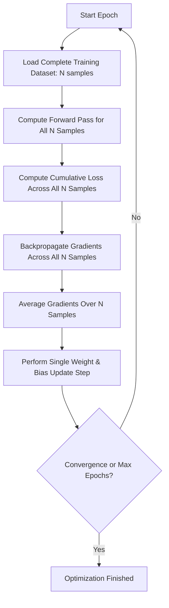
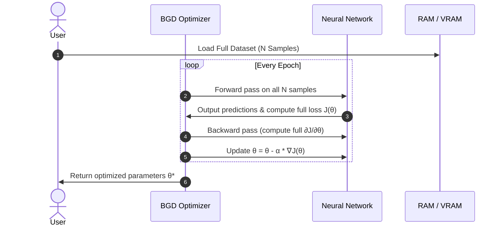
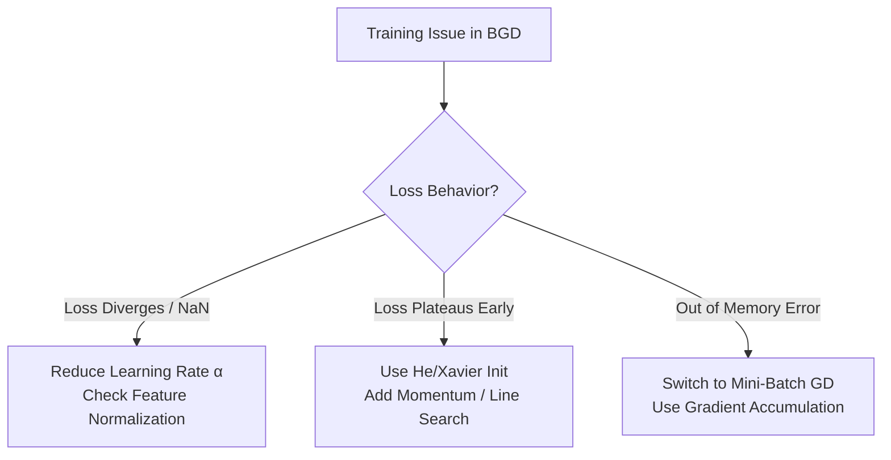

# 📦 Deep Dive: Batch Gradient Descent (Vanilla GD) in Neural Networks 🧠

## 📑 Table of Contents
 1. [1. Introduction & Core Concept](#1-introduction--core-concept-)
 2. [2. Mathematical Formulation](#2-mathematical-formulation-)
 3. [3. Algorithmic Workflow & Architecture](#3-algorithmic-workflow--architecture-)
 4. [4. Convergence Characteristics & Convex vs. Non-Convex Behavior](#4-convergence-characteristics--convex-vs-non-convex-behavior-)
 5. [5. Comprehensive Comparison: BGD vs. SGD vs. Mini-Batch GD](#5-comprehensive-comparison-bgd-vs-sgd-vs-mini-batch-gd-)
 6. [6. Complete Implementation: Python & NumPy from Scratch](#6-complete-implementation-python--numpy-from-scratch-)
 7. [7. Implementation with PyTorch](#7-implementation-with-pytorch-)
 8. [8. Practical Advantages & Critical Limitations](#8-practical-advantages--critical-limitations-)
 9. [9. Best Practices, Hyperparameter Tuning & Troubleshooting](#9-best-practices-hyperparameter-tuning--troubleshooting-)
10. [10. Technical Interview Questions & Answers](#10-technical-interview-questions--answers-)
11. [11. Quick Revision & Cheat Sheet](#11-quick-revision--cheat-sheet-)

---

## 1. 🌟 Introduction & Core Concept 🌟

**Batch Gradient Descent (BGD)**, often referred to as *Vanilla Gradient Descent* or *Deterministic Gradient Descent*, is the canonical formulation of first-order optimization. 

In Batch Gradient Descent, the network computes the error and subsequent gradients for **every single sample in the entire training dataset** before executing a single parameter update.



### 1.1 The High-Level Analogy 🔍
Think of Batch Gradient Descent as a committee where a decision is only made after surveying **every citizen in a nation**:
* The feedback is comprehensive, deterministic, and free of sample noise.
* Holding a nationwide census before taking even one small administrative step is computationally slow, consumes massive memory, and stalls progress if the population is huge.

---

## 2. 📐 Mathematical Formulation 📐

Let our training dataset contain $N$ observations:
$$\mathcal{D} = \{ (x^{(1)}, y^{(1)}), (x^{(2)}, y^{(2)}), \dots, (x^{(N)}, y^{(N)}) \}$$

Where $x^{(i)} \in \mathbb{R}^d$ is the feature vector and $y^{(i)}$ is the ground-truth target.

### 2.1 The Objective Cost Function
The global empirical risk (total cost function) $J(\theta)$ parameterized by $\theta$ is the arithmetic mean of individual losses $L$:

$$J(\theta) = \frac{1}{N} \sum_{i=1}^{N} L(f(x^{(i)}; \theta), y^{(i)})$$

### 2.2 Exact Full Gradient
Because differentiation is a linear operator, the gradient of the batch objective equals the average of the gradients across all $N$ data points:

$$\nabla_{\theta} J(\theta) = \frac{1}{N} \sum_{i=1}^{N} \nabla_{\theta} L(f(x^{(i)}; \theta), y^{(i)})$$

In expanded vector notation for parameters $\theta = [\theta_1, \theta_2, \dots, \theta_P]^T$:

$$\nabla_{\theta} J(\theta) = \begin{bmatrix}
\frac{1}{N} \sum_{i=1}^N \frac{\partial L^{(i)}}{\partial \theta_1} \\
\frac{1}{N} \sum_{i=1}^N \frac{\partial L^{(i)}}{\partial \theta_2} \\
\vdots \\
\frac{1}{N} \sum_{i=1}^N \frac{\partial L^{(i)}}{\partial \theta_P}
\end{bmatrix}$$

### 2.3 Parameter Update Equation
For each epoch $t$, the parameter vector updates via:

$$\theta^{(t+1)} = \theta^{(t)} - \alpha \nabla_{\theta} J(\theta^{(t)})$$

$$\theta^{(t+1)} = \theta^{(t)} - \frac{\alpha}{N} \sum_{i=1}^{N} \nabla_{\theta} L(f(x^{(i)}; \theta^{(t)}), y^{(i)})$$

Where:
* $\alpha \in \mathbb{R}^+$ is the learning rate step-size parameter.
* $N$ is the total dataset cardinality.

---

## 3. ⚙️ Algorithmic Workflow & Architecture ⚙️

### 3.1 Step-by-Step Execution Loop
1. **Initialize** network parameters $\theta^{(0)}$ (e.g., using Xavier or He initialization).
2. Set epoch counter $t = 0$.
3. **Repeat** until stopping criterion is met:
   * Reset gradient accumulator: $G \leftarrow \mathbf{0}$.
   * **For** each example $i = 1, \dots, N$:
     * Compute model prediction: $\hat{y}^{(i)} = f(x^{(i)}; \theta^{(t)})$.
     * Compute error/loss: $L^{(i)} = L(\hat{y}^{(i)}, y^{(i)})$.
     * Compute sample gradient via backpropagation: $g^{(i)} = \nabla_{\theta} L^{(i)}$.
     * Accumulate gradient: $G \leftarrow G + g^{(i)}$.
   * Calculate exact average gradient: $\nabla_{\theta} J(\theta^{(t)}) = \frac{1}{N} G$.
   * Update parameters: $\theta^{(t+1)} \leftarrow \theta^{(t)} - \alpha \nabla_{\theta} J(\theta^{(t)})$.
   * Check termination: $|J(\theta^{(t+1)}) - J(\theta^{(t)})| < \epsilon$ or $t \ge \text{max\_epochs}$.
   * Increment $t \leftarrow t + 1$.



---

## 4. 📈 Convergence Characteristics & Convex vs. Non-Convex Behavior 📈

### 4.1 Smooth and Monotonic Trajectory
Unlike Stochastic Gradient Descent (SGD) which fluctuates wildly, Batch Gradient Descent produces a **strictly smooth loss curve** when $\alpha$ is appropriately chosen:
* If $J(\theta)$ is convex and $L$-Lipschitz smooth ($\|\nabla J(\theta_1) - \nabla J(\theta_2)\| \le L \|\theta_1 - \theta_2\|$):
  * Setting $\alpha \le \frac{1}{L}$ guarantees **monotonic decrease**:
  $$J(\theta^{(t+1)}) \le J(\theta^{(t)})$$
* Convergence rate on convex objectives: $\mathcal{O}(1/t)$ with constant step size.
* Convergence rate on strongly convex objectives: $\mathcal{O}(e^{-ct})$ (linear convergence).

```mermaid
graph LR
    subgraph Convex Function
        C1[Smooth descent] --> C2[Guaranteed Global Minimum]
    end
    subgraph Non-Convex Function (Neural Networks)
        NC1[Smooth descent] --> NC2[Can get trapped in local minima]
        NC1 --> NC3[Can stall indefinitely at saddle points]
    end
```

### 4.2 Behavior on High-Dimensional Non-Convex Surfaces
In deep neural networks, loss surfaces are non-convex:
* **Zero Gradient Noise Advantage:** Direct, deterministic descent path without random oscillations.
* **Zero Gradient Noise Disadvantage:** Complete lack of stochastic noise prevents escaping shallow local minima or flat saddle points ($\nabla_\theta J(\theta) \approx 0$).

---

## 5. 📊 Comprehensive Comparison: BGD vs. SGD vs. Mini-Batch GD 📊

| Dimension | Batch Gradient Descent (BGD) | Stochastic Gradient Descent (SGD) | Mini-Batch Gradient Descent |
| :--- | :--- | :--- | :--- |
| **Batch Size ($B$)** | $B = N$ (Entire Dataset) | $B = 1$ (Single Example) | $1 < B < N$ (Typically $32, 64, 128, 512$) |
| **Updates Per Epoch** | Exactly $1$ | Exactly $N$ | $\lceil N / B \rceil$ |
| **Gradient Accuracy** | Exact true gradient | High-variance unbiased estimate | Low-variance unbiased estimate |
| **Loss Trajectory** | Smooth, strictly decreasing (if $\alpha$ optimal) | Erratic, zigzagging, noisy | Controlled oscillations |
| **Memory Footprint** | Extremely High ($\mathcal{O}(N)$ in RAM/VRAM) | Minimum ($\mathcal{O}(1)$ sample in memory) | Moderate ($\mathcal{O}(B)$ fit for GPU caches) |
| **Vectorization / SIMD** | High hardware utilization, but memory bound | Minimal vector parallel efficiency | Optimal balance of GPU tensor parallelism |
| **Saddle Point Escape** | Very poor (gets stuck easily) | Excellent (stochastic variance kicks it out) | Good (balances noise and stability) |
| **Suitability** | Small datasets, convex loss models | Streaming data, massive single-sample ops | Modern Deep Learning standard (CNN, LLMs) |

---

## 6. 💻 Complete Implementation: Python & NumPy from Scratch 💻

Below is an end-to-end implementation of Batch Gradient Descent for a two-layer neural network solving a non-linear binary classification problem.

```python
import numpy as np
import matplotlib.pyplot as plt

class BatchGradientDescentNN:
    """
    2-Layer Neural Network trained via Full Batch Gradient Descent.
    Architecture: Input (D) -> Hidden (H) with ReLU -> Output (1) with Sigmoid
    """
    def __init__(self, input_dim: int, hidden_dim: int, lr: float = 0.05):
        self.lr = lr
        # He (Kaiming) parameter initialization
        self.W1 = np.random.randn(input_dim, hidden_dim) * np.sqrt(2.0 / input_dim)
        self.b1 = np.zeros((1, hidden_dim))
        self.W2 = np.random.randn(hidden_dim, 1) * np.sqrt(2.0 / hidden_dim)
        self.b2 = np.zeros((1, 1))
        self.loss_history = []

    @staticmethod
    def relu(z: np.ndarray) -> np.ndarray:
        return np.maximum(0, z)

    @staticmethod
    def relu_derivative(z: np.ndarray) -> np.ndarray:
        return (z > 0).astype(float)

    @staticmethod
    def sigmoid(z: np.ndarray) -> np.ndarray:
        return 1.0 / (1.0 + np.exp(-np.clip(z, -500, 500)))

    def forward(self, X: np.ndarray):
        # Full batch matrix multiplication
        self.Z1 = np.dot(X, self.W1) + self.b1   # Shape: (N, H)
        self.A1 = self.relu(self.Z1)             # Shape: (N, H)
        self.Z2 = np.dot(self.A1, self.W2) + self.b2 # Shape: (N, 1)
        self.A2 = self.sigmoid(self.Z2)          # Shape: (N, 1)
        return self.A2

    def compute_loss(self, y_true: np.ndarray, y_pred: np.ndarray) -> float:
        N = y_true.shape[0]
        eps = 1e-12
        # Binary Cross-Entropy averaged over the entire batch N
        bce = - (1.0 / N) * np.sum(
            y_true * np.log(y_pred + eps) + (1.0 - y_true) * np.log(1.0 - y_pred + eps)
        )
        return float(bce)

    def backward(self, X: np.ndarray, y_true: np.ndarray):
        N = X.shape[0]
        
        # dL/dZ2 = (A2 - Y) / N
        dZ2 = (self.A2 - y_true) / N              # Shape: (N, 1)
        dW2 = np.dot(self.A1.T, dZ2)              # Shape: (H, 1)
        db2 = np.sum(dZ2, axis=0, keepdims=True)  # Shape: (1, 1)

        # Backprop through hidden layer
        dA1 = np.dot(dZ2, self.W2.T)              # Shape: (N, H)
        dZ1 = dA1 * self.relu_derivative(self.Z1) # Shape: (N, H)
        dW1 = np.dot(X.T, dZ1)                   # Shape: (D, H)
        db1 = np.sum(dZ1, axis=0, keepdims=True)  # Shape: (1, H)

        # Exact Deterministic Update across entire dataset
        self.W2 -= self.lr * dW2
        self.b2 -= self.lr * db2
        self.W1 -= self.lr * dW1
        self.b1 -= self.lr * db1

    def fit(self, X: np.ndarray, y: np.ndarray, epochs: int = 1000):
        for epoch in range(epochs):
            y_pred = self.forward(X)
            loss = self.compute_loss(y, y_pred)
            self.loss_history.append(loss)
            self.backward(X, y)

            if (epoch + 1) % (epochs // 10 or 1) == 0:
                print(f"Epoch [{epoch+1}/{epochs}] - Loss: {loss:.6f}")

# Example usage:
if __name__ == "__main__":
    np.random.seed(42)
    # Generate synthetic binary dataset (N=1000 samples)
    N = 1000
    X_data = np.random.randn(N, 4)
    y_data = ((X_data[:, [0]] * 1.5 + X_data[:, [1]] * -2.0) > 0.5).astype(float)

    model = BatchGradientDescentNN(input_dim=4, hidden_dim=8, lr=0.1)
    model.fit(X_data, y_data, epochs=300)
    print("Training finished. Final Loss:", model.loss_history[-1])
```

---

## 7. 🛠️ Implementation with PyTorch 🛠️

PyTorch standard training workflows typically use `DataLoader` with batch sizes. To perform **true Batch Gradient Descent**, pass the complete dataset as a single tensor to the forward-backward loop without mini-batch chunking.

```python
import torch
import torch.nn as nn
import torch.optim as optim

# 1. Synthesize Full Dataset
torch.manual_seed(42)
N, input_features = 5000, 10
X = torch.randn(N, input_features)
# True target with a non-linear relationship
y = ((X[:, 0:1] ** 2 + X[:, 1:2] * 2.0) > 1.0).float()

# 2. Define Model
class FullyConnectedNet(nn.Module):
    def __init__(self, in_features):
        super().__init__()
        self.net = nn.Sequential(
            nn.Linear(in_features, 32),
            nn.ReLU(),
            nn.Linear(32, 1),
            nn.Sigmoid()
        )
    def forward(self, x):
        return self.net(x)

model = FullyConnectedNet(in_features=input_features)
criterion = nn.BCELoss()
# Vanilla Gradient Descent (SGD optimizer with batch_size = N)
optimizer = optim.SGD(model.parameters(), lr=0.1)

epochs = 200

# 3. Batch Gradient Descent Training Loop
for epoch in range(1, epochs + 1):
    optimizer.zero_grad()           # Reset accumulated gradients
    
    predictions = model(X)          # Forward pass on ENTIRE dataset (all N samples)
    loss = criterion(predictions, y)# Loss computed over all N samples
    
    loss.backward()                 # Backward pass calculates exact batch gradient
    optimizer.step()                # Single parameter update per epoch
    
    if epoch % 20 == 0:
        print(f"BGD Epoch [{epoch}/{epochs}] -> Full Batch Loss: {loss.item():.5f}")
```

---

## 8. ⚖️ Practical Advantages & Critical Limitations ⚖️

### 8.1 Advantages ✅
* **Exact Gradient Direction:** Computes the true gradient $\nabla J(\theta)$ without approximation error or sampling noise.
* **Deterministic Convergence:** Every run with the same seed, learning rate, and initialization follows the exact same path.
* **Theoretical Guarantees:** For convex problems, it is mathematically proven to converge to the global minimum with an appropriate learning rate.
* **Stable Step Trajectory:** Allows constant learning rates or analytical line-search methods (e.g., backtracking line search) without divergence from sample noise.

### 8.2 Limitations ❌
* **Out-of-Memory (OOM) Errors:** Requires storing activations for all $N$ samples in memory simultaneously during the backward pass:
  $$\text{Memory Overhead} \approx \mathcal{O}(N \times \text{layers} \times \text{hidden units})$$
* **Extremely Slow Parameter Updates:** On a dataset with 1,000,000 samples, the network must perform one million forward and backward passes just to perform **one** parameter update.
* **Vulnerable to Saddle Points:** Lacks the random gradient noise present in mini-batches that helps escape saddle points ($\nabla J(\theta) = 0$).
* **Redundant Computation:** Many samples in large datasets provide repetitive information. BGD computes gradients for all redundant samples before updating.

---

## 9. 💡 Best Practices, Hyperparameter Tuning & Troubleshooting 💡



### 9.1 Step Size Selection ($\alpha$)
* **Exact Line Search:** Because gradients are exact, you can perform a line search along $-\nabla J(\theta)$ to find the optimal step size:
  $$\alpha^* = \arg\min_{\alpha > 0} J(\theta - \alpha \nabla J(\theta))$$
* **Backtracking Line Search:** Start with $\alpha = 1.0$; shrink $\alpha \leftarrow \beta \alpha$ until the Armijo-Goldstein condition is satisfied:
  $$J(\theta - \alpha \nabla J(\theta)) \le J(\theta) - c \alpha \|\nabla J(\theta)\|^2$$

### 9.2 Mandatory Feature Standardization
Batch Gradient Descent is sensitive to feature scaling. If feature $x_1 \in [0, 1]$ and $x_2 \in [0, 10000]$, the loss surface forms an elongated, eccentric valley:
* Parameter updates will bounce between walls rather than moving along the floor.
* **Remedy:** Normalize features using z-scores before training:
  $$z = \frac{x - \mu}{\sigma}$$

### 9.3 Gradient Accumulation (Emulating BGD on Memory Constraints)
If the full dataset $N$ exceeds GPU memory capacity, gradient accumulation splits the full batch into smaller chunks without updating weights until all chunks are processed:

```python
# Emulating Full Batch Gradient Descent across K mini-chunks
optimizer.zero_grad()
for chunk_x, chunk_y in dataset_chunks: # Sum of chunks equals N
    chunk_loss = criterion(model(chunk_x), chunk_y) * (len(chunk_x) / N)
    chunk_loss.backward() # Accumulates gradients in .grad tensors

optimizer.step() # Single exact update step matching BGD
```

---

## 10. 🎯 Technical Interview Questions & Answers 🎯

### Q1: Why does Batch Gradient Descent struggle on large-scale deep learning datasets compared to Mini-Batch GD?
> **Answer:**  
> 1. **Computational Inefficiency:** Datasets like ImageNet contain millions of examples. BGD performs millions of forward/backward operations per single parameter step, making learning extremely slow.  
> 2. **Memory Constraints:** Deep networks must store intermediate layer activation tensors for all inputs during the forward pass to compute gradients during backpropagation. Holding activations for millions of high-resolution images simultaneously causes GPU Out-of-Memory (OOM) errors.  
> 3. **Loss Surface Geometry:** Neural network cost surfaces are non-convex and filled with saddle points. BGD provides zero stochastic noise, causing updates to stall when entering regions where $\nabla J(\theta) \approx \mathbf{0}$.

---

### Q2: Is Batch Gradient Descent guaranteed to find the global minimum in neural networks?
> **Answer:**  
> **No.** Deep neural networks have non-convex loss functions with high-dimensional saddle points, plateaus, and local minima. While BGD is guaranteed to converge to a global minimum for **convex** problems (given a proper learning rate), in non-convex neural networks it only guarantees convergence to a **stationary point** ($\|\nabla J(\theta)\| \to 0$), which may be a local minimum or a saddle point.

---

### Q3: How does the computational complexity per epoch compare between BGD and SGD?
> **Answer:**  
> Both BGD and SGD have a computational time complexity of $\mathcal{O}(N \cdot P)$ per epoch, where $N$ is the number of examples and $P$ is the parameter count. However:
> * **BGD** completes that work to perform **1 large, exact update**.
> * **SGD** completes that work to perform **$N$ individual updates**, allowing it to make substantial progress toward the minimum long before reviewing the entire dataset.

---

## 11. 🚀 Quick Revision & Cheat Sheet 🚀

### 📌 Core Formulas
* **Full Batch Cost:**
  $$J(\theta) = \frac{1}{N} \sum_{i=1}^N L(f(x^{(i)}; \theta), y^{(i)})$$
* **Full Analytical Gradient:**
  $$\nabla_\theta J(\theta) = \frac{1}{N} \sum_{i=1}^N \nabla_\theta L^{(i)}$$
* **Parameter Update:**
  $$\theta \leftarrow \theta - \alpha \nabla_\theta J(\theta)$$

### 📌 Key Takeaways
* **Update Frequency:** Once per epoch (uses $100\%$ of data per update).
* **Trajectory:** Smooth, steady, deterministic; no stochastic oscillations.
* **Best Used For:** Small-to-medium datasets ($N \le 10^4$), linear models, logistic regression, or when analytical step sizes are required.
* **Main Bottlenecks:** GPU/RAM memory saturation and slow optimization on large non-convex landscapes.