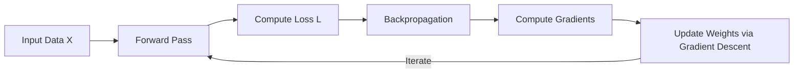
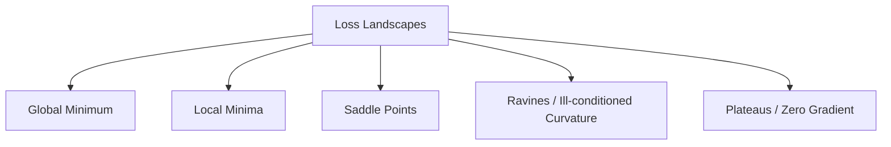
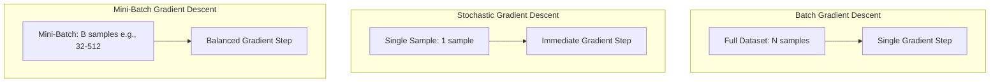
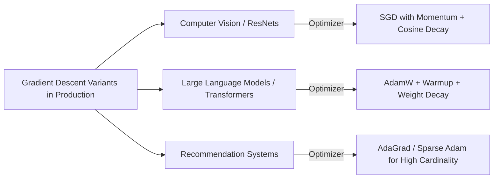
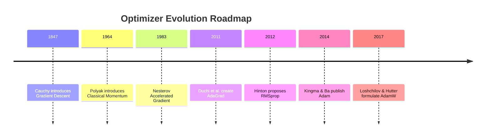

# 📉 Master Guide: Gradient Descent in Neural Networks 🧠

---

## 📑 Table of Contents
1. [1. Introduction & Intuition](#1-introduction--intuition-)
2. [2. Mathematical Foundations](#2-mathematical-foundations-)
3. [3. The Optimization Landscape](#3-the-optimization-landscape-)
4. [4. Variants of Gradient Descent](#4-variants-of-gradient-descent-)
5. [5. Advanced Optimizers & Adaptive Learning Rates](#5-advanced-optimizers--adaptive-learning-rates-)
6. [6. Key Challenges & How to Address Them](#6-key-challenges--how-to-address-them-)
7. [7. Practical Implementation: From Scratch to PyTorch](#7-practical-implementation-from-scratch-to-pytorch-)
8. [8. Real-World Applications & Case Studies](#8-real-world-applications--case-studies-)
9. [9. Best Practices & Common Pitfalls](#9-best-practices--common-pitfalls-)
10. [10. Interview Questions & Theoretical Deep Dives](#10-interview-questions--theoretical-deep-dives-)
11. [11. Quick Revision & Cheat Sheet](#11-quick-revision--cheat-sheet-)

---

## 1. 🌟 Introduction & Intuition

Gradient Descent is the primary optimization backbone used to train deep neural networks. Its purpose is to iteratively update the parameters (weights and biases) of a model to minimize an objective function—known as the **loss** or **cost function**.



### 1.1 The Mountaineer Analogy 🏔️
Imagine standing on a dense, fog-covered mountain where visibility is zero. Your goal is to reach the lowest valley floor (global minimum). 
- You cannot see the landscape as a whole.
- Under your feet, you can feel which direction slopes downward most steeply.
- You take a cautious step in that direction.
- You repeat this process step by step until the terrain levels off.

In this analogy:
- **Your altitude** represents the **Loss Function value** $$L(\theta)$$.
- **Your coordinates** represent the **Model Parameters** $$\theta$$.
- **The slope underfoot** represents the **Gradient** $$\nabla_{\theta} L(\theta)$$.
- **Your stride length** represents the **Learning Rate** $$\alpha$$.

---

## 2. 📐 Mathematical Foundations

Optimization in machine learning requires formulating loss minimization as an objective:

$$\min_{\theta} L(\theta)$$

where $$\theta \in \mathbb{R}^d$$ denotes the trainable parameters of the network.

### 2.1 The Directional Derivative & Gradient Vector
The gradient $$\nabla_{\theta} L(\theta)$$ is the vector of all first-order partial derivatives of the loss function with respect to each parameter:

$$\nabla_{\theta} L(\theta) = \begin{bmatrix} \frac{\partial L}{\partial \theta_1} \\ \frac{\partial L}{\partial \theta_2} \\ \vdots \\ \frac{\partial L}{\partial \theta_d} \end{bmatrix}$$

- The gradient vector points in the direction of the **steepest ascent** (greatest rate of increase).
- Therefore, the negative gradient $$-\nabla_{\theta} L(\theta)$$ points in the direction of the **steepest descent** (greatest rate of decrease).

### 2.2 The General Parameter Update Rule
At step $$t$$, parameter values update according to:

$$\theta_{t+1} = \theta_t - \alpha \nabla_{\theta} L(\theta_t)$$

where:
- $$\theta_t$$ is the parameter vector at iteration $$t$$.
- $$\alpha > 0$$ is the learning rate step size.
- $$\nabla_{\theta} L(\theta_t)$$ is the gradient calculated at $$\theta_t$$.

### 2.3 Taylor Series Approximation Justification
Using a first-order Taylor expansion around $$\theta_t$$:

$$L(\theta_t + \Delta \theta) \approx L(\theta_t) + \nabla_{\theta} L(\theta_t)^T \Delta \theta$$

To guarantee the maximum decrease in loss, we choose a small step vector $$\Delta \theta$$ that minimizes the inner product $$\nabla_{\theta} L(\theta_t)^T \Delta \theta$$. For a fixed step magnitude $\|\Delta \theta\| = \epsilon$, Cauchy-Schwarz proves that the inner product is minimized when:

$$\Delta \theta \propto -\nabla_{\theta} L(\theta_t)$$

Setting the constant of proportionality to $$\alpha$$ yields the gradient descent update equation.

---

## 3. 🗺️ The Optimization Landscape

Loss surfaces in deep learning are high-dimensional, non-convex, and filled with challenging geometric features:



### 3.1 Landscape Topography Overview

| Topological Feature | Mathematical Signature | Impact on Vanilla Gradient Descent | Remediation |
| :--- | :--- | :--- | :--- |
| **Global Minimum** | $$\nabla L = 0$$, Hessian $$H \succ 0$$, lowest overall value | Optimal objective achieved | Goal of optimization |
| **Local Minimum** | $$\nabla L = 0$$, Hessian $$H \succ 0$$ | Model halts prematurely; suboptimal capacity | Stochasticity, Momentum, Restarts |
| **Saddle Point** | $$\nabla L = 0$$, Hessian has both positive & negative eigenvalues | Zero gradient stops updates despite unstable slope | Noise injection, Momentum, Adam |
| **Ravine (Valley)** | High curvature across, low curvature along path | Severe oscillations perpendicular to the optimal path | Momentum, RMSprop, Second-order methods |
| **Plateau** | $$\nabla L \approx 0$$ across extended region | Extreme slowdown; parameters stall | Learning rate warmups, Adaptive optimizers |

---

## 4. 🔀 Variants of Gradient Descent

The three primary variants differ in how much training data is evaluated before calculating updates:



### 4.1 Comparative Analysis

| Dimension | Batch Gradient Descent (BGD) | Stochastic Gradient Descent (SGD) | Mini-Batch Gradient Descent (MBGD) |
| :--- | :--- | :--- | :--- |
| **Sample Size per Step** | Entire dataset ($$N$$) | Exactly 1 sample | Subset batch size ($$B \in [32, 512]$$) |
| **Step Stability** | Smooth, deterministic trajectory | Highly noisy and erratic | Controlled variance; balanced trajectory |
| **Memory Requirement** | Huge ($$O(N)$$ memory footprint) | Minimal ($$O(1)$$ memory footprint) | Fits comfortably in GPU VRAM ($$O(B)$$) |
| **Vectorization / Parallelism** | High | Low (cannot leverage SIMD/GPU efficiently) | Optimal hardware acceleration via Tensor Cores |
| **Saddle Point Escape** | Often gets trapped | Escapes easily due to high gradient noise | Escapes effectively with tuned batch sizes |

---

## 5. 🚀 Advanced Optimizers & Adaptive Learning Rates

### 5.1 Momentum
Vanilla SGD oscillates heavily in ravines. Polyak Momentum accumulates a velocity vector $$v_t$$ using an exponential moving average:

$$v_{t+1} = \beta v_t + \alpha \nabla_{\theta} L(\theta_t)$$

$$\theta_{t+1} = \theta_t - v_{t+1}$$

Where $$\beta \in [0.9, 0.99]$$ controls how much previous velocity is retained.

### 5.2 Nesterov Accelerated Gradient (NAG)
Rather than calculating the gradient at the current position, NAG computes the gradient looking ahead where momentum will carry the parameters:

$$v_{t+1} = \beta v_t + \alpha \nabla_{\theta} L(\theta_t - \beta v_t)$$

$$\theta_{t+1} = \theta_t - v_{t+1}$$

### 5.3 AdaGrad (Adaptive Gradient Algorithm)
AdaGrad adapts the learning rate individually for each parameter by dividing by the square root of the sum of historical squared gradients:

$$G_{t+1} = G_t + g_t \odot g_t$$

$$\theta_{t+1} = \theta_t - \frac{\alpha}{\sqrt{G_{t+1} + \epsilon}} \odot g_t$$

*(Drawback: $$G_t$$ increases monotonically, causing the effective learning rate to decay to zero prematurely.)*

### 5.4 RMSprop (Root Mean Square Propagation)
RMSprop fixes AdaGrad's premature decay by replacing the raw sum with an exponentially decaying moving average:

$$v_{t+1} = \gamma v_t + (1 - \gamma)(g_t \odot g_t)$$

$$\theta_{t+1} = \theta_t - \frac{\alpha}{\sqrt{v_{t+1} + \epsilon}} \odot g_t$$

### 5.5 Adam (Adaptive Moment Estimation)
Adam combines the principles of Momentum (first raw moment) and RMSprop (second uncentered moment) with bias correction:

First moment:
$$m_t = \beta_1 m_{t-1} + (1 - \beta_1) g_t$$

Second moment:
$$v_t = \beta_2 v_{t-1} + (1 - \beta_2) (g_t \odot g_t)$$

Bias corrections (accounting for initialization at zero):
$$\hat{m}_t = \frac{m_t}{1 - \beta_1^t}, \quad \hat{v}_t = \frac{v_t}{1 - \beta_2^t}$$

Update rule:
$$\theta_{t+1} = \theta_t - \frac{\alpha}{\sqrt{\hat{v}_t} + \epsilon} \hat{m}_t$$

Default hyperparameters: $$\alpha = 0.001$$, $$\beta_1 = 0.9$$, $$\beta_2 = 0.999$$, $$\epsilon = 10^{-8}$$.

### 5.6 AdamW (Decoupled Weight Decay)
L2 regularization and weight decay are identical in standard SGD, but they diverge in adaptive optimizers like Adam. AdamW decouples weight decay directly into the parameter step:

$$\theta_{t+1} = \theta_t - \alpha \lambda \theta_t - \frac{\alpha}{\sqrt{\hat{v}_t} + \epsilon} \hat{m}_t$$

This restores proper regularizing behavior and is the modern standard for Transformers and LLMs.

---

## 6. ⚠️ Key Challenges & How to Address Them

### 6.1 Vanishing & Exploding Gradients
In deep networks, gradients backpropagated through layers can shrink exponentially to zero or grow unboundedly:

$$\frac{\partial L}{\partial W^{[1]}} = \frac{\partial L}{\partial a^{[K]}} \prod_{k=2}^K \left( W^{[k]T} \text{diag}(\sigma'(z^{[k]})) \right)$$

- **Solutions for Vanishing Gradients:**
  - Non-saturating activations (ReLU, Leaky ReLU, GELU).
  - Residual / Skip connections (ResNets).
  - Proper weight initializations (He / Kaiming, Xavier / Glorot).
  - Batch / Layer Normalization.
- **Solutions for Exploding Gradients:**
  - Gradient norm clipping: 
    $$g \leftarrow g \cdot \min\left(1, \frac{c}{\|g\|}\right)$$

---

## 7. 💻 Practical Implementation: From Scratch to PyTorch

### 7.1 Pure NumPy Implementation: Linear Model Optimization

```python
import numpy as np
import matplotlib.pyplot as plt

# Generate synthetic linear regression data: y = 3.5x + 2.0 + noise
np.random.seed(42)
X = 2 * np.random.rand(100, 1)
y = 3.5 * X + 2.0 + np.random.randn(100, 1) * 0.2

# Add bias term (column of ones)
X_b = np.c_[np.ones((100, 1)), X]

def mini_batch_gradient_descent(X, y, epochs=100, batch_size=16, lr=0.05):
    m = len(X)
    theta = np.random.randn(2, 1) # Random initialization
    loss_history = []
    
    for epoch in range(epochs):
        shuffled_indices = np.random.permutation(m)
        X_shuffled = X[shuffled_indices]
        y_shuffled = y[shuffled_indices]
        
        for i in range(0, m, batch_size):
            xi = X_shuffled[i:i+batch_size]
            yi = y_shuffled[i:i+batch_size]
            
            # Forward pass: compute predictions and error
            gradients = (2 / len(xi)) * xi.T.dot(xi.dot(theta) - yi)
            
            # Parameter update
            theta -= lr * gradients
            
        epoch_loss = np.mean((X.dot(theta) - y) ** 2)
        loss_history.append(epoch_loss)
        
    return theta, loss_history

theta_opt, loss_hist = mini_batch_gradient_descent(X_b, y)
print(f"Learned parameters: Intercept = {theta_opt[0][0]:.3f}, Slope = {theta_opt[1][0]:.3f}")
```

### 7.2 PyTorch Neural Network Implementation with Custom Optimization

```python
import torch
import torch.nn as nn

# Define a non-linear regression MLP
class RegressionNet(nn.Module):
    def __init__(self):
        super(RegressionNet, self).__init__()
        self.net = nn.Sequential(
            nn.Linear(10, 64),
            nn.ReLU(),
            nn.Linear(64, 32),
            nn.ReLU(),
            nn.Linear(32, 1)
        )
        
    def forward(self, x):
        return self.net(x)

# Setup synthetic data, loss, and AdamW optimizer
model = RegressionNet()
criterion = nn.MSELoss()
optimizer = torch.optim.AdamW(model.parameters(), lr=1e-3, weight_decay=1e-2)

inputs = torch.randn(128, 10)
targets = torch.randn(128, 1)

# Training step demonstration
model.train()
for epoch in range(5):
    optimizer.zero_grad()               # 1. Clear previous step gradients
    predictions = model(inputs)         # 2. Forward pass
    loss = criterion(predictions, targets) # 3. Compute loss
    loss.backward()                     # 4. Backward pass (backpropagation)
    
    # 5. Gradient clipping to prevent exploding gradients
    torch.nn.utils.clip_grad_norm_(model.parameters(), max_norm=1.0)
    
    optimizer.step()                    # 6. Apply parameter update
    print(f"Epoch {epoch+1} Loss: {loss.item():.4f}")
```

---

## 8. 🏢 Real-World Applications & Case Studies



1. **Transformer Language Models (e.g., GPT, LLaMA):**
   - **Optimizer:** AdamW ($$\beta_1 = 0.9$$, $$\beta_2 = 0.95$$, decoupled weight decay $$0.1$$).
   - **Why:** Adaptive updates handle sparse token representations across deep residual blocks while decoupled decay stabilizes weight norms.
2. **Convolutional Architectures (e.g., ImageNet classification):**
   - **Optimizer:** SGD with Nesterov Momentum ($$0.9$$) and weight decay ($$10^{-4}$$).
   - **Why:** While SGD trains slower than Adam initially, empirical studies confirm it often yields superior out-of-distribution generalization in computer vision tasks.
3. **High-Cardinality Recommendation Embeddings:**
   - **Optimizer:** AdaGrad or SparseAdam.
   - **Why:** Rare items receive infrequent updates; AdaGrad scales up learning rates for infrequently updated features, rapidly fitting tail items.

---

## 9. 🛡️ Best Practices & Common Pitfalls

### 9.1 Best Practices Checklist ✅
- [ ] **Normalize Inputs:** Always standardize features to zero mean and unit variance ($$\mu=0, \sigma=1$$) or use LayerNorm/BatchNorm to keep the loss surface symmetric and spherical.
- [ ] **Learning Rate Warm-up:** Linearly scale learning rates from zero over the first few thousand steps to avoid destabilizing randomly initialized weights.
- [ ] **Use Learning Rate Schedulers:** Transition from constant step sizes to Cosine Annealing or Step Decay as training matures.
- [ ] **Zero Gradients Carefully:** Ensure `optimizer.zero_grad(set_to_none=True)` is called prior to `loss.backward()` in PyTorch to avoid unintended gradient accumulation and conserve memory.

### 9.2 Common Mistakes to Avoid ❌
- **Forgetting to Normalize Features:** Produces stretched, elliptical contour lines leading to perpendicular oscillations and slow convergence.
- **Setting Learning Rate Too High:** Diverges immediately (loss values become `NaN` or `Inf`).
- **Setting Learning Rate Too Low:** Stalls training, settling in plateau regions or running out of training budget.
- **Neglecting Gradient Accumulation for Big Batches:** Shrinking batch size below stable thresholds when GPU memory is constrained instead of accumulating gradients over micro-batches.

---

## 10. 🎯 Interview Questions & Theoretical Deep Dives

### Q1: Why does Adam generalize worse than SGD with Momentum in some vision benchmarks?
> **Answer:** Adaptive methods like Adam compute steps using the running second moment of gradients, creating anisotropic learning rates per parameter. This allows individual parameters to move aggressively through sharp minimas. SGD with momentum exhibits higher stochastic exploration and uniform step lengths, making it more likely to settle in broader, flatter minima, which correlate with better generalization test performance.

### Q2: What causes saddle points to dominate high-dimensional optimization over local minima?
> **Answer:** In an $$N$$-dimensional parameter space, a local minimum requires all $$N$$ eigenvalues of the Hessian matrix to be positive:
> 
> $$P(\text{local min}) = \prod_{i=1}^N P(\lambda_i > 0) \approx \left(\frac{1}{2}\right)^N$$
> 
> As $$N \to \infty$$, the probability approaches zero. Most critical points ($$\nabla L = 0$$) possess a mix of positive and negative eigenvalues, creating saddle points.

### Q3: Why is Polyak Momentum mathematically equivalent to a ball rolling down a surface with friction?
> **Answer:** Writing the update as a continuous-time differential equation yields:
> 
> $$\frac{d^2\theta}{dt^2} + \gamma \frac{d\theta}{dt} + \nabla L(\theta) = 0$$
> 
> This is precisely Newton's Second Law with a quadratic potential field and a damping coefficient $$\gamma$$ representing physical friction.

---

## 11. 🔄 Quick Revision & Cheat Sheet



### 11.1 Essential Formulas Summary

| Method | Primary Parameter Update Equation |
| :--- | :--- |
| **Vanilla GD** | $$\theta_{t+1} = \theta_t - \alpha \nabla_{\theta} L(\theta_t)$$ |
| **Momentum** | $$v_{t+1} = \beta v_t + \alpha \nabla L(\theta_t); \quad \theta_{t+1} = \theta_t - v_{t+1}$$ |
| **RMSprop** | $$v_{t+1} = \gamma v_t + (1 - \gamma) g_t^2; \quad \theta_{t+1} = \theta_t - \frac{\alpha}{\sqrt{v_{t+1}} + \epsilon} g_t$$ |
| **Adam** | $$\theta_{t+1} = \theta_t - \frac{\alpha}{\sqrt{\hat{v}_t} + \epsilon} \hat{m}_t$$ |
| **AdamW** | $$\theta_{t+1} = (1 - \alpha \lambda)\theta_t - \frac{\alpha}{\sqrt{\hat{v}_t} + \epsilon} \hat{m}_t$$ |

### 11.2 Core Takeaways
- **First-Order Only:** Standard deep learning uses first derivatives because computing the second-order Hessian ($$O(d^2)$$ space, $$O(d^3)$$ inversion) is intractable for millions of weights.
- **Default Baseline:** Start with **AdamW** ($$\alpha = 3 \times 10^{-4}$$ to $$1 \times 10^{-3}$$) for architectures such as Transformers, LSTMs, and modern MLPs. Use **SGD with Momentum** ($$\alpha = 0.01 - 0.1$$, momentum $$= 0.9$$) for standard ConvNets when squeezing maximal generalization performance.
- **Always Monitor Norms:** Tracking the gradient norm $$\|\nabla L\|$$ during training provides immediate detection of exploding ($$> 10^2$$) or vanishing ($$< 10^{-5}$$) dynamics.