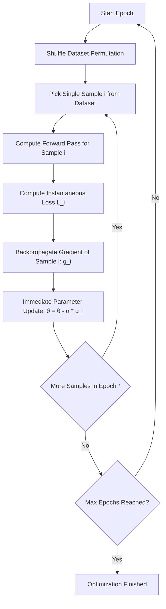
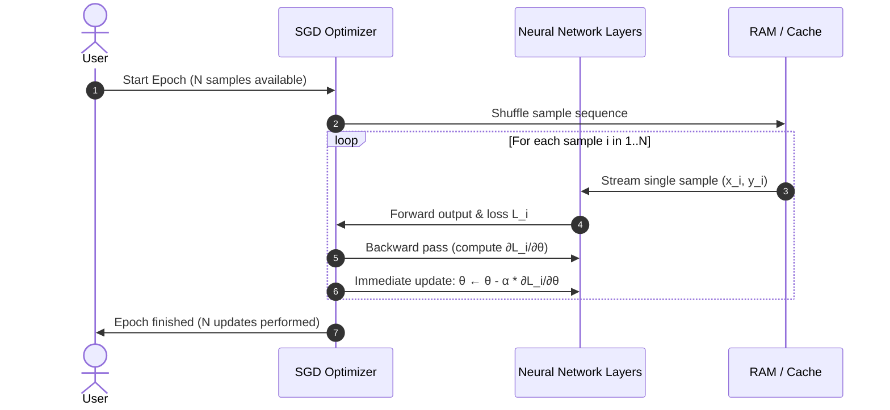
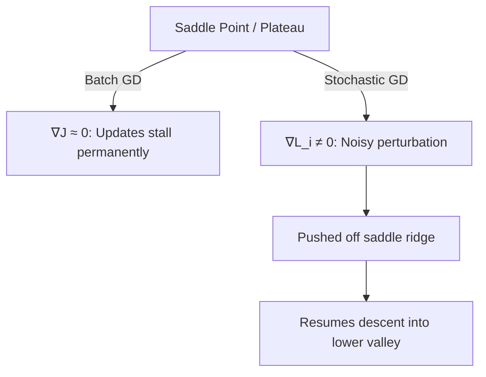

# 🎲 Deep Dive: Stochastic Gradient Descent (SGD) in Neural Networks 🧠

## 📑 Table of Contents

 1. [1. Introduction & Intuitive Concept](#1-introduction--intuitive-concept-)
 2. [2. Mathematical Foundations & Unbiased Estimator Proof](#2-mathematical-foundations--unbiased-estimator-proof-)
 3. [3. Algorithmic Workflow & Mechanics](#3-algorithmic-workflow--mechanics-)
 4. [4. Dynamics of Stochastic Noise & Saddle Point Escape](#4-dynamics-of-stochastic-noise--saddle-point-escape-)
 5. [5. Learning Rate Schedules & Convergence Conditions](#5-learning-rate-schedules--convergence-conditions-)
 6. [6. Detailed Comparison: SGD vs. Batch GD vs. Mini-Batch GD](#6-detailed-comparison-sgd-vs-batch-gd-vs-mini-batch-gd-)
 7. [7. Python & NumPy Implementation from Scratch](#7-python--numpy-implementation-from-scratch-)
 8. [8. PyTorch Implementation with Streaming Data](#8-pytorch-implementation-with-streaming-data-)
 9. [9. Practical Advantages & Critical Pitfalls](#9-practical-advantages--critical-pitfalls-)
10. [10. Technical Interview Questions & Answers](#10-technical-interview-questions--answers-)
11. [11. Quick Revision & Cheat Sheet](#11-quick-revision--cheat-sheet-)

---

## 1. 🌟 Introduction & Intuitive Concept 🌟

**Stochastic Gradient Descent (SGD)** represents the opposite extreme of Batch Gradient Descent. Instead of evaluating the entire dataset to compute one exact gradient step, SGD samples **a single randomly chosen training instance** $(x^{(i)}, y^{(i)})$ at each iteration to compute the gradient and immediately update the model's parameters.



### 1.1 The Drunken Explorer Analogy 🧭

Imagine navigating down a foggy mountain, but instead of surveying all available slopes at every step:
* You glance at a single rough landmark directly next to your foot.
* You take an immediate, energetic step based on that single noisy clue.
* Your path zigzags, stumbles, and bounces around, but the overall drift carries you downhill.
* The chaotic shaking keeps you from getting stuck in tiny potholes (shallow local minima) or hanging on level ridges (saddle points).

---

## 2. 📐 Mathematical Foundations & Unbiased Estimator Proof 📐

Let the training dataset consist of $N$ pairs:

$$
\mathcal{D} = \{ (x^{(1)}, y^{(1)}), (x^{(2)}, y^{(2)}), \dots, (x^{(N)}, y^{(N)}) \}
$$

The true objective function is the empirical risk over the entire distribution:

$$
J(\theta) = \frac{1}{N} \sum_{i=1}^{N} L_i(\theta)
$$

where $L_i(\theta) = L(f(x^{(i)}; \theta), y^{(i)})$.

### 2.1 The Stochastic Approximation

Instead of evaluating the true gradient $\nabla_\theta J(\theta)$, SGD selects an index $i_t \in \{1, \dots, N\}$ uniformly at random at step $t$ and approximates the full gradient using only that sample's gradient:

$$
g_t(\theta) = \nabla_\theta L_{i_t}(\theta)
$$

### 2.2 Proof: The Stochastic Gradient is an Unbiased Estimator

A critical mathematical property of SGD is that the expected value of the sample gradient equals the exact true gradient.

Let $i$ be drawn from a discrete uniform distribution over $\{1, \dots, N\}$ such that $P(i = k) = \frac{1}{N}$ for all $k \in \{1, \dots, N\}$:

$$
\mathbb{E}_{i \sim \mathcal{U}(1, N)} \left[ \nabla_\theta L_i(\theta) \right] = \sum_{k=1}^N P(i = k) \nabla_\theta L_k(\theta)
$$

$$
\mathbb{E}_{i} \left[ \nabla_\theta L_i(\theta) \right] = \sum_{k=1}^N \frac{1}{N} \nabla_\theta L_k(\theta) = \frac{1}{N} \sum_{k=1}^N \nabla_\theta L_k(\theta) = \nabla_\theta J(\theta)
$$

$$\therefore \mathbb{E}\left[ g_t(\theta) \right] = \nabla_\theta J(\theta)$$

Thus, the stochastic gradient is an **unbiased estimator** of the true population gradient.

### 2.3 Variance of the Estimator

While the expectation matches the true gradient, the variance of this single-sample estimator can be substantial:

$$
\text{Var}(g_t(\theta)) = \mathbb{E}\left[ \Vert{} g_t(\theta) - \nabla_\theta J(\theta) \Vert{}^2 \right] = \sigma^2 > 0
$$

This variance causes persistent noise in the parameter updates, preventing SGD with a fixed learning rate $\alpha$ from settling down at the exact minimum.

### 2.4 Parameter Update Rule

At iteration $t$:

$$
\theta_{t+1} = \theta_t - \alpha_t \nabla_\theta L_{i_t}(\theta_t)
$$

---

## 3. ⚙️ Algorithmic Workflow & Mechanics ⚙️

### 3.1 Step-by-Step Execution Sequence

1. **Initialize** parameters $\theta_0$ and set learning rate schedule $\alpha_t$.
2. **For epoch** $e = 1, \dots, E$:
   * Randomly permute/shuffle indices $\{1, 2, \dots, N\}$.
   * **For each index** $i$ in the shuffled sequence:
     * Evaluate prediction $\hat{y}^{(i)} = f(x^{(i)}; \theta)$.
     * Calculate error $L^{(i)} = L(\hat{y}^{(i)}, y^{(i)})$.
     * Compute gradient vector: $g^{(i)} = \nabla_\theta L^{(i)}$.
     * Update parameter vector immediately:
       $$
       \theta \leftarrow \theta - \alpha_t g^{(i)}
       $$
     * Increment global iteration count $t \leftarrow t + 1$.
3. Return converged parameters $\theta^*$.



---

## 4. 🌊 Dynamics of Stochastic Noise & Saddle Point Escape 🌊

### 4.1 Escaping Saddle Points & Poor Local Minima

In high-dimensional non-convex neural network error surfaces, saddle points ($\nabla J(\theta) = 0$ with both positive and negative Hessian eigenvalues) are far more common than isolated local minima.

* **Batch Gradient Descent:** If initialized or driven near a saddle point, $\nabla J(\theta) \approx 0$, causing deterministic updates to halt.
* **Stochastic Gradient Descent:** Even when the population gradient $\nabla J(\theta) \approx 0$, an individual instance gradient $\nabla L_i(\theta)$ is rarely zero:
  $$
  \nabla L_i(\theta) \ne \mathbf{0} \quad \text{even if} \quad \frac{1}{N}\sum_{i=1}^N \nabla L_i(\theta) \approx \mathbf{0}
  $$
  This variance introduces persistent orthogonal perturbation noise, knocking parameters off unstable saddle ridges and into descending valleys.



### 4.2 Generalization and Flat vs. Sharp Minima

Research (e.g., Keskar et al.) shows that the noise introduced by stochastic sampling biases the trajectory toward **flat minima** rather than **sharp minima**:
* **Sharp Minima:** Sensitive to slight shifts between training and test distributions (higher generalization error).
* **Flat Minima:** Low loss spans a wider parameter region, making predictions robust to testing domain shifts.

---

## 5. 📉 Learning Rate Schedules & Convergence Conditions 📉

Because single-sample gradients maintain non-zero variance $\sigma^2$ even at the optimum, a constant step size $\alpha$ will cause parameters to **bounce perpetually** around the minimum instead of settling:

$$
\lim_{t \to \infty} \mathbb{E}\left[ \Vert{} \theta_t - \theta^* \Vert{}^2 \right] \approx \mathcal{O}(\alpha)
$$

### 5.1 Robbins-Monro Conditions

To guarantee asymptotic convergence to an extremum, the learning rate sequence $\alpha_t$ must satisfy the **Robbins-Monro conditions**:

$$
\sum_{t=1}^{\infty} \alpha_t = \infty \quad \text{and} \quad \sum_{t=1}^{\infty} \alpha_t^2 < \infty
$$

1. $\sum \alpha_t = \infty$: The step size sum diverges to infinity, ensuring the optimizer can travel any arbitrary distance to reach the minimum regardless of initialization.
2. $\sum \alpha_t^2 < \infty$: The step size square sum converges, ensuring the step sizes shrink fast enough to cancel out the variance $\sigma^2$ and guarantee convergence.

### 5.2 Common Decay Schedules in Practice

| Schedule Type | Formula | Characteristic |
| :--- | :--- | :--- |
| **Inverse Time Decay** | $\alpha_t = \frac{\alpha_0}{1 + k \cdot t}$ | Satisfies Robbins-Monro conditions; classic theoretical decay. |
| **Exponential Decay** | $\alpha_t = \alpha_0 \cdot \gamma^t \quad (0 < \gamma < 1)$ | Drops rapidly; practical, though strictly does not satisfy $\sum \alpha_t = \infty$. |
| **Step / Staircase Decay** | $\alpha_t = \alpha_0 \cdot \gamma^{\lfloor t / S \rfloor}$ | Standard in CV; drops rate by $5\times - 10\times$ every $S$ epochs. |
| **Cosine Annealing** | $\alpha_t = \alpha_{\min} + \frac{1}{2}(\alpha_0 - \alpha_{\min})(1 + \cos(\frac{t}{T}\pi))$ | Smooth transitions down to minimum step size; widely used in modern training. |

---

## 6. 📊 Detailed Comparison: SGD vs. Batch GD vs. Mini-Batch GD 📊

| Attribute | Stochastic Gradient Descent (SGD) | Batch Gradient Descent (BGD) | Mini-Batch Gradient Descent |
| :--- | :--- | :--- | :--- |
| **Batch Size ($B$)** | **$1$ sample** | Entire dataset ($N$) | Moderate slice ($32 \le B \le 512$) |
| **Updates per Epoch** | **$N$ updates** | $1$ update | $\lceil N / B \rceil$ updates |
| **Computational Footprint** | Extremely low ($\mathcal{O}(1)$ activations) | Extremely high ($\mathcal{O}(N)$ activations) | Balanced ($\mathcal{O}(B)$ fit to VRAM) |
| **Gradient Trajectory** | Highly erratic, noisy zigzag | Deterministic, strictly smooth | Moderately smooth with mild noise |
| **Memory Bottleneck** | None (can train on infinite streams) | High (frequent Out-Of-Memory errors) | None if batch size is properly tuned |
| **Hardware Efficiency** | Poor (underutilizes GPU tensor cores) | High (memory bandwidth bounded) | Maximum (saturates GPU parallel pipelines) |
| **Saddle Point Escape** | Fast and automatic | Extremely poor | Good |
| **Convergence Speed** | Rapid early progress; wanders near end | Very slow initial progress; stable finish | Fast throughout training |

---

## 7. 💻 Python & NumPy Implementation from Scratch 💻

Below is an end-to-end implementation of pure Stochastic Gradient Descent (batch size = 1) with an adaptive decay schedule for a multilayer perceptron.

```python
import numpy as np

class StochasticGradientDescentNN:
    """
    2-Layer Neural Network trained via Pure Stochastic Gradient Descent (Batch size = 1).
    Architecture: Input (D) -> Hidden (H) with ReLU -> Output (1) with Sigmoid
    """
    def __init__(self, input_dim: int, hidden_dim: int, lr_0: float = 0.05, decay_rate: float = 0.001):
        self.lr_0 = lr_0
        self.decay_rate = decay_rate
        self.step_count = 0
        
        # He Initialization
        self.W1 = np.random.randn(input_dim, hidden_dim) * np.sqrt(2.0 / input_dim)
        self.b1 = np.zeros((1, hidden_dim))
        self.W2 = np.random.randn(hidden_dim, 1) * np.sqrt(2.0 / hidden_dim)
        self.b2 = np.zeros((1, 1))
        
        self.epoch_losses = []

    @staticmethod
    def relu(z: np.ndarray) -> np.ndarray:
        return np.maximum(0, z)

    @staticmethod
    def relu_derivative(z: np.ndarray) -> np.ndarray:
        return (z > 0).astype(float)

    @staticmethod
    def sigmoid(z: np.ndarray) -> np.ndarray:
        return 1.0 / (1.0 + np.exp(-np.clip(z, -250, 250)))

    def get_current_lr(self) -> float:
        # Inverse time decay satisfying Robbins-Monro heuristic
        return self.lr_0 / (1.0 + self.decay_rate * self.step_count)

    def fit(self, X: np.ndarray, y: np.ndarray, epochs: int = 50):
        N = X.shape[0]

        for epoch in range(epochs):
            # 1. Stochastic shuffling at the start of each epoch
            indices = np.random.permutation(N)
            cumulative_loss = 0.0

            # 2. Iterate through single samples one by one
            for idx in indices:
                x_i = X[idx:idx+1]  # Shape: (1, D)
                y_i = y[idx:idx+1]  # Shape: (1, 1)

                # --- Forward Pass ---
                z1 = np.dot(x_i, self.W1) + self.b1      # (1, H)
                a1 = self.relu(z1)                       # (1, H)
                z2 = np.dot(a1, self.W2) + self.b2       # (1, 1)
                a2 = self.sigmoid(z2)                    # (1, 1)

                # Instantaneous loss for monitoring
                eps = 1e-12
                sample_loss = -(y_i * np.log(a2 + eps) + (1.0 - y_i) * np.log(1.0 - a2 + eps))
                cumulative_loss += float(sample_loss[0, 0])

                # --- Backward Pass (Single Sample) ---
                dz2 = a2 - y_i                           # (1, 1)
                dW2 = np.dot(a1.T, dz2)                  # (H, 1)
                db2 = dz2                                # (1, 1)

                da1 = np.dot(dz2, self.W2.T)             # (1, H)
                dz1 = da1 * self.relu_derivative(z1)     # (1, H)
                dW1 = np.dot(x_i.T, dz1)                 # (D, H)
                db1 = dz1                                # (1, H)

                # --- Parameter Update on Every Single Sample ---
                lr = self.get_current_lr()
                self.W2 -= lr * dW2
                self.b2 -= lr * db2
                self.W1 -= lr * dW1
                self.b1 -= lr * db1
                
                self.step_count += 1

            avg_epoch_loss = cumulative_loss / N
            self.epoch_losses.append(avg_epoch_loss)

            if (epoch + 1) % (epochs // 5 or 1) == 0:
                print(f"Epoch [{epoch+1}/{epochs}] - Loss: {avg_epoch_loss:.5f} - LR: {self.get_current_lr():.6f}")

# Verification run
if __name__ == "__main__":
    np.random.seed(42)
    N_samples = 2000
    X_train = np.random.randn(N_samples, 2)
    # Circular non-linear boundary: x1^2 + x2^2 < 0.6
    y_train = ((X_train[:, 0]**2 + X_train[:, 1]**2) < 0.6).astype(float).reshape(-1, 1)

    model = StochasticGradientDescentNN(input_dim=2, hidden_dim=16, lr_0=0.02)
    model.fit(X_train, y_train, epochs=25)
```

---

## 8. 🛠️ PyTorch Implementation with Streaming Data 🛠️

In production contexts, pure SGD allows models to train on unbounded, real-time data streams without storing datasets in memory:

```python
import torch
import torch.nn as nn
from torch.utils.data import DataLoader, IterableDataset

# 1. Custom Iterable Dataset simulating a continuous streaming source
class RealTimeStreamingDataset(IterableDataset):
    def __init__(self, total_samples: int):
        self.total_samples = total_samples

    def __iter__(self):
        for _ in range(self.total_samples):
            # Stream one random sample vector and ground truth
            x = torch.randn(8)
            y = torch.tensor([1.0]) if x.sum() > 0.0 else torch.tensor([0.0])
            yield x, y

# 2. Linear/Neural Network Model
model = nn.Sequential(
    nn.Linear(8, 16),
    nn.ReLU(),
    nn.Linear(16, 1),
    nn.Sigmoid()
)

criterion = nn.BCELoss()

# Pure SGD optimizer
optimizer = torch.optim.SGD(model.parameters(), lr=0.01)

# batch_size=1 enforces pure Stochastic Gradient Descent
streaming_loader = DataLoader(RealTimeStreamingDataset(total_samples=3000), batch_size=1)

# 3. Optimization Loop: Updates happen on EVERY instance
running_loss = 0.0
for step, (x_sample, y_sample) in enumerate(streaming_loader, 1):
    optimizer.zero_grad()
    
    prediction = model(x_sample)
    loss = criterion(prediction, y_sample)
    
    loss.backward()
    optimizer.step()  # Immediate update
    
    running_loss += loss.item()
    if step % 500 == 0:
        print(f"Step [{step}/3000] - Rolling Single-Sample Loss: {running_loss / 500:.4f}")
        running_loss = 0.0
```

---

## 9. ⚖️ Practical Advantages & Critical Pitfalls ⚖️

### 9.1 Advantages ✅

* **Immediate Progress:** Does not wait for $N$ forward passes to adjust parameters; updates start on step 1.
* **Minimal Memory Overhead:** Only requires loading a single observation and its intermediate activations into memory ($\mathcal{O}(1)$ batch footprint).
* **Escapes Flat Regions & Saddle Points:** High gradient noise prevents parameters from settling in unstable critical points where $\nabla J(\theta) = 0$.
* **Online & Out-of-Core Learning:** Enables training on streaming data sources and datasets too large to fit in local storage.

### 9.2 Limitations & Pitfalls ❌

* **GPU Underutilization:** Single-sample operations cannot leverage the massive SIMD/tensor core parallelism of modern GPUs, leading to low compute throughput.
* **Severe Path Variance:** The loss does not decrease monotonically. Trajectories bounce erratically across the loss surface, requiring careful learning rate schedules to stabilize.
* **Sensitivity to Outliers:** An erroneous or corrupted single sample immediately distorts the weights across that update step.

---

## 10. 🎯 Technical Interview Questions & Answers 🎯

### Q1: Why doesn't SGD converge to the exact minimum when using a fixed learning rate?
> **Answer:**  
> The single-sample stochastic gradient is an unbiased estimator of the true gradient ($\mathbb{E}[g_t] = \nabla J(\theta)$), but it contains persistent variance:
> $$
> \text{Var}(g_t) = \mathbb{E}[\Vert{} g_t - \nabla J(\theta) \Vert{}^2] = \sigma^2 > 0
> $$
> At the true minimum $\theta^*$, the full gradient is zero ($\nabla J(\theta^*) = \mathbf{0}$). However, individual sample gradients $\nabla L_i(\theta^*)$ are generally non-zero. With a constant learning rate $\alpha$, each update applies a non-zero displacement:
> $$
> \Delta \theta = -\alpha \nabla L_i(\theta^*) \ne \mathbf{0}
> $$
> This causes parameters to continuously oscillate around $\theta^*$ within a variance ball of radius proportional to $\alpha \sigma^2$. To achieve point convergence, $\alpha$ must decay over time according to the Robbins-Monro conditions.

---

### Q2: Why is SGD often credited with finding solutions that generalize better than Batch GD?
> **Answer:**  
> The stochastic noise present in single-sample updates functions as implicit regularization. It prevents the optimizer from settling into narrow, sharp local minima—which are prone to overfitting because small domain shifts yield huge increases in test loss. Instead, gradient noise knocks parameters out of sharp wells, driving them toward wider, flatter basins that are more robust to distribution shifts between training and test sets.

---

### Q3: What is the computational time complexity per epoch for SGD compared to Batch GD?
> **Answer:**  
> Both methods share the exact same theoretical per-epoch time complexity:
> $$
> \mathcal{O}(N \cdot P)
> $$
> where $N$ is the number of samples and $P$ is the parameter count. However, their practical wall-clock runtimes diverge significantly:
> * **Batch GD** computes large matrix-matrix multiplications ($N \times D \times H$), achieving near $100\%$ GPU core saturation.
> * **SGD** executes $N$ separate vector-matrix multiplications ($1 \times D \times H$), incurring substantial sequential overhead and underutilizing GPU hardware.

---

## 11. 🚀 Quick Revision & Cheat Sheet 🚀

### 📌 Core Formulas

* **Sample Gradient (Unbiased Estimator):**
  $$
  g_t = \nabla_\theta L_i(\theta_t) \quad \text{where} \quad \mathbb{E}[g_t] = \nabla_\theta J(\theta_t)
  $$
* **Update Step:**
  $$
  \theta_{t+1} = \theta_t - \alpha_t \nabla_\theta L_i(\theta_t)
  $$
* **Robbins-Monro Convergence Criteria:**
  $$
  \sum_{t=1}^\infty \alpha_t = \infty \quad \text{and} \quad \sum_{t=1}^\infty \alpha_t^2 < \infty
  $$

### 📌 Summary Checklist
* **Batch Size:** $B = 1$.
* **Updates Per Epoch:** Exactly $N$.
* **Convergence Behavior:** Fast initial descent; erratic, noisy trajectory; requires a decaying learning rate to settle.
* **Key Strength:** Minimal memory requirements, natural escape from saddle points, suited for streaming data.
* **Key Weakness:** Poor GPU utilization, high sensitivity to learning rate selection.