<div align="center" id="top">

<!-- ═══════════════════════════════════════════════════════════════════ -->
<!-- 🚀 HERO BANNER -->
<!-- ═══════════════════════════════════════════════════════════════════ -->
<p align="center">
  
</p>

# 🧠 Deep Learning Journey: From Theory to AI

<p align="center">
  <b>A comprehensive, code-rich odyssey from fundamental calculus & neural foundations to cutting-edge Transformers, Computer Vision, Generative AI, and Production MLOps.</b>
</p>

<!-- ═══════════════════════════════════════════════════════════════════ -->
<!-- 🏷️ REPOSITORY SHIELD BADGES -->
<!-- ═══════════════════════════════════════════════════════════════════ -->
<p align="center">
  
  
  
  
  
  
</p>

<p align="center">
  <a href="https://github.com/swapnil3104/deep-learning-journey/stargazers"></a>
  &nbsp;
  <a href="https://github.com/swapnil3104/deep-learning-journey/network/members"></a>
  &nbsp;
  <a href="https://github.com/swapnil3104/deep-learning-journey/issues"></a>
  &nbsp;
  <a href="https://github.com/swapnil3104/deep-learning-journey/commits/main"></a>
</p>

<!-- ═══════════════════════════════════════════════════════════════════ -->
<!-- 🧭 QUICK NAVIGATION BAR -->
<!-- ═══════════════════════════════════════════════════════════════════ -->
<div align="center">

<b><a href="#-welcome--ai-co-pilot">🤖 AI Co-Pilot</a></b> &nbsp;│&nbsp; 
<b><a href="#-daily-progress-tracker--learning-log">📅 Daily Progress Log</a></b> &nbsp;│&nbsp; 
<b><a href="#-curriculum-roadmap--core-pillars">🗺️ 6 Core Pillars</a></b> &nbsp;│&nbsp; 
<b><a href="#-deep-learning-end-to-end-architecture">⚙️ Pipeline Architecture</a></b> &nbsp;│&nbsp; 
<b><a href="#-visual-animations--concept-gallery">🎬 Visual Showcase</a></b> &nbsp;│&nbsp; 
<b><a href="#-tech-stack--frameworks">🛠️ Tech Stack</a></b> &nbsp;│&nbsp; 
<b><a href="#-quick-start--environment-setup">⚡ Quick Setup</a></b>

</div>

<hr/>

<!-- ═══════════════════════════════════════════════════════════════════ -->
<!-- 🤖 WELCOME & AI CO-PILOT CARD WITH CREATIVE TEXT ANIMATION -->
<!-- ═══════════════════════════════════════════════════════════════════ -->
<table width="100%">
  <tr>
    <td align="center" width="30%" style="vertical-align: middle; padding: 12px;">
      <a href="https://github.com/swapnil3104/deep-learning-journey">
        
      </a>
      <br/>
      <sub><b>🤖 Neural Co-Pilot v2.4</b></sub>
    </td>
    <td width="70%" style="vertical-align: middle; padding: 15px;">
      <!-- Main Greeting Typing Animation -->
      <a href="https://github.com/swapnil3104/deep-learning-journey">
        
      </a>
      <br/>
      <!-- Secondary Subtitle Typing Animation -->
      <a href="https://github.com/swapnil3104/deep-learning-journey">
        
      </a>
      <p style="margin-top: 10px; font-size: 14px; line-height: 1.6; color: #8b949e;">
        Welcome to my <b>Deep Learning Journey</b> repository! This repo is actively updated <b>every single day</b> with structured theory, mathematical proofs, scratch implementations, clean PyTorch & TensorFlow workflows, hyperparameter sweeps, and production-grade architectures.
      </p>
      <div>
        <a href="#-daily-progress-tracker--learning-log">
          
        </a>
        &nbsp;
        <a href="#-curriculum-roadmap--core-pillars">
          
        </a>
        &nbsp;
        <a href="https://github.com/swapnil3104/Machine-Learning-Journey">
          
        </a>
      </div>
    </td>
  </tr>
</table>

<br/>

---

## 🌟 Why This Repository Exists

> *"What I cannot create, I do not understand."* — **Richard Feynman**

Many deep learning tutorials either stay purely superficial with high-level `model.fit()` abstractions or get buried in abstract equations without code. This repository bridges both worlds:

1. **First-Principles Derivations**: Forward pass, loss formulation, computational graphs, and backward propagation calculated analytically.
2. **From Scratch to Frameworks**: Build layers from raw NumPy/Python first, then transition into accelerated PyTorch 2.x and TensorFlow.
3. **Daily Consistent Practice**: Daily commits with dedicated jupyter notebooks, notes, benchmarks, and visual diagrams.
4. **Modern Applied AI**: Moving beyond toy MNIST examples toward modern architectures: ResNets, Transformers, Diffusion, and LLM fine-tuning.

---

## 📅 Daily Progress Tracker & Learning Log

> [!TIP]
> **Daily Commitment**: This repository receives daily commits documenting hands-on notebooks, theoretical writeups, and model architectures. Follow along or fork to track your own progress!

| Day | Date | Topic & Focus Area | Framework / Stack | Status | Notes & Notebooks |
| :---: | :---: | :--- | :---: | :---: | :--- |
| **01** | `Day 1` | **Foundations**: Biological vs Artificial Neurons, Perceptron Learning Rule | Python / NumPy |  | [Perceptron Scratch & Decision Boundaries](#) |
| **02** | `Day 2` | **Activation Functions**: Sigmoid, Tanh, ReLU, LeakyReLU, GeLU, Swish | PyTorch / Matplotlib |  | [Vanishing Gradients & Dead Neurons Analysis](#) |
| **03** | `Day 3` | **Loss Surfaces & Convexity**: MSE, Binary & Categorical Cross-Entropy, KL-Divergence | PyTorch / NumPy |  | [Mathematical Formulations & Log-Sum-Exp Trick](#) |
| **04** | `Day 4` | **Computational Graphs & Autograd**: Building a Micrograd-style Engine from Scratch | Pure Python |  | [Scalar Autograd, Topological Sort & Backprop](#) |
| **05** | `Day 5` | **Multilayer Perceptrons (MLPs)**: Full Vectorized Forward & Backward Pass | NumPy / PyTorch |  | [XOR Problem, Non-linearities & Hidden Representations](#) |
| **06** | `Day 6` | **Optimization Engines**: SGD, Momentum, Nesterov, AdaGrad, RMSprop, Adam, AdamW | PyTorch |  | [Trajectory Comparison on Rosenbrock & Saddle Surfaces](#) |
| **07** | `Day 7` | **Weight Initialization & Normalization**: Xavier/Glorot, He/Kaiming, BatchNorm, LayerNorm | PyTorch |  | [Internal Covariate Shift & Gradient Stability](#) |
| **08+** | `Ongoing` | **CNNs, Transformers, Generative AI & MLOps Deployment** | Multi-Framework |  | [Continuously logged in module directories](#) |

*(New entries added daily — check commits for real-time progress!)*

---

## 🗺️ Curriculum Roadmap & Core Pillars

The repository is modularized into **6 Core Deep Learning Pillars**, taking you systematically from scalar calculus to state-of-the-art foundation models:

```
deep-learning-journey/
│
├── 01_Foundations_of_Neural_Networks/   # Perceptrons, MLPs, Activations, Losses, Autograd
├── 02_Optimization_and_Regularization/  # SGD, Adam, AdamW, Dropout, BatchNorm, Learning Schedulers
├── 03_Computer_Vision_and_CNNs/        # Convolutions, ResNet, EfficientNet, YOLO, U-Net
├── 04_Sequence_Models_and_NLP/          # RNN, LSTM, Attention Mechanism, Transformers, BERT, GPT
├── 05_Generative_AI_and_Advanced/       # Autoencoders, VAEs, GANs, Diffusion Models
└── 06_MLOps_and_Production_Deployment/  # ONNX, TensorRT, TorchScript, Quantization, APIs
```

<details open>
<summary><b>📚 Click to View Detailed Breakdown of the 6 Core Pillars</b></summary>
<br/>

<table>
  <tr>
    <td width="50%" valign="top">
      <h3>🧠 Pillar 1: Mathematical & Neural Foundations</h3>
      <ul>
        <li>Linear Algebra, Tensor Calculus & Computational Graphs</li>
        <li>McCulloch-Pitts Neuron, Perceptrons & Linear Separability</li>
        <li>Activation Functions: Sigmoid, Tanh, ReLU, LeakyReLU, GeLU, SiLU</li>
        <li>Loss Functions: MSE, Cross-Entropy, Focal Loss, Triplet Loss</li>
        <li>Reverse-mode Automatic Differentiation & Vectorized Backpropagation</li>
      </ul>
    </td>
    <td width="50%" valign="top">
      <h3>⚡ Pillar 2: Optimization, Training & Regularization</h3>
      <ul>
        <li>First & Second-Order Optimizers: SGD + Momentum, RMSprop, Adam, AdamW</li>
        <li>Loss Surface Topology: Saddle Points, Plateaus, Local Minima</li>
        <li>Weight Initialization: Xavier/Glorot, He/Kaiming, Orthogonal</li>
        <li>Regularization: L1/L2 Weight Decay, Dropout, DropPath, Label Smoothing</li>
        <li>Normalization: Batch Normalization, LayerNorm, RMSNorm, GroupNorm</li>
      </ul>
    </td>
  </tr>
  <tr>
    <td width="50%" valign="top">
      <h3>👁️ Pillar 3: Computer Vision & Convolutional Nets</h3>
      <ul>
        <li>Convolution Mechanics: Filters, Strides, Padding, Dilations</li>
        <li>Classic Backbones: LeNet, AlexNet, VGG, ResNet (Skip Connections)</li>
        <li>Modern Vision: EfficientNet, ConvNeXt, MobileNets</li>
        <li>Visual Explanations: Class Activation Maps (Grad-CAM)</li>
        <li>Object Detection & Segmentation: YOLO family, U-Net, Mask R-CNN</li>
      </ul>
    </td>
    <td width="50%" valign="top">
      <h3>🗣️ Pillar 4: Sequence Modeling & Transformers</h3>
      <ul>
        <li>Recurrent Architectures: Vanilla RNNs, LSTMs, GRUs, Bidirectional</li>
        <li>Seq2Seq Modeling & Encoder-Decoder with Bahdanau Attention</li>
        <li>Vaswani et al. Transformer: Scaled Dot-Product & Multi-Head Self-Attention</li>
        <li>Positional Encodings: Sinusoidal, Rotary Position Embeddings (RoPE)</li>
        <li>Pretrained Paradigms: Masked LM (BERT), Causal LM (GPT), Encoder-Decoder (T5)</li>
      </ul>
    </td>
  </tr>
  <tr>
    <td width="50%" valign="top">
      <h3>🎨 Pillar 5: Generative Deep Learning</h3>
      <ul>
        <li>Autoencoders: Dimensionality reduction, Feature extraction, Denoising</li>
        <li>Variational Autoencoders (VAEs): Reparameterization Trick & KL loss</li>
        <li>Generative Adversarial Networks (GANs): Minimax game, DCGAN, WGAN-GP</li>
        <li>Denoising Diffusion Probabilistic Models (DDPM) & Flow Matching</li>
        <li>Latent Diffusion, Conditioning & Classifier-Free Guidance (CFG)</li>
      </ul>
    </td>
    <td width="50%" valign="top">
      <h3>🚀 Pillar 6: MLOps, Optimization & Deployment</h3>
      <ul>
        <li>Model Export & Interoperability: TorchScript, ONNX Runtime, TensorRT</li>
        <li>Compression & Speed: Post-Training Quantization (INT8/FP16), Pruning, LoRA</li>
        <li>Production Serving: FastAPI, Triton Inference Server, TorchServe</li>
        <li>Experiment Tracking: Weights & Biases (W&B), MLflow, TensorBoard</li>
        <li>Containerization & GPU Orchestration: Docker, NVIDIA Container Toolkit</li>
      </ul>
    </td>
  </tr>
</table>

</details>

---

## ⚙️ Deep Learning End-to-End Architecture

The following computational pipeline highlights the end-to-end flow followed in every experiment and notebook within this repository:

```mermaid
flowchart LR
    classDef input fill:#0d1117,stroke:#00D2FF,stroke-width:2px,color:#E6EDF3;
    classDef process fill:#0d1117,stroke:#FF9100,stroke-width:2px,color:#E6EDF3;
    classDef engine fill:#0d1117,stroke:#38EF7D,stroke-width:2px,color:#E6EDF3;
    classDef optim fill:#0d1117,stroke:#FF007F,stroke-width:2px,color:#E6EDF3;
    classDef prod fill:#0d1117,stroke:#BD34FE,stroke-width:2px,color:#E6EDF3;

    A["📊 Raw Dataset<br/>(Images, Text, Audio, Tabular)"]:::input --> B["⚙️ Preprocessing & Augmentation<br/>(TorchVision / Albumentations / Tokenizers)"]:::process
    B --> C["📦 Batched DataLoader & Pin Memory<br/>(GPU Streaming, Workers)"]:::process
    
    C --> D{"🧠 Neural Network<br/>Forward Pass"}:::engine
    D --> E["📉 Loss Function Calculation<br/>(CrossEntropy, Focal, Triplet, MSE)"]:::optim
    
    E --> F["⚡ Autograd Engine<br/>Reverse Mode Backpropagation"]:::optim
    F --> G["🎛️ Optimizer Step<br/>(AdamW / SGD + Schedulers)"]:::optim
    G -.->|"Iterative Epoch Loop"| D
    
    E --> H["📈 Metrics & Validation<br/>(TensorBoard / Weights & Biases)"]:::process
    H --> I["💾 Checkpointing & Early Stopping<br/>(Best Weights Saved)"]:::process
    
    I --> J["🚀 Model Optimization<br/>(ONNX / INT8 Quantization / Pruning)"]:::prod
    J --> K["🌐 Production Serving<br/>(FastAPI / Triton / Docker)"]:::prod
```



---

## 🎬 Visual Animations & Concept Gallery

<div align="center">
<table width="100%">
  <tr>
    <td align="center" width="60%" style="vertical-align: middle;">
      <b>🌐 Deep Learning Neural Network Architecture & Data Propagation</b><br/><br/>
      <br/>
      <i>Multilayer tensor propagation, feature map extractions, and interconnected synaptic weight dynamics.</i>
    </td>
    <td align="center" width="40%" style="vertical-align: middle;">
      <b>🎉 Daily Commitment & Milestone Celebrations</b><br/><br/>
      <br/>
      <i>Consistent daily practice, pushing gradients, and conquering deep neural network benchmarks!</i>
    </td>
  </tr>
</table>
</div>

---

## 🛠️ Tech Stack & Frameworks

<div align="center">

| Domain | Technologies & Libraries |
| :--- | :--- |
| **Core Languages** |   |
| **Deep Learning Frameworks** |     |
| **Scientific Computing** |    |
| **Computer Vision & NLP** |    |
| **Visualization & Experimentation**|     |
| **Production & MLOps** |     |

</div>

---

## ⚡ Quick Start & Environment Setup

### 1. Clone the Repository
```bash
git clone https://github.com/swapnil3104/deep-learning-journey.git
cd deep-learning-journey
```

### 2. Create and Activate a Virtual Environment
```bash
# Using Python venv
python -m venv dl_env
# Windows:
.\dl_env\Scripts\activate
# Linux / macOS:
source dl_env/bin/activate
```

### 3. Install Dependencies with GPU Acceleration
```bash
# For CUDA 12.1 PyTorch install:
pip install torch torchvision torchaudio --index-url https://download.pytorch.org/whl/cu121

# Install data science & visualization essentials:
pip install numpy scipy matplotlib seaborn jupyterlab tqdm rich
```

### 4. Verify CUDA Availability
```python
import torch
print(f"PyTorch Version: {torch.__version__}")
print(f"CUDA Available: {torch.cuda.is_available()}")
if torch.cuda.is_available():
    print(f"Device Name: {torch.cuda.get_device_name(0)}")
```

### 5. Launch JupyterLab
```bash
jupyter lab
```

---

## 🔗 Companion Repositories

Explore the sister repository covering classical Machine Learning from zero to hero:

[](https://github.com/swapnil3104/Machine-Learning-Journey)

---

## 🤝 Contributing & Community

Contributions, suggestions, and corrections are warmly welcomed!
- 🐛 **Found an issue or typo?** Open an [Issue](https://github.com/swapnil3104/deep-learning-journey/issues).
- 💡 **Have an algorithm implementation or visualization idea?** Submit a [Pull Request](https://github.com/swapnil3104/deep-learning-journey/pulls).
- ⭐ **Finding this valuable?** Star this repository to support daily updates and motivate ongoing work!

---

<!-- ═══════════════════════════════════════════════════════════════════ -->
<!-- 🎯 CLOSING ANIMATION & BACK TO TOP -->
<!-- ═══════════════════════════════════════════════════════════════════ -->
<br/>

<div align="center">
  <a href="https://github.com/swapnil3104/deep-learning-journey">
    
  </a>
  <br/><br/>
  <b><a href="#top">⬆️ Back to Top</a></b>
</div>
